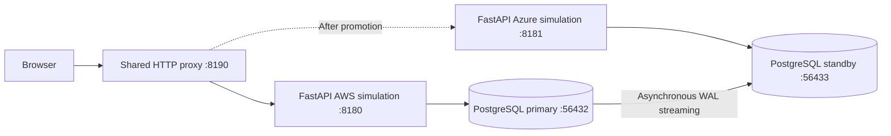

# Multi-Cloud Failover

A disaster recovery project for a stateful web application, exploring PostgreSQL replication, controlled failover, and recovery across independent environments.

The current implementation runs a complete local environment: two FastAPI instances, two PostgreSQL 17 databases, asynchronous streaming replication, and a shared HTTP entry point. An Issues application provides a persistent workload for checking data integrity before and after role changes.

## Project status

| Capability | Status |
|---|---|
| Issues application and PostgreSQL persistence | Implemented |
| Primary/standby streaming replication | Validated locally and across AWS/Azure over WireGuard |
| Shared URL and write-aware routing | Validated locally |
| Switchover, failover, rejoin, and failback | Validated locally |
| Local watcher and read/write probes | Validated locally |
| Linux AMD64 application image and two containerized web instances | Validated locally |
| API/PostgreSQL tests and Linux AMD64 image build on GitHub Actions | Validated |
| GHCR image publication | Validated |
| Published image pull and runtime/database checks | Validated locally |
| Published image verification on a separate CI runner | Validated |
| AWS VPC, subnet, Internet Gateway, and public routing with Terraform | Deployment validated; recreated for Stage 5 |
| AWS host Security Group and SSH/HTTP/HTTPS rules | Deployment validated; recreated for Stage 5 |
| AWS EC2, SSH Key Pair, and Elastic IP | Recreated; status checks and SSH validated |
| AWS single-node K3s cluster | Node Ready, system Pods and StorageClass verified |
| Azure Resource Group, VNet, subnet, and NSG with SSH/HTTP/HTTPS rules | Deployment validated; recreated for Stage 5 |
| Azure Static Public IP, NIC, and Ubuntu VM | Recreated; VM state and SSH validated |
| Azure single-node K3s cluster | Node Ready, system Pods and StorageClass verified |
| WireGuard tunnel between AWS and Azure | Peer handshakes, tunnel routes, and bidirectional ping verified |
| Cloud application deployment | Same image digest on both K3s clusters; HTTP, database roles, issue/comment/history replication, and standby write rejection verified |
| Cloud DNS and HTTPS | Route 53 delegation, origin/shared hostname TLS, writer health checks, and failover records validated |
| Certificate renewal integration | Certbot timers and renewal dry-runs with Kubernetes TLS Secret deploy hooks validated on both clouds |
| Cloud traffic failover and recovery | Planned |

The AWS Terraform root module provisions networking, host access rules, EC2, SSH Key Pair, and Elastic IP in Singapore. The subnet AZ and Ubuntu AMI are pinned. Deployment, post-apply consistency checks, and SSH access were validated. A separate Azure root module provisions the Resource Group, VNet, subnet, NSG and access rules, Static Public IP, NIC, and Ubuntu VM. Its image version and VM zone are pinned, and deployment and SSH access were validated. Both environments were recreated for Stage 5. Each cloud runs an independent single-node K3s v1.35.1+k3s1 cluster. PostgreSQL 17 uses retained local storage and asynchronous WAL streaming over a peer-restricted WireGuard tunnel. A new probe record written on AWS was read on Azure. Both clusters run the same application image digest. HTTP checks confirmed version, environment, database roles, and writer health. Issue details, comments, and create/close/reopen history matched between AWS and Azure, and the operator confirmed standby write rejection. Stages 5 and 6 acceptance is complete. Route 53 serves origin records and the shared application hostname with writer-aware failover records. HTTPS and the shared-hostname certificate were verified on both clouds. Certbot renewal dry-runs with deploy hooks passed on both VMs. Cloud writer transitions and recovery exercises are the next milestone. The [roadmap](docs/ROADMAP.md) tracks progress.

## Features

- Create, update, close, and reopen issues; add comments and inspect activity history.
- Preserve browser drafts, reject stale edits, and handle retries using request IDs.
- Replicate database changes from the primary to a read-only standby.
- Fence the previous writer before promoting a standby and switching application traffic.
- Rebuild a failed database on a new volume while retaining its previous data volume.
- Measure read/write outages, latency, errors, and missing acknowledged writes.

## Local architecture



The AWS and Azure labels identify simulated environments running on one development machine. Database containers communicate through a Docker network; application processes connect through published localhost ports. The proxy changes its destination only after the new writer has been verified.

The [container packaging guide](docs/instruction/giaidoan2_docker_hoa_ungdung.md) also runs the application as two containers from the same image, using host ports 8280 and 8281 and connecting directly to the database services over `mcf-todicode_default`. This validates packaging and replication through the containerized application; the shared proxy above belongs to the Stage 1 recovery lab.

## Quick start

Prerequisites: Windows PowerShell, Python 3.12, Git, and Docker Desktop running Linux containers.

```powershell
git clone https://github.com/todicode/multi-cloud-failover.git
Set-Location multi-cloud-failover
py -3.12 -m venv .venv
.\.venv\Scripts\python.exe -m pip install -r requirements-dev.txt

. .\scripts\Use-LocalLab.ps1
.\.venv\Scripts\python.exe scripts/local_replication.py setup
.\.venv\Scripts\python.exe scripts/local_replication.py start-web
.\.venv\Scripts\python.exe scripts/local_replication.py start-proxy
.\.venv\Scripts\python.exe scripts/seed_demo.py --url http://127.0.0.1:8190
```

Open **[http://127.0.0.1:8190/issues.html](http://127.0.0.1:8190/issues.html)**.

| Endpoint | Purpose |
|---|---|
| `127.0.0.1:8190` | Shared application URL |
| `127.0.0.1:8180` | AWS application simulation |
| `127.0.0.1:8181` | Azure application simulation |
| `127.0.0.1:56432` | Initial PostgreSQL primary |
| `127.0.0.1:56433` | Initial PostgreSQL standby |

Run `Use-LocalLab.ps1` in each new local-lab terminal. It selects the `mcf-todicode` Docker project and configures ports, database access, and UTF-8. Use `setup` for the initial topology; after promotion, follow the [recovery runbook](docs/DISASTER_RECOVERY.md).

## Validation

With the local AWS database acting as primary:

```powershell
. .\scripts\Use-LocalLab.ps1
$env:TASKFLOW_DB_TESTS = '1'
.\.venv\Scripts\python.exe -m pytest -q
.\.venv\Scripts\python.exe scripts/check_local_lifecycle.py
```

The local test suite passed **19 tests**. The lifecycle check passed repeated switchover/failback cycles, interrupted recovery, standby write rejection, retry handling, data/history comparisons, and watcher-triggered failover after an abrupt database stop. Lifecycle checks use an isolated Docker project and separate ports.

The application image was built for Linux AMD64 and run as `appuser` in two containers using the same image ID. Local checks confirmed HTTP endpoints, primary/standby connectivity, and manual issue/comment replication through the containerized web instances.

The [accepted CI run](https://github.com/todicode/multi-cloud-failover/actions/runs/42080473436) passed API/PostgreSQL tests, image build/publication, and verification on a separate runner. That runner pulled by digest, checked the image revision and default user, started the application, and checked liveness, version, and static UI over HTTP. The [Stage 3 guide](docs/instruction/giaidoan3_ci_va_container_registry.md) records the accepted commit and image digest.

## Documentation

- [Project requirements and acceptance criteria](docs/PROJECT_REQUIREMENTS.md)
- [Stage 1: local application and database instructions](docs/instruction/giaidoan1_ungdung_database_local.md)
- [Stage 2: application container packaging](docs/instruction/giaidoan2_docker_hoa_ungdung.md)
- [Stage 3: CI and container registry instructions](docs/instruction/giaidoan3_ci_va_container_registry.md)
- [Stage 4: AWS/Azure infrastructure with Terraform](docs/instruction/giaidoan4_ha_tang_aws_azure_terraform.md)
- [Stage 5: K3s and cloud workloads](docs/instruction/giaidoan5_k3s_va_trien_khai_workload.md)
- [Stage 6: DNS and HTTPS](docs/instruction/giaidoan6_dns_va_https.md)
- [Kubernetes manifests grouped by component](deploy/kubernetes/)
- [Architecture and consistency model](docs/ARCHITECTURE.md)
- [Local setup and operations](docs/LOCAL_DEVELOPMENT.md)
- [Failover and recovery runbook](docs/DISASTER_RECOVERY.md)
- [Database schema](database/README.md)
- [Implementation roadmap](docs/ROADMAP.md)

## Scope and limitations

Asynchronous replication can lose the most recent acknowledged writes during an unplanned failure. The local environment does not model independent cloud failure domains, DNS propagation, or cloud API availability. Replication does not replace backups. The application has no authentication or authorization; database credentials in the local configuration are for development use.
