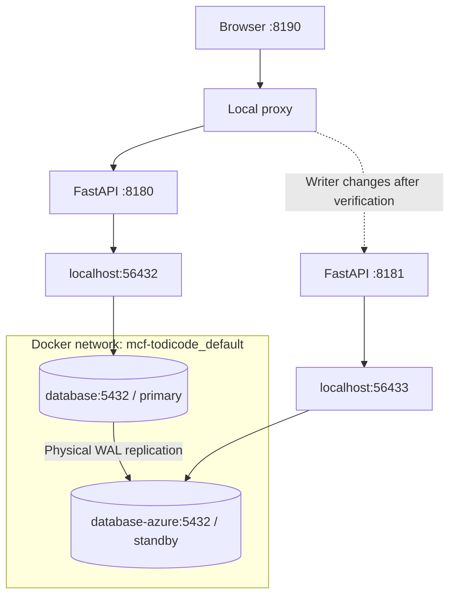

# Architecture

## System overview

The application is deployed as two independent FastAPI processes backed by separate PostgreSQL 17 instances. The initial topology has an AWS-labelled primary and an Azure-labelled standby. These labels identify local simulations; both environments currently run on one machine.

| Component | Responsibility |
|---|---|
| FastAPI application | Serve the Issues UI, business APIs, runtime identity, and health endpoints |
| PostgreSQL primary | Accept writes and stream WAL to the standby |
| PostgreSQL standby | Replay WAL and serve read-only queries until promotion |
| Shared HTTP proxy | Route requests to the verified writer; reject requests during unsafe transition phases |
| Lifecycle controller | Coordinate write barriers, fencing, promotion, rejoin, and failback |
| Local watcher | Detect agreeing failures from the AWS HTTP writer check and a direct database connection |
| Read/write probe | Record client-visible availability, latency, errors, and missing acknowledged writes |

## Runtime topology

The web processes run on the host and use published database ports. The standby connects to the primary using the Compose service name `database` on the Docker network. Each database has its own persistent volume.

## Application and data model

FastAPI serves both the static HTML/CSS/JavaScript interface and the API. The workload covers issue creation and updates, comments, status changes, search, and activity history.

Business changes, history entries, and retry receipts are committed in the same transaction. A version number rejects stale issue edits. A request ID identifies a retried operation; retrying the same operation returns its recorded result when that receipt is present.

Drafts are stored in browser localStorage. They remain available across a backend change when the browser origin remains the same, but are not committed or replicated database data.

See the [database documentation](../database/README.md) for the six tables and their responsibilities.

## Replication and consistency

The standby is initialized with `pg_basebackup` and receives physical WAL through asynchronous streaming replication. PostgreSQL replays those records to reproduce the primary's changes.

The primary can acknowledge a transaction before the standby has received its WAL. An unplanned failure can therefore lose recent acknowledged writes. Retry receipts have the same replication window, so the system does not guarantee exactly-once execution across a failover that loses WAL.

A planned switchover pauses application writes, drains in-flight transactions, records a WAL position, and waits for standby replay before fencing and promotion. The write barrier covers this application's writers; external database writers require separate coordination.

## Health signals

| Endpoint | Meaning |
|---|---|
| `/health/live` | The application process responds |
| `/api/database/status` | Database connectivity, role, write gate, and WAL information |
| `/health/database` | The connected database is primary and application writes are enabled |
| `/api/proxy/status` | The shared proxy's writer, transition phase, and routing eligibility |

A healthy standby returns HTTP 503 from `/health/database` because it is not eligible to receive writes. Database status checks report role and gate state; an actual write probe is needed to validate the full write path.

## Recovery coordination

The lifecycle controller serializes topology operations and records phases in `.local-replication/mcf-todicode/`. The proxy blocks requests while promotion is incomplete. Fencing confirms that the previous database container is stopped and cannot automatically restart before another database becomes writable.

Rejoin creates a new volume and rebuilds the returning database from the current primary. Previous volumes are retained for inspection. The [recovery runbook](DISASTER_RECOVERY.md) describes the supported transitions.

## Planned cloud topology

The next deployment milestone uses one independent single-node K3s environment on AWS and another on Azure. The intended design carries WAL over WireGuard and uses Route 53 writer health checks for DNS selection after fencing and promotion. This deployment has not been implemented or validated in the current repository.
