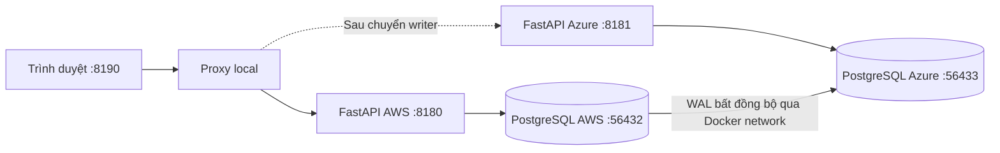

# Giai đoạn 1 — Ứng dụng và PostgreSQL replication local

## 1. Mục tiêu và đầu ra

Thiết lập ứng dụng Issues cùng hai PostgreSQL độc lập trên một máy, kiểm tra đồng bộ dữ liệu và thực hiện vòng chuyển đổi AWS → Azure → AWS qua cùng một URL.

Kết thúc giai đoạn này cần có:

- Hai backend FastAPI chạy cùng ứng dụng, kết nối hai database riêng.
- PostgreSQL AWS là primary, PostgreSQL Azure là standby nhận WAL bất đồng bộ.
- Một proxy HTTP chuyển tới writer đã được xác minh.
- Các thao tác tạo/sửa issue, bình luận, lịch sử, retry và bản nháp hoạt động.
- Switchover, failover, rejoin và failback được kiểm tra ở local.
- Bộ kiểm thử API/database và bài kiểm tra lifecycle đạt.

**Phạm vi:** AWS/Azure trong giai đoạn này là nhãn mô phỏng. Chưa triển khai VM cloud, Kubernetes, WireGuard, Route 53, pipeline CI hoặc registry ứng dụng.

## 2. Kiến trúc và cấu trúc mã



Hai FastAPI chạy trực tiếp trên Windows. Hai PostgreSQL chạy trong container trên Docker network `mcf-todicode_default`. Web kết nối DB qua cổng publish trên localhost; standby kết nối primary bằng tên service `database:5432` trong mạng Docker.

| Đường dẫn | Vai trò |
|---|---|
| [app/main.py](../../app/main.py) | Khởi tạo FastAPI, static UI, identity và health endpoints |
| [app/issues.py](../../app/issues.py) | Route API và model đầu vào của issue/comment |
| [app/static/](../../app/static/) | Giao diện HTML/CSS/JavaScript |
| [database/issues.py](../../database/issues.py) | Transaction, query, version và receipt retry |
| [database/schema/](../../database/schema/) | Schema nghiệp vụ và gate ghi |
| [database/compose.replication.yml](../../database/compose.replication.yml) | Hai container PostgreSQL và volumes |
| [database/replication/](../../database/replication/) | Cấu hình replication và khởi tạo standby |
| [scripts/local_replication.py](../../scripts/local_replication.py) | Điều phối setup và chuyển đổi vai trò |
| [app/local_proxy.py](../../app/local_proxy.py) | Proxy theo writer/phase đã được xác minh |

Mã ứng dụng được cung cấp trong repository. Các bước dưới đây dựng và sử dụng hệ thống từ source, không yêu cầu viết lại giao diện hoặc nghiệp vụ.

## 3. Điều kiện chuẩn bị

- Windows và PowerShell.
- Git và Python 3.12.
- Docker Desktop đang chạy Linux containers.
- Các cổng 8180, 8181, 8190, 56432 và 56433 chưa bị ứng dụng khác chiếm.
- Internet cho lần cài package và tải PostgreSQL image đầu tiên.

Kiểm tra công cụ:

```powershell
git --version
py -3.12 --version
docker --version
docker compose version
docker info --format '{{.ServerVersion}}'
```

Lệnh cuối phải trả về phiên bản Docker Engine. Nếu báo không kết nối được Docker API, mở Docker Desktop và đợi Engine hoạt động trước khi tiếp tục.

## 4. Lấy source và cài dependency

Nếu chưa có repository trên máy:

```powershell
git clone https://github.com/todicode/multi-cloud-failover.git
Set-Location multi-cloud-failover
```

Nếu đã có source, mở PowerShell tại thư mục gốc chứa `app/`, `database/`, `scripts/` và `requirements-dev.txt`; bỏ qua lệnh clone.

Tạo môi trường Python cho lần đầu:

```powershell
py -3.12 -m venv .venv
.\.venv\Scripts\python.exe -m pip install -r requirements-dev.txt
```

Nếu `.venv` đã được tạo và dependency đã cài, có thể dùng lại. Các lệnh tiếp theo gọi trực tiếp Python trong `.venv`, không yêu cầu activate môi trường.

## 5. Cấu hình terminal local

```powershell
. .\scripts\Use-LocalLab.ps1
```

Dấu chấm và khoảng trắng ở đầu lệnh là dot-source: nạp cấu hình vào terminal hiện tại. Chạy lại lệnh này trong mỗi terminal mới dùng cho local lab.

Các biến chính do [Use-LocalLab.ps1](../../scripts/Use-LocalLab.ps1) cấu hình:

| Biến | Giá trị |
|---|---|
| `LOCAL_REPL_PROJECT` | `mcf-todicode` |
| `AWS_DB_PORT` / `AZURE_DB_PORT` | `56432` / `56433` |
| `AWS_WEB_PORT` / `AZURE_WEB_PORT` | `8180` / `8181` |
| `PROXY_WEB_PORT` | `8190` |
| `DATABASE_URL` | Kết nối primary local, dùng cho kiểm thử |
| `PYTHONUTF8` / `PYTHONIOENCODING` | UTF-8 cho log và dữ liệu tiếng Việt |

Docker project riêng xác định tên network/container/volume. Các database dùng credential demo và chỉ publish cổng lên localhost. Bash scripts được lưu với LF qua `.gitattributes` để chạy được trong Linux container.

## 6. Khởi tạo primary và standby

```powershell
.\.venv\Scripts\python.exe scripts/local_replication.py setup
```

Lệnh này thực hiện:

1. Khởi động PostgreSQL AWS với cấu hình WAL phục vụ replication.
2. Tạo quyền replication và bootstrap schema trên primary.
3. Khởi tạo Azure standby bằng `pg_basebackup` trên volume riêng.
4. Khởi động standby và kiểm tra vai trò thực tế.
5. Lưu topology local để controller và proxy cùng sử dụng.

Schema gồm `issues`, `comments`, `issue_history`, `save_requests`, `app_control` và `probe_pings`. Xem [database documentation](../../database/README.md) để biết trách nhiệm từng bảng.

Kiểm tra:

```powershell
.\.venv\Scripts\python.exe scripts/local_replication.py status
docker compose -p mcf-todicode -f database/compose.replication.yml ps
```

Kết quả cần đạt:

- AWS: `role=primary`; có WAL sender với `state=streaming` khi standby đã kết nối.
- Azure: `role=standby`; receiver `status=streaming`; LSN nhận/replay tiến triển.
- Hai container database healthy.

`setup` giữ dữ liệu primary hiện có. Khi đã đổi writer hoặc đang phục hồi, không dùng `setup` để ép trở lại topology ban đầu; sử dụng quy trình rejoin/failback ở mục 11.

## 7. Khởi động hai web và URL chung

```powershell
.\.venv\Scripts\python.exe scripts/local_replication.py start-web
.\.venv\Scripts\python.exe scripts/local_replication.py start-proxy
```

Hai lệnh chạy các tiến trình dưới nền và lưu PID/log. Nếu cổng đã được sử dụng, xác định tiến trình đang chạy thay vì khởi động thêm một bản.

| URL | Vai trò ban đầu |
|---|---|
| http://127.0.0.1:8190/issues.html | URL chung; proxy phục vụ AWS |
| http://127.0.0.1:8180/issues.html | Web AWS, đọc/ghi |
| http://127.0.0.1:8181/issues.html | Web Azure, đọc standby |

Kiểm tra identity, database và proxy:

```powershell
Invoke-RestMethod http://127.0.0.1:8180/version
Invoke-RestMethod http://127.0.0.1:8181/version
Invoke-RestMethod http://127.0.0.1:8180/api/database/status
Invoke-RestMethod http://127.0.0.1:8181/api/database/status
Invoke-RestMethod http://127.0.0.1:8190/api/proxy/status
```

Hai web chạy cùng ứng dụng; `environment` khác nhau. AWS có `writable=true`; Azure có `writable=false`, `replication_connected=true`; proxy có `writer=aws`, `phase=steady` và `routing_enabled=true`.

### Phân biệt ba health signals

| Endpoint | Ý nghĩa |
|---|---|
| `/health/live` | Process web có phản hồi |
| `/api/database/status` | DB kết nối được, role, gate ghi và WAL |
| `/health/database` | DB đang là primary và gate ghi của app đang mở |

Kiểm tra HTTP status của writer endpoint:

```powershell
curl.exe --silent --show-error --output NUL --write-out '%{http_code}' http://127.0.0.1:8180/health/database
curl.exe --silent --show-error --output NUL --write-out '%{http_code}' http://127.0.0.1:8181/health/database
```

Kết quả ban đầu lần lượt là **200** và **503**. Standby trả 503 ở writer check là đúng dù web Azure vẫn sống và đọc được dữ liệu.

## 8. Dữ liệu mẫu và kiểm tra nghiệp vụ

Nạp dữ liệu mẫu qua API:

```powershell
.\.venv\Scripts\python.exe scripts/seed_demo.py --url http://127.0.0.1:8190
```

Script tạo năm issue mẫu với request ID ổn định; chạy lại không tạo thêm các thao tác giống nhau.

Trên trình duyệt, kiểm tra tạo/sửa issue, bình luận, đóng/mở lại, tìm kiếm và lịch sử. Đối chiếu dữ liệu ở web Azure sau khi WAL replay. UI standby polling định kỳ nên có thể hiển thị chậm hơn thời điểm database đã đồng bộ.

### Tạo một issue qua API để dùng trong bài kiểm tra

Chạy các lệnh sau trong cùng terminal điều khiển và giữ lại biến `$StageOneIssue` cho các bước sau:

```powershell
$StageOneBaseUrl = 'http://127.0.0.1:8190'
$StageOneRequestId = [guid]::NewGuid().ToString()
$StageOneBody = @{
    request_id = $StageOneRequestId
    author = 'Local Demo'
    title = 'Verify replication and recovery'
    description = 'Created on AWS before switching the writer.'
    status = 'open'
    version = 0
} | ConvertTo-Json
$StageOneBytes = [Text.Encoding]::UTF8.GetBytes($StageOneBody)
$StageOneIssue = Invoke-RestMethod -Method Post -Uri "$StageOneBaseUrl/api/issues" -ContentType 'application/json; charset=utf-8' -Body $StageOneBytes
$StageOneIssue
```

Sau khi Azure replay, đọc cùng issue ở hai origin:

```powershell
Invoke-RestMethod "http://127.0.0.1:8180/api/issues/$($StageOneIssue.id)" | ConvertTo-Json -Depth 20
Invoke-RestMethod "http://127.0.0.1:8181/api/issues/$($StageOneIssue.id)" | ConvertTo-Json -Depth 20
```

Nếu Azure chưa thấy issue ngay, chờ và đọc lại; không promote để sửa độ trễ replication. Đối chiếu ID, title, version, comments và history, không chỉ số lượng issue.

### Bản nháp và retry

- Nhập nội dung chưa gửi rồi tải lại cùng URL để kiểm tra localStorage.
- Giữ cùng scheme/hostname/port; `localhost` và `127.0.0.1` là hai origin khác nhau đối với trình duyệt.
- Request bị timeout có thể đã commit. Retry bằng cùng request ID và body, không tạo UUID mới cho cùng thao tác.
- Version cũ khi sửa issue phải nhận conflict thay vì ghi đè dữ liệu mới.

Bản nháp chưa gửi không nằm trong PostgreSQL. Receipt retry cũng được replicate bất đồng bộ, nên không bảo đảm exactly-once xuyên một failover có mất WAL.

## 9. Chuyển có kế hoạch sang Azure

Xác nhận AWS đang primary và Azure đang streaming, sau đó chạy:

```powershell
.\.venv\Scripts\python.exe scripts/local_replication.py switchover
```

Thứ tự điều phối là khóa ghi ứng dụng → drain transaction → lấy WAL cuối → chờ Azure replay → fence AWS → promote Azure → kiểm tra writer → đổi proxy.

Trong giai đoạn chuyển đổi, URL chung có thể trả 503. Sau khi hoàn tất:

```powershell
Invoke-RestMethod "$StageOneBaseUrl/version"
Invoke-RestMethod "$StageOneBaseUrl/api/database/status"
```

Phải thấy `environment=azure`, `role=primary` và `writable=true`. Tiếp tục dùng cùng URL trình duyệt.

## 10. Ghi trên Azure và kiểm tra retry

Tạo bình luận trên issue đã giữ từ mục 8, rồi gửi lại đúng body:

```powershell
$StageOneCommentBody = @{
    request_id = [guid]::NewGuid().ToString()
    author = 'Local Demo'
    body = 'Written while Azure is the primary.'
} | ConvertTo-Json
$StageOneCommentBytes = [Text.Encoding]::UTF8.GetBytes($StageOneCommentBody)
$StageOneCommentUrl = "$StageOneBaseUrl/api/issues/$($StageOneIssue.id)/comments"
$StageOneComment = Invoke-RestMethod -Method Post -Uri $StageOneCommentUrl -ContentType 'application/json; charset=utf-8' -Body $StageOneCommentBytes
$StageOneRetry = Invoke-RestMethod -Method Post -Uri $StageOneCommentUrl -ContentType 'application/json; charset=utf-8' -Body $StageOneCommentBytes
if ($StageOneComment.id -ne $StageOneRetry.id) { throw 'Retry returned a different comment ID.' }
Invoke-RestMethod "$StageOneBaseUrl/api/issues/$($StageOneIssue.id)" | ConvertTo-Json -Depth 20
```

Hai response phải có cùng comment ID; chi tiết issue chỉ có một bình luận tương ứng và một hoạt động ghi bình luận tương ứng.

## 11. Rejoin AWS và failback

Azure tiếp tục phục vụ trong lúc dựng lại AWS:

```powershell
.\.venv\Scripts\python.exe scripts/local_replication.py rejoin-aws
.\.venv\Scripts\python.exe scripts/local_replication.py status
```

AWS lúc này phải là standby của Azure. Nó được clone trên volume mới, volume cũ được giữ để kiểm tra. Truy cập AWS trực tiếp và xác nhận bình luận vừa tạo trên Azure đã đến:

```powershell
Invoke-RestMethod "http://127.0.0.1:8180/api/issues/$($StageOneIssue.id)" | ConvertTo-Json -Depth 20
```

Sau khi đồng bộ và dữ liệu khớp, chuyển về AWS:

```powershell
.\.venv\Scripts\python.exe scripts/local_replication.py failback
.\.venv\Scripts\python.exe scripts/local_replication.py status
Invoke-RestMethod "$StageOneBaseUrl/version"
Invoke-RestMethod "$StageOneBaseUrl/api/issues/$($StageOneIssue.id)" | ConvertTo-Json -Depth 20
```

Kết quả cần đạt:

- AWS primary/writable; URL chung phục vụ AWS.
- Azure trở lại standby streaming.
- Issue, bình luận và history phát sinh trên Azure vẫn còn sau failback.

Nếu lệnh dừng giữa chừng, giữ state/log và chạy lại đúng thao tác sau khi xác định lỗi. Không tự sửa trường `writer` để ép proxy đổi tuyến hoặc khởi động primary cũ độc lập.

## 12. Kiểm tra failover bất ngờ

Chỉ chạy khi hệ thống đã về AWS primary/Azure standby sau mục 11. Chọn một trong hai chế độ dưới đây.

### 12.1. Failover thủ công

```powershell
docker compose -p mcf-todicode -f database/compose.replication.yml kill database
.\.venv\Scripts\python.exe scripts/local_replication.py failover
Invoke-RestMethod http://127.0.0.1:8190/api/database/status
```

`failover` vẫn fence AWS trước khi promote Azure, nhưng không có bước khóa ghi/chờ WAL cuối từ primary đã sập. Các giao dịch đã ACK nhưng chưa replicate có thể mất.

Sau khi kiểm tra đọc/ghi trên Azure, chạy `rejoin-aws` và `failback` như mục 11 để khôi phục baseline.

### 12.2. Watcher local tự failover

Trong terminal thứ hai, tại thư mục gốc:

```powershell
. .\scripts\Use-LocalLab.ps1
.\.venv\Scripts\python.exe scripts/watcher.py --interval 5 --threshold 3
```

Trong terminal điều khiển:

```powershell
docker compose -p mcf-todicode -f database/compose.replication.yml kill database
```

Watcher dùng AWS writer endpoint và kết nối PostgreSQL trực tiếp để quyết định gọi failover. Khi hai nguồn cùng lỗi, counter tăng; cả hai khỏe thì reset; bất đồng giữ counter hiện có. Watcher thoát sau failover và không tự failback.

Không chạy lệnh promote/failover tay đồng thời với watcher. Sau khi watcher kết thúc, kiểm tra Azure writer rồi thực hiện rejoin/failback như mục 11. Bài này gây lỗi container DB, chưa mô phỏng mất toàn bộ môi trường cloud.

## 13. Chạy kiểm thử tự động

Khôi phục AWS primary trước khi chạy test database:

```powershell
. .\scripts\Use-LocalLab.ps1
$env:TASKFLOW_DB_TESTS = '1'
.\.venv\Scripts\python.exe -m pytest -q
```

Kết quả đã nghiệm thu cho phiên bản hiện tại: **19 passed**. Tests DB dùng schema riêng; nếu không bật `TASKFLOW_DB_TESTS=1`, các integration tests sẽ bị skip.

Chạy bài end-to-end độc lập:

```powershell
.\.venv\Scripts\python.exe scripts/check_local_lifecycle.py
```

Script tạo Docker project `dcs29-cycle-<id>` riêng, dùng cổng DB 55632/55633 và web/proxy 18080/18081/18090. Các cổng này cần trống. Nó kiểm tra nhiều vòng chuyển đổi, standby từ chối ghi, retry, dữ liệu/history, failback bị ngắt rồi tiếp tục, và watcher sau kill AWS DB. Kết quả phải có dòng `PASS`; tài nguyên của project kiểm thử được dọn sau khi chạy.

## 14. Probe đọc/ghi và bằng chứng

Trong terminal đo đạc riêng:

```powershell
. .\scripts\Use-LocalLab.ps1
$StageOneRunId = 'stage1-' + (Get-Date).ToUniversalTime().ToString('yyyyMMddTHHmmssZ')
$StageOneRunDirectory = Join-Path 'experiments/runs' $StageOneRunId
New-Item -ItemType Directory -Path $StageOneRunDirectory | Out-Null
.\.venv\Scripts\python.exe scripts/probe_failover.py --url http://127.0.0.1:8190 --duration 180 --out "$StageOneRunDirectory/probe.csv"
```

Gây lỗi từ terminal điều khiển khi probe đang chạy. Script gọi `GET /version` và `POST /api/ping`, xuất CSV cùng JSON summary. Ghi kèm thời điểm gây lỗi, chế độ manual/watcher, interval và threshold.

Đọc riêng downtime đọc/ghi, tỷ lệ lỗi, latency và số ghi đã ACK nhưng thiếu trên writer mới. Không suy ra RPO từ số lỗi HTTP hoặc coi bản nháp chưa gửi là giao dịch mất. Giữ số đo local tách khỏi các số đo cloud sẽ thực hiện sau.

Lưu bằng chứng của giai đoạn:

- Output tests và dòng PASS của lifecycle.
- Vai trò, receiver/WAL và phase trước/sau chuyển đổi.
- Issue ID, bình luận tạo trên Azure và history sau failback.
- CSV/summary của lượt đo nếu thực hiện mục này.
- Ảnh UI để minh họa; dữ liệu API/DB mới là phần kiểm tra tính toàn vẹn.

`experiments/runs/` được Git bỏ qua để giữ kết quả từng lượt ngoài source. Log/state/PID của lab nằm trong `.local-replication/mcf-todicode/`.

## 15. Dừng và mở lại

Khi cần dừng:

```powershell
.\scripts\Stop-LocalLab.ps1
```

Helper xác minh PID/module/port thuộc Python của repository trước khi dừng web/proxy, sau đó dừng hai DB. Volumes và state được giữ lại. Không dùng `docker compose down -v` để dừng hằng ngày vì lệnh đó xóa volumes.

Với topology AWS-primary bình thường đã hoàn tất failback, mở lại Docker Engine rồi thực hiện mục 5–7. Nếu đang ở phase phục hồi hoặc Azure đang primary, xử lý theo vai trò/state hiện có trước khi chạy initial setup.

## 16. Xử lý lỗi thường gặp

| Hiện tượng | Kiểm tra/hành động |
|---|---|
| Không kết nối Docker API | Mở Docker Desktop và đợi Engine chạy |
| Cổng web đã được sử dụng | Kiểm tra web hiện có; dùng Stop-LocalLab cho đúng project trước khi mở lại |
| `pipefail` hoặc ký tự `\r` trong script Bash | Kiểm tra `.sh` đang dùng LF và `.gitattributes` đã được áp dụng |
| Log tiếng Việt lỗi encoding | Nạp lại Use-LocalLab.ps1 để bật UTF-8 |
| Azure `/health/database` trả 503 | Bình thường khi Azure là standby; đọc `/api/database/status` và receiver |
| Standby chưa có issue mới | Chờ replay/polling, kiểm tra WAL/receiver; không promote để chữa replication |
| `setup` từ chối sau failover | Dùng rejoin-aws/failback, không ép chạy primary cũ |
| Thao tác topology đang bị khóa | Kiểm tra PID và phase của thao tác đang chạy; không chạy hai controller đồng thời |
| Test DB bị skip | Đặt TASKFLOW_DB_TESTS=1 và xác minh primary local đang writable |

## 17. Checklist hoàn thành giai đoạn 1

Checklist đã được xác nhận ở local ngày 04/11/2026; khi dựng lại trên máy khác, thực hiện lại các kiểm tra tương ứng.

- [x] Ứng dụng và dependency Python hoạt động.
- [x] Hai PostgreSQL có storage riêng; AWS primary, Azure standby streaming.
- [x] Hai backend và URL chung phục vụ UI/API.
- [x] Tạo/sửa issue, bình luận, history, version conflict và retry được kiểm thử.
- [x] Azure standby từ chối ghi đúng vai trò.
- [x] Switchover, failover, rejoin và failback đạt kiểm tra end-to-end.
- [x] Dữ liệu phát sinh trên Azure còn nguyên sau planned recovery đã kiểm tra.
- [x] Bộ test local: 19 passed; lifecycle: PASS.
- [x] Dừng/mở lại giữ được dữ liệu.

Giai đoạn 1 hoàn thành ở phạm vi local. Giai đoạn tiếp theo là đóng gói ứng dụng và kiểm tra container image; tài liệu giai đoạn đó được bổ sung khi bắt đầu thực hiện. Xem [roadmap](../ROADMAP.md) để biết các mốc triển khai còn lại.
