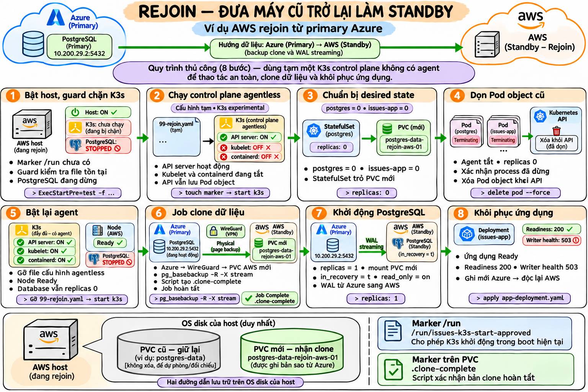
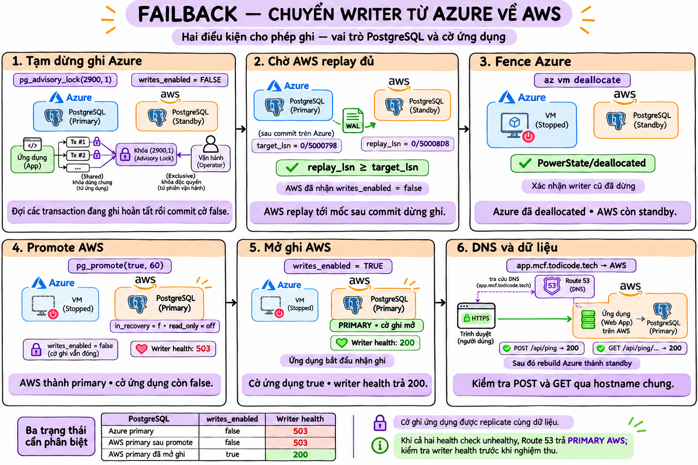

# Giai đoạn 7 — Failover và phục hồi

## 1. Mục tiêu và đầu ra

Thực hành chuyển writer và truy cập ứng dụng từ AWS sang Azure, đưa AWS trở lại làm standby, rồi failback có kiểm soát về AWS. Luồng vận hành phải duy trì một PostgreSQL writer tại mỗi thời điểm và có bằng chứng kiểm tra dữ liệu sau chuyển đổi.

Giai đoạn này phục vụ các yêu cầu S2 về chuyển traffic, S3 về mất khả dụng một môi trường và S5 về độ phức tạp vận hành. Mỗi bước thực hành ghi rõ nơi chạy, lý do, lệnh, kết quả mong đợi và điều kiện tiếp tục.

Phần 7 nối các bước thực hành thành một luồng, kèm ba hình minh họa và bảng giải thích nhóm lệnh. [Bức tranh tổng thể và cách đọc lệnh](#7-bức-tranh-tổng-thể-và-cách-đọc-lệnh).

Mục tiêu automation được cập nhật ở mục 4.128 thành vòng failover, rejoin và failback tự động sau khi controller được cấu hình và khởi chạy. Vòng rejoin và failback thủ công đã được nghiệm thu ở phần trước. Các mục 4.117–4.121 ghi lại những thao tác phục hồi đã hướng dẫn sau lượt failover tự động. Phần Python từ mục 4.122 xây dựng các thao tác phục hồi để controller điều phối theo trạng thái thực tế.

## 2. Trạng thái bắt đầu

- Giai đoạn 6 đã nghiệm thu DNS, HTTPS, writer health checks và renewal dry-run kèm deploy hook trên hai cloud.
- PostgreSQL AWS giữ vai trò primary, Azure giữ vai trò standby trong lượt nghiệm thu gần nhất.
- Hai ứng dụng dùng image ghcr.io/todicode/multi-cloud-failover@sha256:2d7cf831e50eb1c693082dc9e4f7dbf76ded557fa512a249ba68df7995b6b10e, ứng với commit c56fd3f30baee50fa779607dc0fb1a2133b53a9d.
- Hai máy đã được dừng để tiết kiệm chi phí. Lần xác nhận gần nhất ghi nhận EC2 Stopped và Azure VM Deallocated.
- Manifest PostgreSQL AWS hiện khởi động database từ PVC hiện có. Cơ chế kiểm soát writer cũ khi máy khởi động lại cần được bổ sung và kiểm tra trước bài thử failover.

| Thành phần | Giá trị của lab hiện tại |
|---|---|
| AWS profile và account | default, 925271162060 |
| AWS region | ap-southeast-1 |
| EC2 | i-014ee6f4d204aacb7, mcf-aws-primary |
| AWS public IP và WireGuard IP | 175.41.152.242, 10.200.29.1 |
| Azure subscription | 52341a4a-a86f-4780-82dc-879b500022d8 |
| Azure resource group và VM | mcf-azure-rg, mcf-azure-standby |
| Azure public IP và WireGuard IP | 4.145.30.250, 10.200.29.2 |
| Hostname chung | app.mcf.todicode.tech |
| Namespace và workload | issues, StatefulSet postgres, Deployment issues-app |

Các định danh trên thuộc lượt triển khai hiện tại. Người tái dựng dùng account cùng Terraform output của lần triển khai của mình để chọn tài nguyên.

## 3. Trình tự thực hành

1. Đối chiếu danh tính cloud và tài nguyên sẽ vận hành.
2. Khởi động lab và kiểm tra lại kết nối, vai trò database cùng WAL streaming.
3. Chuẩn bị cơ chế kiểm soát writer cũ khi khởi động lại.
4. Thực hành mất khả dụng AWS, xác nhận fencing rồi promote Azure.
5. Kiểm tra writer, truy cập qua hostname chung và dữ liệu sau failover.
6. Rejoin AWS thành standby của Azure bằng dữ liệu đồng bộ từ writer hiện tại.
7. Failback có kiểm soát về AWS và đưa Azure trở lại standby.

PostgreSQL lưu vai trò cùng dữ liệu trên disk. Sau khi promote Azure, AWS cũ cần được đưa trở lại theo vai trò và dữ liệu phù hợp để duy trì một writer. DNS chọn đích truy cập dựa trên health check. Việc kiểm soát writer được thực hiện ở luồng fencing và phục hồi database. [PostgreSQL failover](https://www.postgresql.org/docs/17/warm-standby-failover.html).

## 4. Thực hành từng bước

Code cloud được tổ chức theo quy trình trong scripts/cloud. Package failover chứa watcher cùng các module AWS, PostgreSQL, probe và điều phối. Package rejoin và failback là vị trí triển khai các bước phục hồi tiếp theo.

```text
scripts/cloud/
├── failover/
│   ├── cloud_watcher.py
│   ├── aws_ops.py
│   ├── checks.py
│   ├── postgres_ops.py
│   └── failover_ops.py
├── rejoin/
└── failback/
```

### 4.1. Xác nhận AWS account và EC2 trước khi vận hành

Chạy trong Git Bash trên laptop tại thư mục gốc repository. Bước này sử dụng các API đọc thông tin để xác nhận account và instance. Danh tính đúng cùng instance ID cụ thể là cơ sở cho các bước start, fencing và phục hồi sau đó.

```bash
aws sts get-caller-identity \
  --profile default \
  --query '{Account:Account,Arn:Arn}' \
  --output table \
  --no-cli-pager
```

- sts get-caller-identity trả danh tính của credential AWS CLI đang sử dụng.
- profile default chọn profile đã quản lý tài nguyên của project.
- query chọn hai trường Account và Arn để đối chiếu account cùng IAM principal.
- output table hiển thị kết quả thành bảng. no-cli-pager đưa output trực tiếp về terminal.

Trong lab hiện tại, Account mong đợi là 925271162060, Arn là arn:aws:iam::925271162060:user/todicode.

Tiếp theo kiểm tra EC2 cụ thể.

```bash
aws ec2 describe-instances \
  --profile default \
  --region ap-southeast-1 \
  --instance-ids i-014ee6f4d204aacb7 \
  --query 'Reservations[].Instances[].{Id:InstanceId,State:State.Name}' \
  --output table \
  --no-cli-pager
```

- region chọn Singapore, nơi EC2 của project đã được tạo.
- instance-ids giới hạn request vào instance sẽ được sử dụng trong bài thực hành.
- Reservations[].Instances[] truy cập danh sách instance trong response của EC2 API.
- Phần query chọn InstanceId và State.Name để bảng kết quả chứa hai cột Id và State.

Mong đợi Id là i-014ee6f4d204aacb7 và State là stopped sau lần nghỉ lab. Khi đối chiếu được account và instance, bước tiếp theo xác nhận VM Azure rồi khởi động lab để chuẩn bị kiểm tra lại replication.

Các thông tin này đã được đối chiếu trong lần dừng lab ngay trước giai đoạn 7. AWS account là 925271162060, EC2 i-014ee6f4d204aacb7 đã Stopped. Azure subscription 52341a4a-a86f-4780-82dc-879b500022d8 chứa VM mcf-azure-standby trong resource group mcf-azure-rg, đã xác nhận Deallocated. Các lệnh ở mục 4.1 dùng để đối chiếu khi thay đổi profile, account hoặc lượt triển khai.

### 4.2. Khởi động AWS để chuẩn bị topology ban đầu

Lượt thực hành bắt đầu từ AWS primary và Azure standby đã nghiệm thu ở giai đoạn 6. Khởi động AWS trước để PostgreSQL primary sẵn sàng phục vụ và gửi WAL khi Azure được bật ở bước tiếp theo. EC2 bắt đầu phát sinh phí compute khi hoạt động trở lại.

Trong Git Bash trên laptop, chạy lệnh sau.

```bash
aws ec2 start-instances \
  --profile default \
  --region ap-southeast-1 \
  --instance-ids i-014ee6f4d204aacb7 \
  --no-cli-pager
```

start-instances yêu cầu AWS khởi động EC2 hiện có. profile, region và instance-ids chọn đúng account, region và máy đã đối chiếu ở mục 4.1. no-cli-pager hiển thị response trực tiếp trong terminal. Response thường cho thấy PreviousState stopped và CurrentState pending.

Tiếp theo chờ EC2 vượt qua status checks.

```bash
aws ec2 wait instance-status-ok \
  --profile default \
  --region ap-southeast-1 \
  --instance-ids i-014ee6f4d204aacb7
```

wait instance-status-ok là waiter của AWS CLI, tự truy vấn định kỳ và kết thúc thành công khi instance chạy và các kiểm tra trạng thái đạt. Lệnh thường mất vài phút và trả về prompt với exit code 0 khi thành công. Status checks kiểm tra tình trạng hạ tầng và instance. K3s, PostgreSQL, WireGuard cùng vai trò database được kiểm tra riêng sau khi hai máy được bật.

Checkpoint này hoàn tất khi start được chấp nhận và waiter thành công. Bước tiếp theo khởi động Azure, sau đó kiểm tra trạng thái workload và replication trước khi thay đổi cơ chế điều khiển writer.

### 4.3. Khởi động Azure

Trong lượt thực hành này, EC2 AWS đã ở trạng thái running khi kiểm tra và cả SystemStatus, InstanceStatus đều ok. Người vận hành yêu cầu khởi động hai cloud để tiếp tục. Đã gửi lệnh start cho VM Azure đang Deallocated.

Lệnh tham chiếu để khởi động Azure từ Git Bash trên laptop.

```bash
az vm start \
  --subscription 52341a4a-a86f-4780-82dc-879b500022d8 \
  --resource-group mcf-azure-rg \
  --name mcf-azure-standby
```

subscription chọn gói Azure for Students của lượt triển khai. resource-group và name xác định VM của project. start cấp lại compute cho VM từ các tài nguyên disk và NIC đã giữ lại, cho phép Ubuntu cùng các dịch vụ tự khởi động. Sau khi bật Azure, bước tiếp theo kiểm tra dịch vụ và workload trên hai máy.

Đã đối chiếu Azure API trả PowerState/running và ProvisioningState/succeeded sau lệnh start.

### 4.4. Kiểm tra dịch vụ và Kubernetes trên AWS sau khi bật máy

Mở terminal SSH tới AWS từ Git Bash trên laptop.

```bash
ssh -i ~/.ssh/mcf-lab ubuntu@175.41.152.242
```

Trong terminal Ubuntu của AWS, chạy các lệnh sau.

```bash
sudo systemctl is-active k3s wg-quick@wg0
sudo k3s kubectl get nodes
sudo k3s kubectl -n issues get pods -o wide
```

systemctl is-active kiểm tra hai dịch vụ của host. k3s vận hành Kubernetes của cloud này, wg-quick@wg0 vận hành WireGuard interface dùng cho WAL giữa hai cloud. Mong đợi hai dòng active.

kubectl get nodes kiểm tra Kubernetes đã nhận node mcf-aws-primary ở trạng thái Ready. EC2 status checks xác nhận tình trạng hạ tầng và instance, còn node Ready xác nhận lớp Kubernetes đã sẵn sàng.

kubectl -n issues get pods -o wide tập trung vào workload của project, hiển thị trạng thái container, restart count, IP và node. Mong đợi postgres-0 cùng Pod issues-app đạt 1/1 Running sau khi khởi động ổn định. Các kết quả này chuẩn bị cho bước truy vấn vai trò database và kiểm tra replication.

Checkpoint hiện tại là đối chiếu hai dịch vụ active, node Ready và hai workload Running trên AWS. Bước tiếp theo kiểm tra tương ứng trên Azure rồi đối chiếu primary/standby và WAL streaming.

Kết quả thực hành trên AWS đã xác nhận issues-app-f8fb495f5-thvkw và postgres-0 đều 1/1 Running. App Pod có IP 10.42.0.31 trong mạng Pod, PostgreSQL có IP host 10.29.1.8 do cấu hình hostNetwork. Pod postgres-service-check đã Completed sau lượt kiểm tra kết nối ở giai đoạn trước, phù hợp restartPolicy Never trong manifest của Pod kiểm tra.

### 4.5. Kiểm tra dịch vụ và Kubernetes trên Azure sau khi bật máy

Hai cluster có control plane và workload độc lập. Kiểm tra Azure để xác nhận môi trường standby phục hồi sau lần nghỉ, trước khi đối chiếu replication với AWS.

Trong một terminal Git Bash khác trên laptop, mở SSH tới Azure.

```bash
ssh -i ~/.ssh/mcf-lab azureuser@4.145.30.250
```

Trong terminal Ubuntu của Azure, chạy lần lượt các lệnh sau.

```bash
sudo systemctl is-active k3s wg-quick@wg0
sudo k3s kubectl get nodes
sudo k3s kubectl -n issues get pods -o wide
```

Mong đợi hai dịch vụ active, node mcf-azure-standby Ready và các Pod postgres-0 cùng issues-app đạt 1/1 Running. systemctl kiểm tra dịch vụ host, get nodes kiểm tra node trong cluster Azure và get pods kiểm tra workload của namespace issues. Lệnh kubectl chạy qua k3s trên VM hiện tại sử dụng cluster của VM đó.

Pod postgres-clone có thể hiện Completed vì tác vụ clone ban đầu đã kết thúc. Các workload phục vụ ứng dụng và database cần đạt trạng thái Running. PostgreSQL trên Azure dùng hostNetwork nên IP Pod là địa chỉ private của VM, còn App Pod dùng mạng Pod của K3s.

Checkpoint này hoàn tất khi đối chiếu dịch vụ, node và hai workload phục vụ trên Azure. Bước tiếp theo truy vấn vai trò PostgreSQL và trạng thái WAL để xác nhận topology AWS primary, Azure standby sau khi bật lại.

Kết quả thực hành trên Azure đã xác nhận issues-app-f8fb495f5-lf458 và postgres-0 đều 1/1 Running. PostgreSQL dùng IP host 10.30.1.4, App Pod dùng IP 10.42.0.31. Pod clone cùng Pod kiểm tra kết nối đã Completed.

### 4.6. Xác nhận vai trò PostgreSQL trên hai cloud

Sau khi đối chiếu Pod của cả hai cloud đang Running và Ready, truy vấn PostgreSQL để xác định vai trò cùng chế độ transaction hiện tại. Việc này tạo checkpoint topology trước khi kiểm tra replication và thực hành chuyển writer.

Chạy cùng lệnh sau một lần trong terminal SSH Ubuntu của AWS và một lần trong terminal SSH Ubuntu của Azure.

```bash
sudo k3s kubectl -n issues exec postgres-0 -- \
  psql -X -U taskflow -d taskflow -P pager=off -c \
  "SELECT pg_is_in_recovery() AS in_recovery,
          current_setting('transaction_read_only') AS read_only;"
```

- kubectl -n issues exec postgres-0 chạy lệnh trong container PostgreSQL của Pod postgres-0 thuộc cluster đang được truy cập trên VM hiện tại.
- Dấu -- phân tách tham số kubectl với lệnh psql được chạy trong container.
- psql là PostgreSQL client có sẵn trong image database.
- -X bỏ qua file tùy chỉnh khởi động psql để truy vấn thực hành dùng cấu hình lệnh đã chỉ định.
- -U taskflow chọn database user, -d taskflow chọn database.
- -P pager=off in toàn bộ kết quả trực tiếp trong terminal.
- -c thực thi câu SQL được truyền vào, rồi psql kết thúc.
- pg_is_in_recovery() trả true khi PostgreSQL đang recovery. Standby vật lý của project chạy ở chế độ này để replay WAL từ primary.
- current_setting('transaction_read_only') trả trạng thái read-only của transaction đang chạy truy vấn. AS đặt tên cột kết quả.

Kết quả mong đợi.

| Cloud | in_recovery | read_only | Diễn giải trong topology của lab |
|---|---|---|---|
| AWS | f | off | Primary, transaction kiểm tra có chế độ read-write |
| Azure | t | on | Standby đang recovery, transaction read-only |

psql hiển thị boolean false bằng f và true bằng t. Các giá trị recovery và read-only mô tả trạng thái database tại thời điểm truy vấn. Trạng thái kết nối streaming và dữ liệu đã replay được đối chiếu ở checkpoint WAL tiếp theo. [PostgreSQL recovery functions](https://www.postgresql.org/docs/17/functions-admin.html#FUNCTIONS-RECOVERY-INFO-TABLE), [transaction_read_only](https://www.postgresql.org/docs/17/runtime-config-client.html#GUC-TRANSACTION-READ-ONLY).

Checkpoint này hoàn tất khi AWS trả f/off và Azure trả t/on. Bước tiếp theo kiểm tra WAL sender trên AWS và receiver trên Azure để xác nhận replication đã kết nối lại sau lần nghỉ.

Đã xác nhận AWS trả in_recovery f và read_only off, Azure trả in_recovery t và read_only on sau khi bật lab.

### 4.7. Kiểm tra hai đầu WAL streaming

Vai trò database đã đúng. Kiểm tra WAL sender trên AWS và WAL receiver trên Azure để xác nhận kết nối replication đang hoạt động. Standby có thể tiếp tục chạy recovery với dữ liệu đã nhận trong khi kết nối tới primary bị gián đoạn, nên trạng thái recovery cần được đối chiếu cùng trạng thái streaming.

Trong terminal SSH Ubuntu của AWS, chạy lệnh sau.

```bash
sudo k3s kubectl -n issues exec postgres-0 -- \
  psql -X -U taskflow -d taskflow -P pager=off -c \
  "SELECT client_addr, state, sync_state,
          sent_lsn, write_lsn, flush_lsn, replay_lsn
   FROM pg_stat_replication;"
```

pg_stat_replication là system view cung cấp thông tin các WAL sender. Với topology hiện tại, mong đợi một dòng với client_addr 10.200.29.2, state streaming và sync_state async. client_addr là IP WireGuard của standby Azure mà AWS quan sát được. streaming biểu thị sender đang phục vụ luồng WAL, async là chế độ replication bất đồng bộ.

sent_lsn là vị trí WAL đã gửi. write_lsn, flush_lsn và replay_lsn là các vị trí standby đã báo lại, lần lượt thể hiện WAL đã ghi, đã flush tới disk và đã replay. LSN là vị trí trong luồng WAL, được hiển thị theo dạng hexadecimal. Các cột này giúp đối chiếu tiến độ truyền và áp dụng dữ liệu.

Trong terminal SSH Ubuntu của Azure, chạy lệnh sau.

```bash
sudo k3s kubectl -n issues exec postgres-0 -- \
  psql -X -U taskflow -d taskflow -P pager=off -c \
  "SELECT status, sender_host, sender_port,
          pg_last_wal_receive_lsn() AS receive_lsn,
          pg_last_wal_replay_lsn() AS replay_lsn
   FROM pg_stat_wal_receiver;"
```

pg_stat_wal_receiver là system view của WAL receiver trên standby. Mong đợi một dòng với status streaming, sender_host 10.200.29.1 và sender_port 5432. Hai hàm lấy vị trí WAL đã nhận và đồng bộ xuống disk qua streaming, cùng vị trí đã replay trên Azure.

Các tùy chọn kubectl exec và psql dùng như mục 4.6. Phần SQL thay đổi để quan sát hai đầu của kết nối replication. Hai truy vấn diễn ra tại các thời điểm khác nhau, nên đối chiếu LSN theo trạng thái tải hiện tại. Khi tải ghi ổn định và standby bắt kịp, receive_lsn và replay_lsn thường bằng nhau. [PostgreSQL replication statistics](https://www.postgresql.org/docs/17/monitoring-stats.html#MONITORING-PG-STAT-REPLICATION-VIEW), [WAL receiver statistics](https://www.postgresql.org/docs/17/monitoring-stats.html#MONITORING-PG-STAT-WAL-RECEIVER-VIEW).

Checkpoint này hoàn tất khi AWS và Azure đều có dòng streaming với địa chỉ peer đúng. Bước tiếp theo ghi một bản ghi kiểm chứng mới trên AWS và xác nhận bản ghi được replay trên Azure trước khi thực hành failover.

Kết quả thực hành đã xác nhận AWS có một WAL sender tới 10.200.29.2 ở trạng thái streaming, sync_state async. sent_lsn, write_lsn, flush_lsn và replay_lsn đều là 0/3006C20. Azure có WAL receiver từ 10.200.29.1:5432 ở trạng thái streaming, receive_lsn và replay_lsn đều là 0/3006C20 tại thời điểm đối chiếu.

### 4.8. Ghi bản ghi kiểm chứng mới trên AWS

Streaming cùng các vị trí LSN đã được đối chiếu. Ghi thêm dữ liệu mới để kiểm chứng PostgreSQL Azure replay được một transaction phát sinh sau lần bật máy. Bảng probe_pings đã có trong schema ứng dụng và được thiết kế để lưu các bản ghi kiểm chứng.

Trong terminal SSH Ubuntu của AWS, chạy lệnh sau.

```bash
sudo k3s kubectl -n issues exec postgres-0 -- \
  psql -X -U taskflow -d taskflow -P pager=off -c \
  "INSERT INTO probe_pings (run_id, seq, environment)
   VALUES ('stage7-preflight-' || gen_random_uuid()::text, 1, 'aws')
   RETURNING run_id, seq, environment, created_at;"
```

Các tham số kubectl và psql giống mục 4.6. INSERT INTO chọn bảng và ba cột được gán giá trị. gen_random_uuid() tạo mã UUID cho lượt kiểm chứng. ::text chuyển UUID sang text, còn toán tử || nối chuỗi stage7-preflight- với mã đó để tạo run_id dễ nhận biết và có định danh riêng cho mỗi lần chạy. seq bằng 1 là số thứ tự bản ghi trong lượt kiểm chứng này. environment aws ghi nhận cloud tạo dữ liệu. created_at nhận giá trị mặc định now() từ schema của bảng.

RETURNING in các trường của bản ghi vừa được INSERT để người vận hành sao chép run_id làm điều kiện truy vấn bên Azure. Mong đợi một dòng dữ liệu cùng thông báo INSERT 0 1. Khóa chính (run_id, seq) xác định duy nhất bản ghi. Giữ lại run_id từ output để bước đối chiếu dùng đúng bản ghi vừa tạo.

Checkpoint này là ghi thành công một bản ghi mới trên AWS và lấy run_id. Bước tiếp theo truy vấn theo run_id trên Azure để kiểm chứng WAL đã đưa transaction này tới standby.

Kết quả thực hành trên AWS đã INSERT thành công run_id stage7-preflight-13482cf0-e0f8-41a9-901d-e2177db47853, seq 1, environment aws, created_at 2026-11-14 10:45:20.854422+00. PostgreSQL trả INSERT 0 1.

### 4.9. Đọc bản ghi kiểm chứng trên Azure

Trong terminal SSH Ubuntu của Azure, truy vấn bản ghi vừa tạo trên AWS.

```bash
sudo k3s kubectl -n issues exec postgres-0 -- \
  psql -X -U taskflow -d taskflow -P pager=off -c \
  "SELECT run_id, seq, environment, created_at
   FROM probe_pings
   WHERE run_id = 'stage7-preflight-13482cf0-e0f8-41a9-901d-e2177db47853'
     AND seq = 1;"
```

Trong mỗi lần tái dựng hoặc chạy lại, thay giá trị run_id bằng mã thực tế lấy từ RETURNING ở mục 4.8. run_id và seq là hai cột của khóa chính, nên điều kiện WHERE xác định đúng bản ghi kiểm chứng. SELECT đọc dữ liệu từ PostgreSQL trên Azure qua Pod postgres-0 của cluster Azure.

Mong đợi một dòng có cùng run_id, seq 1, environment aws và created_at 2026-11-14 10:45:20.854422+00. environment lưu cloud đã tạo bản ghi, nên giá trị aws trên bản đọc từ Azure phù hợp với dữ liệu được replicate. created_at cũng thuộc dữ liệu của transaction gốc và được đối chiếu cùng các trường còn lại.

Với vai trò database, hai đầu streaming và bản ghi mới đã được đối chiếu, checkpoint này xác nhận topology ban đầu AWS primary và Azure standby hoạt động sau lần nghỉ. Bước tiếp theo chuẩn bị cơ chế kiểm soát writer cũ khi máy khởi động lại trước bài thử failover.

Kết quả thực hành trên Azure đã đọc được đúng một dòng với run_id stage7-preflight-13482cf0-e0f8-41a9-901d-e2177db47853, seq 1, environment aws và created_at 2026-11-14 10:45:20.854422+00. Transaction mới trên AWS đã được replicate và replay thành dữ liệu có thể truy vấn trên Azure.

### 4.10. Viết cấu hình kiểm soát khởi động K3s sau reboot

Sau khi failover, Azure sẽ giữ dữ liệu mới với vai trò primary. Disk PostgreSQL của AWS cũ vẫn có trạng thái primary từ trước khi bị fence. Khi VM AWS được bật lại, K3s có thể tự khởi động workload database đó. Cơ chế vận hành cần giữ máy cũ ở trạng thái kiểm soát trong thời gian chuẩn bị rejoin.

Project dùng systemd drop-in cho k3s.service, yêu cầu file phê duyệt trong /run trước khi khởi động K3s. Quyết định này áp dụng cho cả hai cloud vì mỗi cloud đều có thể trở thành writer cũ sau failover hoặc failback. Thư mục /run lưu dữ liệu runtime của boot hiện tại, nên file phê duyệt mất sau reboot. Người vận hành đối chiếu writer thực tế và quy trình phục hồi trước khi cho phép K3s khởi động ở boot mới.

Trong Git Bash trên laptop tại thư mục gốc repository, tạo file cấu hình.

```bash
mkdir -p deploy/systemd
touch deploy/systemd/k3s-start-guard.conf
```

Mở deploy/systemd/k3s-start-guard.conf và nhập nội dung sau.

```ini
[Service]
ExecStartPre=/usr/bin/test -f /run/issues-k3s-start-approved
```

- [Service] chọn nhóm tùy chọn quản lý process của service.
- ExecStartPre khai báo lệnh chạy trước lệnh khởi động K3s. systemd yêu cầu lệnh này kết thúc thành công để tiếp tục khởi động service.
- /usr/bin/test -f kiểm tra đường dẫn có tồn tại và là regular file. Khi có file, test trả exit code 0. Khi thiếu file, test trả exit code khác 0 và bước khởi động bị chặn.
- /run/issues-k3s-start-approved là marker ghi nhận sự phê duyệt cho boot hiện tại. Nội dung file có thể rỗng, điều kiện kiểm tra là sự tồn tại của file.

File cấu hình được cài vào thư mục k3s.service.d ở bước tiếp theo để systemd đọc cùng unit K3s hiện có. Guard thực thi kiểm tra file, còn việc xác minh vai trò database và cho phép khởi động thuộc thao tác vận hành. Khi thay đổi vai trò trong cùng boot, runbook phải quản lý marker tương ứng. Fencing bằng cloud API và xác nhận VM dừng vẫn nằm trong luồng failover.

Sau khi cơ chế này được cài và kiểm tra, mỗi lần reboot VM cần đối chiếu writer và phê duyệt khởi động K3s theo vai trò phù hợp. Đây là chi phí vận hành của phương án khởi động có kiểm soát trong lab hai single-node cluster. [systemd service](https://www.freedesktop.org/software/systemd/man/latest/systemd.service.html#ExecStartPre=), [PostgreSQL failover](https://www.postgresql.org/docs/17/warm-standby-failover.html).

Checkpoint hiện tại là chuẩn bị file cấu hình trong repository. Bước tiếp theo cài drop-in trên AWS, tạo marker cho boot hiện tại đã xác nhận AWS primary, rồi reload cấu hình systemd.

### 4.11. Cài cấu hình kiểm soát khởi động K3s trên AWS

File deploy/systemd/k3s-start-guard.conf đã được đối chiếu với hai dòng cấu hình ở mục 4.10. Cài file thành systemd drop-in để service K3s sử dụng điều kiện kiểm tra marker ở những lần khởi động tiếp theo. Topology hiện tại đã được xác nhận AWS primary, Azure standby và bản ghi mới đã replay trên Azure, nên phê duyệt K3s cho boot AWS đang chạy.

Trong Git Bash trên laptop tại thư mục gốc repository, chuyển file cấu hình lên EC2.

```bash
scp -i ~/.ssh/mcf-lab \
  deploy/systemd/k3s-start-guard.conf \
  ubuntu@175.41.152.242:/home/ubuntu/k3s-start-guard.conf
```

Trong terminal SSH Ubuntu của AWS, cài drop-in, tạo marker và reload cấu hình systemd.

```bash
sudo install -d -m 755 -o root -g root /etc/systemd/system/k3s.service.d

sudo install -m 644 -o root -g root \
  /home/ubuntu/k3s-start-guard.conf \
  /etc/systemd/system/k3s.service.d/10-start-guard.conf

sudo touch /run/issues-k3s-start-approved
sudo systemctl daemon-reload
```

install -d tạo thư mục cấu hình bổ sung cho k3s.service. install -m 644 sao chép file, đặt owner root và quyền root đọc/ghi, các user còn lại đọc. File .conf là dữ liệu cấu hình được systemd đọc. Số 10 trong tên file xác định thứ tự đọc drop-in theo tên.

touch tạo marker phê duyệt cho boot hiện tại đã được kiểm tra. daemon-reload yêu cầu systemd đọc lại unit cùng các drop-in để sử dụng cấu hình mới trong lần khởi động service tiếp theo. [systemd drop-ins](https://www.freedesktop.org/software/systemd/man/latest/systemd.unit.html), [systemctl daemon-reload](https://www.freedesktop.org/software/systemd/man/latest/systemctl.html#daemon-reload).

Đối chiếu cấu hình đã nạp, marker và trạng thái dịch vụ.

```bash
sudo systemctl show k3s -p DropInPaths -p ExecStartPre --no-pager --full
sudo ls -l /run/issues-k3s-start-approved
sudo systemctl is-active k3s
```

DropInPaths cần chứa /etc/systemd/system/k3s.service.d/10-start-guard.conf. ExecStartPre cần có /usr/bin/test -f /run/issues-k3s-start-approved trong danh sách lệnh trước khi khởi động K3s. ls cần hiển thị marker thuộc root. is-active cần trả active cho service đang chạy.

Nếu terminal hiển thị (END), systemctl đang mở output bằng pager. Nhấn q để quay về shell rồi chạy lại các lệnh kiểm tra. no-pager hiển thị trực tiếp và full hiển thị đầy đủ các trường. Các dòng modprobe br_netfilter và modprobe overlay thuộc cấu hình chuẩn bị kernel module của K3s. Dòng test của drop-in được bổ sung vào danh sách ExecStartPre với ignore_errors=no, khiến kết quả kiểm tra marker quyết định việc tiếp tục khởi động. Output thực hành đã xác nhận DropInPaths cùng lệnh test được nạp trên AWS. Cần đối chiếu thêm marker và trạng thái active để hoàn tất checkpoint cài đặt.

Checkpoint này xác nhận drop-in đã được cài và systemd đã nạp điều kiện, cùng marker phê duyệt cho boot hiện tại. Bài kiểm tra hành vi chặn khởi động được thực hiện ở bước kiểm chứng riêng sau khi cấu hình trên cả hai cloud.

Kết quả thực hành AWS đã xác nhận ExecStartPre có lệnh test marker với ignore_errors=no, DropInPaths trỏ đúng 10-start-guard.conf, marker là file rỗng thuộc root:root và k3s đang active. Checkpoint cài đặt AWS đã đạt.

### 4.12. Cài cấu hình kiểm soát khởi động K3s trên Azure

Azure hiện là standby và có thể trở thành primary trong bài thử failover. Khi thực hành failback, Azure có thể trở thành writer cũ cần đưa về standby. Cài cùng drop-in để kiểm soát khởi động workload sau reboot trên cả hai VM.

Trong Git Bash trên laptop tại thư mục gốc repository, chuyển file lên Azure.

```bash
scp -i ~/.ssh/mcf-lab \
  deploy/systemd/k3s-start-guard.conf \
  azureuser@4.145.30.250:/home/azureuser/k3s-start-guard.conf
```

Trong terminal SSH Ubuntu của Azure, cài drop-in và phê duyệt boot hiện tại đã xác nhận database là standby.

```bash
sudo install -d -m 755 -o root -g root /etc/systemd/system/k3s.service.d

sudo install -m 644 -o root -g root \
  /home/azureuser/k3s-start-guard.conf \
  /etc/systemd/system/k3s.service.d/10-start-guard.conf

sudo touch /run/issues-k3s-start-approved
sudo systemctl daemon-reload
```

Các lệnh có cùng chức năng như mục 4.11, thực hiện trên host Azure. Cấu hình được lưu trong /etc/systemd/system của VM Azure và marker nằm trong /run của chính VM này. Hai host quản lý file cùng tên trong filesystem riêng.

Kiểm tra cấu hình, marker và service trên Azure.

```bash
sudo systemctl show k3s -p DropInPaths -p ExecStartPre --no-pager --full
sudo ls -l /run/issues-k3s-start-approved
sudo systemctl is-active k3s
```

Mong đợi DropInPaths trỏ đúng 10-start-guard.conf, ExecStartPre có lệnh /usr/bin/test -f /run/issues-k3s-start-approved với ignore_errors=no, marker thuộc root:root và K3s active. Checkpoint này xác nhận cấu hình đã được nạp trên Azure. Bước tiếp theo kiểm chứng hành vi khởi động sau reboot trong trạng thái topology đã xác định.

Kết quả thực hành Azure đã xác nhận drop-in 10-start-guard.conf được nạp, ExecStartPre có lệnh test marker với ignore_errors=no, marker là file rỗng thuộc root:root và K3s active. Checkpoint cài đặt Azure đã đạt.

### 4.13. Kiểm chứng startup guard bằng reboot Azure

Kiểm tra hành vi thực tế bằng reboot VM Azure đang giữ vai trò standby. AWS primary tiếp tục phục vụ ứng dụng trong phép thử, còn Azure tạm gián đoạn replication. Reboot tạo boot mới, giúp kiểm chứng marker trong /run bị xóa và điều kiện ExecStartPre thực sự chặn K3s trước khi workload database khởi động.

Trong terminal SSH Ubuntu của Azure, chạy lệnh sau.

```bash
sudo reboot
```

reboot yêu cầu hệ điều hành khởi động lại VM. Kết nối SSH sẽ ngắt khi hệ điều hành shutdown. Sau khoảng 30–60 giây, mở lại SSH từ Git Bash trên laptop. Thời gian thực tế phụ thuộc quá trình boot của VM.

```bash
ssh -i ~/.ssh/mcf-lab azureuser@4.145.30.250
```

Trong terminal Ubuntu của Azure sau khi kết nối lại, kiểm tra marker và ghi nhận exit code ngay sau lệnh test.

```bash
sudo test -f /run/issues-k3s-start-approved
echo $?
```

test -f kiểm tra file marker. Biến shell $? là exit code của lệnh ngay trước đó, echo in giá trị đó. Mong đợi 1, biểu thị điều kiện file tồn tại không thỏa sau reboot.

Đối chiếu nguyên nhân K3s bị chặn.

```bash
sudo systemctl status k3s --no-pager --full
```

Mong đợi thấy lệnh ExecStartPre /usr/bin/test -f /run/issues-k3s-start-approved kết thúc với status=1/FAILURE. Service có thể hiển thị failed hoặc activating (auto-restart) tùy thời điểm do cấu hình tự thử khởi động lại của K3s. Output status có thể trả exit code khác 0 cho service đang bị chặn. [systemd ExecStartPre](https://www.freedesktop.org/software/systemd/man/latest/systemd.service.html#ExecStartPre=).

Kiểm tra trạng thái cổng PostgreSQL trên host.

```bash
sudo ss -ltnp 'sport = :5432'
```

ss liệt kê socket, -l chọn socket lắng nghe, -t chọn TCP, -n hiển thị địa chỉ/cổng dạng số và -p hiển thị process. Điều kiện sport = :5432 lọc cổng PostgreSQL. Mong đợi bảng chỉ có tiêu đề, tức không có socket TCP 5432 đang lắng nghe. Kết quả giúp đối chiếu rằng database Azure đã dừng sau reboot trong khi K3s bị guard chặn.

Checkpoint hiện tại là marker mất sau reboot, K3s bị chặn bởi đúng lệnh test và cổng PostgreSQL chưa mở. Bước tiếp theo đối chiếu AWS vẫn là writer, rồi phê duyệt boot Azure để khôi phục standby và kiểm tra lại replication.

Kết quả thực hành sau reboot Azure đã trả exit code 1 cho phép kiểm tra marker. systemctl status hiển thị activating (auto-restart), ExecStartPre test marker kết thúc status=1/FAILURE. ss cho cổng 5432 chỉ có dòng tiêu đề. Điều kiện kiểm soát khởi động đã chặn K3s và PostgreSQL sau boot mới như dự kiến.

### 4.14. Xác nhận writer và phê duyệt boot Azure sau phép thử

Khôi phục Azure thành standby sau phép thử reboot. Azure đã được xác nhận standby trước reboot. Đối chiếu AWS hiện vẫn giữ vai trò primary trước khi phê duyệt boot Azure để tiếp tục topology này.

Trong terminal SSH Ubuntu của AWS, chạy lại truy vấn vai trò.

```bash
sudo k3s kubectl -n issues exec postgres-0 -- \
  psql -X -U taskflow -d taskflow -P pager=off -c \
  "SELECT pg_is_in_recovery() AS in_recovery,
          current_setting('transaction_read_only') AS read_only;"
```

Mong đợi f và off. Câu SQL có cùng ý nghĩa như mục 4.6, dùng để đối chiếu writer ngay trước quyết định phê duyệt boot mới của Azure. Khi kết quả khớp topology này, chạy các lệnh sau trong terminal SSH Ubuntu của Azure.

```bash
sudo systemctl stop k3s
sudo touch /run/issues-k3s-start-approved
sudo systemctl reset-failed k3s
sudo systemctl start k3s
```

stop dừng vòng auto-restart đang thử khởi động K3s khi thiếu marker. touch tạo marker cho boot Azure hiện tại. reset-failed xóa trạng thái lỗi cùng bộ đếm giới hạn khởi động của service sau các lần kiểm tra thất bại. start yêu cầu systemd chạy K3s, lúc này lệnh test marker có thể trả thành công. [systemctl](https://www.freedesktop.org/software/systemd/man/latest/systemctl.html).

Đối chiếu service và chờ PostgreSQL Pod sẵn sàng trên Azure.

```bash
sudo systemctl is-active k3s
sudo k3s kubectl -n issues rollout status statefulset/postgres --timeout=180s
sudo k3s kubectl -n issues get pods -o wide
```

Mong đợi active, rollout PostgreSQL thành công và postgres-0 cùng issues-app đạt 1/1 Running sau khi khởi động ổn định. rollout status chờ điều kiện sẵn sàng của StatefulSet thay vì truy vấn ngay khi workload còn khởi động. Bước tiếp theo đối chiếu lại Azure t/on cùng WAL streaming để xác nhận standby đã phục hồi sau phép thử guard.

Checkpoint này áp dụng cho lượt reboot kiểm tra Azure với topology AWS primary, Azure standby đã xác định. Khi VM là writer cũ sau một lần chuyển vai trò, quyết định phê duyệt phải theo quy trình rejoin và trạng thái dữ liệu tại thời điểm đó.

Kết quả thực hành sau phê duyệt boot Azure đã trả K3s active, rollout StatefulSet PostgreSQL thành công, postgres-0 cùng issues-app 1/1 Running. App Pod dùng IP 10.42.0.35 tại thời điểm kiểm tra.

### 4.15. Xác nhận Azure phục hồi standby và WAL receiver sau phép thử guard

K3s và workload đã hoạt động trở lại sau khi phê duyệt boot Azure. Truy vấn database để đối chiếu vai trò cùng kết nối WAL, vì việc process chạy và Pod Ready cần được nghiệm thu cùng trạng thái replication trước bước failover.

Trong terminal SSH Ubuntu của Azure, chạy một lần psql với hai câu SELECT.

```bash
sudo k3s kubectl -n issues exec postgres-0 -- \
  psql -X -U taskflow -d taskflow -P pager=off -c \
  "SELECT pg_is_in_recovery() AS in_recovery,
          current_setting('transaction_read_only') AS read_only;
   SELECT status, sender_host, sender_port,
          pg_last_wal_receive_lsn() AS receive_lsn,
          pg_last_wal_replay_lsn() AS replay_lsn
   FROM pg_stat_wal_receiver;"
```

psql thực thi hai câu SELECT và hiển thị hai bảng kết quả. Câu đầu xác nhận PostgreSQL Azure tiếp tục chạy recovery với transaction read-only. Câu thứ hai xác nhận WAL receiver kết nối lại đúng AWS primary qua WireGuard.

| Bảng kết quả | Điều kiện mong đợi |
|---|---|
| Vai trò | in_recovery t, read_only on |
| WAL receiver | Một dòng, status streaming, sender_host 10.200.29.1, sender_port 5432 |

receive_lsn và replay_lsn thể hiện tiến độ nhận và replay WAL sau lần khởi động lại. Giá trị có thể tiến lên so với lượt kiểm tra trước. Khi ít tải và standby bắt kịp, hai vị trí thường bằng nhau. Các hàm và system view được giải thích ở mục 4.6 và 4.7.

Checkpoint này hoàn tất khi Azure giữ vai trò standby và đã nhận WAL từ đúng AWS primary. Phép thử guard đã bao gồm boot mới bị chặn khi thiếu marker, phê duyệt có kiểm soát, khởi động lại workload và đối chiếu replication. Bước tiếp theo chuẩn bị bài thử mất môi trường AWS và luồng xác nhận fencing trước promote.

Kết quả thực hành Azure sau phê duyệt boot đã xác nhận in_recovery t, read_only on và WAL receiver streaming từ 10.200.29.1:5432. receive_lsn là 0/3000000, replay_lsn là 0/3006F88 trong output này.

### 4.16. Kiểm chứng WAL mới sau khi receiver khởi động lại

Hai giá trị receive_lsn và replay_lsn trong lượt kiểm tra sau reboot có thể phản ánh các mốc khác nhau. Khi WAL receiver khởi động, vị trí flushed ban đầu được khởi tạo theo vị trí bắt đầu nhận, còn recovery có thể replay WAL đã lưu trên disk. Đây là cách giải thích phù hợp với output sau lần restart này, cần đối chiếu thêm transaction mới để xác nhận luồng nhận WAL hiện tại. [WAL receiver statistics](https://www.postgresql.org/docs/17/monitoring-stats.html#MONITORING-PG-STAT-WAL-RECEIVER-VIEW), [PostgreSQL WAL receiver initialization](https://github.com/postgres/postgres/blob/REL_17_STABLE/src/backend/replication/walreceiverfuncs.c).

Trong terminal SSH Ubuntu của AWS, ghi một bản ghi có định danh mới để đánh dấu thời điểm sau phép thử guard.

```bash
sudo k3s kubectl -n issues exec postgres-0 -- \
  psql -X -U taskflow -d taskflow -P pager=off -c \
  "INSERT INTO probe_pings (run_id, seq, environment)
   VALUES ('stage7-after-guard-' || gen_random_uuid()::text, 1, 'aws')
   RETURNING run_id, seq, environment, created_at;"
```

Câu INSERT sử dụng cùng bảng và cấu trúc như mục 4.8. Tiền tố stage7-after-guard- nhận diện phép kiểm tra mới phát sinh sau khi receiver được bật lại. UUID tạo run_id riêng cho mỗi lần thực hành. RETURNING in định danh cùng dữ liệu để dùng trong truy vấn trên Azure.

Mong đợi một dòng bản ghi và INSERT 0 1. Giữ run_id để truy vấn chính xác bản ghi này trên Azure, đồng thời kiểm tra lại receive_lsn và replay_lsn sau khi có WAL mới. Checkpoint này xác nhận replication có thể tiếp nhận và áp dụng transaction mới sau vòng reboot, chặn K3s rồi phê duyệt khởi động.

Kết quả AWS đã INSERT thành công run_id stage7-after-guard-e36c462b-f637-49f6-8dc8-f8c89c92296e, seq 1, environment aws và created_at 2026-11-14 11:35:33.652496+00. PostgreSQL trả INSERT 0 1.

### 4.17. Đối chiếu transaction sau phép thử guard trên Azure

Trong terminal SSH Ubuntu của Azure, chạy hai câu SELECT để đối chiếu bản ghi mới và tiến độ WAL receiver.

```bash
sudo k3s kubectl -n issues exec postgres-0 -- \
  psql -X -U taskflow -d taskflow -P pager=off -c \
  "SELECT run_id, seq, environment, created_at
   FROM probe_pings
   WHERE run_id = 'stage7-after-guard-e36c462b-f637-49f6-8dc8-f8c89c92296e'
     AND seq = 1;
   SELECT status, sender_host,
          pg_last_wal_receive_lsn() AS receive_lsn,
          pg_last_wal_replay_lsn() AS replay_lsn
   FROM pg_stat_wal_receiver;"
```

Khi thực hành lại, dùng run_id lấy từ RETURNING ở mục 4.16. Câu SELECT đầu lọc theo khóa chính (run_id, seq), xác nhận transaction mới sau reboot và phê duyệt K3s đã xuất hiện trên Azure. Mong đợi một dòng với environment aws cùng created_at 2026-11-14 11:35:33.652496+00 từ transaction gốc.

Câu SELECT thứ hai xác nhận receiver tiếp tục streaming từ 10.200.29.1 và đối chiếu vị trí nhận, replay sau WAL mới. Các LSN cần được đọc theo thời điểm thực tế. Khi standby bắt kịp và ít tải ghi, receive_lsn và replay_lsn thường bằng nhau. Bằng chứng bản ghi hiện diện trên Azure xác nhận transaction tương ứng đã được áp dụng và truy vấn được trên standby.

Checkpoint này hoàn tất khi có bản ghi đúng định danh và receiver đang streaming. Tiếp theo chuẩn bị bài thử mất môi trường AWS, xác nhận fencing và promote theo trình tự duy trì một writer.

Kết quả Azure đã xác nhận bản ghi stage7-after-guard-e36c462b-f637-49f6-8dc8-f8c89c92296e với đúng seq, environment và created_at. WAL receiver streaming từ 10.200.29.1, receive_lsn và replay_lsn đều là 0/30072A0. Transaction mới đã được nhận và replay sau vòng reboot, chặn K3s rồi phê duyệt boot.

### 4.18. Mô phỏng mất môi trường AWS và xác nhận fencing

Điều kiện bắt đầu đã được đối chiếu gồm AWS primary, Azure standby, WAL streaming, transaction mới xuất hiện trên Azure và drop-in kiểm soát khởi động đã nạp trên cả hai host. Phép thử trên Azure đã xác nhận marker mất sau reboot và K3s bị chặn đúng điều kiện, sau đó standby được khôi phục thành công.

Bài thử đầu dùng AWS StopInstances theo chế độ shutdown thông thường để làm mất khả dụng toàn bộ workload trên VM AWS. AWS thực hiện graceful OS shutdown theo mặc định. EC2 dừng khiến PostgreSQL, ứng dụng và các dịch vụ trên VM dừng theo. EBS lưu dữ liệu phục vụ bước rejoin. Từ lúc AWS dừng tới khi Azure writer và đường truy cập sẵn sàng, ứng dụng có khoảng gián đoạn.

Fencing ở bước này là dùng cloud API để dừng writer cũ và đối chiếu trạng thái Stopped. Khi kết nối mạng bị gián đoạn, writer cũ vẫn có thể hoạt động. Xác nhận cloud đã dừng EC2 cung cấp điều kiện để tiến hành promote Azure trong lượt thực hành này.

Trong Git Bash trên laptop tại thư mục gốc repository, yêu cầu dừng đúng instance AWS của project.

```bash
aws ec2 stop-instances \
  --profile default \
  --region ap-southeast-1 \
  --instance-ids i-014ee6f4d204aacb7 \
  --no-cli-pager
```

stop-instances gửi yêu cầu shutdown EC2. profile, region và instance-ids xác định account, Singapore region cùng VM đã đối chiếu. Response thường ghi PreviousState running và CurrentState stopping. stopping biểu thị yêu cầu đang được xử lý. [AWS StopInstances](https://docs.aws.amazon.com/cli/latest/reference/ec2/stop-instances.html).

Chờ AWS xác nhận instance đã dừng.

```bash
aws ec2 wait instance-stopped \
  --profile default \
  --region ap-southeast-1 \
  --instance-ids i-014ee6f4d204aacb7
```

Waiter gọi DescribeInstances định kỳ cho tới khi State.Name là stopped. Khi thành công, lệnh trả lại prompt với exit code 0. [AWS instance-stopped waiter](https://docs.aws.amazon.com/cli/latest/reference/ec2/wait/instance-stopped.html).

Lấy bằng chứng trạng thái để lưu cùng lượt thực hành.

```bash
aws ec2 describe-instances \
  --profile default \
  --region ap-southeast-1 \
  --instance-ids i-014ee6f4d204aacb7 \
  --query 'Reservations[].Instances[].{Id:InstanceId,State:State.Name}' \
  --output table \
  --no-cli-pager
```

Mong đợi Id i-014ee6f4d204aacb7 và State stopped. describe-instances in trạng thái rõ ràng để đối chiếu bằng chứng fencing. Checkpoint của bước này là xác nhận writer AWS đã bị fence. Bước promote Azure được hướng dẫn tiếp sau khi có kết quả stopped.

Người vận hành đã xác nhận EC2 AWS ở trạng thái stopped sau bước fencing. Lượt thực hành tiếp tục với AWS giữ trạng thái dừng và Azure hiện là standby.

### 4.19. Promote PostgreSQL Azure thành primary

Điều kiện bắt đầu là AWS đã được fence và xác nhận stopped ở mục 4.18. Promote yêu cầu PostgreSQL Azure kết thúc recovery để trở thành primary. Thao tác này chuyển vai trò database hiện có trên PVC Azure, sử dụng dữ liệu WAL đã nhận và replay.

Trong terminal SSH Ubuntu của Azure, chạy lệnh sau.

```bash
sudo k3s kubectl -n issues exec postgres-0 -- \
  psql -X -U taskflow -d taskflow -P pager=off -c \
  "SELECT pg_promote(true, 60) AS promoted;"
```

pg_promote là hàm quản trị PostgreSQL dùng để promote standby. Tham số true yêu cầu chờ promote hoàn tất, tham số 60 đặt giới hạn chờ 60 giây. AS promoted đặt tên cột kết quả. Mong đợi promoted t, biểu thị PostgreSQL đã xác nhận promote thành công. Giá trị f biểu thị chưa xác nhận hoàn tất trong thời gian chờ và cần đối chiếu trạng thái thực tế trước bước tiếp theo. [PostgreSQL pg_promote](https://www.postgresql.org/docs/17/functions-admin.html#FUNCTIONS-RECOVERY-CONTROL).

Sau khi promoted t, mở một kết nối psql mới để kiểm tra vai trò và cờ cho phép ghi của ứng dụng.

```bash
sudo k3s kubectl -n issues exec postgres-0 -- \
  psql -X -U taskflow -d taskflow -P pager=off -c \
  "SELECT pg_is_in_recovery() AS in_recovery,
          current_setting('transaction_read_only') AS read_only,
          writes_enabled
   FROM app_control
   WHERE singleton = TRUE;"
```

Các tham số kubectl và psql giữ cùng ý nghĩa như mục 4.6. Kết nối mới kiểm tra chế độ transaction sau khi vai trò database đã thay đổi. Hai cột đầu đối chiếu trạng thái PostgreSQL, còn writes_enabled là cờ ứng dụng đọc từ bảng app_control để quyết định cho phép ghi. Điều kiện singleton = TRUE chọn dòng điều khiển duy nhất của ứng dụng.

Mong đợi in_recovery f, read_only off và writes_enabled t. Trong lượt triển khai hiện tại, cờ ứng dụng có giá trị true từ primary AWS và được replicate cùng dữ liệu. Khi PostgreSQL trở thành primary và cờ này true, logic database/role.py trả writable true và /health/database trả HTTP 200. Health check Route 53 có thể đánh giá Azure healthy rồi chọn record SECONDARY cho hostname chung khi AWS unhealthy.

Promote tạo nhánh WAL timeline mới cho primary Azure. Bước rejoin AWS sẽ đồng bộ theo writer hiện tại để chuẩn bị standby. Checkpoint hiện tại là promote được xác nhận và truy vấn vai trò đạt f/off/t. Bước tiếp theo kiểm tra writer health qua HTTPS, DNS hostname chung và giao dịch ghi qua ứng dụng.

Kết quả PostgreSQL trên Azure sau promote đã xác nhận in_recovery f, read_only off và writes_enabled t. Azure đã giữ vai trò primary với cờ ứng dụng cho phép ghi trong khi AWS đã được fence.

### 4.20. Kiểm tra writer health, DNS và hostname chung sau promote

Sau khi đối chiếu vai trò PostgreSQL trên Azure, kiểm tra đường truy cập từ laptop bên ngoài hai môi trường. Ba phép kiểm tra xác nhận origin Azure có writer health tốt, Route 53 chọn SECONDARY và request qua hostname chung tới ứng dụng Azure.

Trong Git Bash trên laptop, kiểm tra writer health origin Azure.

```bash
/c/Windows/System32/curl.exe -fsS --max-time 10 -w '\nHTTP %{http_code}\n' \
  https://azure.mcf.todicode.tech/health/database
```

Lệnh dùng Windows curl đã được kiểm chứng, xác minh TLS và truy cập origin Azure. fsS hiển thị lỗi HTTP và lỗi kết nối, max-time 10 giới hạn thời gian request, còn w in thêm HTTP status code. Mong đợi HTTP 200, connected true, role primary, writable true và writes_paused false. Kết quả này xác nhận ứng dụng kết nối được với database writer mới.

Kiểm tra CNAME của hostname chung qua resolver 1.1.1.1.

```bash
nslookup -type=CNAME app.mcf.todicode.tech 1.1.1.1
```

Mong đợi canonical name azure.mcf.todicode.tech. Route 53 chọn SECONDARY khi health check AWS unhealthy và Azure healthy. Health check cần thời gian đánh giá, các resolver cũng có cache với thời hạn riêng. Khi đang chuyển trạng thái, kiểm tra lại sau khi các health checker đánh giá và cache hết hạn. TTL CNAME hiện là 30 giây.

Kiểm tra ứng dụng qua hostname chung bằng đường phân giải DNS thông thường của laptop.

```bash
/c/Windows/System32/curl.exe -fsS --max-time 10 -w '\nHTTP %{http_code}\n' \
  https://app.mcf.todicode.tech/version
```

Mong đợi HTTP 200 với environment azure, region southeastasia và commit_sha c56fd3f30baee50fa779607dc0fb1a2133b53a9d. Resolver của laptop có thể giữ cache khác với resolver 1.1.1.1 được chọn ở lệnh nslookup, nên đối chiếu cả kết quả DNS và request ứng dụng.

Checkpoint này hoàn tất khi writer health Azure đạt 200, CNAME chọn Azure và request hostname chung trả environment azure. Bước tiếp theo ghi dữ liệu qua ứng dụng trên hostname chung, đối chiếu dữ liệu sau failover và chuẩn bị rejoin AWS.

Kết quả thực hành đã xác nhận resolver 1.1.1.1 trả CNAME app.mcf.todicode.tech tới azure.mcf.todicode.tech. Request HTTPS /version qua hostname chung trả HTTP 200, environment azure, region southeastasia và commit_sha c56fd3f30baee50fa779607dc0fb1a2133b53a9d, tại 2026-11-14 11:47:01.921906+00:00.

### 4.21. Ghi và đọc dữ liệu qua hostname chung sau failover

Đường truy cập hostname chung đã tới Azure. Kiểm tra request ghi để nghiệm thu ứng dụng có thể thực hiện transaction trên writer mới. Endpoint POST /api/ping của project kiểm tra vai trò database, cờ writes_enabled và ghi vào probe_pings qua cùng write barrier được dùng cho nghiệp vụ issue.

Trong Git Bash trên laptop, tạo mã lượt kiểm chứng và gửi JSON body qua stdin của Windows curl.

```bash
MCF_FAILOVER_RUN_ID="stage7-failover-$(date -u +%Y%m%dT%H%M%SZ)"

printf '{"run_id":"%s","seq":1}\n' "$MCF_FAILOVER_RUN_ID" |
  /c/Windows/System32/curl.exe -fsS --max-time 10 \
    -H 'Content-Type: application/json' \
    --data-binary @- \
    -w '\nHTTP %{http_code}\n' \
    https://app.mcf.todicode.tech/api/ping
```

MCF_FAILOVER_RUN_ID là biến trong terminal Git Bash hiện tại. date -u tạo thời gian UTC, định dạng năm/tháng/ngày và giờ/phút/giây để nhận diện lượt kiểm chứng. Command substitution $(...) đặt output của date vào chuỗi run_id. Dấu ngoặc kép giữ chuỗi trong một giá trị biến.

printf tạo JSON body, thay %s bằng run_id của lượt này. Pipe truyền body sang curl. Header Content-Type application/json cho FastAPI biết kiểu dữ liệu. data-binary @- đọc body từ stdin và khiến curl gửi POST. Cách truyền JSON qua stdin phù hợp khi gọi executable Windows từ Git Bash. Các tùy chọn fsS, max-time và w có cùng ý nghĩa như mục 4.20.

Mong đợi HTTP 200 với run_id của lượt này, seq 1 và environment azure. Ứng dụng lấy environment từ runtime APP_ENV của instance xử lý request. Endpoint ghi probe có xử lý trùng khóa (run_id, seq), cho phép kiểm tra lại cùng request mà giữ một bản ghi cho cùng định danh.

Trong cùng terminal Git Bash để sử dụng biến đã tạo, đọc lại dữ liệu qua API.

```bash
/c/Windows/System32/curl.exe -fsS --max-time 10 -w '\nHTTP %{http_code}\n' \
  "https://app.mcf.todicode.tech/api/ping/$MCF_FAILOVER_RUN_ID"
```

Mong đợi HTTP 200, count 1 và một phần tử trong pings với seq 1, environment azure. GET đọc dữ liệu đã lưu trong PostgreSQL, giúp đối chiếu kết quả của request ghi. Giữ run_id và output để sử dụng làm dữ liệu kiểm chứng khi AWS rejoin từ Azure.

Checkpoint này hoàn tất khi POST thành công và GET trả bản ghi đúng định danh, cùng environment azure. Bước tiếp theo đối chiếu dữ liệu trước sự cố và chuẩn bị rejoin AWS từ writer Azure hiện tại.

Kết quả GET qua hostname chung đã trả HTTP 200 với run_id stage7-failover-20261114T121609Z, count 1 và pings chứa seq 1, environment azure. Request ghi sau failover đã tạo dữ liệu có thể đọc lại qua ứng dụng đang phục vụ từ Azure. Giữ định danh này để đối chiếu sau khi rejoin AWS.

### 4.22. Đối chiếu dữ liệu trước sự cố và writer health qua hostname chung

Đã ghi và đọc được dữ liệu mới trên writer Azure. Đọc bản ghi kiểm chứng được tạo trên AWS trước fencing để đối chiếu dữ liệu qua đường truy cập ứng dụng sau chuyển vai trò.

Trong Git Bash trên laptop, chạy lệnh sau.

```bash
/c/Windows/System32/curl.exe -fsS --max-time 10 -w '\nHTTP %{http_code}\n' \
  https://app.mcf.todicode.tech/api/ping/stage7-after-guard-e36c462b-f637-49f6-8dc8-f8c89c92296e
```

GET chọn run_id đã tạo ở mục 4.16. Mong đợi HTTP 200, count 1 và bản ghi seq 1, environment aws. environment trong response của endpoint đọc probe thuộc dữ liệu đã lưu, cho biết bản ghi được tạo ở AWS. /version và record tạo sau failover xác định ứng dụng hiện đang phục vụ từ Azure.

Tiếp theo kiểm tra writer health qua hostname chung.

```bash
/c/Windows/System32/curl.exe -fsS --max-time 10 -w '\nHTTP %{http_code}\n' \
  https://app.mcf.todicode.tech/health/database
```

Mong đợi HTTP 200 với connected true, role primary, writable true và writes_paused false. Phép kiểm tra này đối chiếu ứng dụng truy cập qua hostname chung đang kết nối tới database có khả năng ghi.

Checkpoint này bổ sung bằng chứng dữ liệu kiểm chứng trước sự cố còn truy vấn được, cùng trạng thái writer qua đường truy cập người dùng. Các bản ghi kiểm chứng phục vụ xác minh lượt thực hành. Đánh giá mất acknowledged writes và RPO của workload được thực hiện bằng bộ đo có thiết kế riêng ở giai đoạn 9. Bước tiếp theo chuẩn bị rejoin AWS thành standby từ dữ liệu của Azure primary.

Kết quả GET bản ghi trước sự cố qua hostname chung đã trả HTTP 200, count 1 và environment aws cho stage7-after-guard-e36c462b-f637-49f6-8dc8-f8c89c92296e. Writer health qua hostname chung trả HTTP 200 với connected true, role primary, writable true, writes_paused false và current_lsn 0/30079F0. Cùng với version azure và bản ghi mới environment azure, các kết quả nghiệm thu luồng failover thủ công từ AWS sang Azure trong lượt thực hành này.

### 4.23. Bật AWS để chuẩn bị rejoin với K3s bị chặn

Azure đang là primary phục vụ ứng dụng và đã phát sinh dữ liệu mới sau failover. AWS cần được dựng lại thành standby theo dữ liệu của writer Azure. Bước đầu khởi động EC2 để SSH vào host và đối chiếu startup guard trước khi chuẩn bị storage cùng cấu hình rejoin.

Trong Git Bash trên laptop, bật EC2 AWS hiện có và chờ status checks.

```bash
aws ec2 start-instances \
  --profile default \
  --region ap-southeast-1 \
  --instance-ids i-014ee6f4d204aacb7 \
  --no-cli-pager

aws ec2 wait instance-status-ok \
  --profile default \
  --region ap-southeast-1 \
  --instance-ids i-014ee6f4d204aacb7
```

Hai lệnh có cùng ý nghĩa như mục 4.2, khởi động VM rồi chờ tình trạng hạ tầng và instance đạt. Trong lượt rejoin này, trạng thái ứng dụng và database trên AWS phải được kiểm soát riêng bằng guard. Sau khi waiter thành công, SSH từ Git Bash.

```bash
ssh -i ~/.ssh/mcf-lab ubuntu@175.41.152.242
```

Trong terminal SSH Ubuntu của AWS, đối chiếu trạng thái guard cùng cổng database.

```bash
sudo test -f /run/issues-k3s-start-approved
echo $?
sudo systemctl status k3s --no-pager --full
sudo ss -ltnp 'sport = :5432'
```

Mong đợi exit code 1 của test, K3s bị chặn ở ExecStartPre với status=1/FAILURE, và bảng socket cổng 5432 chỉ có tiêu đề. Cách đọc các lệnh đã được kiểm chứng trên Azure ở mục 4.13. Lần kiểm tra này xác nhận guard trên chính host AWS cũ trước rejoin.

Giữ K3s ở trạng thái bị guard chặn trong checkpoint này. AWS cũ còn dữ liệu của primary trước sự cố. Cấu hình workload và storage cho standby cần được chuẩn bị trước khi cho phép workload hoạt động. Bước tiếp theo chuẩn bị chế độ vận hành control plane và storage mới phục vụ rejoin từ Azure.

Kết quả AWS sau bật lại đã xác nhận marker mất với test trả 1, K3s bị chặn tại ExecStartPre status=1/FAILURE và cổng 5432 chưa lắng nghe. Host AWS đã sẵn sàng để chuẩn bị rejoin trong khi PostgreSQL cũ giữ trạng thái dừng.

### 4.24. Chuẩn bị cấu hình K3s chỉ chạy control plane khi rejoin

K3s single-node hiện chạy cả control plane và agent trên cùng VM. Control plane cung cấp Kubernetes API cùng các controller quản lý trạng thái cluster. Agent gồm kubelet, container runtime và các thành phần node thực thi Pod. Khi bật K3s theo cấu hình thông thường, agent có thể khởi động lại Pod PostgreSQL cũ dựa trên trạng thái đã lưu.

Quy trình rejoin sử dụng tạm chế độ agentless để bật Kubernetes API phục vụ sửa workload và storage trước khi cho agent thực thi Pod. K3s hỗ trợ cấu hình disable-agent cho mục đích vận hành control plane độc lập với agent trên host. Tài liệu K3s đánh dấu tính năng agentless là experimental. Trong lab này chế độ đó được dùng tạm trong lượt bảo trì rejoin, sau đó agent được bật lại khi workload đã trỏ tới storage và vai trò phù hợp. [K3s agentless servers](https://docs.k3s.io/advanced#running-agentless-servers-experimental).

Trong Git Bash trên laptop tại thư mục gốc repository, tạo file cấu hình.

```bash
mkdir -p deploy/k3s
touch deploy/k3s/rejoin-control-plane.yaml
```

Mở deploy/k3s/rejoin-control-plane.yaml và nhập dòng sau.

```yaml
disable-agent: true
```

disable-agent là tên tùy chọn của K3s. Giá trị boolean true yêu cầu K3s server chạy với agent trên host được tắt. Kết quả là có Kubernetes API để dùng kubectl, trong khi kubelet và container runtime của K3s trên host giữ trạng thái dừng. Bước này tạo điều kiện scale workload cũ về 0 và chuẩn bị PVC mới trước khi chạy lại Pod.

Đây là cấu hình của process K3s, được đọc từ file cấu hình trên host. Ở bước tiếp theo, file sẽ được cài vào /etc/rancher/k3s/config.yaml.d/99-rejoin.yaml trên AWS. K3s đọc drop-in cùng config.yaml theo thứ tự tên file. [K3s configuration files](https://docs.k3s.io/installation/configuration#configuration-file).

Checkpoint hiện tại là chuẩn bị file cấu hình trong repository. Bước tiếp theo cài cấu hình này lên AWS, rồi phê duyệt khởi động K3s trong chế độ agentless để sửa trạng thái workload cho rejoin.

### 4.25. Khởi động control plane AWS trong chế độ agentless

File deploy/k3s/rejoin-control-plane.yaml đã được đối chiếu và parse YAML thành công với disable-agent true. Mục tiêu bước này là truy cập Kubernetes API để sửa workload cho rejoin, đồng thời giữ agent ở trạng thái tắt để PostgreSQL cũ tiếp tục dừng.

Trong Git Bash trên laptop tại thư mục gốc repository, chuyển cấu hình lên AWS.

```bash
scp -i ~/.ssh/mcf-lab \
  deploy/k3s/rejoin-control-plane.yaml \
  ubuntu@175.41.152.242:/home/ubuntu/rejoin-control-plane.yaml
```

Trong terminal SSH Ubuntu của AWS, dừng vòng auto-restart của K3s, rồi cài file drop-in của K3s.

```bash
sudo systemctl stop k3s

sudo install -d -m 700 -o root -g root /etc/rancher/k3s/config.yaml.d

sudo install -m 600 -o root -g root \
  /home/ubuntu/rejoin-control-plane.yaml \
  /etc/rancher/k3s/config.yaml.d/99-rejoin.yaml

sudo cat /etc/rancher/k3s/config.yaml.d/99-rejoin.yaml
```

install tạo thư mục và cài cấu hình với quyền truy cập cho root. K3s đọc file YAML này khi process bắt đầu chạy, cùng với /etc/rancher/k3s/config.yaml. Số 99 giúp drop-in rejoin được đọc sau các file có thứ tự tên thấp hơn. Đối chiếu nội dung cat là disable-agent: true trước khi phê duyệt khởi động.

Khi file đã đúng, tạo marker và khởi động K3s trong chế độ vừa cài.

```bash
sudo touch /run/issues-k3s-start-approved
sudo systemctl reset-failed k3s
sudo systemctl start k3s
```

Marker cho systemd vượt qua ExecStartPre. Cấu hình disable-agent true yêu cầu process K3s chạy control plane với agent tắt. Quyết định phê duyệt ở bước này gắn với chế độ agentless đã đối chiếu, để chuẩn bị workload và storage cho standby trước khi bật agent trở lại. Chế độ agentless của K3s được tài liệu đánh dấu experimental và được dùng tạm cho lượt rejoin của lab. [K3s agentless servers](https://docs.k3s.io/advanced#running-agentless-servers-experimental).

Đối chiếu Kubernetes API và cổng database.

```bash
sudo k3s kubectl get --raw=/readyz
sudo ss -ltnp 'sport = :5432'
```

get --raw=/readyz gửi request tới endpoint readiness của Kubernetes API server bằng credential trong kubeconfig. Mong đợi ok, xác nhận API sẵn sàng nhận thao tác quản trị. ss tiếp tục đối chiếu TCP 5432 với bảng chỉ có tiêu đề. Hai kết quả kiểm tra hai mục tiêu của bước này là API đã mở và PostgreSQL cũ tiếp tục dừng. [Kubernetes API health endpoints](https://kubernetes.io/docs/reference/using-api/health-checks/).

Node và Pod object cũ có thể còn trong datastore của Kubernetes với trạng thái của lượt chạy trước. Trạng thái tiến trình thực tế trên host cần được đối chiếu cùng API khi vận hành agentless. Bước tiếp theo dùng API để scale workload cũ về 0, rồi chuẩn bị PVC mới và dữ liệu clone từ Azure.

Kết quả thực hành trên AWS đã trả ok cho /readyz và bảng socket TCP 5432 chỉ có tiêu đề. Kubernetes API đã sẵn sàng, PostgreSQL cũ tiếp tục dừng trong checkpoint agentless.

### 4.26. Đặt số replica workload AWS về 0 trước khi đổi storage

Kubernetes API đã truy cập được trong chế độ agentless. Cập nhật desired state của StatefulSet PostgreSQL và Deployment ứng dụng để chuẩn bị rejoin. Desired state được lưu trong datastore của cluster và sẽ điều khiển workload khi agent được bật lại.

Trong terminal SSH Ubuntu của AWS, chạy hai lệnh sau.

```bash
sudo k3s kubectl -n issues scale statefulset/postgres --replicas=0
sudo k3s kubectl -n issues scale deployment/issues-app --replicas=0
```

scale cập nhật số replica mong muốn của resource được chọn. statefulset/postgres quản lý PostgreSQL, deployment/issues-app quản lý ứng dụng và namespace issues chọn phạm vi của project. replicas 0 yêu cầu số Pod phục vụ của mỗi workload bằng 0. [kubectl scale](https://kubernetes.io/docs/reference/kubectl/generated/kubectl_scale/).

Đặt PostgreSQL về 0 để cấu hình workload giữ trạng thái dừng trong lúc đổi PVC và chuẩn bị bản clone mới từ Azure. Đặt ứng dụng về 0 để chỉ khởi động ứng dụng AWS sau khi database standby mới được kiểm tra. PVC postgres-data hiện tại chứa dữ liệu AWS trước sự cố và được giữ phục vụ đối chiếu trong quy trình rejoin.

Đối chiếu trực tiếp số replica mong muốn đã lưu.

```bash
sudo k3s kubectl -n issues get statefulset/postgres deployment/issues-app \
  -o 'custom-columns=KIND:.kind,NAME:.metadata.name,DESIRED:.spec.replicas'
```

custom-columns chọn các trường cần hiển thị. kind là loại resource, metadata.name là tên resource và spec.replicas là số replica mong muốn. Đối chiếu spec.replicas vì agent đang tắt, còn status của Pod object cũ có thể phản ánh lượt chạy trước hoặc quá trình chờ kết thúc.

Kết quả mong đợi.

```text
KIND          NAME         DESIRED
StatefulSet   postgres     0
Deployment    issues-app   0
```

Checkpoint này hoàn tất khi cả hai desired replica đều bằng 0. Bước tiếp theo chuẩn bị PVC mới và cấu hình clone từ Azure primary, sau đó cập nhật workload trước khi bật lại agent.

### 4.27. Chuẩn bị PVC mới cho AWS rejoin

Tiếp tục sau khi cả hai desired replica ở mục 4.26 đã bằng 0. PostgreSQL AWS trước sự cố nằm trên PVC postgres-data. Azure primary đã phát sinh WAL và dữ liệu mới sau promote. Quy trình rejoin chọn lấy base backup mới từ Azure vào một PVC khác, giữ vùng dữ liệu AWS cũ để đối chiếu.

pg_basebackup cần thư mục đích trống để tạo bản sao database. PVC mới cung cấp vùng lưu trữ riêng cho lượt clone. StorageClass local-path-retain sử dụng local-path provisioner của K3s và policy Retain của project. [PostgreSQL pg_basebackup](https://www.postgresql.org/docs/17/app-pgbasebackup.html).

Trong Git Bash trên laptop tại thư mục gốc repository, tạo bản manifest PVC mới từ cấu hình hiện có.

```bash
cp deploy/kubernetes/database/postgres-pvc.yaml \
  deploy/kubernetes/database/postgres-pvc-rejoin-aws.yaml
```

Mở deploy/kubernetes/database/postgres-pvc-rejoin-aws.yaml và đặt metadata.name thành postgres-data-rejoin-aws-01. Nội dung sau khi sửa.

```yaml
apiVersion: v1
kind: PersistentVolumeClaim
metadata:
  name: postgres-data-rejoin-aws-01
  namespace: issues
spec:
  accessModes:
    - ReadWriteOnce
  storageClassName: local-path-retain
  resources:
    requests:
      storage: 5Gi
```

- apiVersion và kind xác định đây là PersistentVolumeClaim thuộc core API v1.
- metadata.name đặt định danh PVC cho lượt AWS rejoin đầu tiên. Tên được dùng trong Job clone và StatefulSet ở các bước tiếp theo.
- namespace issues đặt PVC cùng namespace với PostgreSQL.
- ReadWriteOnce là access mode cho phép mount read-write trên một node.
- storageClassName chọn local-path-retain đã triển khai trên AWS.
- requests.storage 5Gi khai báo nhu cầu dung lượng, cùng mức với PVC ban đầu. Local-path dùng không gian trên filesystem của node. Dung lượng filesystem thực tế cần được kiểm tra trước bước copy dữ liệu.

Tên hậu tố 01 nhận diện lượt rejoin này. Trong những lượt thực hành sau, chọn tên PVC mới phù hợp với lượt clone và cập nhật các tham chiếu tương ứng. Mỗi bản clone cần vùng đích trống cùng định danh được đối chiếu rõ ràng.

StorageClass đang dùng WaitForFirstConsumer, nên PVC có thể ở Pending sau khi apply cho tới khi workload tiêu thụ và provisioner có điều kiện hoạt động. Agent hiện tắt, việc chạy Pod clone sẽ được thực hiện sau khi hoàn tất cấu hình rejoin và bật lại agent. [Kubernetes volume binding mode](https://kubernetes.io/docs/concepts/storage/storage-classes/#volume-binding-mode).

Checkpoint hiện tại là chuẩn bị manifest PVC trong repository. Bước tiếp theo chuyển file lên AWS, apply bằng Kubernetes API đang hoạt động và đối chiếu PVC mới cùng PVC dữ liệu cũ.

### 4.28. Apply PVC mới trên AWS và đối chiếu storage

Manifest postgres-pvc-rejoin-aws.yaml đã được kiểm tra YAML với tên postgres-data-rejoin-aws-01, namespace issues, access mode ReadWriteOnce, storage class local-path-retain và request 5Gi.

Trong Git Bash trên laptop tại thư mục gốc repository, chuyển file lên AWS.

```bash
scp -i ~/.ssh/mcf-lab \
  deploy/kubernetes/database/postgres-pvc-rejoin-aws.yaml \
  ubuntu@175.41.152.242:/home/ubuntu/postgres-pvc-rejoin-aws.yaml
```

Trong terminal SSH Ubuntu của AWS, apply manifest bằng Kubernetes API đã được khởi động trong chế độ agentless.

```bash
sudo k3s kubectl apply -f /home/ubuntu/postgres-pvc-rejoin-aws.yaml
sudo k3s kubectl -n issues get pvc postgres-data postgres-data-rejoin-aws-01
```

apply -f gửi nội dung manifest tới Kubernetes API để tạo PVC. Lệnh get chọn đúng hai PVC để đối chiếu dữ liệu cũ và yêu cầu storage mới. Kết quả mong đợi tại bước này là postgres-data Bound và postgres-data-rejoin-aws-01 Pending. PVC mới chờ workload tiêu thụ cùng local-path provisioner hoạt động theo cơ chế WaitForFirstConsumer. Agent hiện vẫn tắt.

Kiểm tra filesystem lưu local-path volumes.

```bash
sudo df -h /var/lib/rancher/k3s/storage
sudo du -sh /var/lib/rancher/k3s/storage
```

df -h hiển thị tổng dung lượng, mức đã dùng và dung lượng trống của filesystem chứa thư mục storage. Cột Avail giúp đối chiếu khả năng chứa bản clone mới trong khi giữ dữ liệu cũ. du -sh tổng hợp dung lượng thực tế hiện tại của các local-path volumes. h hiển thị đơn vị dễ đọc như MiB hoặc GiB.

PVC request 5Gi là thông tin Kubernetes dùng trong việc cấp phát volume. Local-path lưu dữ liệu trên filesystem của node, nên việc copy dữ liệu cần được đối chiếu với dung lượng trống thực tế của EBS root và mức dữ liệu hiện có. Chỉ số df và du bổ sung thông tin này trước bước clone.

Checkpoint hiện tại là PVC mới được tạo, PVC cũ còn Bound và dung lượng filesystem đã được đối chiếu. Bước tiếp theo chuẩn bị Job clone từ Azure cùng các tham chiếu tới PVC mới.

Kết quả filesystem AWS đã ghi nhận /dev/root 29G, dùng 4.7G, còn 24G trống và thư mục local-path storage dùng 79M tại thời điểm kiểm tra. Phần dung lượng trống phù hợp với việc giữ bản dữ liệu cũ cùng bản clone mới trong lab hiện tại.

### 4.29. Tạo Secret replication trên cluster AWS cho Job clone

Job clone chạy trên AWS cần credential của role replicator để kết nối Azure primary. Ở giai đoạn 5, file /etc/mcf/replication.env được tạo trên AWS và dùng để đặt mật khẩu role replicator. Credential đó cũng đã được dùng khi clone Azure. Secret postgres-replication trước đây được tạo trong cluster Azure. Lượt AWS rejoin cần Secret tương ứng trong namespace issues của cluster AWS.

Trong terminal SSH Ubuntu của AWS, kiểm tra file credential đã giữ lại từ giai đoạn 5 bằng metadata.

```bash
sudo stat -c '%a %U:%G %n' /etc/mcf/replication.env
```

Mong đợi 600 root:root /etc/mcf/replication.env. stat hiển thị quyền, chủ sở hữu và đường dẫn để đối chiếu đúng file cần dùng.

Tạo hoặc cập nhật Secret từ file trên host AWS.

```bash
sudo k3s kubectl -n issues create secret generic postgres-replication \
  --from-env-file=/etc/mcf/replication.env \
  --dry-run=client -o yaml |
  sudo k3s kubectl apply -f -
```

create secret generic chuẩn bị Secret Opaque chứa các key đọc từ file KEY=value. from-env-file chọn file credential hiện có. dry-run=client cùng o yaml xuất manifest Secret vào pipe, còn apply -f - đọc manifest từ stdin để lưu vào Kubernetes API. sudo cho phép đọc file root và dùng kubeconfig quản trị của cluster AWS. Luồng dữ liệu thực hiện ngay trên VM AWS, với output cuối là thông báo tạo hoặc cập nhật Secret.

Secret sẽ được Job clone tham chiếu qua envFrom để cung cấp REPLICATION_USER và REPLICATION_PASSWORD. Role replicator tồn tại trên Azure sau bản clone PostgreSQL và hiện có quyền phục vụ replication theo cấu hình database. Xác thực thực tế sẽ được đối chiếu khi Job kết nối tới Azure.

Đối chiếu Secret và hai PVC phục vụ lượt rejoin.

```bash
sudo k3s kubectl -n issues describe secret postgres-replication
sudo k3s kubectl -n issues get pvc postgres-data postgres-data-rejoin-aws-01
```

Mong đợi Secret Opaque có REPLICATION_USER 10 bytes và REPLICATION_PASSWORD 64 bytes, PVC postgres-data Bound và PVC postgres-data-rejoin-aws-01 Pending ở checkpoint agentless. describe secret hiển thị tên key và kích thước dữ liệu để đối chiếu các biến Job cần dùng.

Checkpoint này hoàn tất khi Secret replication tồn tại đúng key trên AWS và hai PVC được đối chiếu. Bước tiếp theo chuẩn bị script cùng Job clone trỏ tới Azure primary và PVC mới.

Kết quả trên AWS đã xác nhận Secret postgres-replication có REPLICATION_USER 10 bytes và REPLICATION_PASSWORD 64 bytes. PVC postgres-data Bound trên PV pvc-ab47de01-e885-46d3-8d76-7418af39f2ef với 5Gi. PVC postgres-data-rejoin-aws-01 Pending trong lúc chờ workload và provisioner hoạt động.

### 4.30. Chuẩn bị script clone dùng chung cho AWS và Azure

ConfigMap postgres-clone-script chứa script đã dùng để clone Azure ở giai đoạn 5. Script hiện đặt application_name cố định là mcf-azure-standby trong connection string của pg_basebackup. Lượt AWS rejoin cần tên kết nối thể hiện đúng AWS là standby để đối chiếu từ Azure primary qua pg_stat_replication.

Trên laptop, mở deploy/kubernetes/database/postgres-clone-script.yaml. Thay đoạn gọi pg_basebackup bằng nội dung sau.

```bash
    gosu postgres pg_basebackup \
      -d "host=$SOURCE_DB_HOST port=5432 user=$REPLICATION_USER passfile=$PGPASSFILE application_name=${PGAPPNAME:-mcf-azure-standby} connect_timeout=10" \
      -D "$PGDATA" -R -X stream -c fast -w
```

Phần được bổ sung là biểu thức Bash ${PGAPPNAME:-mcf-azure-standby}. Khi PGAPPNAME có giá trị, script dùng tên đó cho application_name. Khi biến chưa được đặt hoặc rỗng, biểu thức dùng giá trị mặc định mcf-azure-standby. Job Azure hiện tại sử dụng mặc định này. Job AWS rejoin ở bước tiếp theo sẽ đặt PGAPPNAME=mcf-aws-standby.

PGAPPNAME là biến môi trường chuẩn của PostgreSQL client tương ứng với application_name. Tham số application_name trong connection string xác định tên kết nối mà primary quan sát được. Script dùng biến này để gán tên phù hợp với cloud nhận clone. [PostgreSQL environment variables](https://www.postgresql.org/docs/17/libpq-envars.html).

gosu postgres chạy pg_basebackup bằng user postgres. d cung cấp kết nối tới source database cùng password file. D chọn thư mục đích trên PVC. R tạo standby.signal và cấu hình kết nối recovery. X stream lấy WAL trong thời gian copy. c fast yêu cầu checkpoint nhanh để bắt đầu base backup. w dùng thông tin xác thực đã cấp cho chế độ chạy tự động. [pg_basebackup](https://www.postgresql.org/docs/17/app-pgbasebackup.html).

Đoạn thay đổi đã được kiểm tra cú pháp YAML và Bash trên bản nội dung dự kiến. Chuyển manifest sau khi sửa lên AWS từ Git Bash trên laptop.

```bash
scp -i ~/.ssh/mcf-lab \
  deploy/kubernetes/database/postgres-clone-script.yaml \
  ubuntu@175.41.152.242:/home/ubuntu/postgres-clone-script.yaml
```

Trong terminal SSH Ubuntu của AWS, apply ConfigMap và đối chiếu metadata.

```bash
sudo k3s kubectl apply -f /home/ubuntu/postgres-clone-script.yaml
sudo k3s kubectl -n issues get configmap postgres-clone-script
```

Mong đợi ConfigMap postgres-clone-script tồn tại với DATA 1, tương ứng key clone.sh. Job clone sẽ mount key này làm file /bootstrap/clone.sh để thực thi. Checkpoint này là script có thể chọn tên kết nối theo cloud và ConfigMap sẵn sàng trên AWS. Bước tiếp theo viết manifest Job clone dùng Azure source, PVC mới và PGAPPNAME của AWS standby.

Kết quả AWS đã xác nhận ConfigMap postgres-clone-script được tạo và có DATA 1, tương ứng key clone.sh.

### 4.31. Chuẩn bị Job clone AWS rejoin từ Azure

Job là workload chạy tác vụ clone tới khi hoàn tất. Sau khi Job thành công, StatefulSet PostgreSQL sẽ sử dụng dữ liệu trên PVC mới để chạy standby. Tái sử dụng manifest Job clone đã thực hành trên Azure, rồi chọn source, storage và định danh phù hợp cho AWS rejoin.

Trong Git Bash trên laptop tại thư mục gốc repository, tạo file Job mới.

```bash
cp deploy/kubernetes/database/postgres-clone-azure.yaml \
  deploy/kubernetes/database/postgres-clone-rejoin-aws.yaml
```

Mở deploy/kubernetes/database/postgres-clone-rejoin-aws.yaml và sửa bốn giá trị của lượt rejoin.

| Trường | Giá trị AWS rejoin |
|---|---|
| metadata.name | postgres-clone-rejoin-aws-01 |
| SOURCE_DB_HOST trong env | 10.200.29.2 |
| PGAPPNAME thêm trong env | mcf-aws-standby |
| claimName của volume data | postgres-data-rejoin-aws-01 |

Nội dung đầy đủ sau khi chỉnh sửa.

```yaml
apiVersion: batch/v1
kind: Job
metadata:
  name: postgres-clone-rejoin-aws-01
  namespace: issues
spec:
  backoffLimit: 0
  activeDeadlineSeconds: 600
  template:
    spec:
      hostNetwork: true
      dnsPolicy: ClusterFirstWithHostNet
      restartPolicy: Never
      containers:
        - name: basebackup
          image: postgres:17-bookworm@sha256:665dc7b37ac52a17e298511414c21d23ffa4e6a6ef6225b3e5d59c7afb35e994
          command: ["bash", "/bootstrap/clone.sh"]
          envFrom:
            - secretRef:
                name: postgres-replication
          env:
            - name: PGDATA
              value: /var/lib/postgresql/data/pgdata
            - name: SOURCE_DB_HOST
              value: "10.200.29.2"
            - name: PGAPPNAME
              value: "mcf-aws-standby"
          resources:
            requests:
              cpu: 200m
              memory: 256Mi
            limits:
              cpu: "1"
              memory: 1Gi
          volumeMounts:
            - name: data
              mountPath: /var/lib/postgresql/data
            - name: script
              mountPath: /bootstrap
              readOnly: true
      volumes:
        - name: data
          persistentVolumeClaim:
            claimName: postgres-data-rejoin-aws-01
        - name: script
          configMap:
            name: postgres-clone-script
```

metadata.name nhận diện Job của lượt AWS rejoin đầu tiên. SOURCE_DB_HOST chọn IP WireGuard của Azure primary. PGAPPNAME gán tên kết nối cho AWS standby thông qua script đã chuẩn bị. claimName chọn PVC mới đã tạo, là nơi Job ghi dữ liệu clone. Secret postgres-replication cung cấp user và password, ConfigMap postgres-clone-script cung cấp script.

hostNetwork true cho container dùng mạng host AWS để kết nối tới 10.200.29.2 qua WireGuard. volumeMounts đặt dữ liệu ở /var/lib/postgresql/data và script ở /bootstrap. command chạy Bash để thực thi script clone. Resource requests và limits dùng mức đã thực hành cho tác vụ base backup.

backoffLimit 0 ghi nhận thất bại khi Job gặp lỗi để người vận hành xem log và kiểm tra vùng đích trước lần thực hiện tiếp theo. activeDeadlineSeconds 600 giới hạn thời gian hoạt động của Job. Job sẽ được apply khi agent AWS hoạt động trở lại và workload cũ đã được chuẩn bị đúng trạng thái để Pod clone có thể chạy trong thời hạn này. [Kubernetes Jobs](https://kubernetes.io/docs/concepts/workloads/controllers/job/).

Checkpoint hiện tại là chuẩn bị manifest trong repository. Bước tiếp theo sửa StatefulSet AWS để trỏ PVC mới với replicas 0 và điều kiện dữ liệu clone hoàn tất, rồi hoàn thiện các điều kiện trước khi bật lại agent và chạy Job.

Manifest postgres-clone-rejoin-aws.yaml đã được kiểm tra YAML và các tham chiếu. Job chọn source 10.200.29.2, PGAPPNAME mcf-aws-standby, Secret postgres-replication, ConfigMap postgres-clone-script và PVC postgres-data-rejoin-aws-01.

### 4.32. Chuẩn bị StatefulSet AWS dùng dữ liệu clone mới

Job chuẩn bị dữ liệu, còn StatefulSet vận hành PostgreSQL sau khi clone hoàn tất. Cập nhật manifest AWS để khai báo PVC rejoin, số replica 0 trong giai đoạn chuẩn bị và điều kiện kiểm tra bản clone trước khi gọi entrypoint PostgreSQL.

Trên laptop, mở deploy/kubernetes/database/postgres-aws.yaml và thực hiện ba thay đổi sau.

Đặt spec.replicas thành 0.

```yaml
spec:
  serviceName: postgres-headless
  replicas: 0
```

Giá trị 0 đưa trạng thái chuẩn bị vào manifest để lượt apply tiếp theo ghi đúng desired state trong lúc rejoin. Sau khi Job clone được nghiệm thu, số replica sẽ được đặt về 1 để chạy database.

Trong containers của PostgreSQL, thêm command giữa image và args theo mẫu đã thực hành ở manifest Azure.

```yaml
          command:
            - bash
            - -ec
            - |
              test -f /var/lib/postgresql/data/.clone-complete
              test "$(cat "$PGDATA/PG_VERSION")" = 17
              exec docker-entrypoint.sh "$@"
            - --
          args: ["postgres", "-c", "config_file=/etc/postgresql/postgresql.conf"]
```

bash -ec thực thi đoạn script với chế độ dừng khi một lệnh thất bại. Phép kiểm tra đầu yêu cầu marker .clone-complete, được Job tạo sau khi base backup và các kiểm tra hoàn tất. Phép kiểm tra thứ hai đọc major version trong PG_VERSION và yêu cầu giá trị 17, tương ứng image PostgreSQL đang dùng. Hai điều kiện cho phép workload sử dụng bản clone đã hoàn tất để khởi động.

exec docker-entrypoint.sh "$@" chuyển quyền điều khiển process sang entrypoint của image PostgreSQL với danh sách args. Dấu -- đứng sau nội dung script là giá trị $0 của Bash khi dùng -c, còn các phần tử trong args trở thành tham số $1, $2 và tiếp theo. "$@" giữ từng tham số là một đối số riêng, nên entrypoint nhận postgres -c config_file=/etc/postgresql/postgresql.conf.

Điều kiện bản clone cần thiết vì entrypoint của image PostgreSQL có khả năng khởi tạo database khi gặp data directory mới. Trong lượt rejoin, database cần khởi động từ dữ liệu đã clone và cấu hình recovery do pg_basebackup -R tạo. [PostgreSQL image entrypoint](https://github.com/docker-library/postgres/blob/master/docker-entrypoint.sh).

Trong volume data, đặt claimName thành PVC mới của lượt rejoin.

```yaml
      volumes:
        - name: data
          persistentVolumeClaim:
            claimName: postgres-data-rejoin-aws-01
        - name: config
          configMap:
            name: postgres-config
```

Volume data liên kết cùng PVC mà Job ghi base backup. Volume config cung cấp cấu hình PostgreSQL dành cho địa chỉ WireGuard của host AWS. Cấu hình primary_conninfo cùng standby.signal nằm trong PGDATA của bản clone sẽ giúp PostgreSQL kết nối tới writer Azure khi khởi động.

Checkpoint hiện tại là chuẩn bị StatefulSet trên laptop với replicas 0, entrypoint kiểm tra clone và PVC mới. Bước tiếp theo chuyển manifest lên AWS, apply trong chế độ agentless và xử lý các Pod object cũ trước khi bật lại agent.

### 4.33. Apply StatefulSet AWS trong chế độ agentless

Control plane AWS đang chạy với disable-agent: true. API server tiếp nhận manifest, còn việc chạy Pod sẽ được khôi phục sau khi hoàn tất chuẩn bị rejoin. Apply StatefulSet ở thời điểm này để lưu desired replicas 0 và liên kết tới PVC mới trước khi bật lại agent.

Trên Git Bash của laptop, chuyển manifest lên EC2.

```bash
scp -i ~/.ssh/mcf-lab \
  deploy/kubernetes/database/postgres-aws.yaml \
  ubuntu@175.41.152.242:/home/ubuntu/postgres-aws.yaml
```

Trong phiên SSH AWS, apply rồi kiểm tra số replica mong muốn của cả database và ứng dụng.

```bash
sudo k3s kubectl apply -f /home/ubuntu/postgres-aws.yaml

sudo k3s kubectl -n issues get statefulset/postgres deployment/issues-app \
  -o 'custom-columns=KIND:.kind,NAME:.metadata.name,DESIRED:.spec.replicas'
```

Kết quả cần có DESIRED bằng 0 cho cả postgres và issues-app. StatefulSet lấy giá trị này từ manifest vừa apply. Deployment ứng dụng lấy giá trị đã scale ở bước 4.26.

Kiểm tra PVC mà StatefulSet sẽ sử dụng và các Pod object còn lưu trong API.

```bash
sudo k3s kubectl -n issues get statefulset postgres \
  -o jsonpath='{.spec.template.spec.volumes[?(@.name=="data")].persistentVolumeClaim.claimName}{"\n"}'

sudo k3s kubectl -n issues get pods -o wide
```

Tên PVC cần là postgres-data-rejoin-aws-01. Pod object cũ có thể còn xuất hiện hoặc ở trạng thái Terminating khi kubelet đang tắt. Danh sách này giúp xác định các object cần xử lý trước lúc bật lại agent. Đối chiếu với phép kiểm tra socket PostgreSQL đã dừng ở bước 4.25 để phân biệt trạng thái lưu trong API với process trên host.

Checkpoint của bước này gồm desired replicas của hai workload bằng 0, StatefulSet tham chiếu PVC mới và danh sách Pod object hiện tại để chuẩn bị bước tiếp theo.

### 4.34. Xử lý Pod object cũ khi agent AWS đang tắt

Trong lượt thực hành, postgres-0 và issues-app-f8fb495f5-thvkw đang Terminating. Kubelet đang tắt trong chế độ agentless nên chưa thể hoàn tất quy trình xóa Pod thông thường. Cột READY có thể vẫn chứa trạng thái được báo trước đó.

Trên SSH AWS, kiểm tra desired replicas và process PostgreSQL trước khi xóa object.

```bash
sudo k3s kubectl -n issues get statefulset/postgres deployment/issues-app \
  -o 'custom-columns=KIND:.kind,NAME:.metadata.name,DESIRED:.spec.replicas'

sudo pgrep -a -x postgres
sudo ss -ltnp 'sport = :5432'
```

Điều kiện tiếp tục là hai workload đều DESIRED 0, pgrep không tìm thấy process postgres và ss chỉ hiện tiêu đề bảng. Control plane AWS vẫn chạy agentless theo bước 4.25. Nếu kết quả khác các điều kiện này, cần xác định nguyên nhân trước khi thực hiện lệnh xóa.

Với các điều kiện trên đã đạt, xóa đích danh hai Pod object cũ của lượt thực hành.

```bash
sudo k3s kubectl -n issues delete pod \
  postgres-0 issues-app-f8fb495f5-thvkw \
  --force --grace-period=0 --ignore-not-found
```

--force --grace-period=0 yêu cầu API xóa object ngay. --ignore-not-found cho phép chạy lại nếu một object đã được xóa. Cơ chế force delete có thể hoàn tất trước khi process trên node kết thúc, nên việc xác nhận process đã dừng và agent đang tắt là điều kiện cần cho thao tác ở bước này. [Kubernetes force delete StatefulSet Pods](https://kubernetes.io/docs/tasks/run-application/force-delete-stateful-set-pod/).

Kiểm tra kết quả và tình trạng PVC.

```bash
sudo k3s kubectl -n issues get pods -o wide
sudo k3s kubectl -n issues get pvc postgres-data postgres-data-rejoin-aws-01
```

Hai Pod object vừa xóa cần biến mất. PVC postgres-data vẫn Bound và PVC postgres-data-rejoin-aws-01 dự kiến Pending cho tới khi Job clone được lên lịch. Bước tiếp theo khôi phục agent để có thể chạy Job clone dữ liệu từ Azure.

### 4.35. Khôi phục agent AWS sau khi chuẩn bị workload

Agent cung cấp kubelet và container runtime để node chạy Pod. Sau khi desired replicas của hai workload bằng 0, StatefulSet trỏ PVC mới và các Pod object cũ đã được xóa, khôi phục agent để có thể chạy Job clone. Azure tiếp tục giữ vai trò writer trong bước này.

Trên SSH AWS, đối chiếu trạng thái trước khi khởi động lại K3s.

```bash
sudo k3s kubectl -n issues get statefulset/postgres deployment/issues-app \
  -o 'custom-columns=KIND:.kind,NAME:.metadata.name,DESIRED:.spec.replicas'
sudo k3s kubectl -n issues get pods -o wide
sudo test -f /run/issues-k3s-start-approved && echo 'Boot approval present'
```

Hai workload cần DESIRED 0, hai Pod cũ đã biến mất và marker phê duyệt boot hiện tại còn tồn tại. Nếu một điều kiện chưa đạt, hoàn tất bước chuẩn bị tương ứng trước khi khởi động lại dịch vụ.

Khi các điều kiện đã đạt, chạy chuỗi lệnh sau.

```bash
sudo systemctl stop k3s &&
sudo rm -- /etc/rancher/k3s/config.yaml.d/99-rejoin.yaml &&
sudo systemctl start k3s
```

File 99-rejoin.yaml được tạo riêng ở bước 4.25 với disable-agent: true. Xóa file cấu hình tạm này rồi khởi động K3s sẽ khôi phục agent theo cấu hình thông thường của server. K3s đọc các file config.yaml.d/*.yaml khi khởi động. Dấu && khiến lệnh tiếp theo chỉ chạy khi lệnh trước thành công. Marker trong /run đã được phê duyệt cho boot hiện tại và được ExecStartPre kiểm tra khi start dịch vụ. [K3s configuration file](https://docs.k3s.io/installation/configuration#configuration-file).

Chờ node sẵn sàng rồi kiểm tra workload cùng cổng PostgreSQL.

```bash
sudo k3s kubectl wait --for=condition=Ready \
  node/mcf-aws-primary --timeout=180s

sudo k3s kubectl get nodes -o wide
sudo k3s kubectl -n issues get pods -o wide
sudo ss -ltnp 'sport = :5432'
```

Node cần Ready, hai workload ứng dụng và database vẫn có desired replicas 0, cổng 5432 chưa có listener. Các Pod hệ thống có thể được khôi phục trong quá trình node trở lại. Bước kế tiếp mới apply Job clone để thời hạn chạy của Job bắt đầu khi node đã có khả năng thực thi Pod.

### 4.36. Chạy Job clone Azure sang PVC rejoin trên AWS

Sau khi AWS node Ready, namespace issues đã hết Pod và cổng 5432 chưa có listener, chuyển manifest Job đã chuẩn bị lên EC2. Thực hiện trên Git Bash của laptop.

```bash
scp -i ~/.ssh/mcf-lab \
  deploy/kubernetes/database/postgres-clone-rejoin-aws.yaml \
  ubuntu@175.41.152.242:/home/ubuntu/postgres-clone-rejoin-aws.yaml
```

Trong SSH AWS, kiểm tra peer WireGuard và writer Azure.

```bash
ping -c 2 -W 2 10.200.29.2
curl -fsS --max-time 10 -w '\n' \
  https://azure.mcf.todicode.tech/health/database
```

Ping cần nhận được phản hồi từ peer. Writer health cần trả role primary và writable true. Khi cả hai đạt, apply Job.

```bash
sudo k3s kubectl apply -f /home/ubuntu/postgres-clone-rejoin-aws.yaml

sudo k3s kubectl -n issues wait --for=condition=complete \
  job/postgres-clone-rejoin-aws-01 --timeout=600s
```

Job tạo Pod sử dụng network của host AWS để kết nối 10.200.29.2:5432 qua WireGuard. Script lấy credential từ Secret postgres-replication và chạy pg_basebackup vào PVC postgres-data-rejoin-aws-01. local-path provisioner cấp volume khi Pod được lên lịch, phù hợp WaitForFirstConsumer.

pg_basebackup sao chép dữ liệu của PostgreSQL cluster Azure. Tham số -X stream đưa WAL cần cho bản backup vào dữ liệu được nhận, còn -R tạo standby.signal và lưu thông tin kết nối phục vụ replication. Sau các kiểm tra cuối, script tạo marker .clone-complete. [PostgreSQL pg_basebackup](https://www.postgresql.org/docs/17/app-pgbasebackup.html).

Lệnh wait theo dõi condition Complete của Job. Job đã có activeDeadlineSeconds 600 và backoffLimit 0. Khi wait báo lỗi, cần đọc trạng thái và log để xác định nguyên nhân trước khi xử lý dữ liệu clone.

```bash
sudo k3s kubectl -n issues logs job/postgres-clone-rejoin-aws-01
sudo k3s kubectl -n issues get job postgres-clone-rejoin-aws-01
sudo k3s kubectl -n issues get pvc postgres-data-rejoin-aws-01
```

Kết quả nghiệm thu cần có log Base backup completed, Job Complete với COMPLETIONS 1/1 và PVC Bound. PostgreSQL StatefulSet AWS vẫn replicas 0 trong bước này. Sau khi bản clone được nghiệm thu, bước tiếp theo khởi động PostgreSQL AWS từ PVC mới và kiểm chứng vai trò standby.

### 4.37. Khởi động PostgreSQL AWS từ bản clone mới

Sau khi Job clone Complete 1/1, log có Base backup completed và PVC rejoin Bound, tăng số replica PostgreSQL AWS để khởi động database từ dữ liệu vừa nhận. Trong lượt thực hành, PVC mới được gắn với PV pvc-8f0f13b6-05b8-43d8-8887-fb30a9525613.

Trên laptop, mở deploy/kubernetes/database/postgres-aws.yaml và đổi spec.replicas từ 0 thành 1.

```yaml
spec:
  serviceName: postgres-headless
  replicas: 1
```

Thao tác này cập nhật desired state trong file quản lý StatefulSet. Volume data của manifest cần tiếp tục tham chiếu postgres-data-rejoin-aws-01 và command kiểm tra .clone-complete cùng PG_VERSION đã được chuẩn bị ở bước 4.32.

Trên Git Bash laptop, chuyển manifest đã chỉnh lên EC2.

```bash
scp -i ~/.ssh/mcf-lab \
  deploy/kubernetes/database/postgres-aws.yaml \
  ubuntu@175.41.152.242:/home/ubuntu/postgres-aws.yaml
```

Trong SSH AWS, apply và chờ StatefulSet sẵn sàng.

```bash
sudo k3s kubectl apply -f /home/ubuntu/postgres-aws.yaml

sudo k3s kubectl -n issues rollout status statefulset/postgres --timeout=180s

sudo k3s kubectl -n issues get pod postgres-0 -o wide
```

StatefulSet tạo Pod postgres-0 và mount PVC rejoin. Command kiểm tra bản clone trước khi gọi entrypoint. PostgreSQL đọc standby.signal cùng cấu hình kết nối do pg_basebackup -R tạo để khởi động recovery và nhận WAL từ Azure. [PostgreSQL pg_basebackup](https://www.postgresql.org/docs/17/app-pgbasebackup.html).

Khi Pod đạt 1/1 Running, kiểm tra vai trò và WAL receiver bằng kết nối SQL trên AWS.

```bash
sudo k3s kubectl -n issues exec postgres-0 -- \
  psql -X -U taskflow -d taskflow -P pager=off -c \
  "SELECT pg_is_in_recovery() AS in_recovery,
          current_setting('transaction_read_only') AS read_only;
   SELECT status, sender_host, sender_port,
          pg_last_wal_receive_lsn() AS receive_lsn,
          pg_last_wal_replay_lsn() AS replay_lsn
   FROM pg_stat_wal_receiver;"
```

Kết quả cần có in_recovery t, read_only on và một dòng receiver status streaming, sender_host 10.200.29.2, sender_port 5432. in_recovery xác nhận vai trò standby, transaction_read_only xác nhận chế độ chỉ đọc của kết nối và receiver cho biết nguồn WAL Azure. LSN cho biết tiến độ nhận và replay tại thời điểm truy vấn. Sau bước này cần đối chiếu sender trên Azure và dữ liệu đã ghi sau failover trước khi nghiệm thu rejoin.

### 4.38. Đối chiếu WAL sender Azure và dữ liệu sau failover trên AWS

Kết quả kiểm tra AWS sau khi khởi động từ PVC rejoin đã có in_recovery t, read_only on và receiver streaming từ 10.200.29.2:5432. receive_lsn cùng replay_lsn đạt 0/5000060 tại thời điểm truy vấn. Tiếp tục kiểm tra kết nối từ phía Azure và đọc lại dữ liệu đã tạo sau failover.

Trên SSH Azure, xem WAL sender.

```bash
sudo k3s kubectl -n issues exec postgres-0 -- \
  psql -X -U taskflow -d taskflow -P pager=off -c \
  "SELECT application_name, client_addr, state, sync_state,
          sent_lsn, write_lsn, flush_lsn, replay_lsn
   FROM pg_stat_replication;"
```

Kết nối AWS cần có application_name mcf-aws-standby, client_addr 10.200.29.1, state streaming và sync_state async. application_name đến từ cấu hình kết nối mà Job clone lưu qua pg_basebackup -R. client_addr đối chiếu địa chỉ WireGuard của bên nhận. View pg_stat_replication cung cấp trạng thái sender và tiến độ WAL được standby báo về. [PostgreSQL statistics views](https://www.postgresql.org/docs/17/monitoring-stats.html#MONITORING-PG-STAT-REPLICATION-VIEW).

Trên SSH AWS, đọc bản ghi đã tạo qua API Azure sau failover ở bước 4.21.

```bash
sudo k3s kubectl -n issues exec postgres-0 -- \
  psql -X -U taskflow -d taskflow -P pager=off -c \
  "SELECT run_id, seq, environment, created_at
   FROM probe_pings
   WHERE run_id = 'stage7-failover-20261114T121609Z'
     AND seq = 1;"
```

Kết quả cần có một dòng với seq 1 và environment azure. Bản ghi này được tạo khi Azure đã là primary, sau khi AWS cũ bị dừng. Đọc được nó trên AWS xác nhận dữ liệu sau failover hiện có trong database AWS đã rejoin. Cột environment lưu nơi bản ghi được tạo, còn vai trò database hiện tại được kiểm chứng bằng pg_is_in_recovery ở bước 4.37.

Phép đọc này kiểm chứng dữ liệu từ bản clone và quá trình cập nhật đến thời điểm đọc. Bước tiếp theo dùng một transaction mới trên Azure sau rejoin để kiểm tra replication tiếp tục chuyển dữ liệu sang AWS.

### 4.39. Tạo transaction mới trên Azure sau khi AWS rejoin

AWS đã đọc được bản ghi stage7-failover-20261114T121609Z, seq 1, environment azure, created_at 2026-11-14 12:16:13.966852+00. Tiếp tục tạo dữ liệu mới sau thời điểm AWS đã trở lại standby để kiểm chứng replication đang hoạt động với transaction mới.

Trên SSH Azure, chạy lệnh sau.

```bash
sudo k3s kubectl -n issues exec postgres-0 -- \
  psql -X -U taskflow -d taskflow -P pager=off -c \
  "INSERT INTO probe_pings (run_id, seq, environment)
   VALUES ('stage7-after-rejoin-' || gen_random_uuid()::text, 1, 'azure')
   RETURNING run_id, seq, environment, created_at;"
```

Tiền tố stage7-after-rejoin- nhận diện phép thử. gen_random_uuid() tạo định danh mới cho mỗi lần chạy, phép || nối tiền tố với UUID và ::text chuyển UUID sang kiểu chuỗi. environment azure được ghi tường minh bởi câu SQL này. RETURNING hiển thị bản ghi vừa thêm để lấy chính xác run_id cho phép đọc trên AWS ở bước tiếp theo. Với phiên psql đang dùng, transaction được commit khi câu lệnh thành công.

Giữ lại run_id cùng seq 1. Kết quả cần có một dòng RETURNING và thông báo INSERT 0 1. Để hoàn tất đối chiếu từ phía sender, cần lưu cả kết quả pg_stat_replication trên Azure theo bước 4.38.

### 4.40. Đọc transaction mới trên AWS sau rejoin

Lệnh ghi ở bước 4.39 đã tạo run_id stage7-after-rejoin-b7b94038-bdcc-4640-8d7d-7eba71d7336c, seq 1, environment azure, created_at 2026-11-14 15:14:23.426045+00 và trả INSERT 0 1.

Trên SSH AWS, đọc đúng bản ghi vừa tạo trên Azure.

```bash
sudo k3s kubectl -n issues exec postgres-0 -- \
  psql -X -U taskflow -d taskflow -P pager=off -c \
  "SELECT run_id, seq, environment, created_at
   FROM probe_pings
   WHERE run_id = 'stage7-after-rejoin-b7b94038-bdcc-4640-8d7d-7eba71d7336c'
     AND seq = 1;"
```

Kết quả cần có một dòng khớp cả run_id, seq, environment và created_at của lệnh ghi trên Azure. Bản ghi được tạo sau khi clone hoàn tất và AWS đã khởi động thành standby. Đọc được bản ghi này trên AWS kiểm chứng transaction mới đã được chuyển qua replication và replay thành dữ liệu có thể truy vấn.

Nếu lần đọc đầu trả 0 rows, chạy lại câu SELECT để đối chiếu do replication đang dùng chế độ bất đồng bộ. Nếu vẫn thiếu bản ghi, kiểm tra lại WAL receiver và WAL sender theo các bước 4.37 và 4.38.

Các run_id trong phần kết quả ghi nhận lượt thực hành hiện tại. Khi thực hiện lại project, dùng run_id do câu INSERT của lượt mới trả về để đối chiếu.

### 4.41. Khôi phục ứng dụng AWS kết nối tới database standby

AWS đã đọc được transaction mới stage7-after-rejoin-b7b94038-bdcc-4640-8d7d-7eba71d7336c với seq 1, environment azure và created_at 2026-11-14 15:14:23.426045+00. Dữ liệu khớp lệnh ghi trên Azure sau khi AWS rejoin, kiểm chứng luồng replication đang chuyển transaction mới sang AWS.

Khôi phục Deployment ứng dụng AWS đã scale về 0 ở bước 4.26. Manifest deploy/kubernetes/app/app-deployment.yaml đang khai báo replicas 1 và image digest đã được kiểm chứng ở giai đoạn 5. Trên Git Bash laptop, chuyển manifest lên EC2.

```bash
scp -i ~/.ssh/mcf-lab \
  deploy/kubernetes/app/app-deployment.yaml \
  ubuntu@175.41.152.242:/home/ubuntu/app-deployment.yaml
```

Trong SSH AWS, apply và chờ Deployment sẵn sàng.

```bash
sudo k3s kubectl apply -f /home/ubuntu/app-deployment.yaml
sudo k3s kubectl -n issues rollout status deployment/issues-app --timeout=180s
sudo k3s kubectl -n issues get pods -l app=issues-app -o wide
```

Deployment cần có Pod ứng dụng 1/1 Running. Ứng dụng lấy môi trường aws từ ConfigMap issues-app-config và kết nối Service postgres của cluster AWS. Service database ánh xạ tới PostgreSQL ở WireGuard 10.200.29.1. readinessProbe gọi /api/database/status, hỗ trợ database standby khi kết nối thành công.

Kiểm tra HTTPS origin AWS ngay trong SSH AWS.

```bash
curl -fsS --max-time 10 -w '\nHTTP %{http_code}\n' \
  https://aws.mcf.todicode.tech/api/database/status

curl -sS --max-time 10 -w '\nHTTP %{http_code}\n' \
  https://aws.mcf.todicode.tech/health/database
```

Endpoint /api/database/status cần HTTP 200, connected true, role standby, writable false và replication_connected true. Endpoint /health/database cần HTTP 503 vì nó biểu diễn điều kiện writable primary mà Route 53 sử dụng. -f ở câu curl đầu làm lệnh thất bại khi gặp HTTP lỗi. Câu curl thứ hai dùng -sS để hiển thị cả body và HTTP 503 phục vụ đối chiếu vai trò standby.

Checkpoint này nghiệm thu ứng dụng AWS phục vụ được HTTP và truy vấn database standby sau rejoin. Cần lưu kết quả endpoint trước khi chuyển sang chuẩn bị failback có kiểm soát.

### 4.42. Đối chiếu primary Azure và kết nối AWS trước failback

Ứng dụng AWS sau rejoin đã trả /api/database/status HTTP 200 và /health/database HTTP 503, với connected true, role standby, writable false, replication_connected true. receive_lsn và replay_lsn cùng đạt 0/50006C8 tại thời điểm kiểm tra. Database cùng ứng dụng AWS đã hoạt động ở vai trò standby.

Failback đưa vai trò writer về AWS rồi xây dựng lại Azure thành standby. Trình tự dự kiến gồm tạm dừng ghi ứng dụng trên Azure, đợi AWS replay tới mốc WAL được ghi nhận sau khi dừng ghi, fence Azure, promote AWS và mở lại ghi trên AWS. Cờ writes_enabled được lưu trong dữ liệu PostgreSQL và được replicate, nên việc mở lại ghi trên writer mới cần thực hiện tường minh. Quá trình chuyển vai trò có khoảng gián đoạn ghi cần ghi nhận trong lượt thực hành.

Trước khi bắt đầu dừng ghi, đối chiếu topology từ phía Azure. Trên SSH Azure, chạy lệnh sau.

```bash
sudo k3s kubectl -n issues exec postgres-0 -- \
  psql -X -U taskflow -d taskflow -P pager=off -c \
  "SELECT pg_is_in_recovery() AS in_recovery,
          current_setting('transaction_read_only') AS read_only,
          writes_enabled
   FROM app_control
   WHERE singleton = TRUE;
   SELECT application_name, client_addr, state, sync_state,
          sent_lsn, write_lsn, flush_lsn, replay_lsn
   FROM pg_stat_replication;"
```

Kết quả vai trò Azure cần in_recovery f, read_only off và writes_enabled t. Kết nối AWS cần application_name mcf-aws-standby, client_addr 10.200.29.1, state streaming và sync_state async. Các vị trí WAL giúp quan sát tiến độ từ phía sender tại thời điểm truy vấn.

Checkpoint này xác nhận primary hiện tại và đúng bên nhận replication trước khi thay đổi cờ ghi. Lệnh SQL của bước này chỉ đọc trạng thái. Sau khi kết quả được đối chiếu, hướng dẫn tiếp theo thực hiện write barrier bằng advisory lock (2900, 1) tương ứng database/control.py.

### 4.43. Tạm dừng ghi Azure và lấy mốc WAL cho failback

Kết quả preflight đã xác nhận Azure in_recovery f, read_only off, writes_enabled t. WAL sender tới mcf-aws-standby ở 10.200.29.1 đang streaming async, với sent_lsn, write_lsn, flush_lsn và replay_lsn cùng đạt 0/50006C8 tại thời điểm kiểm tra. Lượt AWS rejoin đã được kiểm chứng từ database, dữ liệu mới, ứng dụng và kết nối hai phía.

Bước này bắt đầu khoảng tạm dừng ghi ứng dụng để chuyển vai trò có kiểm soát. Trên SSH Azure, chạy toàn bộ lệnh sau trong cùng một phiên psql.

```bash
sudo k3s kubectl -n issues exec postgres-0 -- \
  psql -X -v ON_ERROR_STOP=1 -U taskflow -d taskflow -P pager=off \
  -c "SET lock_timeout = '15s'; SET synchronous_commit = on;" \
  -c "SELECT pg_advisory_lock(2900, 1);" \
  -c "UPDATE app_control SET writes_enabled = FALSE WHERE singleton = TRUE RETURNING writes_enabled;" \
  -c "SELECT pg_current_wal_flush_lsn() AS target_lsn;" \
  -c "SELECT pg_advisory_unlock(2900, 1) AS unlocked;"
```

Ứng dụng lấy shared transaction advisory lock (2900, 1) trong database/control.py trước khi kiểm tra cờ ghi. Exclusive session lock ở lệnh trên đợi các transaction đang giữ shared lock hoàn tất và chặn các writer ứng dụng mới trong lúc thay đổi cờ. lock_timeout giới hạn thời gian đợi lock ở 15 giây. ON_ERROR_STOP dừng các lệnh tiếp theo khi có lỗi SQL.

Các tùy chọn -c chạy lần lượt trên cùng kết nối psql. UPDATE được commit trước câu SELECT lấy target_lsn, trong khi session advisory lock vẫn được giữ qua các transaction. synchronous_commit on yêu cầu WAL của commit được flush trước khi UPDATE trả thành công. target_lsn được lấy sau đó làm mốc WAL mà AWS cần replay tới. Khi unlock hoàn tất, các writer ứng dụng tiếp tục qua bước lấy shared lock rồi đọc writes_enabled false, nên trả lỗi tạm dừng ghi. Session lock cũng được giải phóng khi kết nối kết thúc. [PostgreSQL advisory locks](https://www.postgresql.org/docs/17/explicit-locking.html#ADVISORY-LOCKS).

Giá trị (2900, 1) là định danh lock do project chọn và dùng thống nhất giữa ứng dụng với thao tác điều phối. Cờ này điều khiển các đường ghi ứng dụng có gọi guard_write. Trong khoảng chuyển vai trò, các thao tác SQL quản trị cần được phối hợp với mốc WAL đã lấy.

Kết quả cần có writes_enabled f, UPDATE 1, một target_lsn và unlocked t. Giữ lại target_lsn để truy vấn trên AWS ở bước tiếp theo. Nếu có lỗi SQL, đối chiếu lỗi cùng trạng thái cờ ghi trước khi tiếp tục chuyển vai trò.

Khi Azure writes_enabled false, endpoint writer health Azure trả 503. AWS standby cũng trả 503. Sau khi cả hai health check được đánh giá unhealthy, Route 53 trả record PRIMARY AWS theo failover policy. DNS có thể chọn AWS trong lúc AWS vẫn là standby. [Route 53 health-check routing](https://docs.aws.amazon.com/Route53/latest/DeveloperGuide/health-checks-how-route-53-chooses-records.html).

Checkpoint là ghi ứng dụng Azure đã tạm dừng và mốc WAL sau commit đã được ghi nhận. Bước tiếp theo kiểm tra AWS vẫn standby, đã replay tới mốc này và đã nhận cờ writes_enabled false trước khi fence Azure.

### 4.44. Kiểm tra AWS replay tới mốc dừng ghi Azure

Write barrier trên Azure đã trả writes_enabled f, UPDATE 1, target_lsn 0/5000798 và unlocked t. Đối chiếu mốc này trên AWS trước khi fence Azure.

Trên SSH AWS, chạy truy vấn sau.

```bash
sudo k3s kubectl -n issues exec postgres-0 -- \
  psql -X -v ON_ERROR_STOP=1 -U taskflow -d taskflow -P pager=off -c \
  "SELECT pg_is_in_recovery() AS in_recovery,
          writes_enabled,
          pg_last_wal_replay_lsn() AS replay_lsn,
          pg_last_wal_replay_lsn() >= '0/5000798'::pg_lsn AS caught_up
   FROM app_control
   WHERE singleton = TRUE;"
```

Kết quả cần một dòng với in_recovery t, writes_enabled f và caught_up t. replay_lsn cần lớn hơn hoặc bằng 0/5000798. Kiểu pg_lsn cho phép so sánh vị trí WAL theo thứ tự PostgreSQL. Phép so sánh dùng >= vì standby có thể tiếp tục replay thêm WAL sau mốc đã ghi nhận.

in_recovery xác nhận AWS vẫn là standby. writes_enabled f xác nhận thay đổi cờ điều khiển đã xuất hiện trong dữ liệu có thể truy vấn trên AWS. caught_up t xác nhận WAL đã được replay tới mốc lấy sau khi commit thao tác tạm dừng ghi trên Azure. Truy vấn kiểm tra cả dữ liệu và tiến độ replay trước khi thay đổi trạng thái nguồn.

Nếu caught_up f, thực hiện lại truy vấn và kiểm tra replication khi cần. Điều kiện chuyển sang fence Azure là đủ cả ba giá trị in_recovery t, writes_enabled f, caught_up t. Khi thực hiện lại project, thay 0/5000798 bằng target_lsn của chính lượt dừng ghi mới.

Checkpoint tiếp theo là xác nhận VM Azure đã được fence ở cấp cloud trước khi promote AWS. Cờ ghi ứng dụng tiếp tục false qua giai đoạn này.

### 4.45. Fence VM Azure trước khi promote AWS

AWS đã trả in_recovery t, writes_enabled f, replay_lsn 0/50008D8 và caught_up t so với target_lsn 0/5000798. Bên nhận đã replay tới mốc được lấy sau commit tạm dừng ghi trên Azure.

Thực hiện fencing ở cấp cloud bằng cách deallocate VM Azure đang giữ vai trò primary. Trên Git Bash laptop, chạy lệnh sau.

```bash
az vm deallocate \
  --subscription 52341a4a-a86f-4780-82dc-879b500022d8 \
  --resource-group mcf-azure-rg \
  --name mcf-azure-standby
```

subscription chỉ định tài khoản triển khai, resource-group xác định nhóm tài nguyên và name chọn đúng VM của project. Tên tài nguyên vẫn là mcf-azure-standby dù database bên trong hiện là primary. Deallocate dừng VM và giải phóng phần cấp phát compute. Trong lượt failback, VM được dừng giúp cô lập PostgreSQL writer cũ trước khi promote AWS. [Azure CLI deallocate](https://learn.microsoft.com/en-us/cli/azure/vm?view=azure-cli-latest#az-vm-deallocate).

Sau khi lệnh hoàn tất, truy vấn power state từ Azure.

```bash
az vm get-instance-view \
  --subscription 52341a4a-a86f-4780-82dc-879b500022d8 \
  --resource-group mcf-azure-rg \
  --name mcf-azure-standby \
  --query "instanceView.statuses[?starts_with(code, 'PowerState/')].code | [0]" \
  --output tsv
```

Kết quả cần là PowerState/deallocated. Query lọc phần trạng thái nguồn điện trong instanceView, lấy trường code và phần tử đầu tiên. --output tsv in giá trị thuận tiện đối chiếu. SSH Azure sẽ mất kết nối khi VM được dừng. Bằng chứng fencing ở bước này là power state do Azure báo về. [Azure VM states](https://learn.microsoft.com/en-us/azure/virtual-machines/states-billing).

Chỉ sau khi xác nhận PowerState/deallocated mới chuyển sang promote AWS. Startup guard đã cài trên Azure sẽ yêu cầu phê duyệt boot khi VM được khởi động lại để rejoin.

### 4.46. Promote PostgreSQL AWS sau khi fence Azure

Azure đã báo PowerState/deallocated qua instance view. AWS đã replay vượt target_lsn 0/5000798 và nhận writes_enabled false ở bước 4.44. Với nguồn writer cũ đã được fence, promote PostgreSQL AWS.

Trên SSH AWS, chạy lệnh sau.

```bash
sudo k3s kubectl -n issues exec postgres-0 -- \
  psql -X -v ON_ERROR_STOP=1 -U taskflow -d taskflow -P pager=off -c \
  "SELECT pg_promote(true, 60) AS promoted;"
```

pg_promote yêu cầu PostgreSQL kết thúc recovery và chuyển thành primary. Đối số true yêu cầu chờ hoàn tất, 60 là số giây chờ tối đa. Kết quả promoted t xác nhận promotion hoàn tất trong thời gian chờ. Nếu hàm trả f hoặc lệnh có lỗi, đối chiếu trạng thái recovery và log trước khi mở ghi. [PostgreSQL recovery control functions](https://www.postgresql.org/docs/17/functions-admin.html#FUNCTIONS-RECOVERY-CONTROL).

Sau đó dùng kết nối psql mới để kiểm tra vai trò cùng cờ ứng dụng.

```bash
sudo k3s kubectl -n issues exec postgres-0 -- \
  psql -X -v ON_ERROR_STOP=1 -U taskflow -d taskflow -P pager=off -c \
  "SELECT pg_is_in_recovery() AS in_recovery,
          current_setting('transaction_read_only') AS read_only,
          writes_enabled
   FROM app_control
   WHERE singleton = TRUE;"
```

Kết quả cần in_recovery f, read_only off và writes_enabled f. Hai cột đầu xác nhận PostgreSQL AWS đã là primary và kết nối có thể thực hiện transaction ghi. writes_enabled f tiếp tục giữ ứng dụng ở trạng thái tạm dừng ghi theo cờ đã replicate từ Azure. Theo database/role.py, writer health ở thời điểm này vẫn trả HTTP 503 vì cờ ứng dụng còn false.

Checkpoint là AWS được promote thành primary trong khi cờ ghi ứng dụng tiếp tục false. Bước kế tiếp mở ghi trên AWS sau khi đối chiếu kết quả promotion và vai trò.

### 4.47. Mở ghi ứng dụng trên primary AWS và kiểm tra writer health

Truy vấn trên AWS sau promotion đã xác nhận in_recovery f, read_only off và writes_enabled f. Azure đã được xác nhận PowerState/deallocated ở bước 4.45. Mở cờ ghi trên primary AWS bằng cùng cơ chế advisory lock mà ứng dụng sử dụng.

Trên SSH AWS, chạy toàn bộ khối lệnh sau.

```bash
sudo k3s kubectl -n issues exec postgres-0 -- \
  psql -X -v ON_ERROR_STOP=1 -U taskflow -d taskflow -P pager=off \
  -c "SET lock_timeout = '15s'; SET synchronous_commit = on;" \
  -c "SELECT pg_advisory_lock(2900, 1);" \
  -c "UPDATE app_control SET writes_enabled = TRUE WHERE singleton = TRUE RETURNING writes_enabled;" \
  -c "SELECT pg_advisory_unlock(2900, 1) AS unlocked;"
```

Exclusive session lock phối hợp thay đổi cờ với shared transaction lock của các đường ghi ứng dụng trong database/control.py. UPDATE được commit trước khi câu lệnh unlock chạy. Kết quả cần writes_enabled t, UPDATE 1 và unlocked t. Khi lock được nhả, request ứng dụng đọc được cờ true và có thể ghi vào primary AWS. lock_timeout giới hạn thời gian chờ lock, ON_ERROR_STOP dừng các lệnh tiếp theo khi có lỗi SQL và synchronous_commit on yêu cầu flush WAL của commit trước khi báo thành công.

Trong SSH AWS, kiểm tra writer health qua HTTPS origin.

```bash
curl -fsS --max-time 10 -w '\nHTTP %{http_code}\n' \
  https://aws.mcf.todicode.tech/health/database
```

Kết quả cần HTTP 200, connected true, role primary, writable true và writes_paused false. database/role.py tính writable từ vai trò PostgreSQL, transaction_read_only và cờ writes_enabled. Kết quả này kiểm chứng ứng dụng AWS đã nhận trạng thái primary được phép ghi. Bước tiếp theo đối chiếu DNS, môi trường phục vụ hostname chung và một request ghi đọc qua API sau failback.

### 4.48. Kiểm tra DNS và HTTPS hostname chung sau khi mở ghi AWS

AWS đã trả writes_enabled t, UPDATE 1 và unlocked t. HTTPS writer health của origin AWS đã trả HTTP 200 với connected true, role primary, writable true, writes_paused false và current_lsn 0/5000B40. Tiếp tục nghiệm thu đường truy cập hostname chung từ laptop.

Trên Git Bash laptop, kiểm tra CNAME qua resolver công cộng.

```bash
nslookup -type=CNAME app.mcf.todicode.tech 1.1.1.1
```

CNAME cần trỏ aws.mcf.todicode.tech. Truy vấn này đối chiếu câu trả lời DNS của resolver 1.1.1.1. Cấu hình failover.tf chọn AWS là PRIMARY và Azure là SECONDARY, với TTL 30 giây cho record chung.

Kiểm tra môi trường phục vụ và writer health bằng hostname chung.

```bash
/c/Windows/System32/curl.exe -fsS --max-time 10 -w '\nHTTP %{http_code}\n' \
  https://app.mcf.todicode.tech/version

/c/Windows/System32/curl.exe -fsS --max-time 10 -w '\nHTTP %{http_code}\n' \
  https://app.mcf.todicode.tech/health/database
```

Endpoint /version cần HTTP 200 với environment aws, region ap-southeast-1 và commit_sha c56fd3f30baee50fa779607dc0fb1a2133b53a9d tương ứng image đang chạy. Endpoint /health/database cần HTTP 200 với role primary, writable true và writes_paused false. curl sử dụng cơ chế phân giải tên của máy laptop, nên kết quả HTTP kiểm chứng cả đường truy cập thực tế cùng TLS của hostname chung, bổ sung cho phép kiểm tra DNS qua resolver công cộng.

Nếu DNS hoặc HTTP chưa chuyển về kết quả mong đợi, đối chiếu lại sau khi health check và cache DNS được cập nhật. Khi cả hai origin đều bị đánh giá unhealthy, Route 53 vẫn có thể trả record PRIMARY AWS theo cơ chế đã giải thích ở bước 4.43, nên CNAME cần được đối chiếu cùng kết quả writer health.

Checkpoint là hostname chung phục vụ ứng dụng AWS với writer health 200. Bước tiếp theo kiểm tra ghi và đọc qua API hostname chung sau failback, rồi chuẩn bị rejoin Azure để khôi phục standby.

### 4.49. Ghi và đọc qua API hostname chung sau failback về AWS

HTTPS hostname chung đã trả /version HTTP 200 với environment aws, region ap-southeast-1 và commit_sha c56fd3f30baee50fa779607dc0fb1a2133b53a9d tại 2026-11-14T15:45:55.047567+00:00. Writer health cùng hostname đã trả HTTP 200, role primary, writable true và writes_paused false. Tiếp tục tạo dữ liệu qua API để kiểm chứng đường ghi sau chuyển vai trò.

Trên Git Bash laptop, tạo mã lượt thử và gửi POST.

```bash
MCF_FAILBACK_RUN_ID="stage7-failback-$(date -u +%Y%m%dT%H%M%SZ)"

printf '{"run_id":"%s","seq":1}\n' "$MCF_FAILBACK_RUN_ID" |
  /c/Windows/System32/curl.exe -fsS --max-time 10 \
    -H 'Content-Type: application/json' \
    --data-binary @- \
    -w '\nHTTP %{http_code}\n' \
    https://app.mcf.todicode.tech/api/ping
```

MCF_FAILBACK_RUN_ID giữ mã lượt thử trong terminal hiện tại. date -u dùng thời gian UTC để tạo hậu tố nhận diện. printf tạo JSON chứa run_id cùng seq 1, pipe truyền JSON vào stdin của curl và --data-binary @- gửi nội dung đó làm POST body. Header Content-Type khai báo JSON. Kết quả cần HTTP 200, run_id khớp biến vừa tạo, seq 1 và environment aws.

Trong cùng terminal Git Bash, đọc lại bằng API.

```bash
/c/Windows/System32/curl.exe -fsS --max-time 10 -w '\nHTTP %{http_code}\n' \
  "https://app.mcf.todicode.tech/api/ping/$MCF_FAILBACK_RUN_ID"
```

GET cần HTTP 200 với run_id khớp, count 1 và pings chứa seq 1, environment aws. POST kiểm chứng ứng dụng cho phép ghi trên writer AWS, còn GET kiểm chứng bản ghi có thể đọc lại qua hostname chung sau commit. Giữ run_id để đối chiếu trên Azure sau khi rebuild standby.

Checkpoint là đường ứng dụng qua hostname chung đã ghi và đọc được trên AWS sau failback. Việc khôi phục topology hai cloud còn cần rejoin Azure thành standby từ dữ liệu primary AWS.

### 4.50. Bật Azure và kiểm tra startup guard trước rejoin

Hostname chung đã ghi và đọc thành công trên AWS với run_id stage7-failback-20261114T154715Z, seq 1, environment aws. POST cùng GET đều trả HTTP 200, GET có count 1. Giữ mã này để kiểm tra dữ liệu trên Azure sau khi rebuild standby.

AWS hiện là primary phục vụ ứng dụng. Azure cần được xây dựng lại thành standby từ dữ liệu primary AWS. Trước tiên bật VM Azure và kiểm tra guard của boot mới đang chặn PostgreSQL cũ.

Trên Git Bash laptop, bật đúng VM trong subscription project.

```bash
az vm start \
  --subscription 52341a4a-a86f-4780-82dc-879b500022d8 \
  --resource-group mcf-azure-rg \
  --name mcf-azure-standby

az vm get-instance-view \
  --subscription 52341a4a-a86f-4780-82dc-879b500022d8 \
  --resource-group mcf-azure-rg \
  --name mcf-azure-standby \
  --query "instanceView.statuses[?starts_with(code, 'PowerState/')].code | [0]" \
  --output tsv
```

Sau khi power state là PowerState/running, kết nối SSH từ laptop.

```bash
ssh -i ~/.ssh/mcf-lab azureuser@4.145.30.250
```

Trong SSH Azure, kiểm tra marker, dịch vụ và socket PostgreSQL.

```bash
sudo test -f /run/issues-k3s-start-approved
echo $?

sudo systemctl status k3s --no-pager --full
sudo ss -ltnp 'sport = :5432'
```

Phép test cần trả exit code 1 vì marker của boot trước đã mất. Dịch vụ K3s có thể hiện activating (auto-restart) hoặc failed do ExecStartPre kiểm tra marker thất bại. ss cần chỉ hiện tiêu đề bảng, thể hiện cổng 5432 chưa có listener. Startup guard kiểm soát thời điểm cho phép K3s khởi động, giúp chuẩn bị lại workload và PVC trước khi chạy database Azure.

Checkpoint của bước này là host Azure đã bật, marker phê duyệt boot còn thiếu và PostgreSQL cũ tiếp tục dừng. Bước kế tiếp cài cấu hình agentless tạm thời trên Azure trước khi tạo marker phê duyệt, tương tự quy trình AWS ở bước 4.24 và 4.25.

### 4.51. Khởi động control plane Azure ở chế độ agentless

Azure sau khi bật lại đã xác nhận marker phê duyệt boot còn thiếu, ExecStartPre kiểm tra marker thất bại và cổng 5432 chưa có listener. Chuẩn bị control plane agentless để cập nhật trạng thái workload trước khi khôi phục khả năng chạy Pod.

Sử dụng lại file deploy/k3s/rejoin-control-plane.yaml đã chuẩn bị cho AWS ở bước 4.24, với nội dung disable-agent: true. Trên Git Bash laptop, chuyển file lên Azure.

```bash
scp -i ~/.ssh/mcf-lab \
  deploy/k3s/rejoin-control-plane.yaml \
  azureuser@4.145.30.250:/home/azureuser/rejoin-control-plane.yaml
```

Trong SSH Azure, dừng vòng khởi động lại K3s và cài cấu hình tạm.

```bash
sudo systemctl stop k3s &&
sudo install -d -m 700 -o root -g root /etc/rancher/k3s/config.yaml.d &&
sudo install -m 600 -o root -g root \
  /home/azureuser/rejoin-control-plane.yaml \
  /etc/rancher/k3s/config.yaml.d/99-rejoin.yaml

sudo cat /etc/rancher/k3s/config.yaml.d/99-rejoin.yaml
```

Nội dung cần là disable-agent: true. install tạo thư mục và sao chép file với quyền sở hữu root cùng permission chỉ định. Dấu && yêu cầu thao tác trước thành công để thực hiện thao tác tiếp theo. K3s đọc drop-in này khi khởi động.

Sau khi xác nhận nội dung cấu hình, tạo marker phê duyệt boot hiện tại và khởi động K3s.

```bash
sudo touch /run/issues-k3s-start-approved &&
sudo systemctl reset-failed k3s &&
sudo systemctl start k3s
```

Marker cho phép vượt qua kiểm tra ExecStartPre. disable-agent true khiến server chạy control plane với kubelet, containerd và CNI của agent được tắt. Chế độ agentless được K3s đánh dấu experimental và được dùng tạm trong quy trình rejoin này. [K3s agentless servers](https://docs.k3s.io/advanced#running-agentless-servers-experimental).

Kiểm tra API server và socket PostgreSQL.

```bash
sudo k3s kubectl get --raw=/readyz
sudo ss -ltnp 'sport = :5432'
```

API cần trả ok, socket 5432 tiếp tục chỉ có tiêu đề bảng. Nếu API đang khởi tạo, kiểm tra lại readyz sau khi chờ vài giây. Các Pod object từ boot trước có thể còn lưu trong API với trạng thái cũ. Bước tiếp theo đặt desired replicas của PostgreSQL và ứng dụng Azure về 0 để chuẩn bị PVC và clone mới.

### 4.52. Đặt workload Azure về 0 trong chế độ agentless

Thực hiện khi API Azure ở bước 4.51 đã trả readyz ok và cổng 5432 chưa có listener. Đặt desired replicas của StatefulSet PostgreSQL và Deployment ứng dụng về 0 để chuẩn bị thay đổi PVC trước khi khôi phục agent.

Trong SSH Azure, chạy lần lượt hai lệnh scale.

```bash
sudo k3s kubectl -n issues scale statefulset/postgres --replicas=0
sudo k3s kubectl -n issues scale deployment/issues-app --replicas=0
```

scale cập nhật spec.replicas của resource đang lưu trong API. StatefulSet quản lý database và Deployment quản lý ứng dụng web. Giá trị 0 yêu cầu controller duy trì số Pod của hai workload bằng 0. Các manifest trên laptop được cập nhật hoặc apply lại theo trạng thái phù hợp trong các bước tiếp theo.

Kiểm tra desired state cùng các Pod object hiện tại.

```bash
sudo k3s kubectl -n issues get statefulset/postgres deployment/issues-app \
  -o 'custom-columns=KIND:.kind,NAME:.metadata.name,DESIRED:.spec.replicas'

sudo k3s kubectl -n issues get pods -o wide
```

Cả postgres và issues-app cần DESIRED 0. Pod object cũ có thể tiếp tục hiện Terminating vì kubelet đang tắt. Danh sách này được dùng để đối chiếu trước bước xử lý object cũ và bật lại agent.

Checkpoint của bước này là desired replicas của hai workload Azure bằng 0 và đã ghi nhận danh sách Pod object còn lưu trong API. Bước tiếp theo chuẩn bị PVC mới dành cho bản clone từ AWS.

### 4.53. Tạo PVC mới cho Azure rejoin

Azure đã xác nhận StatefulSet postgres và Deployment issues-app đều DESIRED 0. Pod postgres-0 và issues-app-f8fb495f5-lf458 đang Terminating. Chuẩn bị PVC riêng cho dữ liệu clone từ primary AWS trước khi xử lý Pod object cũ và khôi phục agent.

Trên laptop, tạo file deploy/kubernetes/database/postgres-pvc-rejoin-azure.yaml với nội dung sau.

```yaml
apiVersion: v1
kind: PersistentVolumeClaim
metadata:
  name: postgres-data-rejoin-azure-01
  namespace: issues
spec:
  accessModes:
    - ReadWriteOnce
  storageClassName: local-path-retain
  resources:
    requests:
      storage: 5Gi
```

PVC này dành cho lượt rebuild Azure đầu tiên, với tên riêng để Job clone cùng StatefulSet tham chiếu ở các bước tiếp theo. ReadWriteOnce cho phép volume được mount đọc ghi trên một node. StorageClass local-path-retain đã được chuẩn bị với reclaimPolicy Retain và volumeBindingMode WaitForFirstConsumer. Request 5Gi khai báo nhu cầu lưu trữ, còn dung lượng thực tế của local-path vẫn phụ thuộc filesystem trên host.

Trên Git Bash laptop, chuyển manifest lên Azure.

```bash
scp -i ~/.ssh/mcf-lab \
  deploy/kubernetes/database/postgres-pvc-rejoin-azure.yaml \
  azureuser@4.145.30.250:/home/azureuser/postgres-pvc-rejoin-azure.yaml
```

Trong SSH Azure, apply rồi kiểm tra PVC cùng dung lượng host.

```bash
sudo k3s kubectl apply -f /home/azureuser/postgres-pvc-rejoin-azure.yaml

sudo k3s kubectl -n issues get pvc postgres-data postgres-data-rejoin-azure-01

sudo df -h /var/lib/rancher/k3s/storage
sudo du -sh /var/lib/rancher/k3s/storage
```

PVC cũ postgres-data cần tiếp tục Bound. PVC mới dự kiến Pending do WaitForFirstConsumer, chờ Pod clone được lên lịch sau khi agent khôi phục. df hiển thị dung lượng trống filesystem, du cho biết dữ liệu local-path hiện chiếm bao nhiêu trên host. Hai kết quả được dùng để đối chiếu khả năng giữ bản cũ cùng bản clone mới trên OS disk Azure.

Checkpoint là PVC mới đã được tạo và đã đối chiếu dung lượng trống cho bản clone. Bước tiếp theo chuẩn bị Job clone AWS sang PVC Azure mới cùng cấu hình StatefulSet Azure dùng bản clone này.

### 4.54. Chuyển StatefulSet Azure sang PVC rejoin với replicas 0

PVC postgres-data-rejoin-azure-01 đã được tạo và đang Pending. PVC cũ postgres-data tiếp tục Bound. Filesystem Azure còn khoảng 26G trống, dữ liệu local-path hiện chiếm 111M tại thời điểm kiểm tra. Chuẩn bị StatefulSet Azure dùng PVC rejoin trước khi khôi phục agent.

Trên laptop, mở deploy/kubernetes/database/postgres-azure.yaml và sửa hai giá trị sau. Trong spec của StatefulSet, đặt replicas về 0.

```yaml
spec:
  serviceName: postgres-headless
  replicas: 0
```

Trong volumes, đặt PVC của volume data thành tên mới.

```yaml
      volumes:
        - name: data
          persistentVolumeClaim:
            claimName: postgres-data-rejoin-azure-01
        - name: config
          configMap:
            name: postgres-config
```

replicas 0 lưu trạng thái chuẩn bị vào manifest, phù hợp với workload đã scale ở bước 4.52. claimName xác định volume sẽ được mount khi PostgreSQL được khởi động sau clone. Manifest Azure đã có command kiểm tra .clone-complete cùng PG_VERSION 17 trước khi gọi entrypoint PostgreSQL. Job clone sẽ tạo marker sau khi base backup hoàn tất.

Trên Git Bash laptop, chuyển manifest đã chỉnh lên Azure.

```bash
scp -i ~/.ssh/mcf-lab \
  deploy/kubernetes/database/postgres-azure.yaml \
  azureuser@4.145.30.250:/home/azureuser/postgres-azure.yaml
```

Trong SSH Azure, apply rồi đối chiếu desired state và PVC được tham chiếu.

```bash
sudo k3s kubectl apply -f /home/azureuser/postgres-azure.yaml

sudo k3s kubectl -n issues get statefulset/postgres deployment/issues-app \
  -o 'custom-columns=KIND:.kind,NAME:.metadata.name,DESIRED:.spec.replicas'

sudo k3s kubectl -n issues get statefulset postgres \
  -o jsonpath='{.spec.template.spec.volumes[?(@.name=="data")].persistentVolumeClaim.claimName}{"\n"}'
```

Cả hai workload cần DESIRED 0. Tên PVC trong StatefulSet cần là postgres-data-rejoin-azure-01. Checkpoint này lưu cấu hình sử dụng volume mới trong API trước bước xử lý Pod object cũ và khôi phục agent Azure.

### 4.55. Dọn Pod object cũ trên Azure trong chế độ agentless

StatefulSet Azure đã được apply với replicas 0 và PVC postgres-data-rejoin-azure-01. Deployment issues-app cũng đã xác nhận DESIRED 0. Trước khi khôi phục agent, xử lý hai Pod object cũ đã quan sát đang Terminating ở bước 4.52.

Trong SSH Azure, đối chiếu cấu hình agentless, process PostgreSQL và socket.

```bash
sudo cat /etc/rancher/k3s/config.yaml.d/99-rejoin.yaml
sudo pgrep -a -x postgres
sudo ss -ltnp 'sport = :5432'
```

File cần có disable-agent true, pgrep cần không tìm thấy process postgres và ss cần chỉ hiện tiêu đề bảng. K3s đang chạy agentless theo bước 4.51. Kết hợp với desired replicas 0 đã xác nhận, các điều kiện này cho phép dọn Pod object cũ của lượt rejoin.

Khi các điều kiện đạt, xóa đích danh hai Pod object sau.

```bash
sudo k3s kubectl -n issues delete pod \
  postgres-0 issues-app-f8fb495f5-lf458 \
  --force --grace-period=0 --ignore-not-found
```

--force --grace-period=0 xóa object ngay khỏi API, còn --ignore-not-found hỗ trợ chạy lại khi object đã được xóa. Force delete có thể hoàn tất trước khi process trên node kết thúc, nên bước này yêu cầu xác nhận process PostgreSQL đã dừng và agent đang tắt. [Kubernetes force delete StatefulSet Pods](https://kubernetes.io/docs/tasks/run-application/force-delete-stateful-set-pod/).

Kiểm tra danh sách Pod và hai PVC sau thao tác.

```bash
sudo k3s kubectl -n issues get pods -o wide
sudo k3s kubectl -n issues get pvc postgres-data postgres-data-rejoin-azure-01
```

Hai Pod vừa xóa cần biến mất. Các Pod postgres-clone-vh8rx và postgres-service-check có thể vẫn hiện Completed từ các phép thử trước. PVC cũ cần tiếp tục Bound, PVC rejoin dự kiến Pending để chờ Job clone mới. Checkpoint kế tiếp là khôi phục agent Azure sau khi xác nhận kết quả dọn object.

### 4.56. Khôi phục agent Azure trước khi clone từ AWS

Azure đã xác nhận namespace issues hết Pod. PVC postgres-data tiếp tục Bound và postgres-data-rejoin-azure-01 đang Pending. StatefulSet cùng Deployment đã được đặt replicas 0, StatefulSet đã trỏ PVC rejoin ở bước 4.54. Khôi phục agent để có thể lên lịch và thực thi Pod clone.

Trên SSH Azure, xác nhận marker phê duyệt boot hiện tại rồi dừng K3s, gỡ cấu hình agentless tạm và khởi động lại dịch vụ.

```bash
sudo test -f /run/issues-k3s-start-approved &&
sudo systemctl stop k3s &&
sudo rm -- /etc/rancher/k3s/config.yaml.d/99-rejoin.yaml &&
sudo systemctl start k3s
```

test kiểm tra marker đã tạo ở bước 4.51. rm xóa file tạm chứa disable-agent true. K3s đọc cấu hình khi khởi động và trở lại chế độ server có agent để chạy kubelet cùng container runtime. Các dấu && yêu cầu từng lệnh thành công trước khi chuyển sang lệnh tiếp theo. Marker hiện có cho phép dịch vụ vượt qua ExecStartPre trong cùng boot.

Chờ node Ready rồi đối chiếu desired state, Pod và socket PostgreSQL.

```bash
sudo k3s kubectl wait --for=condition=Ready \
  node/mcf-azure-standby --timeout=180s

sudo k3s kubectl -n issues get statefulset/postgres deployment/issues-app \
  -o 'custom-columns=KIND:.kind,NAME:.metadata.name,DESIRED:.spec.replicas'

sudo k3s kubectl -n issues get pods -o wide
sudo ss -ltnp 'sport = :5432'
```

Node cần Ready, hai workload cần DESIRED 0, namespace issues tiếp tục hết Pod và cổng 5432 chưa có listener. Nếu có workload xuất hiện ngoài kết quả dự kiến, kiểm tra resource quản lý Pod trước khi chạy clone. Sau checkpoint này, bước tiếp theo chuẩn bị Job clone riêng cho Azure rejoin, kiểm tra Secret replication và ConfigMap script trước khi thực thi.

### 4.57. Chuẩn bị Job clone Azure rejoin từ AWS

Azure đã xác nhận node Ready, StatefulSet postgres và Deployment issues-app DESIRED 0, namespace issues hết Pod và cổng 5432 chưa có listener. Chuẩn bị manifest Job riêng cho lượt rejoin từ primary AWS vào PVC postgres-data-rejoin-azure-01.

Trên Git Bash laptop, sao chép manifest clone Azure đã dùng ở giai đoạn 5.

```bash
cp deploy/kubernetes/database/postgres-clone-azure.yaml \
  deploy/kubernetes/database/postgres-clone-rejoin-azure.yaml
```

Trong file mới, đổi metadata.name của Job.

```yaml
metadata:
  name: postgres-clone-rejoin-azure-01
  namespace: issues
```

Trong volume data, đổi persistentVolumeClaim.claimName thành postgres-data-rejoin-azure-01.

```yaml
        - name: data
          persistentVolumeClaim:
            claimName: postgres-data-rejoin-azure-01
```

Tên Job riêng giúp theo dõi lần clone phục hồi này. PVC riêng xác định nơi script ghi base backup. SOURCE_DB_HOST trong manifest nguồn đã là 10.200.29.1, tương ứng PostgreSQL primary AWS qua WireGuard. Script clone sử dụng application_name mặc định mcf-azure-standby khi PGAPPNAME chưa được gán, phù hợp bên nhận Azure.

Job sử dụng Secret postgres-replication cho REPLICATION_USER cùng REPLICATION_PASSWORD, ConfigMap postgres-clone-script cho script clone và hostNetwork để truy cập mạng WireGuard của host. Trước khi chạy Job, trong SSH Azure kiểm tra các dependency hiện có.

```bash
sudo k3s kubectl -n issues get configmap postgres-clone-script
sudo k3s kubectl -n issues describe secret postgres-replication
```

ConfigMap cần tồn tại. Secret cần có hai key REPLICATION_USER và REPLICATION_PASSWORD trong phần Data. describe hiển thị tên key cùng số byte phục vụ đối chiếu metadata. Credential này đã được dùng cho replication trước failover và được giữ trong cluster Azure.

Checkpoint là manifest Job rejoin đã được chuẩn bị trên laptop, tham chiếu đúng nguồn AWS và PVC Azure mới, cùng dependency đã được đối chiếu. Bước tiếp theo chuyển manifest lên Azure, kiểm tra kết nối tới nguồn và apply Job khi node đã sẵn sàng.

### 4.58. Chạy Job clone từ AWS sang PVC Azure rejoin

Manifest postgres-clone-rejoin-azure.yaml đã được đối chiếu tên Job postgres-clone-rejoin-azure-01, nguồn AWS 10.200.29.1 và PVC postgres-data-rejoin-azure-01. Azure đã xác nhận ConfigMap postgres-clone-script có một key cùng Secret postgres-replication có REPLICATION_USER và REPLICATION_PASSWORD.

Trên Git Bash laptop, chuyển manifest lên Azure.

```bash
scp -i ~/.ssh/mcf-lab \
  deploy/kubernetes/database/postgres-clone-rejoin-azure.yaml \
  azureuser@4.145.30.250:/home/azureuser/postgres-clone-rejoin-azure.yaml
```

Trong SSH Azure, kiểm tra peer WireGuard và writer AWS trước khi chạy clone.

```bash
ping -c 2 -W 2 10.200.29.1

curl -fsS --max-time 10 -w '\n' \
  https://aws.mcf.todicode.tech/health/database
```

Ping cần nhận phản hồi. Writer health cần connected true, role primary, writable true và writes_paused false. Sau khi các điều kiện đạt, apply Job và chờ hoàn tất.

```bash
sudo k3s kubectl apply -f /home/azureuser/postgres-clone-rejoin-azure.yaml

sudo k3s kubectl -n issues wait --for=condition=complete \
  job/postgres-clone-rejoin-azure-01 --timeout=600s
```

Job tạo Pod sử dụng hostNetwork để kết nối PostgreSQL AWS qua WireGuard. Pod mount PVC mới làm nơi nhận base backup và mount script từ ConfigMap. pg_basebackup -R tạo cấu hình phục vụ khởi động standby sau khi clone. PVC có WaitForFirstConsumer được provision khi Pod được lên lịch.

Kiểm tra log và trạng thái resource.

```bash
sudo k3s kubectl -n issues logs job/postgres-clone-rejoin-azure-01
sudo k3s kubectl -n issues get job postgres-clone-rejoin-azure-01
sudo k3s kubectl -n issues get pvc postgres-data-rejoin-azure-01
```

Kết quả cần log Base backup completed, Job Complete với COMPLETIONS 1/1 và PVC Bound. Job có backoffLimit 0 và activeDeadlineSeconds 600. Khi Job hoặc wait báo lỗi, kiểm tra log cùng trạng thái để xác định nguyên nhân trước khi xử lý tiếp bản clone.

Checkpoint là dữ liệu primary AWS đã được clone vào PVC mới trên Azure. PostgreSQL StatefulSet Azure còn replicas 0 trong bước này. Bước tiếp theo cập nhật replicas về 1 và kiểm tra PostgreSQL Azure nhận WAL ở vai trò standby.

### 4.59. Khởi động PostgreSQL Azure thành standby từ PVC rejoin

Job postgres-clone-rejoin-azure-01 đã Complete 1/1 trong 10 giây và log trả Base backup completed. PVC postgres-data-rejoin-azure-01 đã Bound với PV pvc-287d43f7-9892-42cf-b182-e6b528cac9e6. Khởi động StatefulSet PostgreSQL Azure từ bản clone này.

Trên laptop, mở deploy/kubernetes/database/postgres-azure.yaml và đổi spec.replicas từ 0 thành 1.

```yaml
spec:
  serviceName: postgres-headless
  replicas: 1
```

Volume data của StatefulSet cần tham chiếu postgres-data-rejoin-azure-01 theo bước 4.54. Command trong manifest kiểm tra marker .clone-complete cùng PG_VERSION 17 trước khi gọi entrypoint. pg_basebackup -R ở Job clone đã chuẩn bị standby.signal và cấu hình kết nối tới primary AWS trong PGDATA.

Trên Git Bash laptop, chuyển manifest đã chỉnh lên Azure.

```bash
scp -i ~/.ssh/mcf-lab \
  deploy/kubernetes/database/postgres-azure.yaml \
  azureuser@4.145.30.250:/home/azureuser/postgres-azure.yaml
```

Trong SSH Azure, apply và chờ StatefulSet sẵn sàng.

```bash
sudo k3s kubectl apply -f /home/azureuser/postgres-azure.yaml
sudo k3s kubectl -n issues rollout status statefulset/postgres --timeout=180s
sudo k3s kubectl -n issues get pod postgres-0 -o wide
```

Sau khi Pod 1/1 Running, kiểm tra vai trò cùng WAL receiver.

```bash
sudo k3s kubectl -n issues exec postgres-0 -- \
  psql -X -v ON_ERROR_STOP=1 -U taskflow -d taskflow -P pager=off -c \
  "SELECT pg_is_in_recovery() AS in_recovery,
          current_setting('transaction_read_only') AS read_only;
   SELECT status, sender_host, sender_port,
          pg_last_wal_receive_lsn() AS receive_lsn,
          pg_last_wal_replay_lsn() AS replay_lsn
   FROM pg_stat_wal_receiver;"
```

Kết quả cần in_recovery t, read_only on và receiver streaming từ sender_host 10.200.29.1, sender_port 5432. Các trường này xác nhận PostgreSQL Azure đã trở lại standby và nhận WAL từ AWS. Sau checkpoint này cần đối chiếu dữ liệu, transaction mới và ứng dụng Azure trước khi nghiệm thu topology AWS primary, Azure standby.

### 4.60. Đối chiếu sender AWS và dữ liệu failback trên Azure standby

Azure sau khi khởi động từ PVC rejoin đã có in_recovery t, read_only on và receiver streaming từ 10.200.29.1:5432. receive_lsn cùng replay_lsn đạt 0/7000060 tại thời điểm kiểm tra. Tiếp tục đối chiếu kết nối từ primary AWS và dữ liệu tạo sau failback.

Trên SSH AWS, kiểm tra WAL sender tới Azure.

```bash
sudo k3s kubectl -n issues exec postgres-0 -- \
  psql -X -v ON_ERROR_STOP=1 -U taskflow -d taskflow -P pager=off -c \
  "SELECT application_name, client_addr, state, sync_state,
          sent_lsn, write_lsn, flush_lsn, replay_lsn
   FROM pg_stat_replication;"
```

Kết nối Azure cần application_name mcf-azure-standby, client_addr 10.200.29.2, state streaming và sync_state async. Đây là đối chiếu phía sender của luồng AWS sang Azure.

Trên SSH Azure, đọc bản ghi đã được tạo qua API hostname chung trên AWS ở bước 4.49.

```bash
sudo k3s kubectl -n issues exec postgres-0 -- \
  psql -X -v ON_ERROR_STOP=1 -U taskflow -d taskflow -P pager=off -c \
  "SELECT run_id, seq, environment, created_at
   FROM probe_pings
   WHERE run_id = 'stage7-failback-20261114T154715Z'
     AND seq = 1;"
```

Kết quả cần một dòng với run_id khớp, seq 1 và environment aws. Bản ghi này được tạo sau khi AWS đã promote và mở ghi trở lại, trước lúc clone Azure. Phép đọc xác nhận dữ liệu đó hiện có trong database Azure đã rejoin. Cột environment lưu cloud tạo bản ghi.

Checkpoint là kết nối replication đã được đối chiếu hai phía cùng dữ liệu failback trên Azure. Bước tiếp theo cần một transaction mới sau rejoin để kiểm chứng replication tiếp tục chuyển dữ liệu, rồi khôi phục ứng dụng Azure.

### 4.61. Tạo transaction mới trên AWS sau khi Azure rejoin

Azure đã đọc được run_id stage7-failback-20261114T154715Z, seq 1, environment aws, created_at 2026-11-14 15:47:19.236712+00. Tiếp tục tạo một bản ghi sau khi Azure đã khởi động lại thành standby để kiểm chứng replication với transaction mới.

Trên SSH AWS, chạy lệnh sau.

```bash
sudo k3s kubectl -n issues exec postgres-0 -- \
  psql -X -v ON_ERROR_STOP=1 -U taskflow -d taskflow -P pager=off -c \
  "INSERT INTO probe_pings (run_id, seq, environment)
   VALUES ('stage7-restored-' || gen_random_uuid()::text, 1, 'aws')
   RETURNING run_id, seq, environment, created_at;"
```

Tiền tố stage7-restored- nhận diện phép thử sau khi khôi phục replication AWS sang Azure. gen_random_uuid() tạo định danh riêng cho lần chạy, ::text chuyển UUID thành chuỗi và || nối với tiền tố. environment aws được gán tường minh bởi câu SQL. RETURNING trả lại bản ghi vừa thêm để lấy run_id dùng khi đọc trên Azure. Với phiên psql hiện tại, câu INSERT thành công được commit trước khi kết nối kết thúc.

Kết quả cần một dòng RETURNING và INSERT 0 1. Giữ lại run_id cùng seq 1 để đối chiếu trên SSH Azure ở bước tiếp theo. Kết quả WAL sender AWS của bước 4.60 cần được lưu để hoàn tất đối chiếu hai phía.

### 4.62. Đọc transaction mới trên Azure sau khi khôi phục replication

AWS đã tạo run_id stage7-restored-ebcd8bc5-7323-4ae4-a0a8-5c70a733974b, seq 1, environment aws, created_at 2026-11-14 16:31:52.078696+00 và trả INSERT 0 1. Bản ghi được tạo sau khi Azure đã khởi động thành standby từ PVC rejoin.

Trên SSH Azure, đọc đúng bản ghi vừa tạo.

```bash
sudo k3s kubectl -n issues exec postgres-0 -- \
  psql -X -v ON_ERROR_STOP=1 -U taskflow -d taskflow -P pager=off -c \
  "SELECT run_id, seq, environment, created_at
   FROM probe_pings
   WHERE run_id = 'stage7-restored-ebcd8bc5-7323-4ae4-a0a8-5c70a733974b'
     AND seq = 1;"
```

Kết quả cần một dòng khớp run_id, seq, environment cùng created_at của câu INSERT trên AWS. Đọc được dòng này xác nhận transaction mới đã được chuyển qua WAL replication và replay thành dữ liệu có thể truy vấn trên Azure standby.

Nếu lần đầu trả 0 rows, chạy lại SELECT để đối chiếu vì replication đang bất đồng bộ. Nếu vẫn thiếu dữ liệu, kiểm tra receiver Azure ở bước 4.59 và sender AWS ở bước 4.60. Khi thực hiện lại project, dùng run_id từ câu INSERT của lượt mới.

Checkpoint tiếp theo là khôi phục Deployment ứng dụng Azure và đối chiếu các endpoint readiness, writer health của standby.

### 4.63. Khôi phục ứng dụng Azure kết nối database standby

Azure đã đọc được transaction mới stage7-restored-ebcd8bc5-7323-4ae4-a0a8-5c70a733974b với seq 1, environment aws và created_at 2026-11-14 16:31:52.078696+00, khớp câu INSERT trên AWS. Replication đã chuyển dữ liệu mới từ primary AWS sang standby Azure sau rejoin.

Khôi phục Deployment ứng dụng Azure đã scale về 0 ở bước 4.52. Manifest app-deployment.yaml dùng replicas 1 và image digest đã kiểm chứng. Trên Git Bash laptop, chuyển manifest lên Azure.

```bash
scp -i ~/.ssh/mcf-lab \
  deploy/kubernetes/app/app-deployment.yaml \
  azureuser@4.145.30.250:/home/azureuser/app-deployment.yaml
```

Trong SSH Azure, apply rồi chờ Deployment sẵn sàng.

```bash
sudo k3s kubectl apply -f /home/azureuser/app-deployment.yaml
sudo k3s kubectl -n issues rollout status deployment/issues-app --timeout=180s
sudo k3s kubectl -n issues get pods -l app=issues-app -o wide
```

Pod cần 1/1 Running. Deployment lấy APP_ENV azure từ ConfigMap của cluster Azure và kết nối Service postgres tại cluster này. Service database ánh xạ tới 10.200.29.2:5432. readinessProbe kiểm tra /api/database/status, hỗ trợ standby khi ứng dụng kết nối được database.

Trong SSH Azure, kiểm tra HTTPS origin.

```bash
curl -fsS --max-time 10 -w '\nHTTP %{http_code}\n' \
  https://azure.mcf.todicode.tech/api/database/status

curl -sS --max-time 10 -w '\nHTTP %{http_code}\n' \
  https://azure.mcf.todicode.tech/health/database
```

Endpoint /api/database/status cần HTTP 200, connected true, role standby, writable false và replication_connected true. Endpoint /health/database cần HTTP 503 theo logic writer health, phù hợp vai trò standby Azure. Câu curl thứ hai dùng -sS để hiển thị cả body và status 503 phục vụ đối chiếu.

Checkpoint là ứng dụng Azure hoạt động và truy vấn được standby sau rejoin. Bước nghiệm thu cuối cần lưu WAL sender AWS cùng kết quả topology và đường truy cập hostname chung để hoàn tất giai đoạn failover, rejoin, failback thủ công.

### 4.64. Nghiệm thu topology sau khi khôi phục Azure standby

HTTPS origin Azure đã trả /api/database/status HTTP 200 và /health/database HTTP 503, với connected true, role standby, writable false và replication_connected true. receive_lsn cùng replay_lsn đạt 0/70006F8 tại thời điểm truy vấn. Ứng dụng Azure đã kết nối được database standby sau rejoin.

Đối chiếu WAL sender trên SSH AWS để lưu bằng chứng kết nối từ phía primary.

```bash
sudo k3s kubectl -n issues exec postgres-0 -- \
  psql -X -v ON_ERROR_STOP=1 -U taskflow -d taskflow -P pager=off -c \
  "SELECT application_name, client_addr, state, sync_state,
          sent_lsn, write_lsn, flush_lsn, replay_lsn
   FROM pg_stat_replication;"
```

Kết nối cần application_name mcf-azure-standby, client_addr 10.200.29.2, state streaming và sync_state async. Cùng kết quả receiver và phép đọc transaction mới trên Azure ở các bước trước, đây là đối chiếu hai phía của luồng replication đã khôi phục.

Trên Git Bash laptop, kiểm tra DNS cùng đường truy cập người dùng sau khi cả hai ứng dụng đã hoạt động trở lại.

```bash
nslookup -type=CNAME app.mcf.todicode.tech 1.1.1.1

/c/Windows/System32/curl.exe -fsS --max-time 10 -w '\nHTTP %{http_code}\n' \
  https://app.mcf.todicode.tech/version

/c/Windows/System32/curl.exe -fsS --max-time 10 -w '\nHTTP %{http_code}\n' \
  https://app.mcf.todicode.tech/health/database
```

CNAME cần trỏ aws.mcf.todicode.tech. /version cần HTTP 200 với environment aws và region ap-southeast-1. /health/database cần HTTP 200 với role primary, writable true và writes_paused false. Phép kiểm tra cuối xác nhận hostname chung vẫn phục vụ writer AWS sau khi Azure đã trở lại vận hành ở vai trò standby.

Checkpoint nghiệm thu gồm AWS primary, Azure standby, replication streaming bất đồng bộ qua WireGuard, dữ liệu mới đã được kiểm chứng trên standby, hai ứng dụng có thể kết nối database của mình và hostname chung phục vụ writer AWS. Vòng chuyển vai trò thủ công này cung cấp bằng chứng chức năng cho giai đoạn 7. Các phép đo lặp lại về failover time, downtime, latency, RPO và cost proxy được thực hiện ở các giai đoạn sau theo roadmap.

#### Kết quả nghiệm thu chức năng giai đoạn 7

Lượt thực hành ngày 14/11/2026 đã hoàn tất failover thủ công AWS sang Azure, AWS rejoin thành standby, failback có kiểm soát về AWS và Azure rejoin thành standby. Các bước chuyển writer có xác nhận fencing ở cấp cloud. Dữ liệu mới sau mỗi lượt rejoin đã được ghi ở primary và đọc đúng trên standby.

Kiểm tra cuối qua resolver 1.1.1.1 trả CNAME app.mcf.todicode.tech trỏ aws.mcf.todicode.tech. HTTPS /version qua hostname chung trả HTTP 200, environment aws, region ap-southeast-1, commit_sha c56fd3f30baee50fa779607dc0fb1a2133b53a9d tại 2026-11-14T16:36:03.706845+00:00. Writer health cùng hostname trả HTTP 200, role primary, writable true, writes_paused false và current_lsn 0/7000800.

Azure đã được kiểm chứng standby streaming từ AWS, đọc được transaction mới stage7-restored-ebcd8bc5-7323-4ae4-a0a8-5c70a733974b và phục vụ readiness HTTP 200 cùng writer health HTTP 503. Những kết quả này xác nhận topology cuối AWS primary, Azure standby cùng đường truy cập ứng dụng sau khôi phục.

Output WAL sender AWS ở bước 4.64 còn chờ lưu bổ sung. Bằng chứng replication hiện có gồm WAL receiver Azure và phép ghi, đọc transaction mới sau rejoin. Các ô kiểm tra trung gian chưa có output được cung cấp tiếp tục được giữ riêng trong checklist. Nghiệm thu chức năng giai đoạn 7 đã đạt dựa trên các kết quả đầu ra được ghi nhận.

Observability ở giai đoạn 8 và các phép đo lặp lại, baseline, RPO cùng cost proxy ở giai đoạn 9 tiếp tục theo roadmap.

#### Phạm vi tự động hóa và phần tiếp theo

Nghiệm thu trên xác nhận vòng chuyển vai trò và phục hồi thủ công. WAL streaming tự động truyền dữ liệu giữa primary và standby. Route 53 tự đánh giá health check và chọn câu trả lời DNS theo cấu hình failover. Các thao tác xác nhận fencing, promote PostgreSQL và mở cờ ghi trong lượt thực hành này do người vận hành thực hiện.

Cloud watcher là phần tiếp theo cần triển khai để tự phát hiện lỗi AWS, kiểm tra standby Azure, gọi AWS API để fence EC2, chờ xác nhận dừng, promote Azure và kiểm tra writer sẵn sàng. Sau đó writer health cho phép Route 53 chọn Azure. Điều kiện xác nhận fencing và kết quả promotion cần được xử lý trong controller, tương ứng các checkpoint đã thực hành.

scripts/local/watcher.py hiện sử dụng scripts/local/local_replication.py và địa chỉ localhost cho lab local. Triển khai tự động trên cloud cần phần điều khiển phù hợp với API cloud và PostgreSQL trong K3s. Phần controller cloud tiếp tục được xây dựng theo từng bước trước giai đoạn observability.

### 4.65. Chuẩn bị cấu hình cloud watcher

Phần tự động tiếp tục từ topology AWS primary và Azure standby đã được nghiệm thu. Watcher dự kiến chạy bằng systemd trên host Azure, theo dõi writer AWS cùng trạng thái health check Route 53. Khi đủ điều kiện, controller kiểm tra standby, fence đúng EC2 và xác nhận dừng, promote Azure rồi kiểm chứng writer. Phần hiện tại chuẩn bị cấu hình đầu vào trên laptop.

Trên Git Bash laptop tại thư mục gốc repository, tạo thư mục dành cho cấu hình watcher.

```bash
mkdir -p deploy/watcher
```

Tạo file deploy/watcher/config.json với nội dung sau.

```json
{
  "aws_region": "ap-southeast-1",
  "aws_profile": "mcf-watcher",
  "aws_instance_id": "i-014ee6f4d204aacb7",
  "aws_health_check_id": "45a1d674-1355-5102-09ff-69e75ef12793",
  "aws_writer_url": "https://aws.mcf.todicode.tech/health/database",
  "azure_writer_url": "https://azure.mcf.todicode.tech/health/database",
  "kubernetes_namespace": "issues",
  "postgres_pod": "postgres-0",
  "interval_seconds": 5,
  "http_timeout_seconds": 5,
  "failure_threshold": 3,
  "enable_auto_failover": false
}
```

aws_region cùng aws_instance_id xác định EC2 mà controller được phép thao tác khi thực hiện fencing. aws_health_check_id xác định health check writer AWS đã tạo ở giai đoạn 6. Hai ID đã được đối chiếu từ Terraform state của lượt triển khai hiện tại. Khi dựng lại hạ tầng, cập nhật cấu hình theo ID của lượt mới.

aws_profile đặt tên profile AWS dành cho watcher trên host Azure. Phần quyền truy cập và cấu hình profile này được thực hiện ở các bước tiếp theo. Hai writer URL dùng origin riêng để biết chính xác môi trường được kiểm tra. Hostname chung thay đổi đích theo health nên có thể dẫn tới Azure sau failover.

kubernetes_namespace và postgres_pod chọn PostgreSQL local trong cluster Azure khi watcher kiểm tra standby hoặc thực hiện promotion. Tên Pod giống nhau giữa hai cluster, còn watcher sẽ chạy lệnh kubectl từ host Azure.

interval_seconds đặt khoảng nghỉ giữa các lượt kiểm tra. http_timeout_seconds giới hạn thời gian chờ một HTTP request. failure_threshold đặt ngưỡng ba lượt lỗi liên tiếp đáp ứng điều kiện phát hiện mà code sẽ triển khai. Tổng thời gian phát hiện còn phụ thuộc thời gian probe và cập nhật health từ Route 53.

enable_auto_failover false đặt mục tiêu chạy quan sát cho lượt kiểm tra đầu tiên. Script sẽ sử dụng giá trị này để quyết định có thực thi fencing và promotion hay tiếp tục ghi log quan sát. Sau khi các bước điều khiển được kiểm chứng, cấu hình được bật true trong lượt thử tự động. Cơ chế bỏ qua bảo trì, phân loại kết quả probe và điều kiện fencing được bổ sung khi xây dựng logic controller.

Kiểm tra cú pháp JSON trên Git Bash laptop.

```bash
.venv/Scripts/python.exe -m json.tool deploy/watcher/config.json
```

Lệnh cần in lại JSON và kết thúc thành công. json.tool kiểm tra cấu trúc JSON ở máy local. Checkpoint này ghi nhận cấu hình đầu vào đã chuẩn bị. Bước tiếp theo viết phần script đọc và kiểm tra cấu hình, rồi thêm từng chức năng quan sát trước khi triển khai thao tác cloud.

### 4.66. Đọc cấu hình bằng điểm vào Python của cloud watcher

File config.json đã được kiểm tra cú pháp và đối chiếu các trường cấu hình. Bắt đầu script bằng chức năng đọc JSON, kiểm tra cấu trúc object cùng kiểu cờ enable_auto_failover và hiển thị các đầu vào chính.

Trên laptop, tạo scripts/cloud/failover/cloud_watcher.py với nội dung sau.

```python
import json
from pathlib import Path

PROJECT_ROOT = Path(__file__).resolve().parents[3]
CONFIG_PATH = PROJECT_ROOT / "deploy" / "watcher" / "config.json"


def load_config():
    config = json.loads(CONFIG_PATH.read_text(encoding="utf-8-sig"))
    if not isinstance(config, dict):
        raise ValueError("Watcher config must be a JSON object.")
    if type(config.get("enable_auto_failover")) is not bool:
        raise ValueError("enable_auto_failover must be true or false.")
    return config


def main():
    config = load_config()
    mode = "automatic" if config["enable_auto_failover"] else "observe"
    print(f"mode={mode}")
    print(f"aws_region={config['aws_region']}")
    print(f"aws_instance_id={config['aws_instance_id']}")
    print(f"aws_writer_url={config['aws_writer_url']}")


if __name__ == "__main__":
    main()
```

PROJECT_ROOT được tính từ đường dẫn của script. Với scripts/cloud/failover/cloud_watcher.py, parents[0] là thư mục failover, parents[1] là thư mục cloud, parents[2] là thư mục scripts và parents[3] là thư mục gốc repository. CONFIG_PATH ghép đường dẫn tới file JSON theo vị trí project. Cách này xác định file cấu hình từ vị trí script khi terminal có working directory khác.

Path.read_text đọc nội dung file. Encoding utf-8-sig hỗ trợ UTF-8 và xử lý BOM khi có trong file Windows. json.loads chuyển chuỗi JSON thành object Python. JSON object của cấu hình được biểu diễn bằng dict.

load_config kiểm tra object gốc là dict. Kiểm tra type của enable_auto_failover yêu cầu đúng kiểu bool. JSON false trở thành False trong Python. Chuỗi JSON "false" có kiểu str và trong điều kiện Python có giá trị truthy, nên cần phát hiện cấu hình nhầm kiểu trước khi dùng cờ điều khiển.

main gọi load_config, xác định tên chế độ từ cờ và in bốn dòng đối chiếu. F-string chèn giá trị cấu hình vào output. Điều kiện __name__ == "__main__" gọi main khi file được chạy trực tiếp bằng Python và giữ các hàm có thể import trong các bước phát triển tiếp.

Trên Git Bash laptop tại repository, chạy script.

```bash
.venv/Scripts/python.exe scripts/cloud/failover/cloud_watcher.py
```

Với cấu hình đã chuẩn bị, đầu ra mong đợi là

```text
mode=observe
aws_region=ap-southeast-1
aws_instance_id=i-014ee6f4d204aacb7
aws_writer_url=https://aws.mcf.todicode.tech/health/database
```

Checkpoint là script đọc được file cấu hình và in đúng các giá trị của lượt triển khai. Đầu ra mode phản ánh cờ cấu hình cho phần watcher đang xây dựng. Bước tiếp theo bổ sung HTTP probe để quan sát writer health.

### 4.67. Quan sát writer health của hai origin qua HTTP

Người vận hành đã chạy scripts/cloud/failover/cloud_watcher.py và nhận đúng mode observe, AWS region, instance ID cùng writer URL. Tiếp tục bổ sung HTTP probe dùng thư viện httpx đã có trong requirements.txt.

Trong scripts/cloud/failover/cloud_watcher.py, thêm import httpx dưới các import hiện tại.

```python
import httpx
```

Thêm hàm sau giữa load_config và main.

```python
def probe_writer(url, timeout):
    try:
        response = httpx.get(
            url,
            timeout=timeout,
            follow_redirects=False,
            trust_env=False,
        )
    except httpx.RequestError as error:
        return {"http_status": None, "error": type(error).__name__}

    try:
        body = response.json()
    except ValueError:
        return {"http_status": response.status_code, "error": "invalid_json"}

    return {"http_status": response.status_code, "body": body}
```

httpx.get gửi HTTP GET đến origin URL trong cấu hình. timeout lấy từ http_timeout_seconds. follow_redirects false giữ phản hồi của chính URL đã chỉ định để quan sát redirect khi có. trust_env false dùng cấu hình kết nối của code và bỏ qua cấu hình proxy từ environment.

Nhánh except httpx.RequestError thu nhận lỗi mạng hoặc timeout và trả tên loại lỗi cùng http_status null khi in thành JSON. Nhánh except ValueError ghi nhận response có body đọc được nhưng chưa giải mã được thành JSON. Khi JSON được giải mã, kết quả chứa HTTP status cùng body. HTTP 503 của standby vẫn được đưa qua bước đọc JSON để quan sát role và writable. [HTTPX requests and JSON](https://www.python-httpx.org/quickstart/), [HTTPX exceptions](https://www.python-httpx.org/exceptions/).

Cuối hàm main, sau bốn lệnh print hiện có, thêm vòng lặp sau với cùng mức thụt đầu dòng.

```python
    for cloud in ("aws", "azure"):
        url = config[f"{cloud}_writer_url"]
        result = probe_writer(url, config["http_timeout_seconds"])
        print(f"{cloud}={json.dumps(result, ensure_ascii=False)}")
```

Vòng lặp chạy một lần cho aws và một lần cho azure. F-string tạo key aws_writer_url hoặc azure_writer_url. probe_writer nhận URL cùng timeout và trả dữ liệu quan sát. json.dumps chuyển dict kết quả thành chuỗi JSON để đọc ở terminal. ensure_ascii false giữ ký tự Unicode dễ đọc trong output.

Chạy trên Git Bash laptop.

```bash
.venv/Scripts/python.exe scripts/cloud/failover/cloud_watcher.py
```

Với topology đã nghiệm thu, dòng aws cần HTTP status 200, role primary và writable true. Dòng azure cần HTTP status 503, role standby, writable false cùng replication_connected true. Script thực hiện một lượt kiểm tra cho mỗi cloud. Nếu output có trường error, đối chiếu lỗi probe trước khi bổ sung logic quyết định.

Checkpoint là HTTP status và body của hai môi trường đã được quan sát từ chương trình Python. Bước tiếp theo phân loại kết quả probe thành trạng thái phục vụ logic watcher và xử lý riêng trạng thái tạm dừng ghi có kế hoạch.

### 4.68. Phân loại phản hồi writer health

HTTP probe đã trả AWS status 200, role primary, writable true, writes_paused false và current_lsn 0/7000800. Azure trả status 503, role standby, writable false, replication_connected true, receive_lsn cùng replay_lsn 0/7000800. Tiếp tục chuyển các phản hồi quan sát thành trạng thái để phục vụ logic watcher.

Trong scripts/cloud/failover/cloud_watcher.py, thêm hàm sau giữa probe_writer và main.

```python
def classify_probe(result):
    status = result.get("http_status")
    body = result.get("body")
    if not isinstance(body, dict) or body.get("connected") is not True:
        return "unknown"

    role = body.get("role")
    writable = body.get("writable")
    paused = body.get("writes_paused")

    if status == 200 and role == "primary" and writable is True and paused is False:
        return "writer"
    if status == 503 and role == "primary" and writable is False and paused is True:
        return "paused"
    if status == 503 and role == "standby" and writable is False:
        return "standby"
    return "unknown"
```

result.get đọc từng trường từ dict kết quả probe. Phần kiểm tra đầu yêu cầu body là dict cùng connected true. Các trường thiếu hoặc body chưa giải mã được dẫn tới unknown. Các phép is True và is False yêu cầu đúng giá trị boolean.

writer yêu cầu HTTP 200, PostgreSQL primary, writable true và writes_paused false. paused yêu cầu HTTP 503, PostgreSQL primary, writable false và writes_paused true. standby yêu cầu HTTP 503, role standby và writable false. Các phản hồi khác được phân loại unknown để bước quyết định có thể xử lý kết quả chưa đủ thông tin.

Trạng thái paused có ý nghĩa trong failback có kế hoạch. Khi người vận hành đã đặt writes_enabled false, primary còn hoạt động và ứng dụng chủ động tạm dừng ghi. Logic watcher sẽ nhận biết trạng thái này để xử lý bảo trì có kế hoạch. Trạng thái standby mô tả vai trò của database được endpoint báo về. Kiểm tra điều kiện promotion, WAL và fencing được xây dựng trong các bước điều khiển tiếp theo.

Trong main, cập nhật vòng lặp quan sát thành đoạn sau.

```python
    for cloud in ("aws", "azure"):
        url = config[f"{cloud}_writer_url"]
        result = probe_writer(url, config["http_timeout_seconds"])
        state = classify_probe(result)
        print(f"{cloud} state={state} result={json.dumps(result, ensure_ascii=False)}")
```

classify_probe nhận result từ HTTP probe và trả chuỗi trạng thái. Dòng print ghi cả state cùng response gốc để đối chiếu quyết định phân loại với dữ liệu đầu vào.

Chạy trên Git Bash laptop.

```bash
.venv/Scripts/python.exe scripts/cloud/failover/cloud_watcher.py
```

Kết quả mong đợi với topology hiện tại là dòng aws có state=writer và dòng azure có state=standby. Kịch bản primary đã tạm dừng ghi sẽ cho state=paused khi endpoint trả đầy đủ các trường tương ứng.

Checkpoint là phân loại đúng hai origin hiện tại và hiểu ý nghĩa của writer, paused, standby, unknown. Các lỗi mạng và database chưa kết nối hiện rơi vào unknown. Bước tiếp theo bổ sung phân loại bằng chứng lỗi phục vụ phát hiện sự cố, cùng nguồn quan sát Route 53.

### 4.69. Bổ sung bằng chứng unavailable cho HTTP probe

Hàm classify_probe đã được thêm vào script và đối chiếu cấu trúc với endpoint database/role.py. Bổ sung hai tình huống unavailable để chuẩn bị phát hiện sự cố, đồng thời phân biệt kết quả paused của lượt bảo trì có kế hoạch.

Trong scripts/cloud/failover/cloud_watcher.py, thay hàm classify_probe bằng phiên bản sau.

```python
def classify_probe(result):
    if result.get("error") in ("ConnectTimeout", "ReadTimeout"):
        return "unavailable"

    status = result.get("http_status")
    body = result.get("body")
    if (
        status == 503
        and isinstance(body, dict)
        and body.get("connected") is False
    ):
        return "unavailable"
    if not isinstance(body, dict) or body.get("connected") is not True:
        return "unknown"

    role = body.get("role")
    writable = body.get("writable")
    paused = body.get("writes_paused")

    if status == 200 and role == "primary" and writable is True and paused is False:
        return "writer"
    if status == 503 and role == "primary" and writable is False and paused is True:
        return "paused"
    if status == 503 and role == "standby" and writable is False:
        return "standby"
    return "unknown"
```

ConnectTimeout cho biết probe đã hết thời gian chờ kết nối. ReadTimeout cho biết probe hết thời gian chờ nhận dữ liệu. Cả hai được ghi nhận unavailable từ góc quan sát của HTTP probe. Các lỗi ConnectError, lỗi giải mã JSON và phản hồi chưa đủ thông tin tiếp tục rơi vào unknown theo logic hiện tại. Những kết quả này cần được kết hợp với nguồn Route 53 và kiểm tra fencing khi xây dựng quyết định failover.

Trường hợp HTTP 503 kèm connected false tương ứng endpoint ứng dụng báo kết nối database thất bại. Trường hợp này được kiểm tra trước nhánh unknown để phân loại unavailable. HTTP 503 của standby có connected true, còn primary tạm dừng ghi có connected true cùng writes_paused true, nên các nhánh role tiếp tục xử lý thành standby và paused.

Chạy trên Git Bash laptop để đối chiếu trạng thái thực tế.

```bash
.venv/Scripts/python.exe scripts/cloud/failover/cloud_watcher.py
```

Với topology hiện tại, AWS cần state writer và Azure cần state standby.

Kiểm tra riêng nhánh timeout bằng dữ liệu mô phỏng trong Git Bash.

```bash
.venv/Scripts/python.exe - <<'PY'
from scripts.cloud.failover.cloud_watcher import classify_probe

result = {"http_status": None, "error": "ConnectTimeout"}
print(classify_probe(result))
PY
```

Cú pháp heredoc truyền đoạn Python giữa hai dòng PY vào stdin của interpreter. Đầu ra cần unavailable. Phép kiểm tra truyền dữ liệu kết quả trực tiếp vào hàm phân loại, giúp kiểm chứng nhánh lỗi khi hệ thống cloud đang hoạt động bình thường.

Checkpoint là phân loại được writer, paused, standby, unavailable và unknown theo dữ liệu hiện có. Unavailable là quan sát đầu vào để tiếp tục xác minh. Quyết định chuyển vai trò cần được xây dựng với ngưỡng lỗi, nguồn quan sát Route 53 và điều kiện fencing.

### 4.70. Khai báo IAM user dành cho cloud watcher

Script đã có các nhánh writer, paused, standby, unavailable và unknown. Để bổ sung nguồn quan sát Route 53 và thao tác fencing ở phần điều khiển, chuẩn bị danh tính AWS dành cho watcher. Controller dự kiến dùng quyền DescribeInstances, GetHealthCheckStatus của health check AWS và StopInstances đối với EC2 primary. Các quyền được bổ sung từng phần ở các bước tiếp theo.

Trên laptop, tạo deploy/terraform/aws/watcher-iam.tf với nội dung sau.

```hcl
resource "aws_iam_user" "watcher" {
  name = "mcf-azure-watcher"

  tags = {
    Name    = "mcf-azure-watcher"
    Project = "multi-cloud-failover"
  }
}
```

aws_iam_user là resource Terraform quản lý IAM user. watcher là tên tham chiếu bên trong module, ví dụ aws_iam_user.watcher.name. name là tên user thực tế trong AWS account. Azure trong tên thể hiện nơi watcher dự kiến chạy. IAM user này thuộc AWS để xác thực các lời gọi API AWS từ controller trên Azure. Các tags nhận diện resource của project.

IAM user và các permission policy là hai phần của cấu hình. User mới có danh tính, quyền thực hiện các thao tác được quyết định bởi policy áp dụng. Bước hiện tại mới khai báo user, phần policy sẽ được xây dựng sau. [Creating IAM users](https://docs.aws.amazon.com/IAM/latest/UserGuide/id_users_create.html), [Terraform aws_iam_user](https://registry.terraform.io/providers/hashicorp/aws/latest/docs/resources/iam_user).

Trên Git Bash laptop, xác nhận account của profile triển khai.

```bash
aws sts get-caller-identity \
  --profile default \
  --query Account \
  --output text \
  --no-cli-pager
```

Account của lượt thực hành là 925271162060. AWS provider của root module hiện dùng profile default, tương ứng danh tính người vận hành quản lý Terraform. Profile mcf-watcher trong JSON là tên profile sẽ cấu hình cho controller sau khi user cùng policy đã được chuẩn bị.

Kiểm tra Terraform.

```bash
terraform -chdir=deploy/terraform/aws fmt
terraform -chdir=deploy/terraform/aws validate
terraform -chdir=deploy/terraform/aws plan
```

Plan mong đợi thêm aws_iam_user.watcher với name mcf-azure-watcher, tổng 1 to add, 0 to change, 0 to destroy nếu hạ tầng còn lại khớp cấu hình. Nếu plan có thay đổi khác, đối chiếu các resource đó trước khi chuyển sang bước tiếp theo. Checkpoint của bước này là account đã được xác nhận và plan IAM user đã được kiểm tra. Bước sau bổ sung policy quan sát Route 53 cùng EC2, rồi kiểm tra phạm vi quyền fencing.

### 4.71. Khai báo policy quan sát EC2 và Route 53

Plan IAM user đã được người vận hành đối chiếu thành công. Bổ sung inline policy cho hai API quan sát đã xác định trong thiết kế watcher, gồm DescribeInstances của EC2 và GetHealthCheckStatus của Route 53. Các action cùng kiểu resource đã được đối chiếu bằng AWS Service Authorization Reference.

Trong deploy/terraform/aws/variables.tf, thêm biến sau.

```hcl
variable "aws_writer_health_check_id" {
  description = "Route 53 health check observed by the cloud watcher"
  type        = string
}
```

Biến đưa health check ID từ cấu hình triển khai vào policy AWS. Root module DNS đã tạo resource health check, còn root module AWS nhận ID để giới hạn quyền đọc đúng health check đó.

Trong deploy/terraform/aws/terraform.tfvars, thêm giá trị của lượt triển khai hiện tại.

```hcl
aws_writer_health_check_id = "45a1d674-1355-5102-09ff-69e75ef12793"
```

Đây là cùng ID aws_health_check_id trong deploy/watcher/config.json. Khi tái tạo health check, hai cấu hình cần dùng ID của resource mới.

Trong deploy/terraform/aws/watcher-iam.tf, bên dưới resource IAM user đã viết, thêm toàn bộ resource policy sau.

```hcl
resource "aws_iam_user_policy" "watcher_observe" {
  name = "mcf-watcher-observe"
  user = aws_iam_user.watcher.name

  policy = jsonencode({
    Version = "2012-10-17"
    Statement = [
      {
        Effect   = "Allow"
        Action   = "ec2:DescribeInstances"
        Resource = "*"
      },
      {
        Effect   = "Allow"
        Action   = "route53:GetHealthCheckStatus"
        Resource = "arn:aws:route53:::healthcheck/${var.aws_writer_health_check_id}"
      }
    ]
  })
}
```

aws_iam_user_policy quản lý inline policy gắn trực tiếp với một IAM user. user tham chiếu tên resource aws_iam_user.watcher để Terraform xác định quan hệ phụ thuộc. jsonencode chuyển object HCL thành JSON policy mà IAM nhận. Version là phiên bản ngôn ngữ policy của IAM. Hai phần tử Statement cấp hai quyền quan sát.

ec2:DescribeInstances dùng Resource * do action này có phạm vi resource ở mức toàn bộ, thay vì hỗ trợ ARN instance riêng. Client watcher sẽ truy vấn EC2 ID đã cấu hình khi đọc trạng thái. route53:GetHealthCheckStatus hỗ trợ resource healthcheck, nên Resource dùng ARN của đúng health check AWS writer. Action và ARN được xác minh từ danh mục AWS. [EC2 service reference](https://servicereference.us-east-1.amazonaws.com/v1/ec2/ec2.json), [Route 53 service reference](https://servicereference.us-east-1.amazonaws.com/v1/route53/route53.json).

Trên Git Bash laptop, kiểm tra các thay đổi.

```bash
terraform -chdir=deploy/terraform/aws fmt
terraform -chdir=deploy/terraform/aws validate
terraform -chdir=deploy/terraform/aws plan
```

Với Terraform state đã đối chiếu trước bước này, IAM user còn nằm trong plan tạo mới. Kết quả mong đợi thêm aws_iam_user.watcher cùng aws_iam_user_policy.watcher_observe, tổng 2 to add, 0 to change, 0 to destroy. Nếu có thay đổi khác, đối chiếu các resource liên quan trước khi tiếp tục.

Checkpoint là plan có đúng user và policy quan sát với hai Statement đã được giải thích. Bước tiếp theo apply cấu hình đã kiểm tra, rồi chuẩn bị credential profile để quan sát từ script. Quyền StopInstances được bổ sung khi xây dựng phần fencing.

### 4.72. Tạo IAM user và policy quan sát đã kiểm tra

Người vận hành đã đối chiếu plan gồm aws_iam_user.watcher và aws_iam_user_policy.watcher_observe, tổng 2 to add, 0 to change, 0 to destroy. Tiếp tục tạo hai resource trong AWS account của project.

Trên Git Bash laptop tại thư mục gốc repository, chạy lệnh sau.

```bash
terraform -chdir=deploy/terraform/aws apply
```

-chdir chọn root module AWS. Provider của module sử dụng profile default để gọi API bằng danh tính người vận hành. Terraform tạo IAM user mcf-azure-watcher trước, sau đó gắn inline policy mcf-watcher-observe. Tham chiếu user = aws_iam_user.watcher.name giúp Terraform xác định thứ tự phụ thuộc này.

Vì lệnh plan trước đó chưa lưu plan file, apply tính lại kế hoạch rồi yêu cầu xác nhận. Đối chiếu lần nữa hai resource cùng tổng 2 to add, 0 to change, 0 to destroy. Khi khớp, nhập yes và Enter. Nếu có thêm thay đổi, kiểm tra các resource phát sinh trước khi xác nhận. [Terraform apply](https://developer.hashicorp.com/terraform/cli/commands/apply).

Kết quả mong đợi là

```text
Apply complete! Resources: 2 added, 0 changed, 0 destroyed.
```

Kiểm tra thông tin user được lưu trong Terraform state.

```bash
terraform -chdir=deploy/terraform/aws state show aws_iam_user.watcher
```

Đối chiếu name mcf-azure-watcher và ARN arn:aws:iam::925271162060:user/mcf-azure-watcher. ARN xác định user cùng AWS account chứa user. state show đọc thuộc tính resource đã được Terraform ghi nhận trong state. [Terraform state show](https://developer.hashicorp.com/terraform/cli/commands/state/show).

Hai quyền trong policy phục vụ quan sát trạng thái EC2 và health check writer AWS. Danh tính này sẽ được script sử dụng khi bổ sung credential profile và lời gọi API ở các bước sau. Checkpoint hiện tại là apply thành công và user có đúng tên cùng account trong state.

### 4.73. Tạo access key cho danh tính watcher

User mcf-azure-watcher đã được đối chiếu trong account 925271162060. Terraform state đã có cả user và inline policy watcher_observe. Chuẩn bị credential để CLI và chương trình watcher có thể xác thực bằng danh tính này.

Trên AWS Console, dùng tài khoản người vận hành của project và mở IAM. Chọn Users, chọn mcf-azure-watcher, rồi mở tab Security credentials. Trong Access keys, chọn Create access key. Xem thông tin use case, chọn Other và Next. Đặt description mcf-watcher-lab rồi chọn Create access key.

Lưu Access key ID cùng Secret access key vào nơi lưu credential cá nhân ngoài repository. AWS hiển thị secret tại lượt tạo key, vì vậy cần lưu trước khi rời trang. Giữ kín hai giá trị, đặc biệt Secret access key. [Quản lý access key của IAM user](https://docs.aws.amazon.com/IAM/latest/UserGuide/access-keys-admin-managed.html).

Access key ID xác định key được sử dụng. Secret access key được CLI hoặc SDK dùng để ký request. AWS xác thực request rồi đánh giá quyền của IAM user, trong đó có policy quan sát đã gắn. Vì vậy credential và policy cùng tham gia luồng truy cập API.

Trong project, profile mcf-watcher sẽ là tên bộ cấu hình mà CLI hoặc SDK chọn để dùng credential này. Giá trị aws_profile trong config.json giúp chương trình chọn đúng profile khi bổ sung lời gọi AWS API. Watcher dự kiến chạy trên host Azure và gọi API AWS qua HTTPS.

Checkpoint hiện tại là access key đã được tạo cho đúng user và credential được lưu riêng. Bước tiếp theo cấu hình profile mcf-watcher trên laptop rồi kiểm chứng danh tính và quyền quan sát.

### 4.74. Cấu hình profile watcher trên laptop và xác nhận danh tính

Người vận hành đã tạo access key cho mcf-azure-watcher. Trên Git Bash laptop, chạy lệnh cấu hình profile có tên trùng với aws_profile trong deploy/watcher/config.json.

```bash
aws configure --profile mcf-watcher
```

Nhập Access key ID và Secret access key vừa tạo khi CLI hỏi. Đặt Default region name thành ap-southeast-1 và Default output format thành json.

--profile mcf-watcher chọn bộ cấu hình được ghi. Profile là tên cấu hình trên máy đang chạy CLI. IAM user là danh tính trên AWS mà credential thuộc về. AWS CLI mặc định lưu credential trong ~/.aws/credentials, còn region cùng output format trong ~/.aws/config. Trên Windows, các file này nằm trong thư mục .aws thuộc thư mục người dùng. Giữ credential ngoài repository. [AWS CLI configuration files and named profiles](https://docs.aws.amazon.com/cli/latest/userguide/cli-configure-files.html).

Xác nhận danh tính bằng profile vừa cấu hình.

```bash
aws sts get-caller-identity \
  --profile mcf-watcher \
  --query '{Account:Account,Arn:Arn}' \
  --output json \
  --no-cli-pager
```

Kết quả mong đợi là

```json
{
  "Account": "925271162060",
  "Arn": "arn:aws:iam::925271162060:user/mcf-azure-watcher"
}
```

sts get-caller-identity trả danh tính được dùng để gọi API. --query chọn hai trường để đối chiếu account và user. --output json định dạng kết quả, còn --no-cli-pager hiển thị trực tiếp tại terminal. Lệnh này xác nhận credential đang xác thực đúng danh tính. Quyền DescribeInstances và GetHealthCheckStatus được kiểm chứng bằng các lời gọi tương ứng ở bước tiếp theo. [AWS CLI get-caller-identity](https://docs.aws.amazon.com/cli/latest/reference/sts/get-caller-identity.html).

Checkpoint là profile mcf-watcher trên laptop trả đúng account và ARN của watcher. Khi chuyển chương trình sang VM Azure, profile được cấu hình trong môi trường của tài khoản chạy dịch vụ tại đó.

### 4.75. Kiểm chứng quyền quan sát EC2 và Route 53

Sau khi profile mcf-watcher trả đúng account cùng ARN qua STS, dùng profile này để gọi hai API quan sát đã cấp trong policy.

Trên Git Bash laptop, đọc trạng thái EC2 được cấu hình cho watcher.

```bash
aws ec2 describe-instances \
  --profile mcf-watcher \
  --region ap-southeast-1 \
  --instance-ids i-014ee6f4d204aacb7 \
  --query 'Reservations[].Instances[].{InstanceId:InstanceId,State:State.Name}' \
  --output table \
  --no-cli-pager
```

--profile chọn credential watcher, --region chọn region EC2 và --instance-ids xác định máy của project. --query đi qua cấu trúc Reservations và Instances để lấy ID cùng State.Name. Kết quả cần chứa đúng instance ID và trạng thái hiện tại. Trong phiên thực hành đang bật máy, trạng thái dự kiến là running. [AWS CLI describe-instances](https://docs.aws.amazon.com/cli/latest/reference/ec2/describe-instances.html).

EC2 state cung cấp thông tin từ control plane AWS. Trong luồng fencing sẽ xây dựng, controller dùng API này để chờ trạng thái stopped sau khi yêu cầu dừng EC2. EC2 running phản ánh trạng thái máy theo AWS, còn writer health phản ánh khả năng phục vụ ghi của ứng dụng.

Tiếp tục đọc quan sát của health check writer AWS.

```bash
aws route53 get-health-check-status \
  --profile mcf-watcher \
  --health-check-id 45a1d674-1355-5102-09ff-69e75ef12793 \
  --query 'HealthCheckObservations[].{Region:Region,Status:StatusReport.Status}' \
  --output table \
  --no-cli-pager
```

--health-check-id chọn đúng health check được cấp quyền trong policy và được ghi trong deploy/watcher/config.json. Mỗi dòng kết quả là quan sát từ một health checker Route 53. Region là region của checker. Status là nội dung báo cáo của checker đó. Health check này kiểm tra origin AWS qua HTTPS tại /health/database. Khi origin phục vụ writer bình thường, báo cáo dự kiến có thông tin HTTP 200 thành công. [AWS CLI get-health-check-status](https://docs.aws.amazon.com/cli/latest/reference/route53/get-health-check-status.html).

Hai lời gọi thành công với dữ liệu resource tương ứng xác nhận quyền quan sát bằng profile watcher. Nội dung trạng thái cho biết tình hình resource tại thời điểm quan sát. Nếu nhận AccessDenied hoặc UnauthorizedOperation, đối chiếu profile và policy đã apply trước khi tiếp tục.

Checkpoint là đã đối chiếu output EC2 cùng các quan sát health check. Bước tiếp theo đưa lời gọi API quan sát vào chương trình Python theo từng phần.

Kết quả người vận hành đã kiểm chứng bằng profile mcf-watcher là EC2 i-014ee6f4d204aacb7 có State running. Lời gọi Route 53 trả 16 quan sát từ 8 region, tất cả có Status Success: HTTP Status Code 200, OK. Các dòng cùng Region thuộc các health checker báo cáo từ region đó. Hai API đã trả dữ liệu thành công bằng credential watcher. Bản ghi này xác nhận quyền quan sát và kết quả tại lượt kiểm tra.

### 4.76. Chuẩn bị thư viện Python cho cloud watcher

Hai API quan sát đã được kiểm chứng qua CLI. Để gọi API AWS từ cloud_watcher.py, bổ sung Boto3, bộ SDK Python do AWS duy trì. SDK phụ trách tạo request, ký bằng credential và giải mã response thành dữ liệu Python. [Boto3 quickstart](https://docs.aws.amazon.com/boto3/latest/guide/quickstart.html).

Watcher dự kiến là tiến trình chạy trên host Azure. Ghi dependency của tiến trình này trong deploy/watcher/requirements.txt để tái tạo môi trường chạy khi chuyển từ laptop lên host.

Trên laptop, tạo deploy/watcher/requirements.txt và điền hai dòng sau.

```text
boto3==1.44.3
httpx==0.28.1
```

Boto3 phục vụ lời gọi API AWS. HTTPX phục vụ các HTTP probe đã có trong watcher. Phiên bản Boto3 1.44.3 đã được đối chiếu trên PyPI. Cú pháp == cố định phiên bản của từng thư viện trực tiếp, giúp các lượt cài đặt dùng cùng phiên bản đã chọn. [Boto3 1.44.3](https://pypi.org/project/boto3/1.44.3/).

Trên Git Bash laptop tại repository, cài bằng Python của virtual environment hiện có.

```bash
.venv/Scripts/python.exe -m pip install -r deploy/watcher/requirements.txt
```

-m pip chạy pip thuộc interpreter đã chỉ định. -r yêu cầu pip đọc danh sách thư viện từ file. Pip xử lý các dependency đi kèm, trong đó có Botocore được Boto3 sử dụng.

Kiểm tra phiên bản thư viện được Python import.

```bash
.venv/Scripts/python.exe -c "import boto3; print(boto3.__version__)"
```

Kết quả mong đợi là 1.44.3. -c chạy đoạn Python truyền trong đối số. import boto3 nạp thư viện và __version__ cho biết phiên bản đã cài. Checkpoint là môi trường Python của project import được Boto3 theo phiên bản đã khai báo. Bước tiếp theo tạo Session chọn profile mcf-watcher từ cấu hình rồi thêm API quan sát vào script.

### 4.77. Tạo Boto3 Session và kiểm chứng danh tính trong Python

Sau khi cài dependency watcher, bổ sung Session chọn profile và region từ config.json. Gọi STS GetCallerIdentity từ Python để đối chiếu credential mà chương trình sẽ sử dụng cho các API tiếp theo.

Trong scripts/cloud/failover/cloud_watcher.py, thêm import cùng các import thư viện hiện có.

```python
import boto3
```

Đối chiếu load_config theo đoạn dưới để hàm hoàn tất việc đọc và kiểm tra cấu hình trước khi khởi tạo AWS Session.

```python
def load_config():
    config = json.loads(CONFIG_PATH.read_text(encoding="utf-8-sig"))
    if not isinstance(config, dict):
        raise ValueError("Watcher config must be a JSON object.")
    if type(config.get("enable_auto_failover")) is not bool:
        raise ValueError("enable_auto_failover must be true or false.")
    return config
```

Trong main, đặt đoạn tạo Session ngay sau config = load_config(). Phần đầu hàm main, đến trước dòng mode hiện có, cần là

```python
def main():
    config = load_config()
    session = boto3.Session(
        profile_name=config["aws_profile"],
        region_name=config["aws_region"],
    )
    identity = session.client("sts").get_caller_identity()
    print(f"aws_identity={identity['Arn']}")
```

session là biến local của hàm tạo ra nó. Đặt session trong main cho phép các EC2 client và Route 53 client ở các bước sau trong main sử dụng cùng cấu hình AWS. load_config trả config đã được kiểm tra cho main. Sau đó main khởi tạo Session, kiểm chứng danh tính và điều phối các probe.

boto3.Session giữ cấu hình dùng để tạo các service client. profile_name nhận mcf-watcher từ JSON. region_name nhận ap-southeast-1. Với profile đã cấu hình bằng aws configure, SDK tìm credential trong các file AWS của tài khoản đang chạy chương trình. [Boto3 Session](https://docs.aws.amazon.com/boto3/latest/guide/session.html), [Boto3 credentials](https://docs.aws.amazon.com/boto3/latest/guide/credentials.html).

session.client("sts") tạo client của dịch vụ STS. get_caller_identity gửi request AWS để xác nhận danh tính và trả dict Python. identity["Arn"] lấy ARN từ response, rồi print hiển thị giá trị đó. Tạo Session chọn cấu hình, còn request STS kiểm chứng việc xác thực thực tế. [STS GetCallerIdentity trong Boto3](https://docs.aws.amazon.com/boto3/latest/reference/services/sts/client/get_caller_identity.html).

Giữ phần mode và HTTP probe phía sau trong main. Trên Git Bash laptop, chạy lại script.

```bash
.venv/Scripts/python.exe scripts/cloud/failover/cloud_watcher.py
```

Đầu ra cần có dòng sau trước các dòng mode và probe hiện có.

```text
aws_identity=arn:aws:iam::925271162060:user/mcf-azure-watcher
```

Với topology AWS primary, Azure standby đang hoạt động, các dòng probe dự kiến tiếp tục có aws state=writer và azure state=standby. Checkpoint là chương trình Python xác thực bằng đúng IAM user watcher. Bước tiếp theo tạo EC2 client từ cùng Session và đọc state của instance đã cấu hình.

### 4.78. Đọc EC2 state từ Python

Session được khởi tạo trong main để các service client dùng chung profile cùng region. Tiếp tục dùng Session này tạo EC2 client và đọc trạng thái instance được chọn trong config.json.

Trong scripts/cloud/failover/cloud_watcher.py, trong main, ngay sau dòng print aws_identity và trước dòng gán mode, thêm đoạn sau.

```python
    ec2 = session.client("ec2")
    ec2_response = ec2.describe_instances(
        InstanceIds=[config["aws_instance_id"]],
    )
    instance = ec2_response["Reservations"][0]["Instances"][0]
    instance_state = instance["State"]["Name"]
    print(f"aws_ec2_state={instance_state}")
```

session.client("ec2") tạo client EC2 theo cấu hình Session. describe_instances gọi API DescribeInstances. InstanceIds là tên tham số của SDK, nhận list chứa instance ID từ cấu hình. Lượt hiện tại chọn i-014ee6f4d204aacb7. [Boto3 EC2 describe_instances](https://docs.aws.amazon.com/boto3/latest/reference/services/ec2/client/describe_instances.html).

ec2_response là dict Python chứa response AWS. Reservations là list các nhóm instance được trả về. [0] đầu tiên chọn nhóm đầu tiên. Instances bên trong là list instance của nhóm, và [0] tiếp theo chọn instance đầu tiên. Trong lượt kiểm tra này, request chọn một instance cụ thể.

Ví dụ response rút gọn cho trạng thái đang chạy có dạng sau.

```json
{
  "Reservations": [
    {
      "Instances": [
        {
          "InstanceId": "i-014ee6f4d204aacb7",
          "State": {"Name": "running"}
        }
      ]
    }
  ]
}
```

instance["State"]["Name"] lấy chuỗi trạng thái, ví dụ running, stopping hoặc stopped. EC2 state sẽ được dùng trong bước điều khiển fencing để xác nhận AWS đã dừng trước khi chuyển writer. Dữ liệu này bổ sung cho kết quả HTTP probe đang quan sát ứng dụng.

Chạy trên Git Bash laptop.

```bash
.venv/Scripts/python.exe scripts/cloud/failover/cloud_watcher.py
```

Khi EC2 đang chạy, đầu ra cần có dòng aws_ec2_state=running. Đối chiếu giá trị với kết quả CLI DescribeInstances của cùng instance. Checkpoint là Python đọc được EC2 state bằng profile watcher. Bước tiếp theo đọc các quan sát Route 53 từ cùng Session.

### 4.79. Đọc các quan sát health check Route 53 từ Python

Sau khi đọc EC2 state, bổ sung Route 53 client để lấy các báo cáo health check bằng cùng Session. Health check ID lấy từ cấu hình watcher và trùng với resource đã cấp quyền GetHealthCheckStatus.

Trong scripts/cloud/failover/cloud_watcher.py, trong main, ngay sau dòng print aws_ec2_state và trước dòng gán mode, thêm đoạn sau.

```python
    route53 = session.client("route53")
    health_response = route53.get_health_check_status(
        HealthCheckId=config["aws_health_check_id"],
    )
    observations = health_response["HealthCheckObservations"]
    for observation in observations:
        region = observation["Region"]
        status = observation["StatusReport"]["Status"]
        print(f"route53 region={region} status={status}")
```

session.client("route53") tạo client Route 53. get_health_check_status gọi API đã kiểm chứng bằng CLI. HealthCheckId là tên tham số của SDK, nhận chuỗi ID từ config.json. HealthCheckObservations trong response là list các quan sát của checker. Mỗi quan sát có Region và StatusReport, trong đó Status chứa nội dung báo cáo. [Boto3 Route 53 get_health_check_status](https://docs.aws.amazon.com/boto3/latest/reference/services/route53/client/get_health_check_status.html).

Vòng for duyệt các quan sát để hiển thị region cùng status của từng checker. Biến region tại đây mô tả region của checker. Nó lấy từ response Route 53 và được dùng trong dòng log. Giá trị này giúp đọc các nguồn kiểm tra đã tạo ra báo cáo.

Chạy trên Git Bash laptop.

```bash
.venv/Scripts/python.exe scripts/cloud/failover/cloud_watcher.py
```

Với AWS writer đang hoạt động, ví dụ một dòng đầu ra là

```text
route53 region=us-east-1 status=Success: HTTP Status Code 200, OK
```

Số dòng cùng thứ tự region phụ thuộc các quan sát được API trả về. Trong lượt CLI đã nghiệm thu trước đó, có 16 báo cáo từ 8 region. Đối chiếu nội dung với lượt đọc CLI của cùng health check. API cung cấp các báo cáo quan sát phục vụ kiểm chứng. Bước tổng hợp trạng thái sẽ cần xét nội dung, độ mới của báo cáo cùng dữ liệu HTTP probe.

Checkpoint là chương trình đọc được EC2 state, báo cáo Route 53 và HTTP probe hai origin bằng các cấu hình đã chuẩn bị. Các bước tiếp theo xây dựng xử lý lỗi và phân loại dữ liệu quan sát để phục vụ quyết định watcher.

### 4.80. Giới hạn timeout và retry của AWS client

Các lời gọi AWS hiện chạy tuần tự trước HTTP probe. Cấu hình timeout và số lần thử giúp kiểm soát thời gian chờ API khi xây dựng vòng quan sát. Project chọn connect timeout 5 giây, read timeout 5 giây và tối đa 2 lần gửi cho một lời gọi có lỗi được SDK cho phép retry.

Trong scripts/cloud/failover/cloud_watcher.py, thêm import sau cùng các import đầu file.

```python
from botocore.config import Config
```

Trong main, ngay sau config = load_config() và trước đoạn tạo Session, thêm cấu hình sau.

```python
    aws_client_config = Config(
        connect_timeout=5,
        read_timeout=5,
        retries={"mode": "standard", "total_max_attempts": 2},
    )
```

Config là đối tượng thiết lập hành vi của SDK client. connect_timeout giới hạn thời gian chờ thiết lập kết nối. read_timeout giới hạn thời gian chờ đọc dữ liệu từ kết nối. mode standard dùng bộ quy tắc retry chuẩn của SDK. total_max_attempts tính cả lần gửi đầu tiên, nên giá trị 2 cho phép tối đa một lần retry. [Botocore Config](https://docs.aws.amazon.com/botocore/latest/reference/config.html).

Sửa dòng gọi STS hiện có thành hai dòng sau, tại vị trí đang kiểm chứng danh tính.

```python
    sts = session.client("sts", config=aws_client_config)
    identity = sts.get_caller_identity()
```

Sửa dòng tạo EC2 client thành

```python
    ec2 = session.client("ec2", config=aws_client_config)
```

Sửa dòng tạo Route 53 client thành

```python
    route53 = session.client("route53", config=aws_client_config)
```

Ba client nhận cùng aws_client_config. Session tiếp tục cung cấp profile cùng region để khởi tạo client. Tham số config ở session.client nhận đối tượng Config của SDK, còn biến config đọc từ JSON chứa các giá trị của project.

Ví dụ lỗi mạng được SDK đánh giá có thể retry sẽ đi qua lần gửi đầu, khoảng chờ backoff rồi lần thử tiếp theo. Khi vẫn thất bại và đã hết lượt thử, SDK phát sinh exception cho chương trình xử lý. Thời gian toàn bộ lời gọi bao gồm các pha kết nối, đọc và backoff của những lần thử. failure_threshold trong JSON sẽ được dùng để đếm các vòng quan sát khi xây dựng logic watcher.

Chạy lại trên Git Bash laptop.

```bash
.venv/Scripts/python.exe scripts/cloud/failover/cloud_watcher.py
```

Đối chiếu chương trình tiếp tục in danh tính, EC2 state, báo cáo Route 53 cùng HTTP probe khi các API hoạt động bình thường. Checkpoint là ba AWS client đã nhận cấu hình timeout và retry. Bước tiếp theo xử lý lỗi quan sát AWS để đưa vào trạng thái mà watcher có thể đánh giá.

### 4.81. Ghi nhận unknown khi lời gọi EC2 thất bại

Sau khi giới hạn timeout và retry, bổ sung xử lý lỗi cho lần đọc EC2 trong main. Khi SDK báo lỗi, chuyển kết quả EC2 sang unknown và ghi thông tin lỗi để các nguồn quan sát phía sau vẫn được thu thập.

Trong scripts/cloud/failover/cloud_watcher.py, thêm import sau cùng các import đầu file.

```python
from botocore.exceptions import BotoCoreError, ClientError
```

BotoCoreError là lớp gốc của nhiều lỗi phía SDK, gồm lỗi kết nối và timeout. ClientError biểu diễn lỗi được dịch vụ AWS trả về, ví dụ UnauthorizedOperation. [Boto3 error handling](https://docs.aws.amazon.com/boto3/latest/guide/error-handling.html).

Trong main, thay đoạn từ tạo EC2 client đến dòng print aws_ec2_state bằng đoạn sau.

```python
    ec2 = session.client("ec2", config=aws_client_config)
    try:
        ec2_response = ec2.describe_instances(
            InstanceIds=[config["aws_instance_id"]],
        )
        instance = ec2_response["Reservations"][0]["Instances"][0]
        instance_state = instance["State"]["Name"]
    except (BotoCoreError, ClientError) as error:
        instance_state = "unknown"
        print(f"aws_ec2_error={type(error).__name__}: {error}")
    print(f"aws_ec2_state={instance_state}")
```

try bao quanh lời gọi API và phần lấy state. Khi request thành công, instance_state nhận state AWS trả về. Khi gặp một trong hai nhóm exception đã chỉ định, except gán unknown và ghi loại lỗi cùng thông báo. Dòng print cuối nằm ngoài try và except nên hiển thị kết quả của cả hai nhánh. SDK tự thực hiện các retry phù hợp trước khi chuyển exception cho chương trình.

Nếu exception của lời gọi này chưa được xử lý, chương trình dừng tại lỗi đó và bỏ qua các quan sát phía sau trong lượt chạy. Nhánh except ở đây tạo kết quả unknown rõ ràng để bước điều phối tiếp tục thu thập dữ liệu. Ví dụ timeout tới EC2 API có thể xảy ra trong lúc ứng dụng AWS vẫn phục vụ bình thường. Khi xác nhận fencing ở phần sau, stopped là trạng thái cần được AWS xác nhận.

Chạy lại trên Git Bash laptop.

```bash
.venv/Scripts/python.exe scripts/cloud/failover/cloud_watcher.py
```

Khi API thành công và máy đang chạy, kết quả cần tiếp tục có aws_ec2_state=running. Khi lời gọi phát sinh lỗi SDK hoặc lỗi dịch vụ được bắt, chương trình ghi aws_ec2_error rồi aws_ec2_state=unknown và chuyển sang phần đọc Route 53. Checkpoint là nhánh lỗi EC2 đã có kết quả quan sát riêng. Bước tiếp theo xử lý tương ứng cho nguồn Route 53.

### 4.82. Xử lý lỗi đọc báo cáo Route 53

Bổ sung xử lý lỗi cho nguồn quan sát Route 53 trong main. Khi API phát sinh lỗi SDK hoặc lỗi dịch vụ, gán observations thành None, ghi trạng thái unknown và tiếp tục tới HTTP probe. Khi lời gọi thành công, duyệt các báo cáo như bước trước.

Trong scripts/cloud/failover/cloud_watcher.py, thay đoạn từ tạo client route53 đến hết vòng for in từng observation bằng đoạn sau.

```python
    route53 = session.client("route53", config=aws_client_config)
    try:
        health_response = route53.get_health_check_status(
            HealthCheckId=config["aws_health_check_id"],
        )
        observations = health_response["HealthCheckObservations"]
    except (BotoCoreError, ClientError) as error:
        observations = None
        print(f"route53_error={type(error).__name__}: {error}")
        print("route53_state=unknown")
    else:
        for observation in observations:
            region = observation["Region"]
            status = observation["StatusReport"]["Status"]
            print(f"route53 region={region} status={status}")
```

try thực hiện lời gọi API cùng việc lấy danh sách báo cáo. except xử lý hai nhóm exception đã import. observations nhận None để biểu diễn lượt đọc đã thất bại. Hai dòng print ghi nguyên nhân cùng trạng thái unknown để đối chiếu ở terminal.

else của try chạy khi khối try hoàn tất bình thường. Nhờ đó vòng for duyệt báo cáo sau một lời gọi thành công. Ví dụ mất quyền GetHealthCheckStatus sẽ đi qua except, còn response chứa báo cáo HTTP 200 sẽ đi qua else. Hết khối xử lý này, main tiếp tục phần mode cùng HTTP probe. [Boto3 error handling](https://docs.aws.amazon.com/boto3/latest/guide/error-handling.html).

Tình huống cụ thể là origin AWS còn phục vụ ghi nhưng watcher gặp lỗi kết nối API Route 53. Khi ấy HTTP probe trực tiếp có thể trả writer trong khi nguồn báo cáo Route 53 là unknown. Bước quyết định phía sau cần sử dụng đúng trạng thái của từng nguồn quan sát. Việc đọc được API và kết quả checker báo origin khỏe là hai thông tin được kiểm chứng ở các bước tương ứng.

Chạy lại trên Git Bash laptop.

```bash
.venv/Scripts/python.exe scripts/cloud/failover/cloud_watcher.py
```

Khi API hoạt động, chương trình tiếp tục in các báo cáo region và status. Khi gặp lỗi được bắt, đầu ra có route53_error, route53_state=unknown rồi các dòng HTTP probe. Checkpoint là lỗi của nguồn Route 53 đã được xử lý để chương trình tiếp tục thu thập dữ liệu. Bước sau tổng hợp các báo cáo thành trạng thái, có xét trường hợp None, danh sách rỗng và thời điểm kiểm tra của từng báo cáo.

### 4.83. Phân loại từng báo cáo Route 53 theo trạng thái và độ mới

Mỗi StatusReport chứa Status và CheckedTime. Boto3 biểu diễn CheckedTime bằng datetime, với thời điểm kiểm tra UTC từ Route 53. Project chọn ngưỡng tuổi báo cáo 120 giây cho lượt thực hành này. Báo cáo quá ngưỡng, thiếu dữ liệu hoặc có thời điểm ở tương lai được phân loại unknown. [Boto3 Route 53 response](https://docs.aws.amazon.com/boto3/latest/reference/services/route53/client/get_health_check_status.html).

Trong scripts/cloud/failover/cloud_watcher.py, thêm import sau ở đầu file.

```python
from datetime import datetime, timezone
```

Thêm hàm sau ngay trước main.

```python
def classify_route53_report(report, now, max_age_seconds=120):
    if not isinstance(report, dict):
        return "unknown"
    status = report.get("Status")
    checked_at = report.get("CheckedTime")
    if not isinstance(status, str) or not isinstance(checked_at, datetime):
        return "unknown"
    if checked_at.tzinfo is None:
        return "unknown"

    age_seconds = (now - checked_at).total_seconds()
    if not 0 <= age_seconds <= max_age_seconds:
        return "unknown"
    if status.startswith("Success:"):
        return "healthy"
    if status.startswith("Failure:"):
        return "unhealthy"
    return "unknown"
```

report nhận StatusReport của một checker. now là thời điểm UTC tại lượt đánh giá. max_age_seconds có giá trị mặc định 120 do project chọn. Các kiểm tra kiểu dữ liệu yêu cầu status là chuỗi và thời điểm là datetime có timezone.

now - checked_at trả khoảng thời gian đã trôi qua, còn total_seconds chuyển khoảng đó thành số giây. Điều kiện 0 <= age_seconds <= max_age_seconds giữ các báo cáo có tuổi từ 0 đến 120 giây. Sau kiểm tra thời gian, tiền tố Success: được phân loại healthy, Failure: được phân loại unhealthy, còn các nội dung khác là unknown. Ngưỡng tuổi này là lựa chọn của watcher trong lab.

Trong main, thay khối else đang duyệt observations của Route 53 bằng đoạn sau.

```python
    else:
        now = datetime.now(timezone.utc)
        for observation in observations:
            region = observation["Region"]
            report = observation.get("StatusReport")
            checker_state = classify_route53_report(report, now)
            print(f"route53 region={region} state={checker_state}")
```

Tính now một lần để dùng chung mốc đánh giá cho các báo cáo của lượt đọc. observation.get lấy report để hàm có thể trả unknown khi trường này thiếu. Mỗi dòng log hiển thị region cùng kết quả phân loại của checker đó.

Ví dụ với now là 10:00:00 UTC, báo cáo Success: được kiểm tra lúc 09:59:40 có tuổi 20 giây và được phân loại healthy. Báo cáo Failure: được kiểm tra lúc 09:55:00 có tuổi 300 giây và được phân loại unknown theo ngưỡng đã chọn. Báo cáo Failure: lúc 09:59:40 được phân loại unhealthy.

Chạy lại trên Git Bash laptop.

```bash
.venv/Scripts/python.exe scripts/cloud/failover/cloud_watcher.py
```

Khi các checker đang báo thành công với dữ liệu đủ mới, đầu ra có các dòng route53 region=... state=healthy. Checkpoint là từng báo cáo đã có trạng thái healthy, unhealthy hoặc unknown. Bước tiếp theo tổng hợp danh sách trạng thái thành kết quả quan sát chung cho watcher.

### 4.84. Tổng hợp nguồn quan sát Route 53 cho watcher

Sau khi mỗi báo cáo đã có trạng thái riêng, tổng hợp chúng thành một giá trị để bước quyết định có thể sử dụng. Project chọn quy tắc cho watcher trong lab là toàn bộ báo cáo đều healthy thì kết quả healthy, toàn bộ đều unhealthy thì kết quả unhealthy. Các trường hợp khác, bao gồm thiếu báo cáo hoặc có kết quả khác nhau, trả unknown.

Trong scripts/cloud/failover/cloud_watcher.py, thêm hàm sau sau classify_route53_report và trước main.

```python
def classify_route53(observations, now):
    if not observations:
        return "unknown"
    states = [
        classify_route53_report(observation.get("StatusReport"), now)
        for observation in observations
    ]
    if all(state == "healthy" for state in states):
        return "healthy"
    if all(state == "unhealthy" for state in states):
        return "unhealthy"
    return "unknown"
```

if not observations xử lý cả None từ nhánh lỗi API và danh sách rỗng từ một lượt đọc chưa có báo cáo. Trong Python, all trên danh sách rỗng trả True. Kiểm tra dữ liệu rỗng trước giúp hàm trả unknown cho tình huống thiếu quan sát.

List comprehension tạo states bằng cách gọi hàm phân loại hiện có cho từng StatusReport. all yêu cầu mọi phần tử đều thỏa điều kiện. Ví dụ healthy, healthy cho healthy. unhealthy, unhealthy cho unhealthy. healthy, unhealthy hoặc unhealthy, unknown đều cho unknown.

Trong main, tại phần đọc Route 53, thay đoạn từ except của lời gọi Route 53 đến hết khối else đang in từng checker bằng đoạn sau.

```python
    except (BotoCoreError, ClientError) as error:
        observations = None
        print(f"route53_error={type(error).__name__}: {error}")

    now = datetime.now(timezone.utc)
    route53_state = classify_route53(observations, now)
    print(f"route53_state={route53_state}")
    if observations:
        for observation in observations:
            region = observation["Region"]
            report = observation.get("StatusReport")
            checker_state = classify_route53_report(report, now)
            print(f"route53 region={region} state={checker_state}")
```

Sau try và except, tính now một lần để đánh giá kết quả tổng hợp cùng từng checker theo cùng mốc thời gian. classify_route53 nhận observations, xử lý được None hoặc danh sách rỗng, rồi trả trạng thái chung. if observations chỉ duyệt từng báo cáo khi có dữ liệu. Dòng route53_state được in một lần cho lượt quan sát này.

Kết quả tổng hợp là giá trị do watcher tính theo quy tắc của project. Nó sẽ được kết hợp với HTTP probe và các điều kiện điều khiển failover ở các bước tiếp theo. Chọn mọi báo cáo cùng trạng thái giúp xử lý rõ trường hợp các checker đang quan sát khác nhau trong lúc sự cố hoặc khôi phục.

Chạy trên Git Bash laptop.

```bash
.venv/Scripts/python.exe scripts/cloud/failover/cloud_watcher.py
```

Khi tất cả báo cáo đủ mới và đều thành công, đầu ra có route53_state=healthy, kèm các dòng checker tương ứng. Checkpoint là chương trình đã có route53_state để dùng trong bước kết hợp các nguồn quan sát.

### 4.85. Khôi phục lab sau lần nghỉ trước khi tiếp tục watcher

Lượt nghỉ gần nhất đã dừng EC2 và deallocate VM Azure để tiết kiệm compute. Topology trước khi nghỉ là AWS primary và Azure standby. Sau khi bật lại host, startup guard yêu cầu phê duyệt khởi động K3s trong boot hiện tại vì marker dưới /run đã mất.

Đối chiếu account và tài nguyên theo phần đầu tài liệu trước khi bật máy. Các lệnh khởi động host dùng cho topology hiện tại là

```bash
aws ec2 start-instances \
  --profile default \
  --region ap-southeast-1 \
  --instance-ids i-014ee6f4d204aacb7 \
  --no-cli-pager

az vm start \
  --subscription 52341a4a-a86f-4780-82dc-879b500022d8 \
  --resource-group mcf-azure-rg \
  --name mcf-azure-standby
```

Chờ EC2 running với hai status check ok và VM Azure PowerState/running. Từ Git Bash laptop, mở hai terminal SSH riêng.

```bash
ssh -i ~/.ssh/mcf-lab ubuntu@175.41.152.242
```

```bash
ssh -i ~/.ssh/mcf-lab azureuser@4.145.30.250
```

Nếu key có passphrase, nhập tại terminal của người vận hành khi SSH hỏi. Khôi phục workload theo vai trò AWS primary và Azure standby của lượt nghỉ này. Trên mỗi host, chạy lần lượt

```bash
sudo touch /run/issues-k3s-start-approved
sudo systemctl reset-failed k3s
sudo systemctl start k3s
sudo k3s kubectl -n issues rollout status statefulset/postgres --timeout=180s
sudo k3s kubectl -n issues rollout status deployment/issues-app --timeout=180s
```

touch tạo marker phê duyệt boot mà ExecStartPre của startup guard kiểm tra. reset-failed xóa trạng thái lỗi cùng bộ đếm giới hạn khởi động của dịch vụ. start yêu cầu systemd khởi động K3s. Hai lệnh rollout status chờ PostgreSQL và ứng dụng đạt trạng thái triển khai sẵn sàng.

Đối chiếu vai trò database trên từng host.

```bash
sudo k3s kubectl -n issues exec postgres-0 -- \
  psql -X -U taskflow -d taskflow -P pager=off -c \
  "SELECT pg_is_in_recovery() AS in_recovery,
          current_setting('transaction_read_only') AS read_only;"
```

AWS cần in_recovery f, read_only off. Azure cần in_recovery t, read_only on. Checkpoint là workload hai cloud đã khởi động với đúng vai trò sau khi nghỉ. Tiếp tục đối chiếu WireGuard, WAL và HTTP probe trước bước quyết định failover của watcher.

### 4.86. Kết hợp kết quả quan sát thành failover_candidate

Người vận hành đã xác nhận workload sau khi bật máy và vai trò AWS primary, Azure standby đạt kết quả mong đợi. Tiếp tục giữ kết quả HTTP probe của từng cloud trong một dict để tính điều kiện cho lượt quan sát.

Trong scripts/cloud/failover/cloud_watcher.py, ở cuối main, thay vòng for đang probe hai cloud bằng đoạn sau, gồm cả phần tính failover_candidate sau vòng lặp.

```python
    writer_states = {}
    for cloud in ("aws", "azure"):
        url = config[f"{cloud}_writer_url"]
        result = probe_writer(url, config["http_timeout_seconds"])
        state = classify_probe(result)
        writer_states[cloud] = state
        print(f"{cloud} state={state}, result={json.dumps(result, ensure_ascii=False)}")

    failover_candidate = (
        writer_states["aws"] == "unavailable"
        and route53_state == "unhealthy"
        and writer_states["azure"] == "standby"
    )
    print(f"failover_candidate={failover_candidate}")
```

writer_states được tạo một lần trước vòng lặp. Mỗi lượt gán kết quả phân loại vào key aws hoặc azure. Sau vòng lặp, dict chứa đủ trạng thái của hai origin, ví dụ {"aws": "writer", "azure": "standby"} trong topology bình thường.

Biểu thức and yêu cầu cả ba điều kiện cùng đúng. HTTP probe AWS cần unavailable, nguồn Route 53 cần unhealthy theo quy tắc tổng hợp đã chọn và HTTP probe Azure cần standby. Nếu một điều kiện sai, failover_candidate nhận False. Trạng thái paused của AWS trong lượt bảo trì có kế hoạch và trạng thái unknown của nguồn quan sát đều làm biểu thức này trả False.

Ví dụ các kết quả của một lượt đánh giá là

| AWS HTTP state | route53_state | Azure HTTP state | failover_candidate |
|---|---|---|---|
| writer | healthy | standby | False |
| unavailable | healthy | standby | False |
| unavailable | unhealthy | standby | True |
| unavailable | unknown | standby | False |
| paused | unhealthy | standby | False |
| unavailable | unhealthy | writer | False |

Giá trị True là đầu vào cho bộ đếm các lượt lỗi liên tiếp sẽ xây dựng tiếp theo. Trước khi chuyển writer, các bước điều khiển còn phải kiểm chứng standby, fencing AWS và trạng thái writer sau promotion.

Trên Git Bash laptop, chạy script để kiểm chứng với hệ thống vừa khôi phục.

```bash
.venv/Scripts/python.exe scripts/cloud/failover/cloud_watcher.py
```

Khi AWS phục vụ writer, Azure ở vai trò standby và các báo cáo Route 53 đủ mới đều thành công, đầu ra cần có aws state=writer, azure state=standby, route53_state=healthy và failover_candidate=False. Đối chiếu thêm replication_connected true trong body Azure để xác nhận kết nối replication sau khi bật máy.

Checkpoint là đã lưu riêng HTTP state của hai cloud và tính được điều kiện của một lượt quan sát. Bước tiếp theo tổ chức việc quan sát lặp lại và đếm các lượt đáp ứng điều kiện liên tiếp theo failure_threshold.

### 4.87. Lặp quan sát và đếm các lượt lỗi liên tiếp

Một lượt quan sát đã tính được failover_candidate từ các nguồn hiện có. Bổ sung vòng lặp để lấy lại dữ liệu và cập nhật bộ đếm sau mỗi lượt. failure_threshold trong JSON đặt ngưỡng lượt lỗi liên tiếp, còn interval_seconds đặt thời gian nghỉ sau một lượt đã hoàn tất.

Trong scripts/cloud/failover/cloud_watcher.py, thêm import sau ở đầu file.

```python
import time
```

Trong main, chuyển dòng tạo route53 client lên ngay sau dòng tạo ec2 client. Vị trí này nằm sau phần kiểm chứng danh tính STS. Đặt bộ đếm và mở vòng lặp tại đây, để đoạn khởi tạo có dạng sau.

```python
    ec2 = session.client("ec2", config=aws_client_config)
    route53 = session.client("route53", config=aws_client_config)
    failure_count = 0
    while True:
```

Chuyển dòng tạo route53 bằng thao tác cắt và dán để mỗi client được tạo một lần. Sau đó chọn toàn bộ phần đang đọc EC2, bắt đầu từ try ngay dưới đoạn khởi tạo client, đến hết dòng print failover_candidate ở cuối main. Tăng thụt đầu dòng toàn bộ đoạn đã chọn thêm 4 dấu cách để đưa các lệnh đó vào while. Trong VS Code có thể chọn đoạn và nhấn Tab một lần nếu editor đang dùng 4 dấu cách.

Các lệnh cùng cấp trong thân while có 8 dấu cách đầu dòng. Nội dung của try, except, if và for bên trong tiếp tục thụt theo cấp hiện có. EC2, Route 53 và HTTP probe đều được gọi lại trong mỗi lượt. Session, STS và các client được khởi tạo trước vòng lặp.

Ngay sau dòng print failover_candidate, trong thân while, thêm đoạn sau với 8 dấu cách đầu dòng.

```python
        if failover_candidate:
            failure_count += 1
        else:
            failure_count = 0
        threshold_reached = failure_count >= config["failure_threshold"]
        print(f"consecutive_failures={failure_count}")
        print(f"failover_threshold_reached={threshold_reached}")
        time.sleep(config["interval_seconds"])
```

failure_count được khởi tạo trước while để giữ giá trị giữa các lượt. Khi failover_candidate True, += 1 tăng bộ đếm. Khi False, đặt bộ đếm về 0, bắt đầu lại yêu cầu các lượt lỗi liên tiếp. Theo biểu thức đã viết, lượt có dữ liệu unknown hoặc AWS paused cũng làm failover_candidate False và ngắt chuỗi đếm.

threshold_reached nhận True khi bộ đếm đạt hoặc vượt ngưỡng failure_threshold. Với ngưỡng 3, chuỗi True, True, False, True tạo các số đếm 1, 2, 0, 1. Chuỗi True, True, True tạo các số đếm 1, 2, 3 và cờ đạt ngưỡng True ở lượt thứ ba.

time.sleep nghỉ theo interval_seconds rồi vòng lặp bắt đầu lượt quan sát mới. Một vòng gồm thời gian gọi API, HTTP probe cùng thời gian nghỉ. Các dòng trạng thái của từng lượt giúp đối chiếu dữ liệu đầu vào với bộ đếm và cờ đạt ngưỡng. Cờ này sẽ được đưa vào phần điều khiển failover ở các bước tiếp theo.

Trên Git Bash laptop, kiểm tra cú pháp sau khi chỉnh thụt đầu dòng rồi chạy chương trình.

```bash
.venv/Scripts/python.exe -m py_compile scripts/cloud/failover/cloud_watcher.py
.venv/Scripts/python.exe scripts/cloud/failover/cloud_watcher.py
```

Khi topology AWS primary, Azure standby hoạt động bình thường, mỗi lượt cần có failover_candidate=False, consecutive_failures=0 và failover_threshold_reached=False. Sau vài lượt quan sát, dùng Ctrl+C để kết thúc chương trình trên laptop. Checkpoint là mỗi vòng đọc lại dữ liệu, bộ đếm giữ qua các vòng và ngắt chuỗi khi điều kiện của lượt quan sát False.

Người vận hành đã đối chiếu vòng quan sát bình thường. EC2 running, nguồn Route 53 cùng các checker healthy, AWS writer và Azure standby có replication_connected true. current_lsn trên AWS cùng receive_lsn và replay_lsn trên Azure đều là 0/70009B8 trong lượt này. Bộ đếm giữ 0 và cờ đạt ngưỡng False. KeyboardInterrupt tại time.sleep xuất hiện khi kết thúc bằng Ctrl+C.

Trước khi chuyển chương trình sang host Azure, đối chiếu dòng tạo client route53 chỉ có một vị trí ở đầu main, cạnh dòng tạo client ec2. Xóa dòng tạo lại route53 còn nằm trong while nếu thao tác chuyển dòng trước đó đã để lại bản sao. Client ở đầu main được dùng qua các vòng quan sát.

### 4.88. Chuẩn bị môi trường chạy watcher trên host Azure

Chuẩn bị runtime Python trên VM Azure để triển khai watcher theo vị trí chạy đã thiết kế. Watcher dự kiến là tiến trình trên host, có thể quan sát AWS và thực hiện các thao tác điều phối khi đạt điều kiện. Thư mục runtime được chọn là /home/azureuser/mcf-watcher, thuộc tài khoản azureuser.

Trong terminal SSH Azure, chạy lần lượt

```bash
sudo apt-get update
sudo apt-get install -y python3-venv
mkdir -p ~/mcf-watcher/scripts/cloud/failover ~/mcf-watcher/deploy/watcher
python3 -m venv ~/mcf-watcher/.venv
~/mcf-watcher/.venv/bin/python --version
```

apt-get update cập nhật danh mục package. apt-get install cài module venv của Python hệ thống trên Ubuntu. mkdir -p tạo cây thư mục runtime, bao gồm thư mục cha khi cần. python3 -m venv tạo môi trường thư viện riêng cho tiến trình watcher. Lệnh cuối dùng interpreter bên trong môi trường đó để đối chiếu phiên bản. [Ubuntu python3-venv](https://packages.ubuntu.com/noble/python3-venv), [Python venv](https://docs.python.org/3.12/library/venv.html).

Với Ubuntu 24.04 của lab, phiên bản dự kiến là Python 3.12.x. Trên Linux, interpreter của virtual environment nằm dưới .venv/bin/python. Cây scripts/cloud/failover và deploy/watcher được tạo để giữ đúng quan hệ đường dẫn mà PROJECT_ROOT trong cloud_watcher.py sử dụng. Khi chuyển code, script sẽ ở scripts/cloud/failover và đọc JSON từ deploy/watcher trong cùng runtime root.

Checkpoint là môi trường Python trên host Azure đã được tạo và interpreter chạy được. Bước tiếp theo chuyển script, config cùng requirements từ laptop lên cây thư mục này, rồi cài dependency và cấu hình profile AWS cho tài khoản chạy watcher.

### 4.89. Chuyển code watcher lên Azure và cài dependency

Sau khi có cây thư mục runtime cùng virtual environment trên host Azure, chuyển ba file từ laptop vào vị trí tương ứng. Lượt này dùng cloud_watcher.py, config.json và requirements.txt dành cho watcher.

Trên Git Bash laptop tại thư mục gốc repository, chạy lần lượt

```bash
cd /d/multi-cloud-failover

scp -i ~/.ssh/mcf-lab \
  scripts/cloud/failover/cloud_watcher.py \
  azureuser@4.145.30.250:/home/azureuser/mcf-watcher/scripts/cloud/failover/

scp -i ~/.ssh/mcf-lab \
  deploy/watcher/config.json deploy/watcher/requirements.txt \
  azureuser@4.145.30.250:/home/azureuser/mcf-watcher/deploy/watcher/
```

scp truyền file qua kết nối SSH. -i chọn private key dùng để xác thực kết nối. Đối số nguồn là file trên laptop. Phần azureuser@4.145.30.250 xác định tài khoản cùng host nhận file, còn đường dẫn sau dấu hai chấm chọn thư mục đích. Lệnh thứ hai gửi hai file vào cùng thư mục đích. Nhập passphrase tại terminal nếu SSH yêu cầu. [OpenSSH scp](https://man.openbsd.org/scp).

Trong terminal SSH Azure, chuyển vào runtime root và cài dependency bằng Python của virtual environment đã tạo.

```bash
cd ~/mcf-watcher
.venv/bin/python -m pip install -r deploy/watcher/requirements.txt
```

-m pip sử dụng pip thuộc interpreter .venv/bin/python. -r yêu cầu đọc danh sách phiên bản từ file requirements. Lượt cài này chuẩn bị Boto3, HTTPX và các dependency đi kèm cho môi trường Linux của host Azure. [pip install](https://pip.pypa.io/en/stable/cli/pip_install/).

Kiểm tra phiên bản hai thư viện và cú pháp Python trên Azure.

```bash
.venv/bin/python -c "import boto3; import httpx; print(boto3.__version__, httpx.__version__)"
.venv/bin/python -m py_compile scripts/cloud/failover/cloud_watcher.py
```

Dòng đầu cần in 1.44.3 0.28.1 theo requirements đã chuẩn bị. py_compile cần kết thúc thành công. Checkpoint là ba file ở đúng cây thư mục, dependency đã cài và script qua kiểm tra cú pháp trên host Azure. Bước tiếp theo chuẩn bị profile mcf-watcher trong môi trường tài khoản azureuser rồi chạy quan sát từ Azure.

### 4.90. Cấu hình credential profile và chạy quan sát từ Azure

Watcher trên host Azure được chạy bằng tài khoản azureuser trong lượt này. Chuẩn bị profile mcf-watcher trong shared credentials file thuộc tài khoản đó, dùng cặp access key đã tạo cho IAM user mcf-azure-watcher.

Trong terminal SSH Azure, chạy lần lượt

```bash
mkdir -p ~/.aws
chmod 700 ~/.aws
touch ~/.aws/credentials
chmod 600 ~/.aws/credentials
nano ~/.aws/credentials
```

Trong file, tạo hoặc cập nhật section sau. Thay hai giá trị mẫu bằng credential của IAM user watcher đã chuẩn bị.

```ini
[mcf-watcher]
aws_access_key_id = YOUR_WATCHER_ACCESS_KEY_ID
aws_secret_access_key = YOUR_WATCHER_SECRET_ACCESS_KEY
```

Lưu trong nano bằng Ctrl+O, Enter rồi Ctrl+X. mkdir tạo thư mục cấu hình của AWS SDK. chmod 700 cho phép chủ sở hữu truy cập thư mục. chmod 600 cho phép chủ sở hữu đọc và ghi file credential. Quyền được đặt trước khi nhập key. Giữ kín credential và lưu tại ~/.aws/credentials của tài khoản chạy watcher.

Section mcf-watcher khớp với aws_profile trong config.json. Session trong chương trình chọn section này để xác thực. Region được chương trình truyền qua region_name từ JSON. Shared credentials file hỗ trợ các section theo tên profile và được Boto3 đọc trực tiếp. [Boto3 named profiles and shared credentials](https://docs.aws.amazon.com/boto3/latest/guide/credentials.html#shared-credentials-file).

Kiểm tra quyền cùng owner bằng lệnh sau, chỉ hiển thị metadata file.

```bash
stat -c '%a %U:%G %n' ~/.aws ~/.aws/credentials
```

Mong đợi thư mục có mode 700, file có mode 600 và owner là azureuser. Sau đó chạy chương trình từ runtime root trên Azure.

```bash
cd ~/mcf-watcher
.venv/bin/python scripts/cloud/failover/cloud_watcher.py
```

Đối chiếu dòng aws_identity là arn:aws:iam::925271162060:user/mcf-azure-watcher. Khi topology đang khỏe, chương trình cần in mode observe, EC2 running, route53_state healthy, AWS writer, Azure standby, consecutive_failures 0 và failover_threshold_reached False. Body Azure cần replication_connected true trong lượt kiểm tra sau khôi phục.

Lượt chạy này kiểm chứng từ host Azure gồm chọn credential, truy cập AWS API, HTTPS tới hai origin và vòng quan sát. Sau vài vòng đã đối chiếu, dùng Ctrl+C để kết thúc tiến trình chạy trong terminal. Checkpoint là watcher đã hoạt động ở mode observe từ đúng host sẽ điều phối failover. Bước tiếp theo kiểm tra thao tác đọc PostgreSQL trong K3s bằng tài khoản chạy watcher để chuẩn bị preflight standby.

### 4.91. Kiểm chứng đường đọc PostgreSQL của watcher trên Azure

Người vận hành đã xác nhận watcher chạy observe thành công trên host Azure. Tiếp tục kiểm tra đường thực thi lệnh PostgreSQL bằng tài khoản azureuser để chuẩn bị preflight standby trong chương trình.

Trong terminal SSH Azure, kết thúc lượt observe bằng Ctrl+C nếu chương trình đang chạy, rồi thực hiện lệnh sau.

```bash
sudo -n k3s kubectl -n issues exec postgres-0 -- \
  psql -X -v ON_ERROR_STOP=1 -U taskflow -d taskflow -At -c \
  "SELECT json_build_object(
      'in_recovery', pg_is_in_recovery(),
      'read_only', current_setting('transaction_read_only'),
      'receive_lsn', pg_last_wal_receive_lsn()::text,
      'replay_lsn', pg_last_wal_replay_lsn()::text
  );"
```

sudo -n yêu cầu thực thi với quyền sudo theo chế độ non-interactive, phù hợp với tiến trình watcher chạy bằng systemd sau này. Khi sudo yêu cầu mật khẩu, tùy chọn này trả lỗi để chương trình có thể xử lý. k3s kubectl chọn công cụ Kubernetes của cluster trên host Azure. -n issues chọn namespace. exec postgres-0 thực thi psql trong container PostgreSQL. Dấu -- ngăn phần đối số kubectl và lệnh chạy trong container. [kubectl exec](https://kubernetes.io/docs/reference/kubectl/generated/kubectl_exec/).

psql -X bỏ qua cấu hình psqlrc của người dùng. -v ON_ERROR_STOP=1 yêu cầu dừng và báo lỗi khi câu SQL thất bại. -U và -d chọn role cùng database taskflow. -A dùng output unaligned và -t dùng tuples-only, giúp lấy một dòng JSON để Python giải mã ở bước tiếp theo.

json_build_object tạo JSON từ các cặp tên trường và giá trị. in_recovery biểu diễn vai trò recovery của PostgreSQL. read_only cho biết trạng thái transaction_read_only của phiên kết nối. Hai hàm WAL trả vị trí đã nhận qua streaming và vị trí đã replay. ::text biểu diễn LSN thành chuỗi trong JSON. [PostgreSQL JSON functions](https://www.postgresql.org/docs/17/functions-json.html), [PostgreSQL recovery functions](https://www.postgresql.org/docs/17/functions-admin.html#FUNCTIONS-RECOVERY-INFO-TABLE).

Ví dụ dạng kết quả là

```json
{"in_recovery": true, "read_only": "on", "receive_lsn": "0/70009B8", "replay_lsn": "0/70009B8"}
```

Đối chiếu in_recovery true và read_only on cho Azure standby. Giá trị LSN cụ thể phản ánh WAL tại lượt kiểm tra. Lượt này cần có receive_lsn cùng replay_lsn để đối chiếu việc standby đã nhận và áp dụng WAL trước đó.

Checkpoint là tài khoản chạy watcher có thể gọi sudo -n, truy cập Pod PostgreSQL của Azure và nhận dữ liệu JSON từ SQL. Bước tiếp theo đưa đường đọc này vào Python bằng subprocess để chương trình tự kiểm chứng standby khi đạt ngưỡng phát hiện lỗi.

### 4.92. Đọc trạng thái PostgreSQL từ Python bằng subprocess

Lệnh SQL trên Azure đã trả in_recovery true, read_only on, receive_lsn và replay_lsn cùng 0/70009B8 trong lượt đối chiếu. Chuyển đường đọc đã kiểm chứng thành hàm Python để phần preflight có thể sử dụng.

Trên laptop, trong scripts/cloud/failover/cloud_watcher.py, thêm import subprocess ở đầu file. Thêm hàm sau trước main.

```python
def read_postgres_status(config):
    sql = """SELECT json_build_object(
        'in_recovery', pg_is_in_recovery(),
        'read_only', current_setting('transaction_read_only'),
        'receive_lsn', pg_last_wal_receive_lsn()::text,
        'replay_lsn', pg_last_wal_replay_lsn()::text
    );"""
    command = [
        "sudo", "-n", "k3s", "kubectl",
        "-n", config["kubernetes_namespace"],
        "exec", config["postgres_pod"], "--",
        "psql", "-X", "-v", "ON_ERROR_STOP=1",
        "-U", "taskflow", "-d", "taskflow",
        "-At", "-c", sql,
    ]
    result = subprocess.run(
        command,
        check=True,
        capture_output=True,
        text=True,
        timeout=20,
    )
    status = json.loads(result.stdout)
    if not isinstance(status, dict):
        raise ValueError("PostgreSQL status must be a JSON object.")
    return status
```

command biểu diễn chương trình cùng từng đối số bằng list Python. Namespace và Pod nhận từ JSON cấu hình. sql được truyền thành một đối số của psql -c. subprocess.run tạo tiến trình, đợi hoàn tất và trả CompletedProcess. check=True phát sinh CalledProcessError khi exit code khác 0. capture_output=True thu riêng stdout cùng stderr. text=True giải mã output thành chuỗi. timeout=20 giới hạn thời gian chờ thực thi và phát sinh TimeoutExpired khi hết hạn. [Python subprocess.run](https://docs.python.org/3.12/library/subprocess.html#subprocess.run).

result.stdout chứa dòng JSON từ psql. json.loads chuyển chuỗi thành dữ liệu Python. Kiểm tra dict yêu cầu object để phần preflight đọc các trường trạng thái. Các lỗi thực thi, timeout và giải mã được chuyển tới nơi gọi hàm để xử lý trong bước điều phối tiếp theo.

Trên Git Bash laptop, chuyển bản script đã chỉnh sang Azure.

```bash
scp -i ~/.ssh/mcf-lab \
  scripts/cloud/failover/cloud_watcher.py \
  azureuser@4.145.30.250:/home/azureuser/mcf-watcher/scripts/cloud/failover/
```

Trong terminal SSH Azure, gọi riêng hàm để đối chiếu đường đọc từ Python.

```bash
cd ~/mcf-watcher
.venv/bin/python - <<'PY'
import json
from scripts.cloud.failover.cloud_watcher import load_config, read_postgres_status

status = read_postgres_status(load_config())
print(json.dumps(status))
PY
```

Import module cung cấp các hàm, còn đoạn Python trên gọi load_config rồi read_postgres_status. Output cần là object JSON với in_recovery true, read_only on cùng các vị trí WAL của Azure tại lượt query. Checkpoint là hàm Python chạy được trên host Azure và trả trạng thái PostgreSQL dạng dict. Bước tiếp theo sử dụng dữ liệu đó để kiểm chứng standby khi đạt ngưỡng phát hiện lỗi.

### 4.93. Tách thao tác PostgreSQL thành module riêng

Hàm read_postgres_status đã được người vận hành gọi thành công trên Azure, trả in_recovery true, read_only on và hai LSN cùng 0/70009B8. Tách nhóm thao tác PostgreSQL vào postgres_ops.py để các bước đọc trạng thái và promotion sau này có vị trí rõ ràng. cloud_watcher.py tiếp tục điều phối cấu hình, các nguồn quan sát cùng vòng quyết định. Nhóm HTTP probe và phân loại Route 53 sẽ được tổ chức tiếp theo trong checks.py.

Trên laptop, tạo scripts/cloud/failover/postgres_ops.py. Thêm hai import sau ở đầu file, rồi cắt toàn bộ hàm read_postgres_status từ cloud_watcher.py sang dưới hai import.

```python
import json
import subprocess
```

Hàm được chuyển gồm dòng def read_postgres_status(config) đến hết return status. Các tên namespace và Pod tiếp tục nhận qua tham số config. Module mới sử dụng json để giải mã output và subprocess để thực thi lệnh PostgreSQL.

Trong cloud_watcher.py, thêm import sys cùng các import đầu file. Xóa import subprocess sau khi chuyển hàm. Sửa khối PROJECT_ROOT và CONFIG_PATH thành đoạn sau.

```python
PROJECT_ROOT = Path(__file__).resolve().parents[3]
sys.path.insert(0, str(PROJECT_ROOT))

from scripts.cloud.failover.postgres_ops import read_postgres_status

CONFIG_PATH = PROJECT_ROOT / "deploy" / "watcher" / "config.json"
```

PROJECT_ROOT xác định thư mục gốc từ vị trí script. sys.path là danh sách thư mục Python dùng để tìm module. insert đưa root lên đầu danh sách để lệnh chạy trực tiếp scripts/cloud/failover/cloud_watcher.py tìm được scripts.cloud.failover.postgres_ops. Repo cũng sử dụng cách xác định root này trong các script local.

Import đưa tên read_postgres_status vào namespace của cloud_watcher. Các đoạn kiểm chứng trước đó import hàm từ scripts.cloud.failover.cloud_watcher tiếp tục truy cập được tên hàm. Thân hàm được đặt trong postgres_ops.py, còn nơi gọi truyền config như bước trước.

Trên Git Bash laptop tại thư mục gốc repository, kiểm tra cú pháp và chuyển hai file sang Azure.

```bash
.venv/Scripts/python.exe -m py_compile scripts/cloud/failover/cloud_watcher.py scripts/cloud/failover/postgres_ops.py

scp -i ~/.ssh/mcf-lab \
  scripts/cloud/failover/cloud_watcher.py scripts/cloud/failover/postgres_ops.py \
  azureuser@4.145.30.250:/home/azureuser/mcf-watcher/scripts/cloud/failover/
```

Trong terminal SSH Azure, gọi lại đường kiểm chứng đã sử dụng ở bước trước.

```bash
cd ~/mcf-watcher
.venv/bin/python - <<'PY'
import json
from scripts.cloud.failover.cloud_watcher import load_config, read_postgres_status

status = read_postgres_status(load_config())
print(json.dumps(status))
PY
```

Đối chiếu JSON của Azure standby. Sau đó có thể chạy điểm vào hiện tại để kiểm tra vòng quan sát.

```bash
.venv/bin/python scripts/cloud/failover/cloud_watcher.py
```

Checkpoint là thao tác PostgreSQL đã nằm trong module riêng, điểm vào watcher cùng đường import kiểm chứng hoạt động sau khi tách. Bước tiếp theo tổ chức nhóm probe và phân loại thành checks.py, rồi dùng các module này trong preflight và điều phối failover.

### 4.94. Tách HTTP probe và phân loại Route 53 sang checks.py

Tách nhóm quan sát thành module riêng để cloud_watcher.py tập trung vào cấu hình, khởi tạo client và vòng điều phối. checks.py chứa HTTP probe cùng các hàm phân loại kết quả. postgres_ops.py chứa đường truy cập PostgreSQL đã tách ở bước trước.

Trên laptop, tạo scripts/cloud/failover/checks.py và thêm các import sau.

```python
from datetime import datetime

import httpx
```

Cắt toàn bộ bốn hàm sau từ cloud_watcher.py, dán dưới phần import của checks.py theo thứ tự hiện tại.

- probe_writer
- classify_probe
- classify_route53_report
- classify_route53

HTTPX được probe_writer dùng để gọi origin. datetime được classify_route53_report dùng để kiểm tra CheckedTime. classify_route53 gọi hàm phân loại từng report ngay trong cùng module.

Trong cloud_watcher.py, thay phần đầu file từ các import đến hết CONFIG_PATH bằng đoạn sau.

```python
import json
import sys
import time
from datetime import datetime, timezone
from pathlib import Path

import boto3
from botocore.config import Config
from botocore.exceptions import BotoCoreError, ClientError

PROJECT_ROOT = Path(__file__).resolve().parents[3]
sys.path.insert(0, str(PROJECT_ROOT))

from scripts.cloud.failover.checks import (
    classify_probe,
    classify_route53,
    classify_route53_report,
    probe_writer,
)
from scripts.cloud.failover.postgres_ops import read_postgres_status

CONFIG_PATH = PROJECT_ROOT / "deploy" / "watcher" / "config.json"
```

cloud_watcher sử dụng json để đọc cấu hình và ghi log, datetime cùng timezone để lấy mốc UTC của lượt quan sát. Các hàm từ checks được đưa vào namespace của watcher qua import, nên main gọi chúng bằng tên đang sử dụng. Đường import kiểm chứng trước đó tiếp tục có thể truy cập các hàm được đưa vào cloud_watcher. Khối import đầu file cũng gom sys thành một vị trí.

Trên Git Bash laptop tại repository, kiểm tra cú pháp và chuyển ba module sang Azure.

```bash
.venv/Scripts/python.exe -m py_compile scripts/cloud/failover/cloud_watcher.py scripts/cloud/failover/checks.py scripts/cloud/failover/postgres_ops.py

scp -i ~/.ssh/mcf-lab \
  scripts/cloud/failover/checks.py scripts/cloud/failover/postgres_ops.py scripts/cloud/failover/cloud_watcher.py \
  azureuser@4.145.30.250:/home/azureuser/mcf-watcher/scripts/cloud/failover/
```

Trong terminal SSH Azure, chạy lại điểm vào watcher.

```bash
cd ~/mcf-watcher
.venv/bin/python scripts/cloud/failover/cloud_watcher.py
```

Đối chiếu AWS writer, Azure standby, Route 53 healthy và bộ đếm 0 khi topology đang khỏe. Sau vài vòng, kết thúc bằng Ctrl+C. Checkpoint là ba module được import đúng và vòng quan sát hoạt động sau khi tách. Bước tiếp theo bổ sung điều kiện preflight từ dữ liệu PostgreSQL đã đọc được.

### 4.95. Kiểm chứng vai trò standby trong postgres_ops.py

Sau khi tách module và đối chiếu vòng quan sát, bổ sung kiểm chứng vai trò PostgreSQL trong postgres_ops.py. Mã Python được nhóm theo trách nhiệm quan sát, PostgreSQL, thao tác AWS và điều phối. Terraform được nhóm theo network, compute, IAM và DNS trong các root module tương ứng. Mỗi phần mới được đặt cùng logic liên quan để giữ luồng phụ thuộc rõ ràng.

Trên laptop, thêm hàm sau ở cuối scripts/cloud/failover/postgres_ops.py, sau read_postgres_status.

```python
def preflight_standby(config):
    status = read_postgres_status(config)
    if status.get("in_recovery") is not True:
        raise RuntimeError("Target PostgreSQL must be a standby.")
    if status.get("read_only") != "on":
        raise RuntimeError("Standby PostgreSQL must be read-only.")
    return status
```

preflight_standby gọi đường đọc trạng thái đã kiểm chứng. Điều kiện đầu yêu cầu in_recovery là boolean True. Điều kiện thứ hai yêu cầu read_only là chuỗi on. RuntimeError chuyển thông tin thất bại về nơi gọi để phần điều phối quyết định dừng lượt thao tác. Khi hai kiểm tra đạt, hàm trả dict trạng thái để tiếp tục đối chiếu các trường WAL.

Các trường có nguồn từ pg_is_in_recovery và current_setting transaction_read_only trong SQL. PostgreSQL trả true từ pg_is_in_recovery khi recovery còn diễn ra. [PostgreSQL recovery information](https://www.postgresql.org/docs/17/functions-admin.html#FUNCTIONS-RECOVERY-INFO-TABLE).

Trên Git Bash laptop tại repository, chuyển module đã bổ sung sang Azure.

```bash
scp -i ~/.ssh/mcf-lab \
  scripts/cloud/failover/postgres_ops.py \
  azureuser@4.145.30.250:/home/azureuser/mcf-watcher/scripts/cloud/failover/
```

Trong terminal SSH Azure, gọi hàm kiểm chứng.

```bash
cd ~/mcf-watcher
.venv/bin/python - <<'PY'
import json
from scripts.cloud.failover.cloud_watcher import load_config
from scripts.cloud.failover.postgres_ops import preflight_standby

status = preflight_standby(load_config())
print(json.dumps(status))
PY
```

Kết quả mong đợi là JSON của Azure standby với in_recovery true, read_only on cùng các trường receive_lsn và replay_lsn. Khi query thất bại hoặc vai trò được báo về chưa đáp ứng điều kiện, exception được chuyển tới nơi gọi. Kiểm chứng vai trò này là một phần của preflight, các bước sau tiếp tục kiểm chứng fencing, WAL và promotion.

Checkpoint là hàm kiểm chứng standby chạy được từ host Azure và logic PostgreSQL có vị trí riêng trong postgres_ops.py. Bước tiếp theo tổ chức phần thao tác AWS trong module riêng để chuẩn bị fencing và kết nối các bước vào điều phối.

### 4.96. Nhóm việc khởi tạo AWS client trong aws_ops.py

Chuẩn bị module dành cho thao tác AWS trước khi bổ sung phần fencing. Chuyển cấu hình SDK, Session và việc tạo client vào aws_ops.py. cloud_watcher gọi hàm khởi tạo một lần rồi dùng các client trong vòng điều phối.

Trên laptop, tạo scripts/cloud/failover/aws_ops.py với nội dung sau.

```python
import boto3
from botocore.config import Config


def create_aws_clients(config):
    client_config = Config(
        connect_timeout=5,
        read_timeout=5,
        retries={"mode": "standard", "total_max_attempts": 2},
    )
    session = boto3.Session(
        profile_name=config["aws_profile"],
        region_name=config["aws_region"],
    )
    sts = session.client("sts", config=client_config)
    ec2 = session.client("ec2", config=client_config)
    route53 = session.client("route53", config=client_config)
    return sts, ec2, route53
```

Hàm sử dụng các giá trị profile và region từ JSON cùng thiết lập timeout, retry đã xây dựng. Ba client nhận cùng client_config. return trả ba đối tượng theo thứ tự STS, EC2, Route 53. [Boto3 Session](https://docs.aws.amazon.com/boto3/latest/guide/session.html).

Trong cloud_watcher.py, thêm import sau cùng nhóm import module nội bộ, phía dưới phần xác định PROJECT_ROOT và sys.path.

```python
from scripts.cloud.failover.aws_ops import create_aws_clients
```

Xóa import boto3 và from botocore.config import Config khỏi cloud_watcher.py sau khi chuyển phần khởi tạo. Import BotoCoreError cùng ClientError tiếp tục phục vụ xử lý lỗi ở vòng điều phối.

Trong main, thay toàn bộ đoạn từ aws_client_config = Config(...) đến hết dòng tạo route53 client, ngay trước failure_count = 0, bằng đoạn sau.

```python
    sts, ec2, route53 = create_aws_clients(config)
    identity = sts.get_caller_identity()
    print(f"aws_identity={identity['Arn']}")
```

Cú pháp gán ba tên bên trái nhận ba đối tượng trả về theo thứ tự tương ứng. Main gọi STS để đối chiếu danh tính, rồi đi vào vòng quan sát bằng các client đã khởi tạo. Nhóm thao tác AWS có vị trí riêng để tiếp tục thêm hàm đọc state cùng fencing.

Trên Git Bash laptop tại repository, kiểm tra cú pháp và chuyển hai file sang Azure.

```bash
.venv/Scripts/python.exe -m py_compile scripts/cloud/failover/aws_ops.py scripts/cloud/failover/cloud_watcher.py

scp -i ~/.ssh/mcf-lab \
  scripts/cloud/failover/aws_ops.py scripts/cloud/failover/cloud_watcher.py \
  azureuser@4.145.30.250:/home/azureuser/mcf-watcher/scripts/cloud/failover/
```

Trong terminal SSH Azure, chạy điểm vào watcher.

```bash
cd ~/mcf-watcher
.venv/bin/python scripts/cloud/failover/cloud_watcher.py
```

Đối chiếu IAM user watcher, các trạng thái nguồn quan sát và bộ đếm trong topology đang khỏe. Sau vài vòng, dùng Ctrl+C để kết thúc. Checkpoint là các client đã được khởi tạo qua aws_ops.py và dùng lại trong vòng quan sát. Bước tiếp theo đưa việc đọc EC2 state vào module này để chuẩn bị thao tác fencing.

### 4.97. Đọc trạng thái EC2 qua aws_ops.py

Hàm đọc trạng thái được dùng trong vòng quan sát và sẽ được dùng để đối chiếu fencing. Đặt thao tác AWS vào aws_ops.py giúp các điểm gọi dùng chung cách đọc phản hồi EC2.

Thêm hàm sau vào cuối scripts/cloud/failover/aws_ops.py.

```python
def read_instance_state(ec2, instance_id):
    response = ec2.describe_instances(InstanceIds=[instance_id])
    reservations = response["Reservations"]
    if not reservations or not reservations[0]["Instances"]:
        raise RuntimeError(f"EC2 instance {instance_id} was not returned.")

    instance = reservations[0]["Instances"][0]
    return instance["State"]["Name"]
```

ec2 là client đã tạo ở bước trước. InstanceIds nhận một danh sách có đúng ID của máy cần theo dõi. Phản hồi lồng thông tin instance bên trong Reservations rồi Instances. Với truy vấn một ID, lấy instance đầu tiên và trả State.Name, ví dụ running, stopping hoặc stopped. Nếu kết quả rỗng, hàm báo lỗi để bên gọi quyết định cách xử lý. Lỗi SDK cũng truyền lên bên gọi. [EC2 describe_instances](https://docs.aws.amazon.com/boto3/latest/reference/services/ec2/client/describe_instances.html).

Trong cloud_watcher.py, cập nhật import hiện có.

```python
from scripts.cloud.failover.aws_ops import create_aws_clients, read_instance_state
```

Trong while True, thay khối try/except đọc EC2 cùng dòng in aws_ec2_state bằng đoạn sau.

```python
        try:
            instance_state = read_instance_state(ec2, config["aws_instance_id"])
        except (BotoCoreError, ClientError, RuntimeError) as error:
            instance_state = "unknown"
            print(f"aws_ec2_error={type(error).__name__}: {error}")
        print(f"aws_ec2_state={instance_state}")
```

Vòng điều phối chuyển lỗi thành trạng thái unknown và ghi nguyên nhân ra log. Khi làm fencing, chỉ kết quả stopped mới xác nhận máy đã dừng. unknown thể hiện chưa xác định được trạng thái từ API. Trạng thái máy ảo running cũng cần được kết hợp với HTTP và PostgreSQL để đánh giá dịch vụ.

Trên Git Bash laptop tại thư mục repo, kiểm tra cú pháp rồi chuyển hai file sang Azure.

```bash
.venv/Scripts/python.exe -m py_compile scripts/cloud/failover/aws_ops.py scripts/cloud/failover/cloud_watcher.py

scp -i ~/.ssh/mcf-lab \
  scripts/cloud/failover/aws_ops.py scripts/cloud/failover/cloud_watcher.py \
  azureuser@4.145.30.250:/home/azureuser/mcf-watcher/scripts/cloud/failover/
```

Trong terminal SSH Azure, chạy watcher.

```bash
cd ~/mcf-watcher
.venv/bin/python scripts/cloud/failover/cloud_watcher.py
```

Trong topology đang khỏe, đối chiếu aws_ec2_state=running, AWS writer, Azure standby và bộ đếm lỗi bằng 0. Dừng bằng Ctrl+C sau vài vòng. Bước tiếp theo chuẩn bị quyền StopInstances giới hạn cho đúng EC2 của đồ án.

### 4.98. Chuẩn bị quyền fencing cho đúng EC2

Watcher dùng quyền ec2:StopInstances để yêu cầu dừng writer AWS trước khi promote Azure. IAM kiểm tra quyền khi request đến AWS. Việc xác nhận instance đã stopped sẽ được triển khai trong logic fencing.

Trong deploy/terraform/aws/watcher-iam.tf, thêm resource sau ở cuối file. Nhóm IAM của watcher tiếp tục nằm cùng file này.

```hcl
resource "aws_iam_user_policy" "watcher_fence" {
  name = "mcf-watcher-fence"
  user = aws_iam_user.watcher.name

  policy = jsonencode({
    Version = "2012-10-17"
    Statement = [
      {
        Effect   = "Allow"
        Action   = "ec2:StopInstances"
        Resource = aws_instance.primary.arn
      }
    ]
  })
}
```

aws_iam_user_policy tạo inline policy gắn trực tiếp với IAM user watcher. user tham chiếu danh tính mcf-azure-watcher đã tạo. jsonencode chuyển object HCL thành JSON policy mà IAM nhận. Effect Allow cấp quyền cho Action trên Resource được chỉ định.

Resource lấy ARN từ aws_instance.primary trong cùng Terraform root module. ARN xác định partition, service, region, account và instance. Tham chiếu này giúp Terraform tính đúng ARN cho hạ tầng đang quản lý và cập nhật policy khi instance được thay thế. StopInstances hỗ trợ giới hạn quyền theo ARN instance. [AWS EC2 instance policies](https://docs.aws.amazon.com/AWSEC2/latest/UserGuide/ExamplePolicies_EC2.html#iam-example-instances).

Policy quan sát và policy fencing cùng gắn vào IAM user. Profile mcf-watcher tiếp tục dùng credential của user này. Quyền IAM có hiệu lực sau khi thay đổi được apply và lan truyền.

Trên Git Bash laptop tại thư mục repo, chạy các lệnh sau để kiểm tra cấu hình và xem thay đổi dự kiến.

```bash
terraform -chdir=deploy/terraform/aws fmt
terraform -chdir=deploy/terraform/aws validate
terraform -chdir=deploy/terraform/aws plan
```

Với hạ tầng đang khớp cấu hình, phần thay đổi dự kiến là tạo aws_iam_user_policy.watcher_fence, name mcf-watcher-fence, user mcf-azure-watcher, Action ec2:StopInstances và Resource ARN của EC2 primary. Tổng kết dự kiến Plan: 1 to add, 0 to change, 0 to destroy. Các phần Refreshing state hoặc Reading phục vụ đối chiếu hạ tầng hiện có.

Checkpoint của bước này là đối chiếu plan với policy đã giải thích. Bước tiếp theo apply policy rồi dùng EC2 DryRun để kiểm chứng quyền trước khi xây dựng thao tác fencing.

### 4.99. Apply policy và kiểm chứng quyền bằng DryRun

Sau khi plan được đối chiếu với policy watcher_fence, trên Git Bash laptop tại thư mục repo, apply cấu hình AWS.

```bash
terraform -chdir=deploy/terraform/aws apply
```

Đối chiếu phần thay đổi tạo aws_iam_user_policy.watcher_fence rồi nhập yes tại prompt xác nhận. Với plan đã kiểm tra ở bước trước, tổng kết dự kiến là Resources: 1 added, 0 changed, 0 destroyed. Provider Terraform dùng profile default theo providers.tf để tạo inline policy cho user watcher.

Lấy instance ID từ output Terraform để phép thử trỏ đúng máy đang được root module AWS quản lý.

```bash
MCF_AWS_INSTANCE_ID=$(terraform -chdir=deploy/terraform/aws output -raw aws_instance_id)
printf '%s\n' "$MCF_AWS_INSTANCE_ID"
```

output -raw lấy giá trị chuỗi thuần. Cú pháp $(...) đưa kết quả lệnh vào biến shell. Biến này tồn tại trong terminal Git Bash hiện tại.

Gửi phép kiểm tra quyền bằng profile watcher.

```bash
aws ec2 stop-instances \
  --profile mcf-watcher \
  --region ap-southeast-1 \
  --instance-ids "$MCF_AWS_INSTANCE_ID" \
  --dry-run \
  --no-cli-pager
```

--profile chọn credential của mcf-azure-watcher, --region chọn Singapore, --instance-ids xác định EC2 cần kiểm chứng quyền. --dry-run yêu cầu AWS kiểm tra quyền cho thao tác mà không thực thi việc dừng máy. --no-cli-pager hiển thị phản hồi trực tiếp trong terminal.

Kết quả kỳ vọng có mã DryRunOperation. Ví dụ phản hồi có dạng sau.

```text
An error occurred (DryRunOperation) when calling the StopInstances operation: Request would have succeeded, but DryRun flag is set.
```

Đây là quy ước phản hồi DryRun của EC2. DryRunOperation xác nhận danh tính gọi API có quyền cho thao tác được kiểm tra, dù CLI kết thúc với exit code khác 0. UnauthorizedOperation thể hiện thiếu quyền tại thời điểm phép thử. Các lỗi khác cần được đọc theo mã lỗi cụ thể. [AWS CLI StopInstances DryRun](https://docs.aws.amazon.com/cli/latest/reference/ec2/stop-instances.html).

Nếu mới apply mà gặp UnauthorizedOperation, chờ một khoảng ngắn rồi chạy lại đúng lệnh dry-run. IAM thay đổi theo cơ chế eventual consistency nên quyền mới có thể cần thời gian lan truyền. Nếu vẫn lỗi, đối chiếu danh tính profile watcher và ARN instance trong policy. [IAM eventual consistency](https://docs.aws.amazon.com/IAM/latest/UserGuide/troubleshoot.html#troubleshoot_general_eventual-consistency).

Checkpoint là policy đã apply và phép thử trả DryRunOperation. Bước tiếp theo xây dựng hàm fencing trong aws_ops.py, gồm gửi yêu cầu dừng và chờ xác nhận trạng thái stopped.

### 4.100. Viết hàm fencing EC2 và kiểm tra cú pháp

Phép thử DryRun đã xác nhận quyền StopInstances. Thêm hàm sau ở cuối scripts/cloud/failover/aws_ops.py để đóng gói thao tác fencing.

```python
def fence_instance(ec2, instance_id):
    state = read_instance_state(ec2, instance_id)
    if state == "stopped":
        return state

    if state == "running":
        ec2.stop_instances(InstanceIds=[instance_id])
    elif state != "stopping":
        raise RuntimeError(f"Cannot fence EC2 instance in state {state}.")

    waiter = ec2.get_waiter("instance_stopped")
    waiter.wait(
        InstanceIds=[instance_id],
        WaiterConfig={"Delay": 5, "MaxAttempts": 60},
    )
    return "stopped"
```

Hàm đọc trạng thái mới từ AWS ngay khi được gọi. Nếu máy đã stopped, kết quả xác nhận được trả về ngay. Nếu running, StopInstances gửi yêu cầu dừng theo cơ chế shutdown mặc định của EC2. Nếu stopping, hàm tiếp tục tới bước chờ. Các trạng thái khác gây RuntimeError để bên điều phối xử lý. Việc xử lý running, stopping và stopped giúp hàm có thể gọi lại sau khi lượt trước đã gửi yêu cầu dừng.

StopInstances có thể trả về trong khi EC2 còn stopping. instance_stopped là waiter của Boto3, tự gọi DescribeInstances cho tới khi instance đạt stopped hoặc gặp lỗi. Delay 5 là khoảng chờ giữa các lượt poll. MaxAttempts 60 giới hạn số lượt poll. Đây là cấu hình chọn cho lab, thời gian thực tế còn gồm thời gian API và SDK retry. [Boto3 InstanceStopped waiter](https://docs.aws.amazon.com/boto3/latest/reference/services/ec2/waiter/InstanceStopped.html), [Boto3 StopInstances](https://docs.aws.amazon.com/boto3/latest/reference/services/ec2/client/stop_instances.html).

waiter.wait chỉ kết thúc thành công khi điều kiện waiter đạt. Nếu vượt ngưỡng hoặc thất bại, WaiterError truyền lên bên gọi. Các lỗi API cũng truyền lên. Vì dòng return nằm sau waiter, bên điều phối chỉ nhận kết quả stopped sau khi bước xác nhận thành công. Luồng điều phối cần xử lý lỗi fencing bằng cách kết thúc lượt chuyển writer.

Đối chiếu khối xử lý lỗi đọc EC2 trong cloud_watcher.py với mục 4.97 và bổ sung RuntimeError nếu còn thiếu.

```python
        except (BotoCoreError, ClientError, RuntimeError) as error:
```

RuntimeError phục vụ trường hợp kết quả DescribeInstances rỗng mà read_instance_state đã phát hiện. Watcher ghi trạng thái unknown cho lỗi này.

Trên Git Bash laptop tại thư mục repo, kiểm tra cú pháp hai file.

```bash
.venv/Scripts/python.exe -m py_compile \
  scripts/cloud/failover/aws_ops.py \
  scripts/cloud/failover/cloud_watcher.py
```

py_compile kiểm tra cú pháp và tạo bytecode. Điểm gọi fence_instance sẽ được bổ sung cùng preflight và xử lý lỗi trong luồng điều phối. Checkpoint của bước này là có hàm fencing và kiểm tra cú pháp thành công.

### 4.101. Gom preflight và fencing vào hàm điều phối riêng

Tạo scripts/cloud/failover/failover_ops.py để lưu thứ tự các bước chuyển writer. cloud_watcher phụ trách vòng quan sát và phát hiện điều kiện. aws_ops xử lý API AWS. postgres_ops xử lý thao tác PostgreSQL. failover_ops gọi các module theo thứ tự nghiệp vụ.

Trong file mới, nhập nội dung sau.

```python
from scripts.cloud.failover.aws_ops import fence_instance
from scripts.cloud.failover.postgres_ops import preflight_standby


def prepare_failover(config, ec2):
    print("failover_step=preflight_standby")
    preflight_standby(config)

    print("failover_step=fence_aws")
    state = fence_instance(ec2, config["aws_instance_id"])

    print(f"failover_step=fence_confirmed aws_ec2_state={state}")
    return state
```

preflight_standby truy vấn PostgreSQL cục bộ của host chạy watcher bằng kubectl exec. Trong triển khai, host đó là Azure. Nó xác nhận in_recovery true và read_only on trước khi bắt đầu fencing. Kiểm tra này giúp phát hiện Azure chưa sẵn sàng làm standby trước khi gửi yêu cầu dừng AWS. Các mốc LSN được đọc ở bước preflight phản ánh thời điểm kiểm tra. WAL có thể tiếp tục tới Azure trong lúc AWS shutdown, và sẽ được xử lý ở bước kiểm tra trước promotion.

Sau khi preflight thành công, fence_instance nhận client EC2 dùng chung và ID từ JSON. Hàm gửi yêu cầu dừng khi cần, chờ stopped rồi trả trạng thái. Log fence_confirmed chỉ xuất hiện sau khi hàm fencing hoàn tất thành công. return truyền kết quả về bên gọi.

Nếu preflight phát sinh lỗi, việc gọi fence_instance chưa được thực hiện. Nếu fencing phát sinh lỗi, việc ghi log fence_confirmed và return chưa được thực hiện. Hàm để exception truyền lên để điểm điều phối cao hơn xử lý lỗi và kết thúc lượt chuyển writer.

Khi được gọi bằng client AWS thật, hàm này thực hiện thao tác fencing trên EC2 cấu hình. Trong bước hiện tại, chạy kiểm tra cú pháp tại Git Bash laptop từ thư mục repo.

```bash
.venv/Scripts/python.exe -m py_compile \
  scripts/cloud/failover/failover_ops.py \
  scripts/cloud/failover/aws_ops.py \
  scripts/cloud/failover/postgres_ops.py
```

Checkpoint là có module failover_ops với hàm prepare_failover và kiểm tra cú pháp thành công. Những bước tiếp theo bổ sung xử lý WAL, promotion, xác minh writer và điểm kích hoạt có kiểm tra cờ enable_auto_failover trong watcher.

### 4.102. Dùng chung cách gọi SQL trước khi thêm promotion

Khi standby được promote, PostgreSQL phục hồi WAL đang sẵn có trong archive hoặc pg_wal trước khi chuyển sang hoạt động bình thường. Luồng tự động sẽ sử dụng cơ chế này sau khi fencing AWS được xác nhận. Với replication bất đồng bộ, các transaction chưa truyền tới Azure vẫn có thể bị mất khi AWS lỗi. receive_lsn và replay_lsn dùng để quan sát phần WAL bên nhận. [PostgreSQL standby operation](https://www.postgresql.org/docs/17/warm-standby.html#STANDBY-SERVER-OPERATION).

Đọc trạng thái và promotion đều gọi SQL qua cùng đường sudo, kubectl exec và psql. Tách phần gọi lệnh có sẵn thành hàm dùng chung trong scripts/cloud/failover/postgres_ops.py. Thêm hàm sau phía dưới import và phía trên read_postgres_status.

```python
def run_postgres_sql(config, sql, timeout=20):
    command = [
        "sudo", "-n", "k3s", "kubectl",
        "-n", config["kubernetes_namespace"],
        "exec", config["postgres_pod"], "--",
        "psql", "-X", "-v", "ON_ERROR_STOP=1",
        "-U", "taskflow", "-d", "taskflow",
        "-At", "-c", sql,
    ]
    result = subprocess.run(
        command,
        check=True,
        capture_output=True,
        text=True,
        timeout=timeout,
    )
    return result.stdout.strip()
```

Hàm nhận config để xác định namespace và Pod, sql là câu lệnh cần chạy, timeout là giới hạn chờ subprocess tính bằng giây. Giá trị mặc định là 20 cho các truy vấn trạng thái. Lượt gọi promotion sẽ truyền timeout dài hơn để PostgreSQL có thời gian chờ chuyển vai trò.

check=True phát sinh CalledProcessError khi lệnh kết thúc với mã lỗi. timeout phát sinh TimeoutExpired khi subprocess vượt thời gian chờ. capture_output=True thu stdout và stderr, text=True trả chuỗi. strip bỏ khoảng trắng ở hai đầu stdout. Tham số lệnh được truyền dạng danh sách trực tiếp vào subprocess. [Python subprocess.run](https://docs.python.org/3.12/library/subprocess.html#subprocess.run).

Trong read_postgres_status, giữ biến sql cùng phần kiểm tra JSON object. Thay đoạn từ command = [...] qua subprocess.run và dòng status = json.loads(result.stdout) bằng dòng sau.

```python
    status = json.loads(run_postgres_sql(config, sql))
```

Luồng đọc trạng thái trở thành read_postgres_status gọi run_postgres_sql, nhận chuỗi JSON, parse thành dict rồi kiểm tra kiểu. preflight_standby tiếp tục sử dụng read_postgres_status.

Trên Git Bash laptop tại thư mục repo, kiểm tra cú pháp.

```bash
.venv/Scripts/python.exe -m py_compile scripts/cloud/failover/postgres_ops.py
```

Để kiểm chứng đường đọc SQL từ host Azure, chuyển file cập nhật.

```bash
scp -i ~/.ssh/mcf-lab \
  scripts/cloud/failover/postgres_ops.py \
  azureuser@4.145.30.250:/home/azureuser/mcf-watcher/scripts/cloud/failover/
```

Trong terminal SSH Azure, chạy phép đọc trạng thái.

```bash
cd ~/mcf-watcher
.venv/bin/python - <<'PY'
import json
from scripts.cloud.failover.cloud_watcher import load_config
from scripts.cloud.failover.postgres_ops import preflight_standby

print(json.dumps(preflight_standby(load_config())))
PY
```

Trong topology AWS primary và Azure standby đang khỏe, đối chiếu in_recovery true, read_only on cùng các mốc WAL. Checkpoint là đọc trạng thái thành công qua hàm SQL dùng chung. Bước tiếp theo thêm lời gọi pg_promote bằng hàm này và kiểm tra kết quả promotion.

### 4.103. Viết hàm promote standby và xác minh vai trò

Thêm hàm sau ở cuối scripts/cloud/failover/postgres_ops.py. Hàm sử dụng run_postgres_sql để gọi promotion, rồi read_postgres_status mở lượt gọi SQL mới để xác minh vai trò.

```python
def promote_standby(config):
    sql = "SELECT json_build_object('promoted', pg_promote(true, 60));"
    result = json.loads(run_postgres_sql(config, sql, timeout=75))
    if not isinstance(result, dict) or result.get("promoted") is not True:
        raise RuntimeError("PostgreSQL promotion was not confirmed.")

    status = read_postgres_status(config)
    if status.get("in_recovery") is not False or status.get("read_only") != "off":
        raise RuntimeError("PostgreSQL primary role was not confirmed.")
    return status
```

pg_promote(true, 60) yêu cầu chuyển PostgreSQL standby thành primary. Tham số true yêu cầu chờ hoàn tất. Tham số 60 giới hạn thời gian chờ của hàm SQL tính bằng giây. Hàm trả true khi promotion hoàn tất trong thời gian chờ và false nếu chưa được xác nhận thành công. json_build_object đóng gói boolean thành object JSON với trường promoted. [PostgreSQL recovery control functions](https://www.postgresql.org/docs/17/functions-admin.html#FUNCTIONS-RECOVERY-CONTROL).

timeout 75 là giới hạn chọn cho subprocess, tạo khoảng chờ thêm cho sudo, kubectl và psql quanh lượt chờ 60 giây của PostgreSQL. Nếu SQL lỗi, JSON không hợp lệ, kết quả sai kiểu hoặc promoted khác boolean true, exception truyền lên bên gọi. Timeout hay kết quả false biểu thị kết quả promotion chưa được xác nhận. Trạng thái PostgreSQL thực tế cần được đọc lại khi xử lý lượt dang dở.

Sau kết quả true, read_postgres_status gọi psql qua một tiến trình mới và đối chiếu in_recovery false cùng read_only off. Bước này xác minh trạng thái qua kết nối mới sau promotion. return trả dict trạng thái cho điểm điều phối. Quyền ghi của ứng dụng tiếp tục được đánh giá qua app_control và writer health khi xây dựng bước xác minh writer.

Hàm promotion sẽ được gọi sau prepare_failover trong luồng điều phối, khi fencing AWS đã được xác nhận. Trong bước hiện tại, tại Git Bash laptop từ thư mục repo, kiểm tra cú pháp.

```bash
.venv/Scripts/python.exe -m py_compile scripts/cloud/failover/postgres_ops.py
```

Checkpoint là thêm promote_standby và kiểm tra cú pháp thành công. Bước tiếp theo ghép promotion sau fencing trong luồng điều phối.

### 4.104. Ghép fencing và promotion trong hàm điều phối

Trong scripts/cloud/failover/failover_ops.py, cập nhật dòng import từ postgres_ops.

```python
from scripts.cloud.failover.postgres_ops import preflight_standby, promote_standby
```

Thêm hàm sau bên dưới prepare_failover.

```python
def run_failover(config, ec2):
    prepare_failover(config, ec2)

    print("failover_step=promote_azure")
    status = promote_standby(config)

    print("failover_step=promotion_confirmed")
    return status
```

prepare_failover thực hiện preflight trên PostgreSQL Azure rồi fence EC2 AWS và chờ stopped. Sau khi hàm này trả về thành công, promote_standby mới được gọi. Hàm promotion kiểm tra kết quả pg_promote và đọc lại vai trò PostgreSQL qua kết nối mới. status là dict trạng thái từ lượt xác minh này và được trả về cho bên gọi.

Các lời gọi chạy tuần tự trong cùng luồng thực thi. Exception từ preflight hoặc fencing truyền lên và kết thúc run_failover trước lời gọi promotion. Exception từ promotion kết thúc hàm trước log promotion_confirmed. Bên gọi sẽ xử lý lỗi của lượt failover khi xây dựng điểm kích hoạt trong watcher.

Khi được kích hoạt thành công, thứ tự log dự kiến là như sau.

```text
failover_step=preflight_standby
failover_step=fence_aws
failover_step=fence_confirmed aws_ec2_state=stopped
failover_step=promote_azure
failover_step=promotion_confirmed
```

Hàm này thực hiện fencing và promotion khi được gọi bằng client cùng cấu hình thật trên host Azure. Trong bước hiện tại, trên Git Bash laptop tại thư mục repo, kiểm tra cú pháp các module.

```bash
.venv/Scripts/python.exe -m py_compile \
  scripts/cloud/failover/failover_ops.py \
  scripts/cloud/failover/aws_ops.py \
  scripts/cloud/failover/postgres_ops.py
```

Checkpoint là run_failover ghép đúng thứ tự preflight, fencing và promotion, cùng kiểm tra cú pháp thành công. Phần tiếp theo bổ sung xác minh writer qua HTTPS, rồi ghép điểm kích hoạt với enable_auto_failover và ngưỡng lỗi trong vòng watcher. promotion_confirmed phản ánh vai trò database đã được xác minh. Writer health sẽ kiểm chứng thêm đường ứng dụng và trạng thái ghi của ứng dụng.

### 4.105. Xác minh Azure writer qua HTTPS sau promotion

Trong scripts/cloud/failover/checks.py, thêm import time vào nhóm import đầu file. Thêm hàm sau phía dưới classify_probe.

```python
def wait_for_writer(url, timeout, interval, max_attempts=12):
    if max_attempts < 1:
        raise ValueError("max_attempts must be positive.")

    for attempt in range(1, max_attempts + 1):
        result = probe_writer(url, timeout)
        state = classify_probe(result)
        print(f"writer_check attempt={attempt} state={state}")
        if state == "writer":
            return result["body"]
        if attempt < max_attempts:
            time.sleep(interval)

    raise RuntimeError(
        f"Writer verification failed after {max_attempts} attempts: {result}"
    )
```

Hàm dùng lại probe_writer và classify_probe để xác minh cùng quy tắc với vòng quan sát. writer yêu cầu HTTP 200 và JSON connected true, role primary, writable true, writes_paused false. Trong database/role.py, endpoint /health/database kiểm tra vai trò PostgreSQL và trạng thái cho phép ghi từ app_control. Các trạng thái standby, paused, unavailable và unknown tiếp tục được ghi vào log trong lúc chờ.

Chọn 12 lượt thử cho lab để chờ đường HTTP sẵn sàng sau promotion. timeout áp dụng cho probe HTTP, interval là khoảng nghỉ giữa hai lượt thử. Thời gian thực tế phụ thuộc thời gian phản hồi của mỗi probe. Hàm trả JSON body ngay khi xác nhận writer. Nếu hết lượt thử, RuntimeError kèm kết quả cuối truyền lên bên điều phối. max_attempts phải là số nguyên dương.

Trong scripts/cloud/failover/failover_ops.py, thêm import cùng nhóm module nội bộ.

```python
from scripts.cloud.failover.checks import wait_for_writer
```

Trong run_failover, ngay sau log promotion_confirmed và trước return status, thêm đoạn sau.

```python
    print("failover_step=verify_azure_writer")
    wait_for_writer(
        config["azure_writer_url"],
        config["http_timeout_seconds"],
        config["interval_seconds"],
    )
    print("failover_step=writer_confirmed")
```

azure_writer_url trỏ trực tiếp origin Azure tại https://azure.mcf.todicode.tech/health/database. Hostname này kiểm chứng đúng phía vừa promote qua HTTPS, Traefik, Service, ứng dụng và database. Hostname chung app.mcf.todicode.tech được kiểm chứng cùng hành vi DNS trong lượt failover end-to-end.

Log promotion_confirmed xác nhận vai trò PostgreSQL. Log writer_confirmed xác nhận writer health qua ứng dụng. Nếu app_control còn tạm dừng ghi hoặc đường HTTP gặp lỗi, bước xác minh sẽ phát sinh exception sau số lượt thử đã định. Khi xử lý lỗi này, PostgreSQL Azure có thể đã là primary và AWS đã stopped. Điểm điều phối cần đối chiếu trạng thái thực tế để xử lý lượt dang dở.

Trên Git Bash laptop tại thư mục repo, kiểm tra cú pháp.

```bash
.venv/Scripts/python.exe -m py_compile \
  scripts/cloud/failover/checks.py \
  scripts/cloud/failover/failover_ops.py
```

Tiếp theo kiểm tra Python nạp được module cùng các import.

```bash
.venv/Scripts/python.exe -c "from scripts.cloud.failover.failover_ops import run_failover; print('Import OK')"
```

py_compile kiểm tra cú pháp của từng file. Lệnh import ở trên nạp các module phụ thuộc để kiểm tra tên hàm được import. Nếu gặp ImportError với wait_for_writer, đối chiếu import time cùng định nghĩa wait_for_writer trong bản checks.py đã lưu trên đĩa. Kết quả mong đợi là Import OK.

Checkpoint là hàm xác minh writer được gọi sau promotion trong run_failover và module được import thành công. Bước tiếp theo ghép điểm kích hoạt với cờ enable_auto_failover và ngưỡng lỗi trong watcher.

### 4.106. Ghép điểm kích hoạt failover vào vòng watcher

Trong scripts/cloud/failover/cloud_watcher.py, thêm import cùng nhóm module nội bộ, dưới phần thiết lập PROJECT_ROOT và sys.path.

```python
from scripts.cloud.failover.failover_ops import run_failover
```

Ở cuối vòng while True, thay đoạn in failover_threshold_reached cùng dòng time.sleep bằng đoạn sau.

```python
        print(f"failover_threshold_reached={threshold_reached}")

        if config["enable_auto_failover"] and threshold_reached:
            print("failover_triggered=true")
            run_failover(config, ec2)
            print("failover_result=success")
            return

        time.sleep(config["interval_seconds"])
```

Hai toán hạng của and phải cùng true mới kích hoạt run_failover. enable_auto_failover xác định chế độ vận hành. threshold_reached phản ánh bộ đếm các vòng liên tiếp đủ điều kiện failover_candidate. Với cấu hình failure_threshold 3, cần ba vòng liên tiếp gồm probe AWS unavailable, kết quả Route 53 unhealthy và probe Azure standby.

Nếu cờ false hoặc ngưỡng chưa đạt, vòng quan sát đi tới time.sleep rồi kiểm tra tiếp. Nếu cả hai true, hàm điều phối thực hiện preflight, fencing, promotion và xác minh writer. Log success chỉ xuất hiện khi hàm điều phối trả về thành công.

Chọn kết thúc tiến trình watcher sau một lượt chuyển writer thành công. return thoát main và kết thúc tiến trình bình thường. Exception từ lượt điều phối truyền lên main sẽ kết thúc tiến trình với mã lỗi theo cơ chế Python hiện tại. Phần xử lý lỗi có cấu trúc sẽ được bổ sung tiếp để ghi rõ trạng thái lượt dang dở trước lượt thử tự động thực tế.

Trên Git Bash laptop tại thư mục repo, kiểm tra cú pháp và khả năng nạp module.

```bash
.venv/Scripts/python.exe -m py_compile scripts/cloud/failover/cloud_watcher.py

.venv/Scripts/python.exe -c "from scripts.cloud.failover.cloud_watcher import main; print('Import OK')"
```

Đối chiếu cấu hình chế độ vận hành.

```bash
.venv/Scripts/python.exe -c "from scripts.cloud.failover.cloud_watcher import load_config; print('enable_auto_failover=' + str(load_config()['enable_auto_failover']))"
```

Checkpoint của bước ghép code là import thành công và cấu hình enable_auto_failover=False cho giai đoạn kiểm tra quan sát. Điểm thực thi tự động sẽ chạy trên host Azure khi cấu hình được bật trong lượt thực hành tự động. Bước tiếp theo bổ sung xử lý lỗi và chuẩn bị runtime trên Azure.

### 4.107. Ghi lỗi lượt failover và trả mã thoát

Trong scripts/cloud/failover/cloud_watcher.py, thêm import subprocess vào nhóm import đầu file để bắt lỗi tiến trình psql hoặc kubectl. Thay khối if kích hoạt failover đã viết ở bước trước bằng đoạn sau.

```python
        if config["enable_auto_failover"] and threshold_reached:
            print("failover_triggered=true")
            try:
                run_failover(config, ec2)
            except (
                BotoCoreError,
                ClientError,
                OSError,
                subprocess.SubprocessError,
                ValueError,
                RuntimeError,
            ) as error:
                print(
                    f"failover_result=failed error_type={type(error).__name__} error={error}",
                    file=sys.stderr,
                    flush=True,
                )
                if isinstance(error, subprocess.CalledProcessError) and error.stderr:
                    print(error.stderr.strip(), file=sys.stderr, flush=True)
                return 1

            print("failover_result=success")
            return 0
```

Khối try bao quanh một lượt điều phối. BotoCoreError bao gồm lỗi waiter, ClientError là lỗi API AWS. OSError bao gồm lỗi khởi chạy công cụ. subprocess.SubprocessError bao gồm CalledProcessError và TimeoutExpired từ đường gọi SQL. ValueError bao gồm lỗi parse JSON và kiểm tra kiểu kết quả. RuntimeError chứa các điều kiện preflight, fencing, promotion và writer health chưa đạt.

except ghi loại lỗi và nội dung vào stderr, flush=True đẩy dòng log ra ngay. Với CalledProcessError có stderr, in thêm nội dung lỗi mà subprocess đã thu từ kubectl hoặc psql. Các dòng failover_step trước lỗi giúp xác định bước đang thực hiện. return 1 kết thúc main với kết quả lỗi. return 0 thể hiện toàn bộ lượt điều phối đã thành công.

Ở cuối file, sửa điểm vào chương trình thành như sau.

```python
if __name__ == "__main__":
    sys.exit(main())
```

main trả số nguyên cho sys.exit để tiến trình có mã thoát tương ứng. Thành công là 0, lỗi lượt failover là 1. Lỗi khởi tạo hoặc lỗi lập trình ngoài khối bắt lỗi vẫn phát sinh exception theo cơ chế Python.

Ví dụ writer health có thể thất bại sau khi Azure đã promote và AWS đã stopped. Khi đó mã 1 phản ánh lượt điều phối gặp lỗi ở bước xác minh. Vai trò PostgreSQL thực tế cần được đọc lại khi chẩn đoán và phục hồi. Việc return kết thúc lượt chạy tại lỗi, giúp người vận hành đối chiếu log cùng trạng thái thực tế trước lượt xử lý tiếp theo.

Trên Git Bash laptop tại thư mục repo, kiểm tra cú pháp và import.

```bash
.venv/Scripts/python.exe -m py_compile scripts/cloud/failover/cloud_watcher.py

.venv/Scripts/python.exe -c "from scripts.cloud.failover.cloud_watcher import main; print('Import OK')"
```

Checkpoint là khối kích hoạt trả 0 hoặc 1 theo kết quả và điểm vào dùng sys.exit(main()). Bước tiếp theo chuyển runtime sang Azure, xác nhận chế độ observe và cấu hình service watcher. Sau đó thực hành failover tự động, kiểm tra DNS cùng dữ liệu và phục hồi topology.

### 4.108. Cập nhật runtime trên Azure và chạy observe

Runtime Azure dùng virtual environment và profile mcf-watcher đã chuẩn bị ở các bước trước. Cập nhật đủ các module để điểm vào watcher nạp được luồng điều phối mới.

Trong terminal SSH Azure, tạo thư mục đích của package failover.

```bash
mkdir -p ~/mcf-watcher/scripts/cloud/failover
```

Trên Git Bash laptop tại thư mục repo, chuyển năm file Python sang thư mục runtime Azure.

```bash
scp -i ~/.ssh/mcf-lab \
  scripts/cloud/failover/cloud_watcher.py \
  scripts/cloud/failover/aws_ops.py \
  scripts/cloud/failover/checks.py \
  scripts/cloud/failover/postgres_ops.py \
  scripts/cloud/failover/failover_ops.py \
  azureuser@4.145.30.250:/home/azureuser/mcf-watcher/scripts/cloud/failover/
```

cloud_watcher là điểm vào, aws_ops chứa thao tác AWS, checks xử lý probe và phân loại, postgres_ops chứa thao tác SQL, failover_ops điều phối chuyển writer. Các import trong điểm vào cần đủ các module này trong runtime.

Chuyển cấu hình của lượt triển khai. Cấu hình local đã được đối chiếu với enable_auto_failover false cho bước chạy observe.

```bash
scp -i ~/.ssh/mcf-lab \
  deploy/watcher/config.json \
  azureuser@4.145.30.250:/home/azureuser/mcf-watcher/deploy/watcher/config.json
```

Trong terminal SSH Azure của azureuser, chạy watcher từ thư mục runtime.

```bash
cd ~/mcf-watcher
.venv/bin/python -u scripts/cloud/failover/cloud_watcher.py
```

.venv/bin/python sử dụng môi trường có boto3 và httpx đã cài cho watcher. -u đẩy log stdout và stderr ra ngay. Điểm vào đọc cấu hình, đối chiếu danh tính AWS, rồi quan sát EC2, Route 53 và hai origin theo chu kỳ.

Trong topology AWS primary và Azure standby đang khỏe, đối chiếu mode observe, EC2 running, Route 53 healthy, HTTP AWS writer và HTTP Azure standby. failover_candidate False cùng consecutive_failures 0 cho thấy vòng quan sát nhận đúng trạng thái ban đầu. Cờ false chọn nhánh quan sát tại điểm kích hoạt.

Sau vài vòng log, dùng Ctrl+C để kết thúc lượt chạy foreground. Checkpoint là runtime mới chạy observe trên Azure với đúng topology. Bước tiếp theo cấu hình systemd service để vận hành watcher trên host Azure trước lượt thực hành failover tự động.

### 4.109. Vận hành watcher bằng systemd trên Azure

Tạo deploy/watcher/mcf-watcher.service trên laptop với nội dung sau.

```ini
[Unit]
Description=Multi-cloud failover watcher
Wants=network-online.target
After=network-online.target

[Service]
Type=exec
User=azureuser
WorkingDirectory=/home/azureuser/mcf-watcher
Environment=HOME=/home/azureuser
ExecStart=/home/azureuser/mcf-watcher/.venv/bin/python -u /home/azureuser/mcf-watcher/scripts/cloud/failover/cloud_watcher.py
Restart=no

[Install]
WantedBy=multi-user.target
```

Wants kéo network-online.target vào lượt khởi động và After đặt thứ tự chạy sau target này. Type exec coi bước khởi chạy thành công khi thực thi được chương trình. User azureuser khớp với tài khoản đã có profile mcf-watcher và quyền sudo -n dùng cho đường gọi kubectl. WorkingDirectory chọn thư mục runtime. HOME xác định thư mục người dùng chứa .aws/credentials. ExecStart dùng đường dẫn tuyệt đối tới Python trong virtual environment cùng điểm vào watcher, và -u đẩy log ra ngay. [systemd service](https://www.freedesktop.org/software/systemd/man/latest/systemd.service.html), [systemd execution environment](https://www.freedesktop.org/software/systemd/man/latest/systemd.exec.html).

Chọn Restart no phù hợp với lượt điều phối hiện tại kết thúc bằng mã 0 hoặc 1. Sau khi tiến trình kết thúc, người vận hành đọc log và trạng thái hệ thống rồi dùng systemctl start để chạy lượt tiếp theo. WantedBy multi-user.target cho phép enable service trong chế độ vận hành thông thường của máy.

Trên Git Bash laptop tại thư mục repo, chuyển unit file sang Azure.

```bash
scp -i ~/.ssh/mcf-lab \
  deploy/watcher/mcf-watcher.service \
  azureuser@4.145.30.250:/home/azureuser/mcf-watcher.service
```

Trong terminal SSH Azure, cài unit vào thư mục systemd và khởi động service.

```bash
sudo install -m 644 -o root -g root \
  /home/azureuser/mcf-watcher.service \
  /etc/systemd/system/mcf-watcher.service

sudo systemctl daemon-reload
sudo systemctl enable --now mcf-watcher.service
sudo systemctl status mcf-watcher.service --no-pager --full
```

install đặt file cấu hình với owner root và mode 644. daemon-reload yêu cầu systemd đọc lại unit. enable cấu hình chạy service khi host khởi động, --now đồng thời khởi động ngay. status hiển thị tiến trình cùng trạng thái service. Trong lượt observe đang khỏe, kết quả mong đợi là active running. [systemctl](https://www.freedesktop.org/software/systemd/man/latest/systemctl.html).

Xem log vận hành.

```bash
sudo journalctl -u mcf-watcher.service -n 30 -f
```

-u chọn service, -n 30 hiển thị 30 dòng gần nhất, -f theo dõi log mới. Đối chiếu mode observe cùng AWS writer và Azure standby. Ctrl+C kết thúc lượt xem journalctl, service tiếp tục chạy do systemd quản lý. [journalctl](https://www.freedesktop.org/software/systemd/man/latest/journalctl.html).

Checkpoint là service active running và ghi đúng trạng thái observe trong journal. Bước tiếp theo chuẩn bị lượt thực hành failover tự động từ topology AWS primary và Azure standby đã xác nhận.

Khi cập nhật một runtime đã có service theo cấu trúc thư mục mới, thực hiện lại bước chép code ở mục 4.108 cùng bước install unit và daemon-reload ở mục này trước lượt chạy service tiếp theo. ExecStart cần trỏ tới scripts/cloud/failover/cloud_watcher.py trong runtime.

### 4.110. Bật chế độ tự động trên runtime Azure

Service đã chạy observe và nhận đúng topology AWS writer, Azure standby. Trong terminal SSH Azure, mở cấu hình runtime.

```bash
nano ~/mcf-watcher/deploy/watcher/config.json
```

Đổi giá trị enable_auto_failover thành boolean true.

```json
"enable_auto_failover": true
```

Lưu bằng Ctrl+O, Enter rồi thoát bằng Ctrl+X. Cấu hình này nằm trong runtime của host Azure. Cờ true cho phép nhánh điều phối thực thi khi bộ đếm đồng thời đạt failure_threshold. Trong topology khỏe, AWS writer và Route 53 healthy làm failover_candidate False nên vòng quan sát tiếp tục.

Khởi động lại service để điểm vào đọc cấu hình mới.

```bash
sudo systemctl restart mcf-watcher.service
sudo journalctl -u mcf-watcher.service -n 30 -f
```

main đọc JSON một lần lúc tiến trình khởi động, vì vậy restart tạo tiến trình mới với cấu hình vừa lưu. Trong log của tiến trình mới, đối chiếu mode automatic, AWS writer, Azure standby, failover_candidate False và consecutive_failures 0. Các dòng observe cũ có thể xuất hiện trong phần lịch sử -n 30. Dòng mode automatic của lượt khởi động mới xác nhận đã nạp cờ.

Khi phát hiện đủ ba lượt liên tiếp thỏa điều kiện lỗi, watcher sẽ thực hiện preflight, xác nhận fencing EC2, promote Azure và kiểm tra writer qua HTTPS. Sau một lượt điều phối, tiến trình kết thúc với mã 0 hoặc 1 theo kết quả. Với Restart no, người vận hành đọc log và trạng thái thực tế trước lượt chạy tiếp theo.

Checkpoint là service đang chạy mode automatic trong topology AWS writer và Azure standby. Bước tiếp theo ghi dữ liệu kiểm chứng trước sự cố rồi mô phỏng mất khả dụng AWS để quan sát failover tự động.

### 4.111. Ghi dữ liệu kiểm chứng trước lượt failover tự động

Watcher đã chạy automatic trong topology AWS writer và Azure standby. Chuẩn bị một bản ghi để đối chiếu dữ liệu sau chuyển writer.

Trên Git Bash laptop tại thư mục repo, tạo run ID cho lượt thực hành và ghi bản ghi seq 1 qua hostname chung.

```bash
MCF_AUTO_RUN_ID="stage7-auto-$(date -u +%Y%m%dT%H%M%SZ)"
printf 'MCF_AUTO_RUN_ID=%s\n' "$MCF_AUTO_RUN_ID"

printf '{"run_id":"%s","seq":1}\n' "$MCF_AUTO_RUN_ID" |
  /c/Windows/System32/curl.exe -fsS --max-time 10 \
    -H 'Content-Type: application/json' \
    --data-binary @- \
    -w '\nHTTP %{http_code}\n' \
    https://app.mcf.todicode.tech/api/ping
```

run_id nhận diện lượt thực hành, seq 1 nhận diện bản ghi trước sự cố. printf tạo JSON và pipe chuyển nội dung vào curl. --data-binary @- đọc JSON từ stdin, Content-Type xác định định dạng body, -w hiển thị mã HTTP. curl.exe của Windows là công cụ đã dùng thành công cho HTTPS trong lab.

Trong topology hiện tại, kết quả mong đợi là HTTP 200 cùng run_id vừa tạo, seq 1 và environment aws. Lưu lại run ID đã in ở đầu để dùng khi đối chiếu sau failover. Biến shell tồn tại trong terminal Git Bash hiện tại.

Đọc cùng run ID trực tiếp qua origin Azure.

```bash
/c/Windows/System32/curl.exe -fsS --max-time 10 \
  -w '\nHTTP %{http_code}\n' \
  "https://azure.mcf.todicode.tech/api/ping/$MCF_AUTO_RUN_ID"
```

Kết quả mong đợi là HTTP 200, count 1 và pings chứa seq 1 với environment aws. Endpoint GET thực hiện SELECT trên PostgreSQL Azure standby. Đọc được bản ghi cho thấy dữ liệu vừa ghi trên AWS đã được WAL replication chuyển và replay trên Azure. Nếu kết quả count 0, chạy lại lệnh GET để chờ bản ghi xuất hiện trước lượt gây sự cố.

Checkpoint là bản ghi trước sự cố được ghi trên AWS và đọc được trên Azure. Bước tiếp theo mô phỏng mất khả dụng AWS rồi theo dõi watcher tự xác nhận fencing, promote Azure và kiểm chứng writer.

### 4.112. Mô phỏng AWS mất khả dụng và theo dõi failover tự động

Bản ghi seq 1 đã được ghi qua ứng dụng AWS và đọc được từ Azure standby. Watcher trên Azure đang chạy automatic. Lượt này dùng dừng EC2 để mô phỏng mất khả dụng toàn bộ workload trên host AWS.

Trong terminal SSH Azure, mở log service để theo dõi quá trình.

```bash
sudo journalctl -u mcf-watcher.service -n 10 -f
```

Trên Git Bash laptop tại thư mục repo, lấy ID từ Terraform output rồi gửi yêu cầu dừng EC2.

```bash
MCF_AWS_INSTANCE_ID=$(terraform -chdir=deploy/terraform/aws output -raw aws_instance_id)

aws ec2 stop-instances \
  --profile default \
  --region ap-southeast-1 \
  --instance-ids "$MCF_AWS_INSTANCE_ID" \
  --no-cli-pager
```

Lệnh dùng danh tính vận hành default và chọn EC2 đang được Terraform quản lý. StopInstances thực hiện shutdown hệ điều hành theo mặc định. Response thường có CurrentState stopping. Khi EC2 dừng, PostgreSQL, ứng dụng và K3s trên host AWS mất khả dụng. [AWS StopInstances](https://docs.aws.amazon.com/cli/latest/reference/ec2/stop-instances.html).

Trong kịch bản này, người vận hành tạo sự cố bằng yêu cầu dừng EC2. Hàm fencing của watcher đọc trạng thái và xác nhận stopped trước khi promotion. Nhánh gửi StopInstances trong hàm fencing được dùng khi watcher bắt đầu fencing mà EC2 còn running.

Quan sát log Azure. HTTP probe AWS chuyển unavailable và báo cáo Route 53 chuyển unhealthy. Khi Azure còn standby và ba lượt liên tiếp đạt điều kiện, bộ đếm lần lượt lên 1, 2, 3 và kích hoạt run_failover. Độ trễ phát hiện phụ thuộc timeout của probe, thời điểm cập nhật báo cáo Route 53 và các vòng quan sát liên tiếp.

Các mốc chính mong đợi sau khi điều kiện kích hoạt đạt là như sau.

```text
failover_threshold_reached=True
failover_triggered=true
failover_step=preflight_standby
failover_step=fence_aws
failover_step=fence_confirmed aws_ec2_state=stopped
failover_step=promote_azure
failover_step=promotion_confirmed
failover_step=verify_azure_writer
failover_step=writer_confirmed
failover_result=success
```

Writer check có thể ghi thêm các lượt chờ giữa verify_azure_writer và writer_confirmed. Sau khi run_failover thành công, tiến trình trả mã 0 và service chuyển inactive dead theo thiết kế kết thúc một lượt. journal ghi nhận tiến trình hoàn tất thành công.

Checkpoint là log xác nhận EC2 stopped trước promotion và kết thúc bằng failover_result success. Nếu lượt điều phối ghi failover_result failed, dùng loại lỗi cùng dòng failover_step cuối để xác định bước cần xử lý. Bước tiếp theo đối chiếu HTTPS hostname chung, bản ghi seq 1 và khả năng ghi mới trên Azure.

### 4.113. Nghiệm thu DNS và dữ liệu qua hostname chung sau failover tự động

Log lượt thực hành ngày 2026-11-15 ghi nhận failover_candidate true liên tiếp với bộ đếm 1 lúc 14:26:50, 2 lúc 14:27:03 và 3 lúc 14:27:14. Watcher kích hoạt lúc 14:27:14, xác nhận EC2 stopped trước promotion, rồi ghi promotion_confirmed, writer_confirmed và failover_result success lúc 14:27:15. systemd ghi Deactivated successfully sau khi tiến trình kết thúc. Các mốc này dùng timestamp trong journal của host Azure.

Đối chiếu DNS trên Git Bash laptop.

```bash
nslookup -type=CNAME app.mcf.todicode.tech 1.1.1.1
```

Kết quả mong đợi là app.mcf.todicode.tech có canonical name azure.mcf.todicode.tech. Nếu vẫn trả AWS, chờ health check và DNS cập nhật rồi chạy lại lệnh. Tiếp tục ghi qua hostname chung khi kết quả DNS đã chọn Azure.

Trong cùng terminal Git Bash đã tạo MCF_AUTO_RUN_ID, ghi bản ghi thứ hai của lượt thực hành.

```bash
printf '{"run_id":"%s","seq":2}\n' "$MCF_AUTO_RUN_ID" |
  /c/Windows/System32/curl.exe -fsS --max-time 10 \
    -H 'Content-Type: application/json' \
    --data-binary @- \
    -w '\nHTTP %{http_code}\n' \
    https://app.mcf.todicode.tech/api/ping
```

Kết quả mong đợi là HTTP 200, đúng run_id đang dùng, seq 2 và environment azure. Đây là request ghi qua hostname chung sau chuyển writer. Nếu dùng terminal mới, gán lại MCF_AUTO_RUN_ID bằng giá trị đã lưu ở bước 4.111 trước khi gửi request.

Đọc lại toàn bộ bản ghi của run ID.

```bash
/c/Windows/System32/curl.exe -fsS --max-time 10 \
  -w '\nHTTP %{http_code}\n' \
  "https://app.mcf.todicode.tech/api/ping/$MCF_AUTO_RUN_ID"
```

Kết quả mong đợi là HTTP 200, count 2 và danh sách pings gồm seq 1 với environment aws cùng seq 2 với environment azure. seq 1 đối chiếu bản ghi trước sự cố đã có trên Azure standby. seq 2 chứng minh ứng dụng trên writer Azure chấp nhận ghi mới sau promotion. Hai trường environment lưu nơi tạo từng bản ghi.

Lượt nghiệm thu ngày 2026-11-15 xác nhận app.mcf.todicode.tech trỏ CNAME tới azure.mcf.todicode.tech. Run ID stage7-auto-20261115T142154Z ghi seq 2 qua hostname chung với environment azure và HTTP 200. Lượt GET cùng run ID trả count 2, gồm seq 1 với environment aws và seq 2 với environment azure, cùng HTTP 200.

Checkpoint là DNS chọn Azure và API hostname chung ghi, đọc được dữ liệu trước cùng sau chuyển writer. Sau lượt này, topology vận hành là Azure primary và EC2 AWS stopped. Bước tiếp theo đưa watcher về observe và chuẩn bị phục hồi AWS theo quy trình rejoin.

### 4.114. Tiếp tục phục hồi sau khi bật lại hai host

Lượt failover tự động gần nhất kết thúc với PostgreSQL Azure primary và AWS stopped. Khi tạm nghỉ, VM Azure đã deallocate và watcher đã được disable. Dữ liệu primary nằm trên PVC Azure. Lượt tiếp tục ngày 2026-11-17 đã khởi động hai host, xác nhận EC2 running với SystemStatus và InstanceStatus ok, cùng Azure VM running. AWS dùng Elastic IP 175.41.152.242 và Azure dùng Static Public IP 4.145.30.250.

Phục hồi workload Azure trước để primary cung cấp dữ liệu cho AWS rejoin. Trong Git Bash laptop, SSH vào Azure.

```bash
ssh -i ~/.ssh/mcf-lab azureuser@4.145.30.250
```

Trong terminal SSH Azure, khởi động WireGuard, phê duyệt K3s cho boot hiện tại rồi chờ PostgreSQL.

```bash
sudo systemctl start wg-quick@wg0
sudo touch /run/issues-k3s-start-approved
sudo systemctl reset-failed k3s
sudo systemctl start k3s

sudo k3s kubectl -n issues rollout status statefulset/postgres --timeout=180s
```

WireGuard cung cấp địa chỉ wg0 mà cấu hình PostgreSQL sử dụng. Marker trong /run được tạo lại cho boot hiện tại sau khi đối chiếu Azure đang giữ dữ liệu primary của lượt failover. reset-failed xóa trạng thái lỗi của các lần K3s bị guard chặn. start chạy K3s theo workload đang lưu trên host. rollout status chờ StatefulSet PostgreSQL sẵn sàng.

Đối chiếu vai trò và cờ ghi ứng dụng trên Azure.

```bash
sudo k3s kubectl -n issues exec postgres-0 -- \
  psql -X -v ON_ERROR_STOP=1 -U taskflow -d taskflow -P pager=off -c \
  "SELECT pg_is_in_recovery() AS in_recovery,
          current_setting('transaction_read_only') AS read_only,
          writes_enabled
   FROM app_control
   WHERE singleton = TRUE;"
```

Kết quả mong đợi là in_recovery f, read_only off và writes_enabled t. Các trường này xác nhận PostgreSQL Azure tiếp tục primary và ứng dụng được phép ghi. AWS được chuẩn bị ở chế độ control-plane agentless trong quy trình rejoin để cập nhật workload và clone vào PVC mới.

Checkpoint là PostgreSQL Azure sẵn sàng ở vai trò primary. Các bước tiếp theo đồng bộ runtime theo cấu trúc scripts/cloud/failover và chuẩn bị AWS rejoin từ Azure bằng dữ liệu của lượt failover vừa nghiệm thu.

### 4.115. Đồng bộ cấu trúc failover và chạy observe khi phục hồi

Trước khi bắt đầu AWS rejoin, cập nhật runtime Azure theo cấu trúc scripts/cloud/failover. Cấu hình trong repository dùng enable_auto_failover false cho lượt quan sát phục hồi.

Trong terminal SSH Azure, dừng service trước khi cập nhật runtime và tạo thư mục package.

```bash
sudo systemctl stop mcf-watcher.service
mkdir -p ~/mcf-watcher/scripts/cloud/failover
```

Trên Git Bash laptop tại thư mục repo, chuyển các file Python và cấu hình triển khai.

```bash
scp -i ~/.ssh/mcf-lab \
  scripts/cloud/failover/*.py \
  azureuser@4.145.30.250:/home/azureuser/mcf-watcher/scripts/cloud/failover/

scp -i ~/.ssh/mcf-lab \
  deploy/watcher/config.json \
  deploy/watcher/mcf-watcher.service \
  azureuser@4.145.30.250:/home/azureuser/mcf-watcher/deploy/watcher/
```

*.py chọn các module cùng file khởi tạo package trong thư mục failover. config.json chọn chế độ observe và các định danh của lượt triển khai. Unit file mới đặt ExecStart tới scripts/cloud/failover/cloud_watcher.py.

Trở lại terminal SSH Azure, cài unit rồi bật service với cấu hình vừa chuyển.

```bash
sudo install -m 644 -o root -g root \
  /home/azureuser/mcf-watcher/deploy/watcher/mcf-watcher.service \
  /etc/systemd/system/mcf-watcher.service

sudo systemctl daemon-reload
sudo systemctl enable --now mcf-watcher.service
sudo journalctl -u mcf-watcher.service -n 20 -f
```

install cập nhật unit của hệ thống, daemon-reload nạp đường chạy mới. enable cấu hình service cho các lượt khởi động host và --now chạy tiến trình mới ngay. Watcher sử dụng cấu hình observe vừa sao chép từ repository. Journal hiển thị tiến trình hiện tại cùng lịch sử gần nhất.

Trong topology phục hồi sau failover, đối chiếu mode observe, Azure state writer và AWS chưa sẵn sàng phục vụ trước rejoin. Kết quả probe AWS có thể là unavailable hoặc unknown tùy phản hồi mạng trong khi guard đang chặn K3s. Azure writer làm failover_candidate False và bộ đếm giữ ở 0.

Checkpoint là service chạy từ package mới và log mode observe cùng Azure writer. Bước tiếp theo chuẩn bị AWS ở chế độ control-plane agentless và PVC mới để rejoin từ Azure primary.

### 4.116. Dọn các module cũ ở runtime Azure

Sau khi runtime mới chạy observe thành công, đối chiếu đường chạy service trên terminal SSH Azure.

```bash
sudo systemctl show mcf-watcher.service -p ExecStart --no-pager
```

ExecStart cần trỏ tới /home/azureuser/mcf-watcher/scripts/cloud/failover/cloud_watcher.py. Đây là điểm vào đã cập nhật theo package mới.

Gỡ năm file Python cũ đặt trực tiếp dưới scripts/cloud trong runtime Azure.

```bash
rm -f -- \
  ~/mcf-watcher/scripts/cloud/cloud_watcher.py \
  ~/mcf-watcher/scripts/cloud/aws_ops.py \
  ~/mcf-watcher/scripts/cloud/checks.py \
  ~/mcf-watcher/scripts/cloud/postgres_ops.py \
  ~/mcf-watcher/scripts/cloud/failover_ops.py
```

Lệnh rm nhận danh sách đường dẫn cụ thể của năm module trước khi chuyển thư mục. -f cho phép chạy lại khi một file đã được gỡ, -- kết thúc danh sách tùy chọn. Code runtime hiện tại nằm trong scripts/cloud/failover và các import dùng namespace scripts.cloud.failover.

Checkpoint là runtime dùng package failover và các module cũ ở cấp scripts/cloud đã được gỡ. Tiếp theo chuẩn bị AWS rejoin từ Azure primary.

### 4.117. Chuẩn bị control plane AWS cho lượt rejoin sau failover tự động

Azure đang phục vụ writer sau lượt failover tự động. AWS đã được bật và cần nhận bản clone mới từ Azure. Dùng lại cấu hình deploy/k3s/rejoin-control-plane.yaml với disable-agent true để truy cập API Kubernetes trong khi phần thực thi Pod trên AWS được tạm dừng. K3s đánh dấu agentless là experimental, được dùng tạm trong lượt bảo trì này. [K3s agentless servers](https://docs.k3s.io/advanced#running-agentless-servers-experimental).

Trong Git Bash laptop tại thư mục repo, chuyển file cấu hình có sẵn rồi SSH vào AWS.

```bash
scp -i ~/.ssh/mcf-lab \
  deploy/k3s/rejoin-control-plane.yaml \
  ubuntu@175.41.152.242:/home/ubuntu/rejoin-control-plane.yaml

ssh -i ~/.ssh/mcf-lab ubuntu@175.41.152.242
```

Trong terminal SSH AWS, dừng K3s và cài cấu hình agentless trước khi tạo marker phê duyệt boot.

```bash
sudo systemctl stop k3s
sudo systemctl start wg-quick@wg0

sudo install -d -m 700 -o root -g root /etc/rancher/k3s/config.yaml.d
sudo install -m 600 -o root -g root \
  /home/ubuntu/rejoin-control-plane.yaml \
  /etc/rancher/k3s/config.yaml.d/99-rejoin.yaml

sudo touch /run/issues-k3s-start-approved
sudo systemctl reset-failed k3s
sudo systemctl start k3s
```

WireGuard cung cấp kết nối tới nguồn Azure. Drop-in 99-rejoin.yaml đặt disable-agent true trước lượt start K3s. Marker cho phép startup guard vượt qua ExecStartPre trong boot hiện tại với cấu hình agentless đã cài. API và controller chạy để cập nhật StatefulSet, Deployment và PVC. Agent thực thi Pod sẽ được bật lại sau khi desired state cùng volume rejoin được chuẩn bị.

Đối chiếu API và cổng database thực tế trên AWS.

```bash
sudo k3s kubectl get --raw=/readyz
sudo ss -ltnp 'sport = :5432'
```

Kết quả mong đợi là API trả ok và bảng TCP 5432 có tiêu đề với danh sách listener rỗng. API sẵn sàng cho thao tác quản trị và database cũ tiếp tục ở trạng thái dừng. Các Pod object trong datastore có thể còn thông tin của lượt trước, nên bước rejoin đối chiếu trạng thái thực thi trên host cùng desired state trong API.

Checkpoint là AWS chạy control plane agentless và PostgreSQL cũ đã dừng. Tiếp theo đặt replicas PostgreSQL cùng ứng dụng AWS về 0 rồi chuẩn bị PVC mới cho bản clone từ Azure. PVC postgres-data-rejoin-aws-01 thuộc lượt phục hồi trước, vì vậy lượt rejoin mới sẽ sử dụng một PVC khác.

### 4.118. Đặt workload AWS về 0 và tạo PVC cho lượt rejoin mới

AWS đã chạy control plane agentless, API trả ready và PostgreSQL cũ đang dừng. Trong terminal SSH AWS, đặt desired replicas của hai workload về 0.

```bash
sudo k3s kubectl -n issues scale statefulset/postgres --replicas=0
sudo k3s kubectl -n issues scale deployment/issues-app --replicas=0

sudo k3s kubectl -n issues get statefulset/postgres deployment/issues-app \
  -o 'custom-columns=KIND:.kind,NAME:.metadata.name,DESIRED:.spec.replicas'
```

DESIRED cần bằng 0 cho cả postgres và issues-app. Giá trị được lưu trong API và chi phối workload khi agent được bật lại. Đây là trạng thái chuẩn bị cho việc chuyển PostgreSQL sang PVC mới và chạy clone từ Azure.

Trên laptop, trong deploy/kubernetes/database/postgres-pvc-rejoin-aws.yaml, đổi metadata.name từ postgres-data-rejoin-aws-01 thành postgres-data-rejoin-aws-02.

```yaml
metadata:
  name: postgres-data-rejoin-aws-02
  namespace: issues
```

Các thông số StorageClass local-path-retain, ReadWriteOnce và yêu cầu 5Gi thuộc cấu hình PVC hiện có. Tên 02 nhận diện volume của lượt rejoin sau bài thử tự động. PVC 01 thuộc lượt phục hồi trước và còn phục vụ đối chiếu dữ liệu AWS cũ.

Trong Git Bash laptop tại thư mục repo, chuyển manifest cập nhật sang AWS.

```bash
scp -i ~/.ssh/mcf-lab \
  deploy/kubernetes/database/postgres-pvc-rejoin-aws.yaml \
  ubuntu@175.41.152.242:/home/ubuntu/postgres-pvc-rejoin-aws.yaml
```

Trong terminal SSH AWS, tạo PVC mới.

```bash
sudo k3s kubectl apply -f /home/ubuntu/postgres-pvc-rejoin-aws.yaml

sudo k3s kubectl -n issues get pvc \
  postgres-data-rejoin-aws-01 postgres-data-rejoin-aws-02
```

Kết quả mong đợi là PVC 01 Bound và PVC 02 Pending. StorageClass dùng WaitForFirstConsumer, nên volume của PVC mới được cấp khi Pod tiêu thụ volume được lên lịch. Job clone sẽ sử dụng PVC 02 ở bước tiếp theo.

Checkpoint là hai workload có desired replicas 0 và PVC mới đã được tạo. Tiếp theo cập nhật StatefulSet cùng Job clone để cùng tham chiếu postgres-data-rejoin-aws-02 trước khi bật agent và chạy clone.

### 4.119. Cùng trỏ StatefulSet và Job clone tới PVC rejoin AWS mới

Trên laptop, trong deploy/kubernetes/database/postgres-aws.yaml, đặt spec.replicas về 0 và claimName của volume data thành postgres-data-rejoin-aws-02.

```yaml
  replicas: 0
```

```yaml
      volumes:
        - name: data
          persistentVolumeClaim:
            claimName: postgres-data-rejoin-aws-02
```

replicas 0 thể hiện trạng thái chuẩn bị ngay trong manifest được apply. Volume data xác định nơi PostgreSQL đọc dữ liệu khi được bật sau bước clone. Các mục config và mount khác thuộc cấu hình đang dùng của StatefulSet.

Trong deploy/kubernetes/database/postgres-clone-rejoin-aws.yaml, đổi metadata.name thành postgres-clone-rejoin-aws-02 và claimName của volume data thành postgres-data-rejoin-aws-02.

```yaml
metadata:
  name: postgres-clone-rejoin-aws-02
  namespace: issues
```

```yaml
      volumes:
        - name: data
          persistentVolumeClaim:
            claimName: postgres-data-rejoin-aws-02
```

Tên Job 02 nhận diện lượt clone mới. Job và StatefulSet cùng sử dụng PVC 02 để PostgreSQL khởi động từ đúng bản sao vừa tạo. SOURCE_DB_HOST trong Job dùng 10.200.29.2, là PostgreSQL primary Azure qua WireGuard. PGAPPNAME mcf-aws-standby giúp nhận diện kết nối replication ở phía nguồn.

Trong Git Bash laptop tại thư mục repo, chuyển hai manifest cập nhật sang AWS.

```bash
scp -i ~/.ssh/mcf-lab \
  deploy/kubernetes/database/postgres-aws.yaml \
  deploy/kubernetes/database/postgres-clone-rejoin-aws.yaml \
  ubuntu@175.41.152.242:/home/ubuntu/
```

Trong terminal SSH AWS, apply StatefulSet ở trạng thái replicas 0 và đọc lại cấu hình đã lưu trong API.

```bash
sudo k3s kubectl apply -f /home/ubuntu/postgres-aws.yaml

sudo k3s kubectl -n issues get statefulset postgres \
  -o jsonpath='{.spec.replicas}{"\t"}{.spec.template.spec.volumes[?(@.name=="data")].persistentVolumeClaim.claimName}{"\n"}'
```

Output cần lần lượt là 0 và postgres-data-rejoin-aws-02. Job clone đã được chuẩn bị trên host, sẽ được apply sau khi agent và node AWS sẵn sàng chạy Pod.

Checkpoint là StatefulSet đã lưu replicas 0 và PVC 02 trong Kubernetes API, cùng manifest Job 02 dùng đúng PVC đích. Bước tiếp theo dọn Pod object cũ khi đã xác nhận tiến trình database dừng, rồi bật lại agent để thực thi Job clone.

### 4.120. Dọn Pod object cũ và bật lại agent AWS

Trong terminal SSH AWS, đối chiếu desired state và tiến trình database trước khi dọn Pod object.

```bash
sudo k3s kubectl -n issues get statefulset/postgres deployment/issues-app \
  -o 'custom-columns=KIND:.kind,NAME:.metadata.name,DESIRED:.spec.replicas'

sudo pgrep -a -x postgres
```

Cả hai workload cần DESIRED 0 và pgrep có danh sách tiến trình postgres rỗng. pgrep trả exit code 1 khi tìm thấy 0 tiến trình. K3s đang chạy agentless và PostgreSQL cũ đã được đối chiếu dừng trong bước trước.

Khi các điều kiện trên đạt, xóa Pod object cũ của hai workload theo label.

```bash
sudo k3s kubectl -n issues delete pod \
  -l 'app in (postgres,issues-app)' \
  --force --grace-period=0
```

Label chọn Pod của PostgreSQL và ứng dụng trong namespace issues. Trong chế độ agentless, kubelet đang tắt nên Pod object có thể còn Terminating từ lượt scale về 0. Force delete dùng để gỡ object khỏi API sau khi đã xác nhận tiến trình thực tế dừng. Kubernetes yêu cầu bảo đảm instance StatefulSet cũ đã dừng trước khi force delete để giữ tính duy nhất của Pod. [Force delete StatefulSet Pods](https://kubernetes.io/docs/tasks/run-application/force-delete-stateful-set-pod/).

Khôi phục agent bằng cách gỡ cấu hình tạm của lượt bảo trì rồi khởi động lại K3s.

```bash
sudo systemctl stop k3s &&
sudo rm -- /etc/rancher/k3s/config.yaml.d/99-rejoin.yaml &&
sudo systemctl start k3s

sudo k3s kubectl wait --for=condition=Ready \
  node/mcf-aws-primary --timeout=180s

sudo k3s kubectl -n issues get pods \
  -l 'app in (postgres,issues-app)' -o wide
```

99-rejoin.yaml chứa disable-agent true của bước chuẩn bị. Khi gỡ file này, lần khởi động K3s tiếp theo khôi phục kubelet và container runtime theo cấu hình server thông thường. Dấu && yêu cầu thao tác trước thành công rồi mới chuyển sang thao tác kế tiếp. Marker phê duyệt boot trong /run tiếp tục được startup guard kiểm tra ở cùng boot này.

Node cần Ready và danh sách Pod của hai workload cần rỗng vì desired replicas đang bằng 0. Node sẵn sàng cung cấp môi trường thực thi cho Job clone.

Checkpoint là agent AWS hoạt động, node Ready và hai workload phục vụ đang replicas 0. Trước khi chạy Job clone, đối chiếu manifest theo mục 4.119 để Job có tên postgres-clone-rejoin-aws-02 và volume data tham chiếu postgres-data-rejoin-aws-02.

### 4.121. Chạy Job clone AWS lượt 02 từ primary Azure

Sau mục 4.120, node AWS cần Ready và StatefulSet postgres cùng Deployment issues-app có replicas 0. Azure đang giữ vai trò primary của lượt vận hành.

Trên laptop, mở deploy/kubernetes/database/postgres-clone-rejoin-aws.yaml. Đổi metadata.name thành postgres-clone-rejoin-aws-02 và claimName của volume data thành postgres-data-rejoin-aws-02.

```yaml
metadata:
  name: postgres-clone-rejoin-aws-02
  namespace: issues
```

```yaml
      volumes:
        - name: data
          persistentVolumeClaim:
            claimName: postgres-data-rejoin-aws-02
```

Tên Job mới tạo một lượt thực thi riêng. PVC 02 phải trùng PVC mà StatefulSet đã chọn. PVC 01 chứa dữ liệu của lượt trước và có thể đã có marker .clone-complete. Script thấy PG_VERSION cùng marker sẽ trả Existing completed clone found, vì vậy chọn nhầm PVC 01 có thể kết thúc Job với dữ liệu cũ trong khi StatefulSet đang trỏ PVC 02.

Trong Git Bash trên laptop, chuyển file đã lưu lên AWS.

```bash
scp -i ~/.ssh/mcf-lab \
  deploy/kubernetes/database/postgres-clone-rejoin-aws.yaml \
  ubuntu@175.41.152.242:/home/ubuntu/postgres-clone-rejoin-aws.yaml
```

Trong SSH AWS, tạo Job và chờ kết quả.

```bash
sudo k3s kubectl apply -f /home/ubuntu/postgres-clone-rejoin-aws.yaml

sudo k3s kubectl -n issues wait --for=condition=Complete \
  job/postgres-clone-rejoin-aws-02 --timeout=600s

sudo k3s kubectl -n issues logs job/postgres-clone-rejoin-aws-02

sudo k3s kubectl -n issues get pvc postgres-data-rejoin-aws-02
```

Job dùng ConfigMap postgres-clone-script và Secret postgres-replication đã có trên AWS. SOURCE_DB_HOST 10.200.29.2 là địa chỉ WireGuard của PostgreSQL Azure. pg_basebackup kết nối TCP 5432 qua tunnel, ghi bản sao vật lý vào PVC 02. Tùy chọn -R tạo standby.signal và cấu hình kết nối replication, -X stream nhận WAL cần cho tính nhất quán của bản backup. [PostgreSQL pg_basebackup](https://www.postgresql.org/docs/17/app-pgbasebackup.html).

Pod Job là consumer đầu tiên của PVC 02 nên StorageClass WaitForFirstConsumer có thể bắt đầu provision volume trên node AWS. Kết quả cần có Job Complete, log Base backup completed và PVC Bound. Khi lệnh wait báo lỗi hoặc timeout, đọc log cùng trạng thái Job để xác định kết quả thực tế trước khi chuyển sang khởi động database.

Checkpoint là PVC 02 đã nhận bản backup từ primary Azure. Bước tiếp theo khởi động PostgreSQL AWS từ PVC này và đối chiếu trạng thái standby streaming.

### 4.122. Bắt đầu Python automation rejoin AWS bằng kiểm tra primary nguồn

Vòng rejoin và failback thủ công đã hoàn thành. Tiếp tục xây dựng chương trình Python để người vận hành khởi chạy một lượt rejoin AWS, rồi chương trình thực hiện các bước chuẩn bị, clone, khởi động standby và xác minh kết quả.

Chọn chạy chương trình rejoin trên host AWS, nơi cần điều khiển K3s, cấu hình agentless và các manifest. Chương trình được gọi chủ động trong phiên phục hồi. Watcher failover tiếp tục có nhiệm vụ chuyển writer sang Azure khi đủ điều kiện phát hiện sự cố.

Các module được bổ sung dần theo trách nhiệm.

```text
scripts/cloud/rejoin/
├── __init__.py
├── preflight.py        # Kiểm tra primary nguồn
├── host_ops.py         # Điều khiển dịch vụ và cấu hình K3s
├── kubernetes_ops.py   # Workload, PVC và Job clone
└── rejoin_aws.py        # Điều phối một lượt rejoin AWS
```

Trong bước này, trên laptop tạo scripts/cloud/rejoin/preflight.py và nhập hàm sau.

```python
from scripts.cloud.failover.checks import classify_probe, probe_writer


def require_source_writer(source_url, timeout=5):
    result = probe_writer(source_url, timeout)
    state = classify_probe(result)
    if state != "writer":
        raise RuntimeError(
            f"Rejoin source writer was not confirmed: {result}"
        )
    return result["body"]
```

probe_writer và classify_probe là logic đã dùng trong failover. Hàm require_source_writer tái sử dụng chúng để yêu cầu HTTP 200 cùng connected true, role primary, writable true và writes_paused false. source_url nhận URL origin Azure https://azure.mcf.todicode.tech/health/database từ hàm điều phối ở bước sau. timeout giới hạn mỗi pha chờ của request theo cơ chế HTTPX hiện có.

Nếu primary nguồn chưa được xác nhận, RuntimeError truyền về hàm điều phối để dừng lượt rejoin trước các bước thay đổi tài nguyên. Kết quả kiểm tra phản ánh thời điểm request, các thao tác clone và xác minh replication phía sau tiếp tục phải kiểm tra kết quả thực tế.

return result["body"] cung cấp thông tin primary cho hàm điều phối ghi log. Import từ package failover tái sử dụng phần probe hiện có. Khi cần dùng chung thêm giữa các quy trình, có thể chuyển module đó sang package dùng chung trong một bước refactor riêng.

Checkpoint của bước này là module preflight.py đã được nhập trên laptop. Phần tiếp theo bổ sung thao tác host AWS trong host_ops.py. Việc chạy luồng rejoin thực tế được thực hiện khi các bước điều phối cần thiết đã được ghép đầy đủ.

### 4.123. Điều khiển host AWS và khởi động control plane agentless bằng Python

Trên laptop, tạo scripts/cloud/rejoin/host_ops.py. Module này thực hiện lệnh trên host AWS khi chương trình rejoin được khởi chạy tại đó.

```python
import subprocess
from pathlib import Path


def run_host_command(*arguments, timeout=60):
    result = subprocess.run(
        ["sudo", "-n", *arguments],
        check=True,
        capture_output=True,
        text=True,
        timeout=timeout,
    )
    return result.stdout.strip()


def start_agentless_control_plane(project_root):
    config_source = Path(project_root) / "deploy/k3s/rejoin-control-plane.yaml"
    if not config_source.is_file():
        raise FileNotFoundError(config_source)

    config_directory = "/etc/rancher/k3s/config.yaml.d"
    run_host_command("systemctl", "stop", "k3s", timeout=120)
    run_host_command("install", "-d", "-m", "700", config_directory)
    run_host_command(
        "install", "-m", "600", str(config_source),
        f"{config_directory}/99-rejoin.yaml",
    )
    run_host_command("touch", "/run/issues-k3s-start-approved")
    run_host_command("systemctl", "reset-failed", "k3s")
    run_host_command("systemctl", "start", "k3s", timeout=120)
```

run_host_command dùng chung cho các thao tác host của luồng rejoin. arguments nhận từng đối số lệnh, subprocess truyền chúng trực tiếp vào chương trình. sudo -n yêu cầu quyền sudo có sẵn và trả lỗi ngay nếu cần nhập mật khẩu. check=True làm lệnh có exit code khác 0 phát sinh CalledProcessError, dừng chuỗi thao tác tại điểm lỗi. capture_output giữ stdout cùng stderr cho phần điều phối báo lỗi. text=True trả chuỗi và timeout giới hạn thời gian chờ một lệnh. [Python subprocess.run](https://docs.python.org/3/library/subprocess.html#subprocess.run).

start_agentless_control_plane nhận đường dẫn gốc project trên AWS. Trước khi thay đổi dịch vụ, hàm kiểm tra file cấu hình nguồn đã được chuyển lên host. Các thao tác sau tương ứng với quy trình thủ công đã nghiệm thu.

1. Dừng dịch vụ K3s để chuẩn bị lần khởi động với cấu hình mới.
2. Tạo thư mục cấu hình với quyền 700 và cài file disable-agent true với quyền 600.
3. Tạo marker phê duyệt của boot hiện tại để startup guard cho phép khởi động.
4. Xóa trạng thái lỗi trước đó và khởi động K3s ở chế độ agentless.

K3s agentless duy trì control plane và tắt embedded agent, gồm kubelet, container runtime cùng CNI của agent. Chế độ này được K3s đánh dấu experimental và dùng tạm trong quy trình rejoin đã chọn. [K3s agentless servers](https://docs.k3s.io/advanced#running-agentless-servers-experimental).

Điều kiện đầu vào của bước bảo trì là PostgreSQL cũ trên AWS đã dừng. systemctl stop k3s có thể để lại container đang chạy, vì vậy hàm điều phối cần xác nhận tiến trình PostgreSQL đã dừng trước khi gọi bước này và trước khi phê duyệt boot. Phần kiểm tra trạng thái đó được ghép ở bước điều phối.

Checkpoint là hai hàm đã được nhập trên laptop. Bước tiếp theo bổ sung module kubernetes_ops.py để Python cập nhật replicas và quản lý PVC cùng Job clone.

### 4.124. Dọn các bản sao file dùng cho thao tác thủ công

Các file được scp trực tiếp vào home để chạy lệnh thủ công có thể dọn sau khi nội dung đã có trong repository và được lưu ở Kubernetes API hoặc đường dẫn cấu hình hệ thống. Chương trình rejoin đang được xây dựng sẽ đọc manifest và cấu hình từ cây project trên AWS.

Trong SSH AWS, dọn bốn bản sao đầu vào của lượt hướng dẫn thủ công vừa rồi.

```bash
rm -f -- \
  /home/ubuntu/rejoin-control-plane.yaml \
  /home/ubuntu/postgres-pvc-rejoin-aws.yaml \
  /home/ubuntu/postgres-clone-rejoin-aws.yaml \
  /home/ubuntu/postgres-aws.yaml
```

kubectl apply đã lưu resource vào API. File cấu hình agentless đã được install sang /etc/rancher/k3s/config.yaml.d/99-rejoin.yaml trong bước chuẩn bị. Xóa bản sao đầu vào ở home chỉ dọn file cho thao tác thủ công. PVC 02 cùng replicas 0 là trạng thái chuẩn bị sẽ được chương trình rejoin sử dụng. Các tài nguyên này tiếp tục được quản lý theo tiến độ phục hồi.

Trong SSH Azure, bản sao unit file từng được đặt trực tiếp ở home cũng có thể dọn.

```bash
rm -f -- /home/azureuser/mcf-watcher.service
```

Service hiện dùng unit tại /etc/systemd/system/mcf-watcher.service và runtime tại /home/azureuser/mcf-watcher. Mục 4.116 đã hướng dẫn dọn năm module Python cũ sau khi chuyển sang package failover.

Các lệnh trên chọn từng file cụ thể. File có thể đã được dọn trong lượt trước, khi đó rm -f kết thúc thành công. Bước dọn này giữ cơ sở dữ liệu và cấu hình vận hành cần thiết cho lần rejoin đang xây dựng.

### 4.125. Điều khiển resource Kubernetes trong automation rejoin

Sau lần nghỉ, bật lại EC2 AWS và VM Azure bằng API cloud. Startup guard yêu cầu phê duyệt K3s theo vai trò database của lượt phục hồi. Azure tiếp tục giữ dữ liệu primary sau failover. Watcher đã disable trong lần nghỉ để người vận hành tiếp tục phục hồi.

Lượt tiếp tục ngày 2026-11-17 đã đối chiếu EC2 running cùng SystemStatus ok và InstanceStatus ok, VM Azure PowerState/running cùng VM Agent Ready. WireGuard và K3s Azure đã được khởi động lại cho primary hiện tại. Endpoint writer Azure trả HTTP 200 với connected true, role primary, writable true và writes_paused false.

Trên laptop, tạo scripts/cloud/rejoin/kubernetes_ops.py và nhập các hàm sau.

```python
from scripts.cloud.rejoin.host_ops import run_host_command


def run_kubectl(namespace, *arguments, timeout=60):
    return run_host_command(
        "k3s", "kubectl", "-n", namespace,
        *arguments,
        timeout=timeout,
    )


def scale_workloads_to_zero(namespace):
    return run_kubectl(
        namespace,
        "scale", "statefulset/postgres", "deployment/issues-app",
        "--replicas=0",
    )


def apply_manifest(namespace, manifest_path):
    return run_kubectl(
        namespace,
        "apply", "-f", str(manifest_path),
    )
```

run_kubectl ghép tiền tố sudo -n k3s kubectl -n cùng namespace và các đối số thao tác. run_host_command cung cấp xử lý exit code, stdout, stderr và timeout đã có ở module host_ops. Các lệnh Kubernetes của lượt rejoin cùng đi qua đường gọi này.

scale_workloads_to_zero cập nhật desired replicas của StatefulSet postgres và Deployment issues-app về 0 trong một lệnh kubectl scale. Controller dựa vào các giá trị này khi agent thực thi workload. Trong giai đoạn agentless, việc cập nhật desired state và việc tiến trình container thực sự dừng cần được đối chiếu riêng ở luồng điều phối. [kubectl scale](https://kubernetes.io/docs/reference/kubectl/generated/kubectl_scale/).

apply_manifest áp dụng một file manifest đã chuẩn bị. Hàm này sẽ được dùng cho PVC rejoin, StatefulSet đã trỏ đúng PVC và Job clone. manifest_path là đường dẫn file trên host AWS, nơi chương trình rejoin thực thi. Resource cần cùng namespace với tham số truyền vào.

Các lời gọi minh họa trong hàm điều phối sau này là scale_workloads_to_zero("issues") và apply_manifest("issues", project_root / "deploy/kubernetes/database/postgres-pvc-rejoin-aws.yaml"). Bước này nhập các hàm vào module trên laptop. Bước tiếp theo bổ sung chờ Kubernetes API sẵn sàng để nối chính xác thao tác khởi động control plane với thao tác chỉnh resource.

### 4.126. Chờ Kubernetes API sẵn sàng trước khi cập nhật workload

Trong scripts/cloud/rejoin/kubernetes_ops.py trên laptop, thêm hai import ở đầu file, phía trên import run_host_command.

```python
import subprocess
import time
```

Thêm hàm sau vào cuối file.

```python
def wait_for_api(namespace, timeout=120):
    deadline = time.monotonic() + timeout
    last_error = None

    while time.monotonic() < deadline:
        try:
            run_kubectl(
                namespace,
                "get", "--raw=/readyz", "--request-timeout=5s",
                timeout=10,
            )
            return
        except (subprocess.CalledProcessError, subprocess.TimeoutExpired) as error:
            last_error = error
            time.sleep(2)

    raise RuntimeError("Kubernetes API did not become ready.") from last_error
```

Sau khi systemctl start k3s, hàm điều phối sẽ gọi wait_for_api("issues") rồi scale_workloads_to_zero("issues"). Hàm chờ này đưa việc kiểm tra API sẵn sàng vào luồng automation.

GET /readyz kiểm tra API server đã sẵn sàng phục vụ request. kubectl trả exit code thành công khi nhận phản hồi HTTP thành công. Endpoint này cung cấp điều kiện cho thao tác quản trị resource, còn Node Ready và database streaming được chờ ở các bước sau. [Kubernetes API health endpoints](https://kubernetes.io/docs/reference/using-api/health-checks/).

time.monotonic đo thời gian trôi qua để xác định mốc kết thúc, phù hợp cho thời gian chờ khi đồng hồ hệ thống được điều chỉnh. Mỗi request có request-timeout 5s, còn timeout 10 của subprocess giới hạn thời gian chờ tiến trình kubectl. Nếu API chưa sẵn sàng hoặc tiến trình hết thời gian, hàm đợi 2 giây rồi thử lại trong khoảng chờ. Vòng cuối có thể kết thúc sau mốc deadline do request và thời gian nghỉ đang thực hiện.

CalledProcessError là exception từ check=True trong run_host_command khi kubectl trả mã lỗi. TimeoutExpired là exception khi tiến trình vượt thời gian chờ. Các lỗi khác truyền về hàm điều phối. Khi hết khoảng chờ, RuntimeError dừng luồng rejoin và from last_error giữ nguyên nguyên nhân lần thất bại gần nhất.

Checkpoint là module kubernetes_ops.py có các hàm gọi kubectl, chờ API, scale workload và apply manifest. Bước tiếp theo chuẩn bị việc chọn PVC cùng Job clone của một lượt rejoin trước khi ghép luồng thực thi.

### 4.127. Đọc template Kubernetes từ Python

Trong scripts/cloud/rejoin/kubernetes_ops.py trên laptop, thêm import json ở đầu file và hàm sau ở cuối file.

```python
def read_manifest(namespace, manifest_path):
    output = run_kubectl(
        namespace,
        "create", "--dry-run=client", "--validate=false",
        "-f", str(manifest_path), "-o", "json",
    )
    return json.loads(output)
```

kubectl đọc manifest YAML và xuất object JSON với dry-run client. Python dùng json có sẵn để đọc các trường cấu hình. Tham số validate false bỏ bước xác thực schema khi đọc, các bước apply phía sau tiếp tục được API server xác thực. Lệnh này có thể cần truy cập API discovery, nên chạy sau wait_for_api. [kubectl create](https://kubernetes.io/docs/reference/kubectl/generated/kubectl_create/).

Worker sẽ dùng read_manifest để đọc các template YAML trước khi sinh bộ manifest của lượt rejoin. PVC có thể ở trạng thái Pending do StorageClass WaitForFirstConsumer cho đến khi Job clone dùng volume đó.

### 4.128. Tự động toàn bộ vòng phục hồi và sinh manifest theo lượt

Mục tiêu mới là sau khi controller được cấu hình và chạy, toàn bộ chuỗi phát hiện sự cố, fencing, promote Azure, đưa AWS trở lại standby, failback về AWS và đưa Azure trở lại standby được thực hiện tự động. Người vận hành chủ động gây sự cố cho bài demo, sau đó quan sát log và kết quả API. Cấu hình bảo trì cần cho phép tạm dừng controller trước khi dừng hai host để nghỉ.

Bộ điều phối chạy bằng systemd trên VM Azure, ngoài K3s. Nó lưu tiến độ trên đĩa Azure, cấp một operation_id cho từng lượt rejoin và gọi worker AWS qua SSH. Khi Azure đã nhận ghi qua tên miền chung, bộ điều phối bắt đầu tính thời gian quan sát và có thể gọi AWS API để bật lại EC2. Startup guard giữ PostgreSQL AWS cũ ở trạng thái dừng trong lúc worker chuẩn bị bản clone.

Watcher Azure hiện kết thúc sau một lượt failover thành công. Khi ghép controller toàn vòng, quyền thực thi failover cần được chuyển sang một đầu điều phối duy nhất. Những hàm kiểm tra, fencing, promotion và rejoin hiện có được tái sử dụng trong chuỗi này.

Cho bài demo, cấu hình tối thiểu 300 giây kể từ khi Azure ghi thành công qua tên miền chung. Failback bắt đầu khi đã hết khoảng quan sát, các kiểm tra đọc ghi trên Azure đạt và AWS đã chạy ổn định ở vai trò standby nhận WAL từ Azure. Bộ điều phối đóng ghi bằng advisory lock, đợi AWS replay tới mốc WAL cuối, scale StatefulSet PostgreSQL Azure về 0 và xác nhận Pod đã dừng cùng cổng 5432 đã đóng. VM Azure giữ bộ điều phối hoạt động để promote AWS, kiểm tra writer mới và dựng lại Azure standby. Đây là thiết kế đang xây dựng. [PostgreSQL failover](https://www.postgresql.org/docs/17/warm-standby-failover.html).

Bước code hiện tại tự sinh tên PVC và Job theo operation_id để mỗi lượt rejoin có volume đích tương ứng. Tạo scripts/cloud/rejoin/manifest_ops.py trên laptop.

```python
import json
from pathlib import Path

from scripts.cloud.rejoin.kubernetes_ops import read_manifest


def render_manifests(namespace, project_root, output_directory, operation_id):
    templates = Path(project_root) / "deploy/kubernetes/database"
    pvc = read_manifest(namespace, templates / "postgres-pvc-rejoin-aws.yaml")
    postgres = read_manifest(namespace, templates / "postgres-aws.yaml")
    clone = read_manifest(namespace, templates / "postgres-clone-rejoin-aws.yaml")

    pvc_name = f"postgres-data-rejoin-aws-{operation_id}"
    pvc["metadata"]["name"] = pvc_name
    postgres["spec"]["replicas"] = 0
    clone["metadata"]["name"] = f"postgres-clone-rejoin-aws-{operation_id}"

    for workload in (postgres, clone):
        volumes = workload["spec"]["template"]["spec"]["volumes"]
        data_volume = next(volume for volume in volumes if volume["name"] == "data")
        data_volume["persistentVolumeClaim"]["claimName"] = pvc_name

    output_directory = Path(output_directory)
    output_directory.mkdir(parents=True, exist_ok=True)
    paths = {}
    for name, manifest in (("pvc", pvc), ("postgres", postgres), ("clone", clone)):
        path = output_directory / f"{name}.json"
        path.write_text(json.dumps(manifest, indent=2), encoding="utf-8")
        paths[name] = path
    return paths, pvc_name
```

read_manifest sử dụng parser kubectl để đọc ba template. Hàm cập nhật tên PVC, tên Job, replicas và cả hai claimName trong các object Python. File JSON sinh ra được kubectl apply hỗ trợ. [kubectl apply](https://kubernetes.io/docs/reference/kubectl/generated/kubectl_apply/).

operation_id dự kiến là uuid.uuid4().hex được cấp một lần rồi lưu vào trạng thái controller trước khi chạy lượt rejoin. Ví dụ operation_id 4d7525a85683454787cc7c6831ab77ed tạo PVC postgres-data-rejoin-aws-4d7525a85683454787cc7c6831ab77ed. Khi thử lại cùng lượt, controller đọc lại operation_id đã lưu. Lượt rejoin mới nhận operation_id mới.

Hàm trả đường dẫn ba file và tên PVC vừa gán. Worker apply PVC trước, StatefulSet sau và dùng paths["clone"] cho Job clone. Các template có tên đuôi 01 hoặc 02 được cập nhật theo operation_id của lượt chạy. Tên PVC trả về được lưu theo lượt để đối chiếu Job và StatefulSet thực tế.

Checkpoint là render_manifests đã được nhập trên laptop. Các bước controller, lưu trạng thái, remote execution, chính sách ổn định trước failback và vòng phục hồi tự động còn đang được xây dựng. Nghiệm thu cuối phải bao gồm một lượt đầy đủ từ gây sự cố đến khôi phục AWS primary cùng Azure standby mà người vận hành quan sát toàn bộ quá trình.

### 4.129. Chạy Job clone của lượt rejoin và chờ hoàn tất

Tạo scripts/cloud/rejoin/clone_ops.py trên laptop. Hàm nhận file JSON của Job và tên PVC do render_manifests trả về.

```python
import json
import time
from pathlib import Path

from scripts.cloud.rejoin.kubernetes_ops import apply_manifest, run_kubectl


class CloneJobFailed(RuntimeError):
    """Kubernetes reported a terminal failure for the clone Job."""


def run_clone(namespace, job_path, pvc_name, timeout=630):
    job = json.loads(Path(job_path).read_text(encoding="utf-8"))
    job_name = job["metadata"]["name"]
    volumes = job["spec"]["template"]["spec"]["volumes"]
    data_volume = next(volume for volume in volumes if volume["name"] == "data")
    if data_volume["persistentVolumeClaim"]["claimName"] != pvc_name:
        raise ValueError("Clone Job must reference the rejoin PVC.")

    apply_manifest(namespace, job_path)
    deadline = time.monotonic() + timeout
    while True:
        current = json.loads(run_kubectl(
            namespace,
            "get", f"job/{job_name}", "-o", "json", "--request-timeout=10s",
            timeout=15,
        ))
        for condition in current.get("status", {}).get("conditions", []):
            if condition.get("status") != "True":
                continue
            if condition.get("type") == "Complete":
                return job_name
            if condition.get("type") == "Failed":
                reason = condition.get("reason") or "unknown reason"
                raise CloneJobFailed(f"Clone Job {job_name} failed: {reason}")

        remaining = deadline - time.monotonic()
        if remaining <= 0:
            raise TimeoutError(f"Timed out waiting for clone Job {job_name}.")
        time.sleep(min(2, remaining))
```

Điều kiện trước khi gọi là AWS đã khôi phục agent, node Ready, hai workload phục vụ replicas 0 và PVC cùng StatefulSet đã được chuẩn bị. Việc khôi phục agent và xác minh tiến trình PostgreSQL cũ dừng sẽ được nối vào luồng điều phối trước bước chạy Job.

Hàm đọc tên Job từ manifest được sinh theo operation_id, rồi tìm volume data để đối chiếu PVC đích. Nếu claimName khác tên PVC của lượt đang chạy, ValueError dừng bước clone trước khi apply. Khi đúng, apply tạo hoặc đối chiếu Job theo manifest.

Worker đọc status.conditions của Job từ Kubernetes. Complete=True trả tên Job để lưu tiến độ. Failed=True đưa ngay CloneJobFailed kèm lý do về controller. TimeoutError cho biết worker hết thời gian chờ và Job có thể vẫn đang chạy. Mốc chờ mặc định 630 giây dành thêm thời gian cho manifest đặt activeDeadlineSeconds 600. Kết quả dựa trên trạng thái Job. Log phục vụ chẩn đoán riêng. [Kubernetes Job conditions](https://kubernetes.io/docs/concepts/workloads/controllers/job/#terminal-job-conditions).

Chuỗi gọi trong hàm điều phối sẽ dùng các kết quả đã chuẩn bị.

```python
# Khôi phục agent và chờ node Ready ở bước điều phối.
job_name = run_clone(namespace, paths["clone"], pvc_name)
```

Checkpoint là run_clone đã được nhập trên laptop. Bước tiếp theo bổ sung thao tác khôi phục agent AWS, rồi khởi động PostgreSQL từ PVC clone và kiểm tra standby streaming. Trạng thái Job Complete xác nhận phần backup đã kết thúc, việc xác nhận replication liên tục thuộc bước khởi động standby sau đó.

### 4.130. Khôi phục agent và chờ AWS node sẵn sàng chạy clone

Trong scripts/cloud/rejoin/host_ops.py trên laptop, thêm hai hàm sau. subprocess đã được import ở đầu file.

```python
def require_postgres_stopped():
    result = subprocess.run(
        ["pgrep", "-a", "-x", "postgres"],
        capture_output=True,
        text=True,
        timeout=10,
    )
    if result.returncode == 1:
        return
    result.check_returncode()
    raise RuntimeError(f"PostgreSQL is still running: {result.stdout.strip()}")


def restore_agent():
    run_host_command("systemctl", "stop", "k3s", timeout=120)
    run_host_command("rm", "-f", "--", "/etc/rancher/k3s/config.yaml.d/99-rejoin.yaml")
    run_host_command("systemctl", "start", "k3s", timeout=120)
```

pgrep tìm tiến trình có tên chính xác postgres trên host Ubuntu của lab. Mã 1 biểu thị không có tiến trình khớp, hàm kết thúc thành công. Mã 0 biểu thị có tiến trình, hàm báo RuntimeError kèm danh sách. Mã lỗi khác đi qua check_returncode để phát sinh CalledProcessError. Lệnh pgrep đọc danh sách tiến trình bằng user đang chạy worker trên cấu hình Ubuntu hiện tại.

restore_agent dừng dịch vụ K3s, gỡ file cấu hình agentless tạm rồi khởi động lại. rm -f cho phép thử lại bước gỡ khi file đã được gỡ ở lần trước. Startup marker trong /run do start_agentless_control_plane tạo vẫn tồn tại trong cùng boot.

Trong scripts/cloud/rejoin/kubernetes_ops.py, đổi dòng import run_host_command thành khối sau.

```python
from scripts.cloud.rejoin.host_ops import (
    require_postgres_stopped,
    restore_agent,
    run_host_command,
)
```

Thêm hàm sau vào cuối kubernetes_ops.py.

```python
def restore_node_for_clone(namespace, node_name):
    resources = json.loads(run_kubectl(
        namespace,
        "get", "statefulset/postgres", "deployment/issues-app", "-o", "json",
    ))
    for resource in resources["items"]:
        if resource["spec"].get("replicas", 1) != 0:
            raise RuntimeError("Workload replicas must be 0 before agent restore.")

    require_postgres_stopped()
    run_kubectl(
        namespace,
        "delete", "pod", "-l", "app in (postgres,issues-app)",
        "--force", "--grace-period=0", "--ignore-not-found=true",
    )
    restore_agent()
    wait_for_api(namespace)
    return run_kubectl(
        namespace,
        "wait", "--for=condition=Ready", f"node/{node_name}",
        "--timeout=180s",
        timeout=210,
    )
```

Hàm điều phối bước agent chỉ tiếp tục khi StatefulSet postgres và Deployment issues-app đã có replicas 0, cùng tiến trình PostgreSQL cũ đã dừng. Sau đó dọn Pod object cũ theo label, khôi phục agent, chờ API rồi chờ Node Ready. Xác nhận tiến trình cũ đã dừng trước force delete là điều kiện giữ tính duy nhất của Pod StatefulSet trong lượt phục hồi. [Force delete StatefulSet Pods](https://kubernetes.io/docs/tasks/run-application/force-delete-stateful-set-pod/).

Mọi exception từ các thao tác truyền về worker rejoin. Controller cần đọc trạng thái thực tế khi thử lại, đồng thời giữ operation_id của lượt đang phục hồi. Hàm restore_node_for_clone chạy sau khi apply PVC và StatefulSet, trước Job clone.

```python
apply_manifest(namespace, paths["pvc"])
apply_manifest(namespace, paths["postgres"])
restore_node_for_clone(namespace, "mcf-aws-primary")
job_name = run_clone(namespace, paths["clone"], pvc_name)
```

Checkpoint là các hàm khôi phục agent đã được nhập trên laptop. Bước tiếp theo khởi động PostgreSQL sau khi Job clone Complete, rồi xác nhận nó là standby đang nhận WAL từ Azure. Controller toàn vòng còn đang được ghép từ các thao tác này.

### 4.131. Khởi động PostgreSQL AWS từ PVC clone

Tạo scripts/cloud/rejoin/postgres_ops.py trên laptop. Hàm start_standby đối chiếu PVC đã gắn và chờ StatefulSet PostgreSQL sẵn sàng.

```python
import json

from scripts.cloud.rejoin.kubernetes_ops import run_kubectl


def start_standby(config, pvc_name):
    namespace = config["kubernetes_namespace"]
    postgres = json.loads(run_kubectl(
        namespace,
        "get", "statefulset/postgres", "-o", "json",
    ))
    volumes = postgres["spec"]["template"]["spec"]["volumes"]
    data_volume = next(volume for volume in volumes if volume["name"] == "data")
    if data_volume["persistentVolumeClaim"]["claimName"] != pvc_name:
        raise RuntimeError("PostgreSQL must use the completed clone PVC.")

    run_kubectl(namespace, "scale", "statefulset/postgres", "--replicas=1")
    run_kubectl(
        namespace,
        "rollout", "status", "statefulset/postgres", "--timeout=300s",
        timeout=330,
    )
```

Hàm được gọi sau khi run_clone đã xác nhận Job Complete. config cung cấp kubernetes_namespace issues. pvc_name là PVC của operation_id hiện tại, được render_manifests trả về.

Đầu tiên, hàm đọc StatefulSet thực tế từ Kubernetes API để đối chiếu volume data với PVC chứa clone của lượt hiện tại. Khi khớp, scale replicas 1 tạo Pod PostgreSQL. Container mount PVC clone, kiểm tra .clone-complete và PG_VERSION rồi khởi động PostgreSQL. standby.signal cùng cấu hình do pg_basebackup -R sinh ra đưa database vào standby và kết nối tới Azure.

rollout status chờ StatefulSet hoàn tất lượt triển khai và Pod sẵn sàng theo probe đã cấu hình. timeout kubectl 300 giây giới hạn khoảng chờ rollout, timeout subprocess 330 giây giới hạn tiến trình. [kubectl rollout status](https://kubernetes.io/docs/reference/kubectl/generated/kubectl_rollout/kubectl_rollout_status/).

Sau rollout, wait_for_streaming ở mục 4.132 kiểm tra vai trò standby và nguồn WAL cùng lúc.

Phần điều phối sau Job clone sẽ gọi như sau.

```python
job_name = run_clone(namespace, paths["clone"], pvc_name)
start_standby(config, pvc_name)
```

Checkpoint là start_standby đã được nhập trên laptop. Controller sẽ chỉ đánh dấu rejoin hoàn tất sau bước chờ WAL receiver streaming từ primary Azure và khôi phục ứng dụng AWS.

### 4.132. Chờ PostgreSQL AWS streaming từ đúng primary Azure

Trong scripts/cloud/rejoin/postgres_ops.py trên laptop, thêm import time và bổ sung run_postgres_sql vào import từ package failover.

```python
import json
import time

from scripts.cloud.failover.postgres_ops import preflight_standby, run_postgres_sql
from scripts.cloud.rejoin.kubernetes_ops import run_kubectl
```

Thêm hàm sau ở cuối file.

```python
def wait_for_streaming(config, source_host, timeout=120):
    sql = """SELECT COALESCE(
        (SELECT json_build_object(
            'status', status,
            'sender_host', sender_host,
            'sender_port', sender_port
        ) FROM pg_stat_wal_receiver),
        '{}'::json
    );"""
    deadline = time.monotonic() + timeout

    while time.monotonic() < deadline:
        status = preflight_standby(config)
        receiver = json.loads(run_postgres_sql(config, sql))
        if (
            receiver.get("status") == "streaming"
            and receiver.get("sender_host") == source_host
            and receiver.get("sender_port") == 5432
        ):
            return {**status, "receiver": receiver}
        time.sleep(2)

    raise RuntimeError(f"Standby did not start streaming from {source_host}.")
```

Luồng gọi sau bước clone là start_standby(config, pvc_name), rồi wait_for_streaming(config, "10.200.29.2"). Hàm chạy SQL trong PostgreSQL AWS vì worker rejoin thực thi trên host AWS. source_host là địa chỉ WireGuard của primary Azure.

Mỗi vòng gọi preflight_standby để đối chiếu in_recovery true cùng transaction_read_only on và đọc các LSN quan sát. Sau đó truy vấn pg_stat_wal_receiver lấy trạng thái receiver, host nguồn và cổng nguồn. Hàm chỉ trả thành công khi receiver streaming từ source_host trên cổng 5432. [PostgreSQL pg_stat_wal_receiver](https://www.postgresql.org/docs/17/monitoring-stats.html#MONITORING-PG-STAT-WAL-RECEIVER-VIEW).

Khi receiver đang kết nối và view có 0 dòng, SELECT bên trong trả NULL, COALESCE trả object JSON rỗng. Python dùng get để đọc các trường và tiếp tục chờ. Mỗi vòng chưa đạt điều kiện đợi 2 giây. Khoảng chờ mặc định 120 giây được đo bằng monotonic, vòng SQL cuối có thể kết thúc sau mốc này. Lỗi thực thi SQL hoặc vai trò database không đạt yêu cầu truyền ngay về worker để controller xử lý trạng thái thực tế.

Kết quả trả về gộp trạng thái standby, receive_lsn, replay_lsn và object receiver. Ví dụ dạng kết quả mong đợi dưới đây chỉ minh họa cấu trúc.

```json
{
  "in_recovery": true,
  "read_only": "on",
  "receive_lsn": "0/9000060",
  "replay_lsn": "0/9000060",
  "receiver": {
    "status": "streaming",
    "sender_host": "10.200.29.2",
    "sender_port": 5432
  }
}
```

Điều kiện streaming xác nhận AWS có vai trò standby và kết nối tới nguồn mong muốn tại thời điểm đọc. Trước failback, controller còn cần lấy target_lsn sau commit cờ tạm dừng ghi trên Azure và chờ replay_lsn của AWS đạt mốc đó. Các giá trị LSN quan sát trong bước rejoin phục vụ ghi trạng thái, phép kiểm tra mốc chuyển writer được thực hiện tại bước failback.

Checkpoint là wait_for_streaming đã được nhập trên laptop. Bước tiếp theo khôi phục Deployment ứng dụng AWS và đối chiếu health của origin standby, rồi ghép worker rejoin để controller gọi từ xa.

### 4.133. Khôi phục ứng dụng AWS và xác nhận origin standby

Tạo scripts/cloud/rejoin/app_ops.py trên laptop. Hàm được gọi sau khi PostgreSQL AWS đã qua kiểm tra standby streaming từ Azure.

```python
import time

from scripts.cloud.failover.checks import classify_probe, probe_writer
from scripts.cloud.rejoin.kubernetes_ops import run_kubectl


def restore_application(namespace, writer_url, timeout=120):
    run_kubectl(namespace, "scale", "deployment/issues-app", "--replicas=1")
    run_kubectl(
        namespace,
        "rollout", "status", "deployment/issues-app", "--timeout=180s",
        timeout=210,
    )
    deadline = time.monotonic() + timeout
    result = None

    while time.monotonic() < deadline:
        result = probe_writer(writer_url, timeout=5)
        if (
            classify_probe(result) == "standby"
            and result["body"].get("replication_connected") is True
        ):
            return result["body"]
        time.sleep(2)

    raise RuntimeError(f"Application standby health was not confirmed: {result}")
```

Scale replicas 1 khôi phục Deployment issues-app đã có cấu hình và image từ lượt triển khai trước. rollout status chờ Deployment có replica sẵn sàng, với readinessProbe /api/database/status đã cấu hình trong manifest. [kubectl rollout status](https://kubernetes.io/docs/reference/kubectl/generated/kubectl_rollout/kubectl_rollout_status/).

Sau rollout, hàm probe origin writer_url để đối chiếu đường HTTPS qua Ingress và ứng dụng. Lượt AWS rejoin truyền https://aws.mcf.todicode.tech/health/database. classify_probe yêu cầu HTTP 503, connected true, role standby và writable false để phân loại standby. Điều kiện bổ sung replication_connected true yêu cầu ứng dụng đọc được receiver đang streaming.

Endpoint /api/database/status trả 200 khi ứng dụng truy vấn được PostgreSQL standby, nên readinessProbe cho phép Pod nhận traffic. Endpoint /health/database trả 503 trong vai trò standby, phù hợp với policy DNS ưu tiên writer. Các phản hồi này được đối chiếu trực tiếp với database/role.py của project.

Khoảng timeout 120 giây áp dụng cho vòng probe sau rollout. Mỗi probe có HTTPX timeout 5 giây cho từng pha chờ, giữa hai vòng đợi 2 giây. Vòng cuối có thể kết thúc sau mốc deadline. Khi hết khoảng chờ, exception mang kết quả probe cuối cùng về phần điều phối để ghi nhận nguyên nhân chưa đạt.

Phần điều phối sau bước kiểm tra replication sẽ dùng như sau.

```python
replication_status = wait_for_streaming(config, source_host="10.200.29.2")
application_status = restore_application(
    config["kubernetes_namespace"],
    "https://aws.mcf.todicode.tech/health/database",
)
```

Checkpoint là restore_application đã được nhập trên laptop. Các thao tác của AWS rejoin đã có phần chuẩn bị host, manifest theo operation_id, storage, agent, clone, standby streaming và ứng dụng. Bước tiếp theo bổ sung lưu tiến độ của worker để controller có thể tiếp tục lượt phục hồi khi tiến trình hoặc kết nối bị gián đoạn, rồi ghép các thao tác theo thứ tự.

### 4.134. Lưu và đọc tiến độ của worker rejoin

Tạo scripts/cloud/rejoin/state_ops.py trên laptop. File state được lưu trên disk của host chạy worker. Controller truyền operation_id đã lưu của lượt phục hồi vào worker để cùng một lượt có thể tiếp tục dùng đúng PVC và Job đã tạo.

```python
import json
import os
from pathlib import Path
from tempfile import NamedTemporaryFile


def load_state(state_path, operation_id):
    state_path = Path(state_path)
    try:
        state = json.loads(state_path.read_text(encoding="utf-8"))
    except FileNotFoundError:
        return {"operation_id": operation_id, "phase": "pending"}

    if not isinstance(state, dict) or state.get("operation_id") != operation_id:
        raise ValueError("Rejoin state does not match the operation ID.")
    if not isinstance(state.get("phase"), str):
        raise ValueError("Rejoin state must include a phase.")
    return state


def save_state(state_path, state):
    state_path = Path(state_path)
    state_path.parent.mkdir(parents=True, exist_ok=True)
    temporary = NamedTemporaryFile(
        mode="w", encoding="utf-8",
        dir=state_path.parent, prefix=".state-", delete=False,
    )
    temporary_path = Path(temporary.name)
    try:
        with temporary:
            json.dump(state, temporary, indent=2)
            temporary.flush()
            os.fsync(temporary.fileno())
        os.replace(temporary_path, state_path)
    finally:
        temporary_path.unlink(missing_ok=True)
```

load_state trả phase pending khi file của operation_id hiện tại chưa tồn tại. Khi file đã có, hàm đối chiếu operation_id và cấu trúc phase. File JSON lỗi hoặc state không phù hợp phát sinh exception để worker báo trạng thái về controller. Worker cần lưu state pending trước thao tác thay đổi tài nguyên đầu tiên.

save_state ghi JSON vào một file tạm nằm cùng thư mục với state đích, flush dữ liệu và gọi fsync, sau đó thay thế state bằng os.replace. File tạm và file đích ở cùng filesystem để rename có tính atomic khi thành công. finally dọn file tạm nếu nó còn tồn tại sau lỗi. Reader sẽ thấy phiên bản state cũ hoặc phiên bản mới hoàn chỉnh khi tiến trình bị gián đoạn trong quá trình ghi. [Python os.replace](https://docs.python.org/3/library/os.html#os.replace).

Ví dụ cấu trúc state sau khi Job clone đã hoàn tất dưới đây dùng phase clone_complete. Các định danh ví dụ chỉ minh họa cấu trúc, worker sẽ lưu định danh thực tế của lượt đang chạy.

```json
{
  "operation_id": "4d7525a85683454787cc7c6831ab77ed",
  "phase": "clone_complete",
  "pvc_name": "postgres-data-rejoin-aws-4d7525a85683454787cc7c6831ab77ed",
  "job_name": "postgres-clone-rejoin-aws-4d7525a85683454787cc7c6831ab77ed"
}
```

Worker cập nhật phase sau khi hành động cùng kiểm tra kết quả của bước đó thành công. Ví dụ Job clone Complete thì lưu clone_complete cùng tên Job và PVC. Khi worker được gọi lại, phần điều phối cần đọc state và đối chiếu resource thực tế để quyết định tiếp tục, kể cả trường hợp thao tác đã xong nhưng tiến trình bị ngắt trước lúc lưu phase. Việc ghi atomic bảo vệ file JSON, còn logic đối chiếu trạng thái và thứ tự bước được ghép vào worker ở phần sau.

State của worker ghi tiến độ các thao tác rejoin trên host. State của controller trên VM Azure ghi tiến độ toàn vòng chuyển writer. Cả hai cùng dùng operation_id của lượt phục hồi để đối chiếu. Bước tiếp theo bổ sung khóa thực thi trên host để các lần gọi SSH chồng nhau không cùng sửa workload, sau đó ghép worker theo các phase.

### 4.135. Khóa một worker rejoin trên mỗi host

Tạo scripts/cloud/rejoin/lock_ops.py trên laptop. Khóa được sử dụng khi worker chạy trên host Ubuntu.

```python
from contextlib import contextmanager
from pathlib import Path


class RejoinBusy(RuntimeError):
    """Another worker is already running on this host."""


@contextmanager
def rejoin_lock():
    import fcntl

    state_directory = Path.home() / ".local" / "state" / "mcf-rejoin"
    state_directory.mkdir(mode=0o700, parents=True, exist_ok=True)

    with (state_directory / "worker.lock").open("a") as lock_file:
        try:
            fcntl.flock(lock_file, fcntl.LOCK_EX | fcntl.LOCK_NB)
        except BlockingIOError as error:
            raise RejoinBusy("A rejoin worker is already running.") from error
        yield
```

Tất cả lượt rejoin trên mỗi host dùng cùng worker.lock dưới tài khoản chạy worker. PVC của từng lượt có tên riêng theo operation_id. Các thao tác trên StatefulSet postgres và dịch vụ K3s cùng tác động vào resource chung, nên chúng dùng một khóa chung trên host.

LOCK_EX cấp khóa độc quyền. LOCK_NB trả lỗi ngay nếu khóa đang được giữ. RejoinBusy giúp controller nhận biết một lượt đang chạy và xử lý riêng với lỗi phục hồi. Khi thoát khối with, file descriptor đóng và hệ điều hành nhả khóa. Giữ nguyên file worker.lock trên đĩa để các tiến trình mở cùng một file. [Python fcntl.flock](https://docs.python.org/3.12/library/fcntl.html#fcntl.flock).

Worker sẽ đặt load_state, bước đối chiếu resource, các thao tác thay đổi và save_state bên trong with rejoin_lock(). File state ghi tiến độ giữa các lần chạy. Khóa bảo vệ các lần gọi worker chồng nhau dưới cùng tài khoản thực thi.

### 4.136. Ghép bước chuẩn bị AWS vào worker rejoin

Tạo scripts/cloud/rejoin/rejoin_aws.py trên laptop. Hàm run_aws_rejoin là điểm gọi của worker, thực thi trên Ubuntu AWS khi controller Azure gửi operation_id. Bước này nối các hàm từ lúc kiểm tra nguồn đến khi AWS sẵn sàng chạy clone.

```python
from pathlib import Path
from uuid import UUID

from scripts.cloud.rejoin.host_ops import (
    require_postgres_stopped,
    run_host_command,
    start_agentless_control_plane,
)
from scripts.cloud.rejoin.kubernetes_ops import (
    apply_manifest,
    restore_node_for_clone,
    scale_workloads_to_zero,
    wait_for_api,
)
from scripts.cloud.rejoin.lock_ops import rejoin_lock
from scripts.cloud.rejoin.manifest_ops import render_manifests
from scripts.cloud.rejoin.preflight import require_source_writer
from scripts.cloud.rejoin.state_ops import load_state, save_state

PROJECT_ROOT = Path(__file__).resolve().parents[3]
NAMESPACE = "issues"
AWS_NODE = "mcf-aws-primary"
AZURE_WRITER_URL = "https://azure.mcf.todicode.tech/health/database"


def prepare_aws(operation_id, operation_directory):
    require_source_writer(AZURE_WRITER_URL)
    run_host_command("systemctl", "start", "wg-quick@wg0")
    addresses = run_host_command("ip", "-4", "-o", "addr", "show", "dev", "wg0")
    if "10.200.29.1/32" not in addresses.split():
        raise RuntimeError("Expected the AWS WireGuard address on this host.")

    require_postgres_stopped()
    start_agentless_control_plane(PROJECT_ROOT)
    wait_for_api(NAMESPACE)
    scale_workloads_to_zero(NAMESPACE)
    paths, pvc_name = render_manifests(NAMESPACE, PROJECT_ROOT, operation_directory, operation_id)
    apply_manifest(NAMESPACE, paths["pvc"])
    apply_manifest(NAMESPACE, paths["postgres"])
    restore_node_for_clone(NAMESPACE, AWS_NODE)
    return pvc_name


def run_aws_rejoin(operation_id):
    operation_id = UUID(operation_id).hex
    operation_directory = Path.home() / ".local" / "state" / "mcf-rejoin" / operation_id
    state_path = operation_directory / "state.json"

    with rejoin_lock():
        state = load_state(state_path, operation_id)
        if state["phase"] == "pending":
            save_state(state_path, state)
            pvc_name = prepare_aws(operation_id, operation_directory)
            state.update(phase="prepared", pvc_name=pvc_name)
            save_state(state_path, state)
        elif state["phase"] != "prepared":
            raise ValueError(f"Unknown rejoin phase: {state['phase']}")
        return state
```

UUID chuẩn hóa ID controller gửi thành 32 ký tự hex để làm tên thư mục và hậu tố cho PVC cùng Job. Thư mục của lượt chứa state.json và ba manifest JSON. Lượt gọi lại với cùng ID sẽ mở đúng thư mục. rejoin_lock giữ khóa xuyên suốt lúc đọc tiến độ, sửa cluster và ghi lại tiến độ.

prepare_aws xác nhận Azure đang nhận ghi và kiểm tra WireGuard trên host có địa chỉ AWS. Sau khi xác nhận PostgreSQL cũ đã dừng, hàm khởi động K3s agentless, đặt workload về 0, sinh manifest cùng PVC đích và khôi phục agent. Bước prepared được lưu khi node AWS đã Ready cho Job clone.

State pending được ghi trước khi bắt đầu thay đổi host. Lỗi giữa lúc chuẩn bị giữ lại ID của lượt đang chạy. Khi thử lại, cùng ID sinh cùng tên resource. State prepared ghi nhận bước chuẩn bị đã xong ở lần trước. Bước chạy clone sẽ đối chiếu trạng thái node và PVC thực tế, vì một lần reboot có thể làm K3s dừng lại theo startup guard.

Phần tiếp theo nối run_clone, start_standby, wait_for_streaming và restore_application vào worker dưới cùng khóa. Sau đó controller Azure sẽ gọi worker qua SSH trong luồng phục hồi.

### 4.137. Nối clone và xác nhận WAL streaming vào worker AWS

Trong scripts/cloud/rejoin/rejoin_aws.py, import thêm run_clone từ clone_ops, run_kubectl vào nhóm import kubernetes_ops và start_standby, wait_for_streaming từ postgres_ops.

```python
from scripts.cloud.rejoin.clone_ops import run_clone
from scripts.cloud.rejoin.postgres_ops import start_standby, wait_for_streaming
```

Thêm các hằng số sau bên dưới AZURE_WRITER_URL. Xóa lời gọi require_source_writer ở đầu prepare_aws vì run_aws_rejoin sẽ gọi trước khi thực hiện hoặc tiếp tục lượt phục hồi.

```python
AZURE_WAL_HOST = "10.200.29.2"
K3S_START_MARKER = Path("/run/issues-k3s-start-approved")
POSTGRES_CONFIG = {"kubernetes_namespace": NAMESPACE, "postgres_pod": "postgres-0"}
```

Thay hàm run_aws_rejoin bằng phiên bản dưới đây.

```python
def run_aws_rejoin(operation_id):
    operation_id = UUID(operation_id).hex
    operation_directory = Path.home() / ".local" / "state" / "mcf-rejoin" / operation_id
    state_path = operation_directory / "state.json"

    with rejoin_lock():
        state = load_state(state_path, operation_id)
        phase = state["phase"]
        if phase == "standby_streaming":
            return state
        if phase not in ("pending", "prepared", "clone_complete"):
            raise ValueError(f"Unknown rejoin phase: {phase}")

        require_source_writer(AZURE_WRITER_URL)
        if phase == "pending":
            save_state(state_path, state)
            pvc_name = prepare_aws(operation_id, operation_directory)
            state.update(phase="prepared", pvc_name=pvc_name)
            save_state(state_path, state)
        elif not K3S_START_MARKER.is_file():
            pvc_name = prepare_aws(operation_id, operation_directory)
            if pvc_name != state["pvc_name"]:
                raise RuntimeError("Rejoin PVC changed while resuming the operation.")
        else:
            wait_for_api(NAMESPACE)
            run_kubectl(
                NAMESPACE, "wait", "--for=condition=Ready", f"node/{AWS_NODE}",
                "--timeout=180s", timeout=210,
            )

        pvc_name = state["pvc_name"]
        if state["phase"] == "prepared":
            run_kubectl(NAMESPACE, "get", f"pvc/{pvc_name}", "-o", "name")
            job_name = run_clone(NAMESPACE, operation_directory / "clone.json", pvc_name)
            state.update(phase="clone_complete", job_name=job_name)
            save_state(state_path, state)

        start_standby(POSTGRES_CONFIG, pvc_name)
        replication = wait_for_streaming(POSTGRES_CONFIG, AZURE_WAL_HOST)
        state.update(phase="standby_streaming", replication=replication)
        save_state(state_path, state)
        return state
```

State prepared giữ tên PVC sau khi node đã sẵn sàng. Nếu kết nối gián đoạn trước khi lưu clone_complete, lần gọi lại với cùng operation_id dùng lại manifest và tên Job. run_clone kiểm tra trạng thái Job hiện có. Nếu clone_complete đã được lưu, worker tiếp tục từ bước khởi động PostgreSQL.

Khi tiếp tục một lượt dang dở, startup marker cho biết boot hiện tại đã được phê duyệt. Nếu marker mất sau reboot, chuẩn bị lại với cùng PVC và operation_id. Nếu marker còn, chờ API cùng node Ready rồi tiếp tục. Hàm save_state chỉ cập nhật standby_streaming sau khi PostgreSQL là standby và receiver nối đúng 10.200.29.2:5432. Đây là kết quả của bước rejoin database tại thời điểm kiểm tra, còn failback cần xác minh trực tiếp WAL replay trước khi chuyển writer.

Bước tiếp theo nối restore_application và kết quả worker cho controller Azure. Code trong mục này tiếp tục được nhập trên laptop để triển khai cùng worker hoàn chỉnh.

### 4.138. Khôi phục web AWS và lưu kết quả rejoin

Trong scripts/cloud/rejoin/rejoin_aws.py, thêm import và URL origin AWS cùng nhóm import và hằng số hiện có.

```python
from scripts.cloud.rejoin.app_ops import restore_application
```

```python
AWS_WRITER_URL = "https://aws.mcf.todicode.tech/health/database"
```

Trong prepare_aws, gỡ dòng require_source_writer(AZURE_WRITER_URL) nếu còn. run_aws_rejoin đã gọi hàm đó trước khi chuẩn bị hoặc tiếp tục lượt phục hồi.

Trong run_aws_rejoin, cập nhật đoạn kiểm tra phase ngay sau load_state.

```python
        phase = state["phase"]
        if phase == "complete":
            return state
        if phase not in ("pending", "prepared", "clone_complete", "standby_streaming"):
            raise ValueError(f"Unknown rejoin phase: {phase}")
```

Thay khối cuối hàm, bắt đầu từ start_standby, bằng đoạn sau. Giữ đoạn bên trong with rejoin_lock().

```python
        start_standby(POSTGRES_CONFIG, pvc_name)
        replication = wait_for_streaming(POSTGRES_CONFIG, AZURE_WAL_HOST)
        state.update(phase="standby_streaming", replication=replication)
        save_state(state_path, state)

        application = restore_application(NAMESPACE, AWS_WRITER_URL)
        state.update(phase="complete", application=application)
        save_state(state_path, state)
        return state
```

restore_application scale Deployment issues-app lên 1 replica, chờ rollout và gọi HTTPS vào origin AWS. Hàm yêu cầu HTTP 503 kèm role standby, connected true, writable false và replication_connected true. HTTP 503 ở endpoint này cho Route 53 biết AWS chưa phải writer. AWS vẫn phục vụ đọc khi ứng dụng kết nối được database.

Nếu web chưa sẵn sàng, worker giữ phase standby_streaming. Lần gọi lại cùng operation_id bỏ qua Job clone, đối chiếu PostgreSQL đang streaming rồi thử khôi phục web. Phase complete xác nhận bước rejoin đã thành công tại thời điểm ghi state. Controller Azure sẽ đọc lại trạng thái thực tế và kiểm tra WAL trước khi quyết định failback.

Bước tiếp theo là thêm điểm vào cho controller Azure gọi worker qua SSH và nhận kết quả dạng JSON.

## 5. Theo dõi tiến độ

- [x] Nghiệm thu giai đoạn 6 và xác định phạm vi giai đoạn 7.
- [x] Đối chiếu AWS account và EC2 của lượt thực hành.
- [x] Đối chiếu subscription và VM Azure của lượt thực hành.
- [x] Khởi động EC2 AWS và chờ status checks đạt.
- [x] Xác nhận Azure Running sau lệnh start.
- [ ] Kiểm tra dịch vụ, node và workload trên AWS sau khi bật máy.
- [x] Đối chiếu App Pod và PostgreSQL Pod AWS đạt 1/1 Running.
- [ ] Kiểm tra dịch vụ, node và workload trên Azure sau khi bật máy.
- [x] Đối chiếu App Pod và PostgreSQL Pod Azure đạt 1/1 Running.
- [x] Đối chiếu vai trò PostgreSQL AWS primary, Azure standby sau khi bật máy.
- [x] Đối chiếu WAL sender và receiver đều streaming qua đúng peer WireGuard.
- [x] Ghi bản ghi kiểm chứng mới trên AWS và đọc cùng bản ghi trên Azure.
- [x] Khởi động và kiểm tra topology AWS primary, Azure standby.
- [x] Viết systemd drop-in kiểm soát khởi động K3s.
- [x] Cài drop-in trên AWS và đối chiếu cấu hình, marker của boot hiện tại.
- [x] Cài drop-in trên Azure và đối chiếu cấu hình, marker của boot hiện tại.
- [x] Kiểm chứng marker mất và K3s bị chặn sau reboot Azure.
- [x] Khôi phục workload Azure sau khi phê duyệt boot trong phép thử guard.
- [x] Đối chiếu Azure standby và WAL streaming sau phép thử guard.
- [x] Kiểm chứng transaction mới và đối chiếu LSN sau khi receiver khởi động lại.
- [x] Chuẩn bị và kiểm tra cơ chế kiểm soát writer cũ khi khởi động lại.
- [x] Dừng EC2 AWS và xác nhận trạng thái Stopped trước promote.
- [x] Promote Azure và đối chiếu PostgreSQL primary cùng cờ cho phép ghi ứng dụng.
- [x] Kiểm tra writer health Azure, DNS và request qua hostname chung sau promote.
- [x] Đối chiếu DNS chọn Azure và hostname chung trả version của ứng dụng Azure.
- [x] Ghi và đọc lại bản ghi qua API hostname chung sau failover.
- [x] Đối chiếu bản ghi trước sự cố và writer health qua hostname chung.
- [x] Thực hành failover AWS sang Azure với fencing được xác nhận.
- [x] Kiểm tra truy cập và dữ liệu trên writer Azure.
- [x] Bật host AWS và xác nhận guard chặn K3s cùng PostgreSQL trước rejoin.
- [x] Chuẩn bị cấu hình K3s agentless phục vụ rejoin.
- [x] Khởi động control plane AWS với agent tắt và xác nhận PostgreSQL cũ tiếp tục dừng.
- [ ] Đặt desired replicas của PostgreSQL và ứng dụng AWS về 0 để chuẩn bị rejoin.
- [x] Chuẩn bị PVC mới cho lượt AWS rejoin đầu tiên.
- [x] Apply PVC mới trên AWS và đối chiếu PVC cũ cùng dung lượng filesystem.
- [x] Đối chiếu dung lượng filesystem AWS cho lượt clone mới.
- [x] Tạo Secret replication trên AWS từ credential hiện có và đối chiếu metadata.
- [x] Chuẩn bị script clone dùng chung với tên kết nối theo cloud và apply ConfigMap trên AWS.
- [x] Chuẩn bị manifest Job clone AWS rejoin từ Azure vào PVC mới.
- [x] Chuẩn bị StatefulSet AWS replicas 0, PVC mới và kiểm tra clone hoàn tất.
- [ ] Apply StatefulSet AWS và đối chiếu desired replicas, PVC cùng Pod object cũ.
- [x] Đối chiếu StatefulSet tham chiếu PVC rejoin và hai Pod object cũ đang Terminating.
- [ ] Xóa Pod object cũ sau khi xác nhận desired replicas 0 và PostgreSQL đã dừng.
- [x] Đối chiếu hai Pod object cũ đã biến mất khỏi namespace issues.
- [x] Khôi phục agent AWS, kiểm tra node Ready và PostgreSQL tiếp tục dừng trước clone.
- [x] Chạy Job clone từ Azure sang PVC rejoin AWS và đối chiếu log, Job, PVC.
- [x] Khởi động PostgreSQL AWS từ PVC rejoin và đối chiếu vai trò cùng WAL receiver.
- [x] Đối chiếu sender Azure của kết nối AWS standby.
- [x] Đọc bản ghi sau failover trên AWS đã rejoin.
- [x] Tạo transaction mới trên Azure sau khi AWS rejoin.
- [x] Tạo và đọc lại transaction mới từ Azure sang AWS sau rejoin.
- [x] Khôi phục ứng dụng AWS và đối chiếu readiness cùng writer health của standby.
- [x] Kiểm chứng database, dữ liệu mới và ứng dụng AWS hoạt động ở vai trò standby sau rejoin.
- [x] Đối chiếu primary Azure và WAL sender tới AWS trước failback.
- [x] Rejoin AWS thành standby.
- [x] Tạm dừng ghi Azure bằng write barrier và lấy mốc WAL sau commit.
- [x] Xác nhận AWS standby đã replay tới mốc dừng ghi và nhận writes_enabled false.
- [x] Deallocate VM Azure và xác nhận power state để fence writer cũ trước failback.
- [x] Đối chiếu AWS sau promotion là primary với cờ ghi ứng dụng còn false.
- [x] Mở ghi ứng dụng AWS và xác nhận writer health HTTP 200.
- [x] Đối chiếu DNS và HTTPS hostname chung phục vụ primary AWS sau failback.
- [x] Đối chiếu HTTPS hostname chung trả version AWS và writer health HTTP 200 sau failback.
- [x] Ghi và đọc lại dữ liệu qua API hostname chung trên primary AWS sau failback.
- [x] Bật Azure và kiểm chứng startup guard chặn database cũ trước rejoin.
- [ ] Khởi động control plane Azure agentless và xác nhận PostgreSQL cũ tiếp tục dừng.
- [x] Đặt desired replicas PostgreSQL và ứng dụng Azure về 0 trước rejoin.
- [x] Tạo PVC Azure rejoin và đối chiếu PVC cũ cùng dung lượng filesystem.
- [x] Cập nhật StatefulSet Azure replicas 0, tham chiếu PVC rejoin và đối chiếu trên API.
- [ ] Dọn hai Pod object cũ trên Azure sau khi xác nhận agent tắt và PostgreSQL đã dừng.
- [x] Đối chiếu namespace Azure hết Pod, PVC cũ Bound và PVC rejoin Pending.
- [x] Khôi phục agent Azure và kiểm tra node Ready cùng workload replicas 0 trước clone.
- [x] Chuẩn bị Job clone Azure rejoin và đối chiếu Secret cùng ConfigMap trên Azure.
- [x] Clone từ AWS sang PVC Azure rejoin và đối chiếu Job, log cùng PVC.
- [x] Khởi động PostgreSQL Azure từ PVC rejoin và xác nhận standby nhận WAL từ AWS.
- [ ] Đối chiếu WAL sender AWS tới Azure sau rejoin.
- [x] Đọc dữ liệu sau failback trên Azure standby.
- [x] Tạo transaction mới trên AWS sau khi Azure rejoin.
- [x] Tạo và đọc lại transaction mới từ AWS sang Azure sau rejoin.
- [x] Khôi phục ứng dụng Azure và đối chiếu readiness cùng writer health của standby.
- [x] Lưu kết quả nghiệm thu cuối về DNS và HTTPS hostname chung sau Azure rejoin.
- [x] Failback và khôi phục topology AWS primary, Azure standby.
- [x] Nghiệm thu chức năng vòng failover, rejoin và failback thủ công giai đoạn 7.
- [ ] Triển khai và kiểm chứng cloud watcher tự động phát hiện lỗi, fence AWS và promote Azure.
- [x] Chuẩn bị và kiểm tra file cấu hình cloud watcher trên laptop.
- [x] Viết và chạy điểm vào Python đọc cấu hình cloud watcher.
- [x] Thêm HTTP probe và đối chiếu writer health hai origin trong mode observe.
- [x] Thêm phân loại writer, paused, standby và unknown cho kết quả HTTP probe.
- [ ] Bổ sung unavailable và đối chiếu phân loại timeout cùng lỗi kết nối database.
- [x] Khai báo IAM user watcher trong Terraform và đối chiếu account cùng plan.
- [x] Khai báo policy quan sát EC2 và Route 53, đối chiếu Terraform plan.
- [x] Apply IAM user cùng policy quan sát và đối chiếu user trong Terraform state.
- [x] Tạo và lưu riêng access key cho user mcf-azure-watcher.
- [ ] Cấu hình profile mcf-watcher trên laptop và xác nhận account cùng ARN qua STS.
- [x] Dùng profile mcf-watcher đọc EC2 state và quan sát health check writer AWS.
- [ ] Khai báo dependency cloud watcher và kiểm tra import Boto3 trong virtual environment laptop.
- [ ] Tạo Boto3 Session theo cấu hình và đối chiếu ARN watcher từ STS trong Python.
- [ ] Đọc EC2 state từ Boto3 bằng instance ID trong cấu hình và đối chiếu CLI.
- [ ] Đọc các quan sát health check Route 53 bằng Boto3 và đối chiếu CLI.
- [ ] Cấu hình timeout và retry cho STS, EC2 và Route 53 client.
- [ ] Xử lý lỗi lời gọi EC2 thành state unknown và tiếp tục thu thập các quan sát phía sau.
- [ ] Xử lý lỗi đọc Route 53 thành nguồn quan sát unknown và tiếp tục HTTP probe.
- [ ] Phân loại từng báo cáo Route 53 theo nội dung và CheckedTime với ngưỡng tuổi 120 giây của lab.
- [ ] Tổng hợp route53_state theo quy tắc các báo cáo cùng trạng thái và xử lý None, danh sách rỗng thành unknown.
- [x] Khôi phục workload sau lần nghỉ lab và đối chiếu lại AWS primary, Azure standby trước khi tiếp tục watcher.
- [ ] Lưu HTTP state hai cloud và tính failover_candidate từ HTTP AWS, Route 53 cùng vai trò Azure trong một lượt quan sát.
- [x] Chạy vòng quan sát lặp lại và đối chiếu bộ đếm 0 trong topology khỏe với AWS writer, Azure standby streaming.
- [x] Đối chiếu các AWS client được tạo một lần và tái sử dụng qua các vòng quan sát.
- [ ] Tạo thư mục runtime và virtual environment của watcher trên host Azure.
- [ ] Chuyển ba file runtime lên Azure, cài dependency và kiểm tra phiên bản cùng cú pháp script.
- [x] Cấu hình profile mcf-watcher cho azureuser và đối chiếu vòng observe chạy từ host Azure.
- [x] Dùng azureuser đọc trạng thái PostgreSQL trong K3s bằng sudo -n và nhận JSON cho preflight standby.
- [x] Thêm read_postgres_status dùng subprocess và đối chiếu kết quả hàm trên host Azure.
- [x] Tách read_postgres_status sang postgres_ops.py và đối chiếu điểm vào cùng đường import sau khi chuyển module.
- [x] Tách nhóm HTTP probe và phân loại Route 53 sang checks.py, đối chiếu vòng quan sát sau khi chuyển module.
- [x] Thêm preflight_standby trong postgres_ops.py và đối chiếu vai trò standby từ host Azure.
- [x] Tách cấu hình SDK, Session và việc tạo AWS client sang aws_ops.py rồi đối chiếu vòng observe.
- [ ] Chuyển thao tác đọc EC2 state sang aws_ops.py và đối chiếu vòng observe.
- [x] Thêm policy watcher_fence giới hạn StopInstances theo ARN EC2 primary và đối chiếu plan.
- [x] Apply policy watcher_fence và kiểm chứng quyền bằng EC2 DryRunOperation.
- [x] Viết fence_instance trong aws_ops.py và kiểm tra cú pháp.
- [x] Tạo failover_ops.py, ghép preflight với fencing trong prepare_failover và kiểm tra cú pháp.
- [ ] Tách run_postgres_sql trong postgres_ops.py và đối chiếu preflight từ host Azure.
- [x] Thêm promote_standby, kiểm tra kết quả pg_promote và đối chiếu vai trò qua kết nối mới.
- [x] Ghép prepare_failover và promote_standby trong run_failover, kiểm tra cú pháp các module.
- [x] Thêm wait_for_writer và ghép xác minh HTTPS origin Azure sau promotion.
- [x] Ghép run_failover vào watcher với cờ enable_auto_failover và ngưỡng lỗi, kiểm tra import cùng chế độ observe.
- [x] Bổ sung bắt lỗi lượt failover, ghi stderr và trả mã thoát 0 hoặc 1.
- [x] Cập nhật năm module và cấu hình runtime trên Azure, chạy observe với AWS writer và Azure standby.
- [x] Cài mcf-watcher.service trên Azure, enable service và đối chiếu log observe trong journal.
- [x] Bật enable_auto_failover trên runtime Azure và xác nhận mode automatic trong topology khỏe.
- [x] Ghi bản ghi seq 1 trước sự cố và đọc được qua origin Azure standby.
- [x] Mô phỏng mất khả dụng EC2 AWS và đối chiếu watcher tự xác nhận fencing, promote Azure, xác minh writer.
- [x] Đối chiếu DNS chọn Azure, ghi seq 2 và đọc seq 1/2 qua hostname chung sau failover tự động.
- [x] Bật lại hai host sau lần nghỉ, xác nhận AWS running và hai status checks ok, Azure running.
- [x] Khôi phục K3s Azure sau boot và đối chiếu PostgreSQL primary, cờ ghi ứng dụng.
- [x] Đồng bộ runtime scripts/cloud/failover lên Azure, cài unit mới và chạy observe khi phục hồi.
- [x] Dọn năm module Python cũ ở cấp scripts/cloud trong runtime Azure sau khi đối chiếu ExecStart mới.
- [x] Khởi động K3s AWS agentless sau failover tự động, đối chiếu API ready và PostgreSQL cũ dừng trước rejoin.
- [x] Đặt workload AWS replicas 0 và tạo postgres-data-rejoin-aws-02 cho lượt rejoin sau failover tự động.
- [ ] Cập nhật StatefulSet AWS replicas 0 và Job clone 02 cùng tham chiếu postgres-data-rejoin-aws-02.
- [ ] Dọn Pod object cũ sau khi xác nhận replicas 0 và PostgreSQL dừng, khôi phục agent AWS và node Ready.

## 6. Tài liệu kỹ thuật

- [PostgreSQL 17 failover](https://www.postgresql.org/docs/17/warm-standby-failover.html).
- [AWS CLI get-caller-identity](https://docs.aws.amazon.com/cli/latest/reference/sts/get-caller-identity.html).
- [AWS CLI describe-instances](https://docs.aws.amazon.com/cli/latest/reference/ec2/describe-instances.html).
- [AWS CLI start-instances](https://docs.aws.amazon.com/cli/latest/reference/ec2/start-instances.html).
- [AWS CLI instance-status-ok](https://docs.aws.amazon.com/cli/latest/reference/ec2/wait/instance-status-ok.html).

## 7. Bức tranh tổng thể và cách đọc lệnh

### 7.1. Bốn lớp đang được điều khiển

Giai đoạn 7 thực hành tiếp tục phục vụ ứng dụng khi môi trường AWS mất khả dụng, rồi khôi phục đủ primary và standby. Có bốn lớp cùng tham gia.

| Lớp | Thành phần của project | Trạng thái cần theo dõi |
|---|---|---|
| Máy ảo | EC2 AWS và VM Azure | Máy chạy, Stopped hoặc Deallocated |
| Kubernetes | K3s, StatefulSet postgres, Deployment issues-app | API hoạt động, agent hoạt động, số replica và PVC |
| Database | PostgreSQL và app_control | Primary hoặc standby, tiến độ WAL, cờ ghi ứng dụng |
| Đường truy cập | Route 53, HTTPS và Traefik | DNS chọn origin nào, ứng dụng origin đó phục vụ được ghi hay chưa |

Mỗi cloud có một ứng dụng kết nối database của chính cloud đó. WAL truyền dữ liệu giữa hai database qua WireGuard. Khi vai trò thay đổi, ứng dụng ở cloud được promote sử dụng database local vừa trở thành primary.

Trình duyệt hỏi DNS để tìm origin, sau đó kết nối HTTPS trực tiếp tới origin. Trên host, Traefik chuyển request qua Service issues-app tới Pod web. Web truy vấn Service postgres, được ánh xạ tới địa chỉ WireGuard của database trên host cùng cloud.

### 7.2. Toàn bộ vòng chuyển đổi


| Thời điểm | AWS | Azure | Nơi nhận ghi ứng dụng |
|---|---|---|---|
| Ban đầu | Primary | Standby | AWS |
| Sau khi fence AWS, trước promote | EC2 dừng | Standby | Khoảng gián đoạn ghi |
| Sau promote Azure | EC2 dừng | Primary | Azure |
| Sau rejoin AWS | Standby từ PVC mới | Primary | Azure |
| Sau failback về AWS và mở ghi | Primary | VM đã deallocate | AWS |
| Sau rejoin Azure | Primary | Standby từ PVC mới | AWS |

Failover là đưa writer sang môi trường dự phòng khi bên đang phục vụ mất khả dụng. Rejoin là xây dựng lại bên cũ thành standby của writer hiện tại. Failback là chuyển writer có kiểm soát về AWS theo topology mong muốn. Sau failback, Azure được rejoin để khôi phục môi trường dự phòng.

### 7.3. Liên kết các lệnh failover AWS sang Azure

Lệnh aws ec2 stop-instances gửi yêu cầu dừng host AWS. aws ec2 wait instance-stopped và truy vấn state xác nhận EC2 đã dừng. Đây là fencing ở cấp cloud của lượt thực hành, bảo đảm writer cũ đã được cô lập trước khi promote bên nhận.

Khi AWS dừng, PostgreSQL Azure tiếp tục có dữ liệu WAL đã nhận nhưng vẫn giữ vai trò standby. Trên Azure, câu SELECT pg_promote(true, 60) yêu cầu PostgreSQL kết thúc recovery để trở thành primary. Query pg_is_in_recovery và transaction_read_only kiểm chứng kết quả vai trò. [PostgreSQL failover](https://www.postgresql.org/docs/17/warm-standby-failover.html).

Cờ app_control.writes_enabled khi đó đang true từ dữ liệu đã replicate. Khi Azure trở thành primary, ứng dụng báo writable true và writer health trả 200. Route 53 đánh giá các health check rồi chọn Azure khi AWS unhealthy và Azure healthy. DNS và cache cần thời gian cập nhật theo cấu hình. [Route 53 failover routing](https://docs.aws.amazon.com/Route53/latest/DeveloperGuide/health-checks-how-route-53-chooses-records.html).

Lệnh POST /api/ping tạo bản ghi mới qua ứng dụng trên writer Azure. GET cùng run_id đọc lại kết quả đã lưu. Phép thử này nối đủ đường hostname chung, HTTPS, web, database và commit transaction.

Lượt gây sự cố dùng thao tác dừng EC2 có kiểm soát. Các phép đo lặp lại và thử nghiệm mất dữ liệu của tình huống gián đoạn đột ngột được lên kế hoạch riêng trong giai đoạn đánh giá.

### 7.4. Vì sao rejoin có nhiều lệnh K3s và PVC



Sau khi Azure nhận ghi, dữ liệu authoritative của lượt vận hành nằm trên Azure. AWS cũ còn disk và dữ liệu từ lúc trước khi dừng. Quy trình đã chọn tạo bản clone vật lý mới từ Azure và khởi động AWS thành standby của Azure.

Các lệnh rejoin được nối theo chuỗi sau.

| Nhóm lệnh hoặc cấu hình | Việc thay đổi | Vì sao ở vị trí này |
|---|---|---|
| Khởi động EC2 và kiểm tra startup guard | Bật host, giữ K3s bị chặn | Dành thời gian chuẩn bị vai trò database trước khi chạy Pod |
| disable-agent true và start k3s | Chạy API, tắt kubelet cùng containerd | Có thể sửa resource Kubernetes khi khả năng thực thi Pod đang tạm dừng |
| scale replicas 0 | Cập nhật desired state của database và web | Controller được yêu cầu duy trì số Pod bằng 0 khi agent trở lại |
| Tạo PVC rejoin và sửa claimName | Chọn nơi lưu bản clone | Giữ volume cũ và chuẩn bị volume riêng cho dữ liệu mới |
| delete pod --force sau kiểm tra process | Dọn object cũ đang Terminating khỏi API | Hoàn tất phần trạng thái còn lưu khi kubelet đang tắt |
| Gỡ cấu hình agentless, start K3s | Khôi phục kubelet và container runtime | Node có thể chạy Pod clone với database vẫn replicas 0 |
| Apply Job clone | Chạy pg_basebackup từ primary hiện tại | Chuẩn bị dữ liệu và recovery config trên PVC mới |
| replicas 1 và apply StatefulSet | Chạy PostgreSQL từ PVC rejoin | Bản clone đã hoàn tất và có standby.signal |
| Apply Deployment ứng dụng | Chạy lại web kết nối database standby | Hoàn thành kiểm chứng lớp ứng dụng của cloud đã rejoin |

Agentless được K3s đánh dấu experimental. Project dùng nó làm trạng thái bảo trì tạm trong lượt phục hồi này. API có thể còn lưu Pod object với trạng thái cũ khi agent đang tắt. [K3s agentless servers](https://docs.k3s.io/advanced#running-agentless-servers-experimental).

Hai marker được kiểm tra ở hai lớp khác nhau.

| Marker | Nơi lưu | Thành phần kiểm tra | Ý nghĩa |
|---|---|---|---|
| /run/issues-k3s-start-approved | Host, runtime của boot hiện tại | systemd ExecStartPre | Người vận hành đã cho phép K3s khởi động ở boot này |
| .clone-complete | Volume data của PostgreSQL | Script khởi động container | Job đã sao chép và kiểm tra bản clone xong |

Lệnh touch tạo file rỗng. test -f kiểm tra file tồn tại nên marker phê duyệt boot có thể là file rỗng. Marker này cần được tạo sau khi cấu hình boot của lượt phục hồi đã được chuẩn bị phù hợp.

Job clone chạy pg_basebackup -R -X stream. -R tạo standby.signal và lưu thông tin kết nối tới nguồn. -X stream nhận WAL cần cho bản backup trong khi sao chép. Script kiểm tra PG_VERSION 17, standby.signal rồi tạo .clone-complete. Job Complete xác nhận script đã kết thúc thành công.

Sau đó StatefulSet mount cùng PVC và chạy PostgreSQL. standby.signal đưa PostgreSQL vào recovery, cấu hình kết nối chỉ nguồn WAL là primary hiện tại. Kết quả in_recovery t, read_only on và receiver streaming xác nhận vai trò cùng kết nối.

PVC mới trong StorageClass local-path-retain sử dụng thư mục trên OS disk của host. Hai PVC cũ và mới của mỗi cloud cùng tiêu thụ dung lượng filesystem đó. df và du được dùng để đối chiếu dung lượng trước clone. Đây là lý do có bước kiểm tra disk trong quá trình rejoin.

### 7.5. Liên kết các lệnh failback Azure về AWS



Khi bắt đầu failback, Azure đang primary và AWS đã là standby streaming. Lượt chuyển có kế hoạch này dùng cờ ứng dụng và mốc WAL để chờ AWS nhận đủ các transaction ứng dụng đã được chấp nhận trước khi dừng ghi.

1. Ứng dụng giữ shared transaction advisory lock (2900, 1) khi ghi. Phiên điều phối lấy exclusive session advisory lock cùng mã để đợi các writer đang giữ shared lock hoàn tất.
2. UPDATE app_control SET writes_enabled = FALSE commit cờ tạm dừng ghi. Sau khi nhả lock, request ghi mới đọc cờ false và nhận phản hồi tạm dừng của ứng dụng. Mã (2900, 1) do project chọn và dùng thống nhất trong database/control.py.
3. pg_current_wal_flush_lsn được gọi sau commit để lấy target_lsn. Trong lượt thực hành, mốc này là 0/5000798.
4. Trên AWS, phép so sánh pg_last_wal_replay_lsn() >= target_lsn trả caught_up t. AWS còn standby, đã nhận writes_enabled false và replay tới 0/50008D8. Bản ghi cờ cùng WAL của các transaction ứng dụng đã hoàn tất trước mốc được kiểm chứng ở bên nhận.
5. az vm deallocate dừng VM Azure. PowerState/deallocated từ API cloud xác nhận fencing trước khi đổi vai trò AWS.
6. pg_promote trên AWS chuyển PostgreSQL thành primary. Kết nối SQL mới báo in_recovery f, read_only off và writes_enabled f.
7. UPDATE cờ về true trên AWS mở lại ghi ứng dụng. Writer health chuyển 200. DNS, version và POST/GET qua hostname chung kiểm chứng writer mới.

Advisory lock ở cấp session tồn tại qua các transaction cho đến khi được nhả hoặc kết nối kết thúc. Các tùy chọn -c của cùng lệnh psql được chạy trên cùng kết nối. Đây là cơ sở để commit UPDATE rồi lấy mốc WAL trong khi phiên vẫn đang giữ lock. [PostgreSQL advisory locks](https://www.postgresql.org/docs/17/explicit-locking.html#ADVISORY-LOCKS).

Vai trò PostgreSQL và cờ ứng dụng là hai trạng thái riêng. Primary có thể chấp nhận SQL ghi trong khi ứng dụng đang tạm dừng ghi theo app_control. Trong lượt failback, trạng thái chuyển qua primary với cờ false được kiểm tra trước khi mở ghi.

| PostgreSQL | writes_enabled | API ứng dụng được phép ghi | Writer health |
|---|---|---|---|
| Standby | true hoặc false | Chỉ đọc | 503 |
| Primary | false | Đang tạm dừng ghi | 503 |
| Primary | true | Cho phép ghi | 200 |

Cờ false được replicate cùng dữ liệu. Vì vậy AWS vừa promote vẫn tiếp tục cờ false đã nhận từ Azure, cho đến bước mở lại ghi trên AWS. Các thao tác SQL quản trị trong lượt chuyển cần được phối hợp với write barrier và mốc WAL của ứng dụng.

Azure sau khi đã deallocate được đưa trở lại bằng cùng quy trình rejoin. Lần này primary nguồn là AWS và đích nhận clone mới là PVC Azure. Sau khi PostgreSQL Azure streaming, ứng dụng Azure được khôi phục để hoàn tất topology.

### 7.6. Cách đọc các lệnh kiểm chứng

| Lệnh hoặc trường kết quả | Kiểm chứng |
|---|---|
| kubectl apply -f | Lưu manifest vào API để controller thực hiện desired state |
| kubectl rollout status | Theo dõi controller hoàn tất lượt triển khai workload |
| kubectl wait condition Complete của Job | Script clone đã hoàn tất thành công |
| kubectl logs job/... | Nội dung script báo trong lúc chạy clone |
| pg_is_in_recovery | PostgreSQL còn recovery hay đã thành primary |
| pg_stat_wal_receiver | Bên standby đang nhận WAL từ nguồn nào |
| pg_stat_replication | Bên primary đang gửi WAL cho kết nối nào |
| receive_lsn | Vị trí WAL đã nhận và flush được báo từ receiver |
| replay_lsn | Vị trí WAL đã được replay vào trạng thái database |
| INSERT trên primary, SELECT cùng run_id trên standby | Dữ liệu mới đã đi qua replication và có thể đọc trên bên nhận |
| /api/database/status HTTP 200 | Web kết nối được database với vai trò hiện tại |
| /health/database HTTP 200 | Web truy cập primary được phép ghi theo logic ứng dụng |
| /version | Cloud và phiên bản ứng dụng thực sự xử lý request |
| nslookup CNAME | Câu trả lời DNS của resolver được chỉ định |

Các số LSN biểu diễn vị trí trong WAL, dạng hai phần hexadecimal. Trong cùng luồng replication của lượt kiểm chứng, việc so sánh replay_lsn với mốc sau commit giúp xác định bên nhận đã áp dụng tới mốc cần thiết. Một phép đọc probe thành công cung cấp bằng chứng cho bản ghi đó. Đánh giá số write bị mất và các chỉ số RPO cần bài đo có workload cùng kết quả ACK được lưu để đối chiếu.

### 7.7. Phần thủ công hiện tại và cloud watcher tiếp theo

Trong lượt giai đoạn 7 đã thực hành, người vận hành gửi lệnh fencing, promotion, kiểm tra rồi mở ghi khi cần. PostgreSQL tự stream WAL khi primary và standby được cấu hình đúng. Route 53 tự đánh giá health và chọn DNS theo policy.

Cloud watcher dự kiến chạy trên host Azure để thực hiện các bước điều khiển failover khi phát hiện AWS lỗi. Luồng cần triển khai là phát hiện lỗi theo ngưỡng, kiểm tra standby, xác nhận fencing AWS, promote Azure và kiểm tra writer. Khi Azure sẵn sàng nhận ghi, writer health hỗ trợ Route 53 chọn Azure. Controller cloud tiếp tục được xây dựng theo từng phần sau khi người vận hành đã hiểu vòng thủ công.

Ba hình là sơ đồ giải thích được tạo bằng ImageGen từ trạng thái và cấu hình của lượt thực hành. Hình tổng quan rút gọn lớp Ingress, Service và Pod để tập trung vào sự thay đổi vai trò giữa hai cloud.
